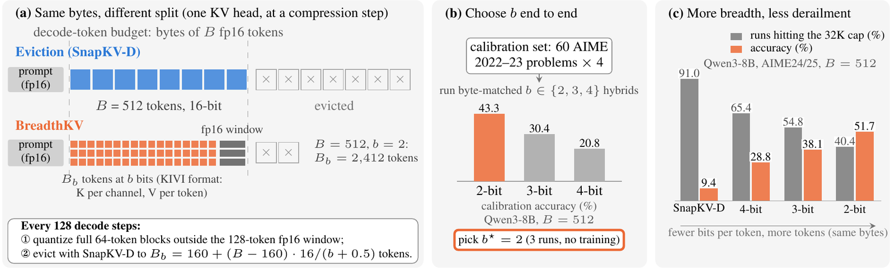
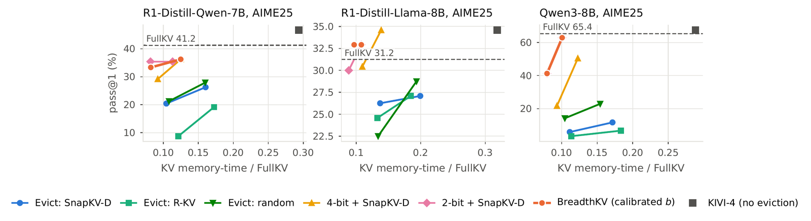
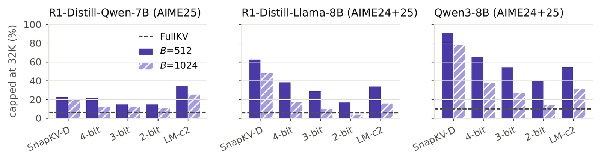
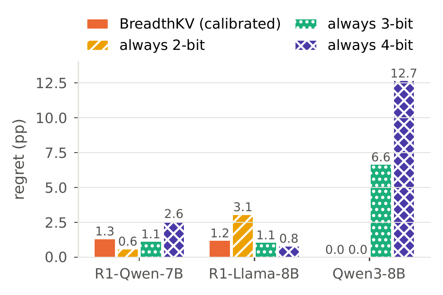

<section class="bkv-hero" aria-label="Overview">
  
arXiv preprintOctober 2026 · KV cache compression · Reasoning models

  
BreadthKV

  
In the same bytes, keep <em>more tokens at fewer bits</em>.

  
Reasoning models write most of their KV cache while they decode, so the cache has to be compressed during generation. Existing methods decide which tokens to evict and keep the rest at full precision. We ask how a fixed byte budget should be split between the number of cached tokens and their precision. On three 7–8B reasoning models, keeping several times as many tokens at 2–4 bits beats eviction alone in 17 of 18 settings, mostly because far fewer runs keep reasoning until the length cap without giving an answer.

  
<strong>Runguo Li</strong> · University of Illinois Urbana-Champaign

  

    <a class="bkv-btn primary" href="https://arxiv.org/abs/2610.05685"><i class="ai ai-arxiv" aria-hidden="true"></i>arXiv</a>
    <a class="bkv-btn primary" href="/files/breadthkv-kv-compression.pdf"><i class="fa-solid fa-file-pdf" aria-hidden="true"></i>Paper (PDF)</a>
    <a class="bkv-btn ghost" href="#split-the-budget"><svg width="13" height="13" viewBox="0 0 13 13" aria-hidden="true"><rect x="1" y="1" width="4" height="4" rx="1" fill="currentColor"/><rect x="7" y="1" width="2" height="2" fill="currentColor"/><rect x="10" y="1" width="2" height="2" fill="currentColor"/><rect x="7" y="4" width="2" height="2" fill="currentColor"/><rect x="10" y="4" width="2" height="2" fill="currentColor"/><rect x="1" y="8" width="11" height="4" rx="1" fill="none" stroke="currentColor" stroke-width="1.2"/></svg>Split the budget</a>
    <a class="bkv-btn ghost" href="#every-method"><svg width="13" height="13" viewBox="0 0 13 13" aria-hidden="true"><rect x="1" y="1.5" width="11" height="2.4" rx="1" fill="currentColor"/><rect x="1" y="5.3" width="7" height="2.4" rx="1" fill="currentColor"/><rect x="1" y="9.1" width="9" height="2.4" rx="1" fill="currentColor"/></svg>All results</a>
    <a class="bkv-btn ghost" href="#links-and-citation"><i class="fa-solid fa-quote-right" aria-hidden="true"></i>BibTeX</a>
  

  

    
<b>Eviction (SnapKV-D)</b>
<i style="width:21.2%;background:var(--c-ev);padding:0"></i>512 tokens, 16 bits each

    
<b>BreadthKV at 2 bits</b>
<i style="width:94.7%;background:var(--c-hy)">2,412 tokens: 2 bits each, plus a 128-token fp16 window</i><i style="width:5.3%;background:var(--c-win);padding:0"></i>

    
Tokens one KV head can hold at budget B = 512. Both rows occupy the same bytes.

  

</section>

  

17 <small>of</small> 18

held-out settings where the low-bit hybrid beats eviction at the same bytes

  

+17.4 <small>pp</small>

pooled accuracy gain over SnapKV-D, 95% CI [14.5, 20.3]

  

91% → 40%

of Qwen3-8B AIME runs reach the 32K length cap at B = 512, eviction vs. 2 bits

  

0.76×

the output length of eviction, which lowers the memory held over time further

<h2 id="the-problem">The problem</h2>

On competition math, reasoning models such as the DeepSeek-R1 distillations and Qwen3 often write 10–30K tokens of chain of thought per problem, and the KV cache grows with every token. At 32K tokens, one Qwen3-8B sequence holds 4.8 GB of KV cache, so four sequences already take more memory than the model's 16 GB of weights. The cache has to be compressed while the model is still writing.

Decode-time methods so far choose <strong>which</strong> tokens to keep, by attention, redundancy or thought type, and store the survivors as 16-bit floats. An evicted token cannot be recovered, and a long chain of thought keeps returning to its own intermediate results. Under eviction, runs can fall into re-checking loops that last until the length limit, and the extra tokens they write take back part of the memory that was saved.

Precision is the other axis. In the bytes of K fp16 tokens, a head can hold about 3K tokens at 4 bits or 6K at 2 bits. A token stored at 2 bits is noisy, but a later reasoning step can still find it. We measure this trade at equal KV bytes, with the eviction scorer and the quantization format fixed and only the split varied.

  

<i></i>Models
R1-Distill-Qwen-7B, R1-Distill-Llama-8B and Qwen3-8B in thinking mode. Sampling at temperature 0.6 and top-p 0.95, up to 32K output tokens (16K on MATH500).

  

<i></i>Budget
For each sequence, layer and KV head, decode tokens are limited to the bytes of B fp16 tokens, with B = 512 or 1024. That is 3–8% of an average AIME trace. Every method keeps the prompt in full and compresses every 128 decode steps.

  

<i></i>Evaluation
pass@1 on AIME24 and AIME25 (8 samples per problem), MATH500 (1) and GPQA-Diamond (4, one model), 18 held-out settings in all. Confidence intervals come from a paired bootstrap over problems.

Terms used below

<dl class="bkv-terms">
  
<dt>FullKV.</dt> <dd>The uncompressed cache, the reference for accuracy and memory.</dd>

  
<dt>SnapKV-D.</dt> <dd>SnapKV applied during decoding: each head keeps its top-B decode tokens by the attention they receive from the last 8 queries. It is our eviction baseline and the scorer inside every hybrid.</dd>

  
<dt>b-bit hybrid.</dt> <dd>The same eviction, but tokens older than a 128-token fp16 window are stored at b bits in the KIVI format, and the token budget is raised until the bytes match.</dd>

  
<dt>BreadthKV.</dt> <dd>The hybrid whose width b ∈ {2, 3, 4} is chosen for each model and budget on 60 held-out calibration problems.</dd>

  
<dt>Capped or derailed run.</dt> <dd>A sample that reaches the 32K-token length cap without finishing.</dd>

  
<dt>KV memory-time.</dt> <dd>The bytes a cache holds, summed over decode steps. It counts both the budget and the output length.</dd>

  
<dt>pp.</dt> <dd>Percentage points of pass@1 accuracy.</dd>

  
<dt>Held-out regret.</dt> <dd>The gap to the best bit-width on a test setting, for a width chosen without that test set.</dd>

</dl>

<h2 id="key-results">Key results</h2>

Method

<h3 class="bkv-h" id="one-budget-two-splits">One budget, two ways to use it</h3>

Both rows of panel (a) occupy the same bytes. Eviction keeps B decode tokens in fp16. The hybrid stores older tokens at b bits and uses the bytes it saves to keep several times as many of them. BreadthKV is this hybrid with b chosen by three short runs on a calibration set.

<figure class="bkv-fig">
  

  

    

1Quantize
Every 128 decode steps, complete 64-token blocks older than the 128-token fp16 window are quantized to b bits: keys per channel and values per token, which costs b + 0.5 bits per element with the scales.

    

2Evict to a larger budget
SnapKV-D then brings each head back to Bb tokens, the number that fits the bytes of B fp16 tokens: 2,412 tokens at 2 bits for B = 512, and 5,689 for B = 1024.

    

3Choose b end to end
The 2-, 3- and 4-bit hybrids are run on 60 AIME 2022–23 problems with 4 samples each, and the most accurate width is kept. This takes three runs, no training and no test problems.

  

  
Bb = 160 + (B − 160) · 16 / (b + 0.5)
    <small>tokens per head at b bits; 160 approximates the fp16 tail, and memory-time is measured exactly</small>

  <figcaption><strong>Figure 1.</strong> Overview of BreadthKV. (a) At the same KV byte budget per head, eviction keeps B full-precision decode tokens, whereas BreadthKV quantizes older tokens to b bits and keeps Bb of them plus a 128-token fp16 window. (b) The bit-width is chosen for each model and budget on 60 held-out AIME problems. (c) At equal bytes, fewer bits per token lower the share of runs that reach the 32K cap and raise accuracy (FullKV: 10.2% capped, 69.8% accuracy).</figcaption>
</figure>

Interactive

<h3 class="bkv-h" id="split-the-budget">Split the budget yourself</h3>

Choose a model, a budget and a precision. The grid shows how much of an average trace one head can hold in those bytes, and the bars show what happened when we ran that split on AIME25.

<figure class="bkv-fig" id="bkv-split">
  

    Model 
    Budget B 
    Precision 
  

  

    

      
What one KV head can hold · one square = 64 tokens

      

      

      
<i class="e"></i>fp16 tokens<i class="q"></i>low-bit tokens<i class="w"></i>128-token fp16 window<i></i>rest of an average FullKV trace

    

    

      

      

      
<i class="tick"></i>FullKV<i class="tick ev"></i>eviction at this budget

    

  

  <figcaption>
    Filled squares show how many tokens a head can hold, not which ones: SnapKV-D chooses them by attention in both cases. A strike-through marks a precision that was not run at that budget. † Budgets of 2,048 and 4,096 were run on AIME25 only.</figcaption>
</figure>

Main result

<h3 class="bkv-h" id="main-result">More tokens at low precision beat fewer tokens in fp16</h3>

The table gives BreadthKV's accuracy gain over SnapKV-D at the same budget on every held-out setting. The gain is positive in 17 of 18 and its confidence interval excludes zero in 16. Pooled over all settings it is 17.4 points [14.5, 20.3], or 8.6 on R1-Qwen, 7.9 on R1-Llama and 35.8 on Qwen3-8B. Eviction alone nearly collapses on Qwen3-8B, which scores 5.8% on AIME25 at B = 512 against 65.4% with FullKV.

<figure class="bkv-fig">
  

  <table class="bkv-table">
    <thead>
      <tr><th rowspan="2">Benchmark</th><th colspan="2" class="c">R1-Qwen-7B</th><th colspan="2" class="c">R1-Llama-8B</th><th colspan="2" class="c">Qwen3-8B</th></tr>
      <tr><th class="c">B = 512</th><th class="c">1024</th><th class="c">B = 512</th><th class="c">1024</th><th class="c">B = 512</th><th class="c">1024</th></tr>
    </thead>
    <tbody>
      <tr><td>AIME24</td><td class="c" colspan="2">development set</td><td class="heat" style="background:rgba(var(--heat),.36)">+20.8</td><td class="heat" style="background:rgba(var(--heat),.19)">+8.3</td><td class="heat" style="background:rgba(var(--heat),.75)">+49.2</td><td class="heat" style="background:rgba(var(--heat),.76)">+50.0</td></tr>
      <tr><td>AIME25</td><td class="heat" style="background:rgba(var(--heat),.26)">+12.9</td><td class="heat" style="background:rgba(var(--heat),.22)">+10.0</td><td class="heat" style="background:rgba(var(--heat),.17)">+6.7*</td><td class="heat" style="background:rgba(var(--heat),.16)">+5.8</td><td class="heat" style="background:rgba(var(--heat),.56)">+35.4</td><td class="heat" style="background:rgba(var(--heat),.78)">+51.2</td></tr>
      <tr><td>MATH500</td><td class="heat" style="background:rgba(var(--heat),.20)">+8.6</td><td class="heat" style="background:rgba(var(--heat),.16)">+5.8</td><td class="heat" style="background:rgba(var(--heat),.17)">+6.8</td><td class="heat" style="background:var(--soft)">−0.8*</td><td class="heat" style="background:rgba(var(--heat),.32)">+17.4</td><td class="heat" style="background:rgba(var(--heat),.24)">+11.6</td></tr>
      <tr><td>GPQA-Diamond</td><td class="heat" style="background:rgba(var(--heat),.18)">+7.3</td><td class="heat" style="background:rgba(var(--heat),.17)">+6.8</td><td class="c" colspan="2">not run</td><td class="c" colspan="2">not run</td></tr>
    </tbody>
  </table>
  

  <figcaption><strong>Table 2.</strong> Accuracy gain (pp) of BreadthKV over SnapKV-D at the same budget. * The 95% CI includes 0. R1-Qwen on AIME24 was our development set and is not reported.
    The one negative cell is R1-Llama on MATH500 at B = 1024, where SnapKV-D is already within 2.4 points of FullKV. Which eviction score is used matters much less than the split: BreadthKV is above the best of SnapKV-D, R-KV, H2O, StreamingLLM, random eviction and VaSE in 17 of 18 settings.</figcaption>
</figure>

A cache costs the bytes it holds over time, so longer outputs take back part of what a small budget saves. Figure 2 plots accuracy against KV memory-time. Up and to the left is better.

<figure class="bkv-fig" style="--accent:var(--c-ev)">
  

  <figcaption><strong>Figure 2.</strong> Accuracy vs. KV memory-time (relative to FullKV) on AIME25. Each line connects a method's results at B = 512 and 1024. The square is KIVI-4 without eviction, and the dashed line is FullKV.
    SnapKV-D outputs are 1.1–2.0× as long as FullKV's, and BreadthKV's are 0.76× as long as SnapKV-D's. On Qwen3-8B at B = 1024, SnapKV-D holds 0.17× FullKV's memory-time and scores 11.7%, while BreadthKV holds 0.10× and scores 62.9%.</figcaption>
</figure>

Interactive

<h3 class="bkv-h" id="every-method">Every method, setting by setting</h3>

This table holds every method we ran on the 18 held-out settings. A good method has a long accuracy bar and a short bar for runs that reach the cap. KV memory-time is relative to FullKV on the same setting.

<figure class="bkv-fig" id="bkv-explore">
  

    Model 
    Benchmark 
    Budget 
  

  

  <table class="bkv-table">
    <thead><tr><th>Method</th><th>Accuracy (pass@1)</th><th>Runs that reach the cap</th><th>Output length</th><th>KV memory-time</th></tr></thead>
    <tbody></tbody>
  </table>
  

  

  <figcaption>
    The length cap is 32K tokens, and 16K on MATH500. KIVI-4 keeps every token and holds 0.29–0.34× FullKV's memory-time, against 0.08–0.22× for the hybrids. RDKV runs with our fix to its released quantizer, and ThinKV is our re-implementation; both are discussed below.</figcaption>
</figure>

Mechanism

<h3 class="bkv-h" id="derailed-runs">Eviction loses through runs that never finish</h3>

We call a run <strong>derailed</strong> if it reaches the 32K cap. Derailed runs are almost never correct, and on R1-Llama and Qwen3-8B, 74–98% of SnapKV-D's wrong answers are derailed. Such a run rarely loops word for word. In one Qwen3-8B run under eviction, the model finds the right answer within the first tenth of its output and then checks it again and again, in slightly different words each time, until it is cut off.

<figure class="bkv-fig" style="--accent:var(--c-ev)">
  

  

  <table class="bkv-table">
    <thead><tr><th>Model, B = 512</th><th>Method</th><th>Accuracy</th><th>Runs that reach the cap</th><th class="r">Wrong answers that are capped</th></tr></thead>
    <tbody>
      <tr><td rowspan="4">R1-Llama-8B</td><td>FullKV</td><td>41.2%</td><td>
<i class="cap" style="width:6%"></i>6.0%
</td><td class="r">10%</td></tr>
      <tr><td>SnapKV-D</td><td>29.0%</td><td>
<i class="cap" style="width:62.7%"></i>62.7%
</td><td class="r">88%</td></tr>
      <tr><td>4-bit hybrid</td><td>41.9%</td><td>
<i class="cap" style="width:38.8%"></i>38.8%
</td><td class="r">67%</td></tr>
      <tr><td>2-bit hybrid</td><td>37.9%</td><td>
<i class="cap" style="width:17.3%"></i>17.3%
</td><td class="r">28%</td></tr>
      <tr class="sep"><td rowspan="4">Qwen3-8B</td><td>FullKV</td><td>69.8%</td><td>
<i class="cap" style="width:10.2%"></i>10.2%
</td><td class="r">32%</td></tr>
      <tr><td>SnapKV-D</td><td>9.4%</td><td>
<i class="cap" style="width:91%"></i>91.0%
</td><td class="r">98%</td></tr>
      <tr><td>4-bit hybrid</td><td>28.8%</td><td>
<i class="cap" style="width:65.4%"></i>65.4%
</td><td class="r">90%</td></tr>
      <tr><td>2-bit hybrid</td><td>51.7%</td><td>
<i class="cap" style="width:40.4%"></i>40.4%
</td><td class="r">82%</td></tr>
    </tbody>
  </table>
  

  <figcaption><strong>Figure 4 and the derailment table (excerpt).</strong> Share of samples hitting the 32K length cap on the test AIMEs (R1-Qwen: AIME25; others: AIME24 and AIME25), by method and budget. Dashed: FullKV.
    At equal bytes, fewer bits per token mean fewer derailed runs: going from 4 to 3 to 2 bits never raises the capped share. It does not always raise accuracy, because fewer bits add noise to every token that is kept. On R1-Llama at B = 512, 4 bits derails about twice as often as 2 bits and still scores higher.</figcaption>
</figure>

<h3 class="bkv-h" id="what-the-cache-holds">What the cache still holds when the model checks again†</h3>

Our account is that eviction deletes the record of a check along with its result. Once both have gone unattended long enough to be evicted, the model derives the result again, and that derivation is evicted in turn. To test the first half, we replayed all 480 Qwen3-8B AIME runs at B = 512 under the same compression and recorded, each time the model started a new check, how much of its earlier checks the caches still held.

<figure class="bkv-fig" style="--accent:var(--c-ev)">
  

  <table class="bkv-table">
    <thead><tr><th>Earlier check ended</th><th>SnapKV-D</th><th>2-bit hybrid</th></tr></thead>
    <tbody>
      <tr><td>under 1K tokens ago</td><td>
<i class="ev" style="width:41%"></i>41%
</td><td>
<i class="hy" style="width:94%"></i>94%
</td></tr>
      <tr><td>1–2K tokens ago</td><td>
<i class="ev" style="width:3%"></i>3%
</td><td>
<i class="hy" style="width:67%"></i>67%
</td></tr>
      <tr><td>2–4K tokens ago</td><td>
<i class="ev" style="width:1%"></i>1%
</td><td>
<i class="hy" style="width:27%"></i>27%
</td></tr>
      <tr><td>4–8K tokens ago</td><td>
<i class="ev" style="width:1%"></i>1%
</td><td>
<i class="hy" style="width:6%"></i>6%
</td></tr>
      <tr><td>8K or more tokens ago</td><td>
<i class="ev" style="width:0.5%"></i>0%
</td><td>
<i class="hy" style="width:1%"></i>1%
</td></tr>
      <tr class="sep"><td>First statement of the correct answer, when it is restated 1K or more tokens later</td><td>
<i class="ev" style="width:1%"></i>1%
</td><td>
<i class="hy" style="width:23%"></i>23%
</td></tr>
    </tbody>
  </table>
  

  <figcaption><strong>Retention replay</strong> (Qwen3-8B, AIME24 and AIME25, B = 512). Share of layer-head caches still holding the tokens of earlier checks when a new check starts, by tokens since the earlier check ended.
    Under SnapKV-D a check is almost entirely evicted within 1K tokens after it ends. Of the runs that state the correct answer at some point, 20% conclude under SnapKV-D, 79% under the 2-bit hybrid and 96% with FullKV. Pinning the first statements of the correct answer in SnapKV-D's cache, an oracle, doubles the share that conclude to 40% and raises accuracy from 9.4% to 14.0%, still far below the hybrid's 51.7%. Whether losing the surrounding checks causes the re-checking is not tested.</figcaption>
</figure>

Choosing the width

<h3 class="bkv-h" id="choosing-the-width">No fixed width is safe for every model</h3>

The best width depends on the model and the budget, and the cheap proxies we tried do not find it. Offline attention error at equal bytes gets the preference wrong on two of the three models. For Qwen3-8B it favors 4 bits over 2, the opposite of what happens end to end. BreadthKV measures the preference directly on the calibration set.

<figure class="bkv-fig">
  

    

    <table class="bkv-table">
      <thead><tr><th>Calibration accuracy (%)</th><th class="r">B</th><th class="r">2-bit</th><th class="r">3-bit</th><th class="r">4-bit</th><th>Chosen</th></tr></thead>
      <tbody>
        <tr><td rowspan="2">R1-Qwen-7B</td><td class="r">512</td><td class="r">28.3</td><td class="r"><b>31.2</b></td><td class="r">28.3</td><td>3 bits</td></tr>
        <tr><td class="r">1024</td><td class="r">33.8</td><td class="r">35.0</td><td class="r"><b>40.0</b></td><td>4 bits</td></tr>
        <tr><td rowspan="2">R1-Llama-8B</td><td class="r">512</td><td class="r">33.8</td><td class="r"><b>36.7</b></td><td class="r">35.8</td><td>3 bits</td></tr>
        <tr><td class="r">1024</td><td class="r"><b>40.0</b></td><td class="r"><b>40.0</b></td><td class="r">39.2</td><td>2 bits</td></tr>
        <tr><td rowspan="2">Qwen3-8B</td><td class="r">512</td><td class="r"><b>43.3</b></td><td class="r">30.4</td><td class="r">20.8</td><td>2 bits</td></tr>
        <tr><td class="r">1024</td><td class="r"><b>62.9</b></td><td class="r">57.1</td><td class="r">50.0</td><td>2 bits</td></tr>
      </tbody>
    </table>
    

    

  

  <figcaption><strong>Table 3 and Figure 3.</strong> Calibration accuracy of the 2-, 3- and 4-bit hybrids with the chosen width (ties go to fewer bits), and the held-out regret of each selection strategy: the mean gap (pp) to the best bit-width over each model's six test settings. Lower is better.
    Calibration beats always using 4 bits by 4.5 points [3.2, 5.9] and always using 3 bits by 2.1 [1.1, 3.1]. At these budgets always using 2 bits is statistically as good (+0.4 [−0.3, 1.0]). Each fixed width does badly on some model, 2 bits on R1-Llama (mean regret 3.1 points) and 4 bits on Qwen3-8B (12.7), while calibration stays within 1.3 points on every model.</figcaption>
</figure>

Baselines

<h3 class="bkv-h" id="other-allocators">Against finer allocators</h3>

BreadthKV uses one width per model and budget. We ran three finer ways of allocating precision under the same protocol.

  

−1.0 pp

RDKV, at 1.27× the memory-time
RDKV solves a rate–distortion problem that gives each value token and key channel 0, 2, 4, 8 or 16 bits. We ran the authors' code in its block-wise decode mode, after fixing a zero-point clamp in the released quantizer that made generation collapse on R1-Llama. Pooled over the 18 settings it is 1.0 point below BreadthKV [−2.04, +0.02] while holding 1.27× its KV memory-time. A native decode-time implementation might do better.

  

−12.3 pp

ThinKV, re-implemented
ThinKV has no public code, so we re-implemented it from the paper. Our version scores 12.3 points below BreadthKV [−14.9, −9.7] with 0.86× its memory-time, and its runs reach the cap far more often. In the one setting we can compare with the ThinKV paper, our version reaches 25.0% where 50% is reported†, so this is a gap to our re-implementation and may not hold for ThinKV as published.

  

1 of 18

Per-head online allocation
Choosing the width online for each head lowers offline attention error by 20–42%. End to end it is indistinguishable from fixed widths, with 1 of 18 comparisons significant. Single-step attention error predicts accuracy poorly.

<h2 id="where-it-stops-helping">Where it stops helping</h2>

Larger budgets†

<h3 class="bkv-h" id="larger-budgets">The lead shrinks as eviction nears the full cache</h3>

The main budgets hold 3–8% of an average AIME trace. With 2–8× larger budgets on AIME25, or 12–30% of a trace, eviction comes closer to FullKV and the hybrids' lead shrinks. On R1-Llama it is gone at B = 4096. On R1-Qwen and Qwen3-8B the 4-bit hybrid still leads by 7.9 [+2.5, +13.8] and 16.2 [+7.9, +25.4] points there, and reaches FullKV's accuracy with 0.24× its KV memory-time.

<figure class="bkv-fig" style="--accent:var(--c-ref)">
  

  <table class="bkv-table">
    <thead><tr><th>AIME25, pass@1 (%)</th><th>B = 512</th><th>B = 1024</th><th>B = 2048</th><th>B = 4096</th><th class="r">FullKV</th></tr></thead>
    <tbody>
      <tr><td>R1-Qwen-7B</td><td>20.4 → <b>35.4</b> 2-bit</td><td>26.2 → <b>37.5</b> 3-bit</td><td>31.2 → <b>37.9</b> 4-bit</td><td>34.6 → <b>42.5</b> 4-bit</td><td class="r">41.2</td></tr>
      <tr><td>R1-Llama-8B</td><td>26.2 → <b>32.9</b> 3-bit</td><td>27.1 → <b>34.6</b> 4-bit</td><td>30.4 → <b>35.8</b> 4-bit</td><td><b>36.7</b> → 35.8 8-bit</td><td class="r">31.2</td></tr>
      <tr><td>Qwen3-8B</td><td>5.8 → <b>41.2</b> 2-bit</td><td>11.7 → <b>62.9</b> 2-bit</td><td>37.1 → <b>66.2</b> 2-bit</td><td>52.1 → <b>68.3</b> 4-bit</td><td class="r">65.4</td></tr>
    </tbody>
  </table>
  

  <figcaption><strong>SnapKV-D → the most accurate byte-matched hybrid</strong> at each budget on AIME25, with that hybrid's width. The width here is the best on the test set, not the calibrated one.
    The best width rises with the budget, from 2–3 bits at B = 512 to 4 or 8 bits at B = 4096.</figcaption>
</figure>

Cost

<h3 class="bkv-h" id="decode-speed">Decode steps are slower</h3>

Holding several times as many tokens makes attention more expensive, even at the same bytes. We wrote a Triton decode kernel that reads packed low-bit KV directly and timed whole decode steps with it on an A800. The accuracy gain does not come with faster decoding.

  

1.2–3.0×

Time per decode step†
A 2-bit hybrid step takes 1.2–2.0× as long as a SnapKV-D step at B = 512 and 1.3–3.0× at B = 1024, more at larger batch sizes. At equal context, the 4-bit kernel is close to fp16 FlashAttention at 27% of the memory.

  

0.89–1.9×

Decode time per sample†
The hybrid writes shorter outputs, so a sample needs fewer steps. Counting correct AIME answers per GPU-hour, it is ahead of SnapKV-D by 2.0–6.2× on Qwen3-8B but only 0.8–1.7× on R1-Qwen-7B.

  

40%

Runs that still derail
On Qwen3-8B at our tightest budget, 40% of 2-bit runs still reach the cap. Cutting capped runs where they start to repeat and forcing a conclusion recovers 15% of them on Qwen3-8B and almost none on the R1 models.

  

≈ 2 bits

The floor of breadth
With the codecs we tested, going below 2 bits stops helping. A 1.25-bit codec collapses end to end, and a 2.25-bit one is 2.6 points below the plain 2-bit hybrid although its offline error is the same.

<h2 id="using-these-results">Using these results</h2>

  

1Start from 2 bits at tight budgets
When the budget holds under a tenth of the trace, quantize older tokens to 2 bits and raise the token budget with the formula above until the bytes match.

  

2Check the width end to end
In our runs, three calibration runs on 60 problems avoided the width that fails on each model. Without labels, picking the width with the shortest calibration outputs does as well as always using 2 bits.

  

3Raise the bits with the budget, and watch the cap
At 12–30% of a trace, 4 or 8 bits were best on the R1 models. Report the share of capped runs and KV memory-time along with accuracy, since longer outputs take back memory.

Scope: three open 7–8B reasoning models on English math and science benchmarks. Quantization is simulated in the engine with exact byte accounting. The main runs use one sampling seed, with a three-seed check on one setting per model.

† Added after arXiv v2. This page follows the current revision of the paper, whose pooled confidence intervals resample each benchmark's problems jointly across the settings that share them, so a few intervals differ from v2.

<h2 id="links-and-citation">Links and citation</h2>

  <a class="bkv-btn primary" href="https://arxiv.org/abs/2610.05685"><i class="ai ai-arxiv" aria-hidden="true"></i>arXiv 2610.05685</a>
  <a class="bkv-btn ghost" href="/files/breadthkv-kv-compression.pdf"><i class="fa-solid fa-file-pdf" aria-hidden="true"></i>Paper (PDF)</a>
  <a class="bkv-btn ghost" href="/files/bibtex/li2026breadthkv.bib"><i class="fa-solid fa-quote-right" aria-hidden="true"></i>BibTeX file</a>
  <a class="bkv-btn ghost" href="/publication/2026-10-breadthkv"><i class="fa-solid fa-book-open" aria-hidden="true"></i>Publication page</a>

The code, all configurations and the per-sample generations of every run will be released with the paper.

<button class="bkv-copy" type="button" data-target="bkv-bibtex">Copy</button>
<pre><code id="bkv-bibtex">@misc{li2026breadthkv,
  title         = {Spend Bytes on Breadth: Precision--Count Trade-offs for Decode-Time {KV} Compression in Long Chain-of-Thought Reasoning},
  author        = {Li, Runguo},
  year          = {2026},
  eprint        = {2610.05685},
  archivePrefix = {arXiv},
  url           = {https://arxiv.org/abs/2610.05685}
}</code></pre>

