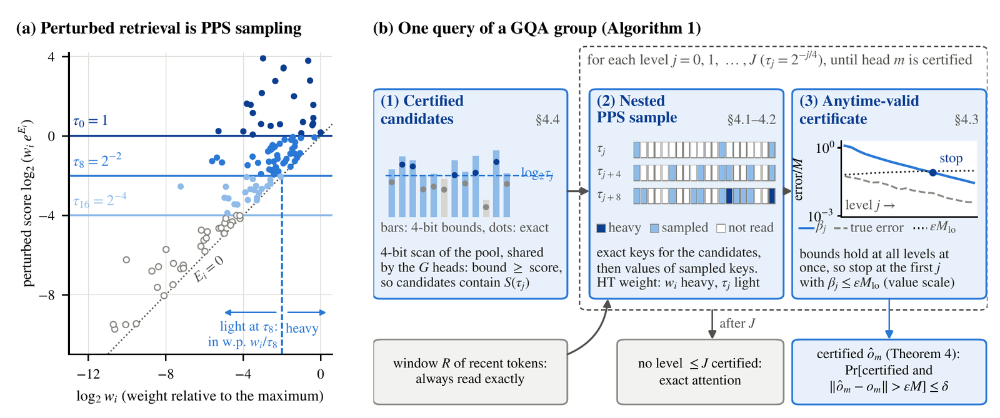
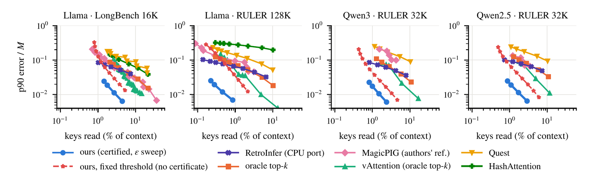
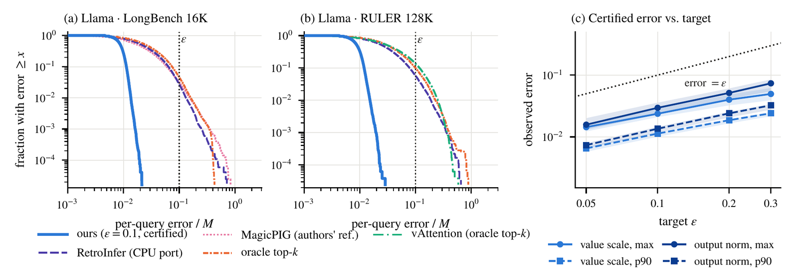

  
arXiv preprint &middot; October 2026 &middot; cs.LG

  
Sparse attention that <strong>certifies its error</strong> on every head and every decoding step: perturbing key scores
  turns threshold retrieval into weighted sampling, and each head stops reading keys as soon as its error bound meets the target.

  
<strong>Runguo Li</strong> &middot; University of Illinois Urbana-Champaign

  

    <a class="csa-btn" href="https://arxiv.org/abs/2610.24991"><i class="ai ai-arxiv" aria-hidden="true"></i> arXiv</a>
    <a class="csa-btn" href="/files/certified-sparse-attention.pdf"><i class="fa-solid fa-file-pdf" aria-hidden="true"></i> Paper (PDF)</a>
    <a class="csa-btn csa-btn--accent" href="#interactive-demo"><i class="fa-solid fa-play" aria-hidden="true"></i> Interactive demo</a>
    <a class="csa-btn" href="#links-and-citation"><i class="fa-solid fa-quote-right" aria-hidden="true"></i> BibTeX</a>
  

  

0

errors above &epsilon; across 120 configurations: 3 LLMs, 16K&ndash;128K tokens

  

4.6&ndash;7.9&times;

lower 90th-percentile error than the best of 15 baseline families at equal keys read

  

&le; 1 pt

end-to-end score change versus dense attention; PG-19 perplexity within 0.1%

  

1.1&ndash;1.4&times;

faster whole decoding steps on CPU at 32K&ndash;128K tokens

Sparse attention speeds up long-context decoding by reading few keys of the KV cache, but existing methods do not control
the error of a query, and on real KV caches their errors have heavy tails. Perturbing the score of every key with an
independent Exp(1) variable turns threshold retrieval into sampling keys in proportion to their attention weights:
descending a geometric grid of thresholds gives nested samples, an unbiased Horvitz–Thompson estimate at every level, and
confidence bounds valid at all levels at once, so each head stops at the first level certified to meet the target error ε.
On three LLMs and ten settings at 16K–128K tokens, no certificate is violated, and at equal keys read the 90th-percentile
error is 4.6–7.9× lower than that of the best of 15 baseline families.

## Key results

### How it works: perturb, lower the threshold, certify

  
<b>Perturb</b>Every key's score gets an independent Exp(1) lift, drawn afresh at each decoding step. At threshold &tau;, key <i>i</i> is
    retrieved with probability min(1, wi/&tau;): sampling in proportion to its attention weight.

  
<b>Estimate</b>Lowering &tau; along a geometric grid only adds keys. Heavy keys enter exactly and each sampled light key is weighted by
    &tau;, which gives an unbiased Horvitz&ndash;Thompson estimate at every level.

  
<b>Certify and stop</b>Confidence bounds hold at all levels at once, so each head stops at the first level whose bound meets &epsilon;.
    At a suitable threshold, O(&epsilon;&minus;2 log 1/&delta;) values suffice whatever the context length, which is optimal up to constants.

<figure class="csa-fig">
  
  <figcaption><strong>Figure 1.</strong> (a) A key is in the sample at threshold &tau; exactly when its perturbed score lies above the line of &tau;,
  which happens with probability min(1, wi/&tau;); lowering &tau; only adds keys. (b) A 4-bit scan shared by the query heads of a group bounds
  every score, so its candidates contain the sample exactly, and a certified output errs by more than &epsilon;M with probability at most &delta; (Theorem 4).</figcaption>
</figure>

### 4.6–7.9× lower 90th-percentile error at equal keys read

**Table 1 (excerpt). Error/M at matched keys read (ε = 0.1; baselines read at most 1.1× our keys).**

| Model · data | Ours: keys / p90 / max | Best baseline: keys, p90 / max | Ratio (p90) |
|---|---|---|---:|
| Llama · LongBench 16K | 2.70% / **0.011** / **0.021** | MagicPIG (ref.) 2.75%, 0.059 / 0.83 | 5.3× |
| Llama · RULER 32K | 1.35% / **0.011** / **0.025** | RetroInfer 1.24%, 0.058 / 0.49 | 5.0× |
| Llama · RULER 128K | 0.46% / **0.012** / **0.029** | RetroInfer 0.47%, 0.077 / 0.65 | 6.5× |
| Qwen3 · RULER 32K | 1.50% / **0.011** / **0.025** | RetroInfer 1.37%, 0.073 / 1.62 | 6.9× |
| Qwen2.5 · RULER 32K | 1.73% / **0.011** / **0.027** | RetroInfer 1.22%, 0.090 / 0.98 | 7.9× |

Over all ten settings the gap is 4.6–7.9×. Charged for bytes instead, since our 4-bit scan reads every key, the best
baselines reach 0.6–1.6× our 90th-percentile error, but their largest errors stay at least 4.9× ours.

<figure class="csa-fig">
  
  <figcaption><strong>Figure 2.</strong> On every setting shown, certified stopping (blue, &epsilon; from 0.05 to 0.3) lies below the Pareto front of every
  baseline family. The same estimator at one fixed threshold (dashed) already beats most baselines, but at the closest number of keys read its
  90th-percentile error is 2.4&ndash;9.6&times; ours: choosing the stopping level per head carries most of the gain.</figcaption>
</figure>

### No certificate violated, and no heavy tail

<figure class="csa-fig">
  
  <figcaption><strong>Figure 3.</strong> At matched keys read, the strongest baselines have heavy error tails, with maxima of 0.39&ndash;1.62&nbsp;&times;&nbsp;M across
  the ten settings, while our largest error at &epsilon; = 0.1 is 0.021&ndash;0.029. Across 120 configurations (10 settings &times; 3 error measures &times;
  4 values of &epsilon;), no error exceeds &epsilon;; the largest is 0.31&epsilon; on the value scale and 0.41&epsilon; on the output norm (c).</figcaption>
</figure>

### End to end: within one point of dense attention

**Table 2 (excerpt). End-to-end score change versus dense attention (ε = 0.1, fresh perturbations at every step), with task-stratified 95% CIs.**

| Model · data (samples) | Keys read | Δ score [95% CI] | Same output as dense |
|---|---:|---|---:|
| Llama · LongBench (300) | 5.26% | −0.29 [−0.63, −0.03] | 0.80 |
| Llama · RULER 32K (200) | 1.50% | −0.65 [−2.05, +0.35] | 0.93 |
| Llama · RULER 128K (48) | 0.49% | 0.00 [0.00, 0.00] | 0.90 |
| Qwen3 · RULER 32K (100) | 1.53% | +1.00 [−0.20, +3.10] | 0.85 |
| Qwen2.5 · LongBench (150) | 5.38% | +0.07 [−0.09, +0.25] | 0.79 |

Mean scores stay within one point of dense attention and PG-19 perplexity changes by −0.02% to +0.07%. At similar
bytes the strongest baselines score as well, so the end-to-end benefit is the per-call guarantee rather than higher task scores.

### Trade-offs

  <ul>
    <li><strong>Bytes, not just keys.</strong> Finding the sample takes a 4-bit scan of every key, a fixed 16.4% of the bytes of dense attention. This floor
      caps the speedup, and at equal bytes the strongest baselines reach our typical error, though not our largest.</li>
    <li><strong>Conservative bounds.</strong> Observed errors are about &epsilon;/10 at the 90th percentile, and the guarantee costs 1.8&ndash;3.5&times; the keys
      of an uncertified central-limit rule.</li>
    <li><strong>Scope.</strong> All measurements are on CPUs. With seven query heads per KV head (Qwen2.5), attention is not faster.</li>
  </ul>

## Interactive demo

Step one attention head through the threshold levels and watch its certificate tighten until it stops, then compare
certified stopping with a fixed level and with oracle top-k on 200 heads. The demo runs the paper's value-scale certificate
in your browser on synthetic heads with 32,768 keys.

  
Live demo &middot; runs locally in your browser, no server
    <a href="/files/projects/2026-10-certified-sparse-attention/demo/index.html" target="_blank" rel="noopener">Open full screen <i class="fa-solid fa-up-right-from-square" aria-hidden="true"></i></a>

  <iframe src="/files/projects/2026-10-certified-sparse-attention/demo/index.html" width="100%" height="1180" loading="lazy" title="Certified sparse attention interactive demo"></iframe>

## Links and citation

  <a class="csa-btn" href="https://arxiv.org/abs/2610.24991"><i class="ai ai-arxiv" aria-hidden="true"></i> arXiv 2610.24991</a>
  <a class="csa-btn" href="/files/certified-sparse-attention.pdf"><i class="fa-solid fa-file-pdf" aria-hidden="true"></i> Paper (PDF)</a>
  <a class="csa-btn" href="/files/bibtex/li2026certified.bib"><i class="fa-solid fa-quote-right" aria-hidden="true"></i> BibTeX file</a>
  <a class="csa-btn" href="/publication/2026-10-certified-sparse-attention"><i class="fa-solid fa-book-open" aria-hidden="true"></i> Publication page</a>

<button class="csa-copy" type="button" data-target="csa-bibtex">Copy</button>
<pre><code id="csa-bibtex">@misc{li2026certified,
  title         = {Certified Sparse Attention via Perturbed Retrieval},
  author        = {Li, Runguo},
  year          = {2026},
  eprint        = {2610.24991},
  archivePrefix = {arXiv},
  primaryClass  = {cs.LG},
  url           = {https://arxiv.org/abs/2610.24991}
}</code></pre>

