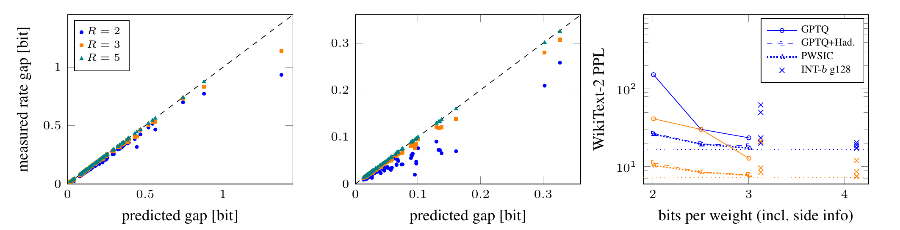

<section class="gr-hero" aria-label="Overview">
  
arXiv preprintUnder review · cs.IT / cs.LG · November 2026

  
In the worst case a random rotation cannot replace waterfilling. On real LLM layers <em>it nearly does</em>.

  
GPTQ quantizes a layer with one step size for all columns; WaterSIC gives every column its own and is within 0.255 bit of the rate-distortion limit. A random rotation before GPTQ closes most of the difference in practice, and Ordentlich and Polyanskiy asked how large it can be in the worst case. This paper gives the exact limit of rotated GPTQ, the <strong>sharp worst-case gap</strong>, and the reason real layers sit far below it.

  
<strong>Runguo Li</strong> · University of Illinois Urbana-Champaign

  

    <a class="gr-btn primary" href="https://arxiv.org/abs/2611.01669"><i class="ai ai-arxiv" aria-hidden="true"></i>arXiv 2611.01669</a>
    <a class="gr-btn ghost" href="/files/gptq-random-rotation.pdf"><i class="fa-solid fa-file-pdf" aria-hidden="true"></i>Paper (PDF)</a>
    <a class="gr-btn ghost" href="#rotate-a-spectrum"><i class="fa-solid fa-rotate" aria-hidden="true"></i>Rotate a spectrum</a>
    <a class="gr-btn ghost" href="#links-and-citation"><i class="fa-solid fa-quote-right" aria-hidden="true"></i>BibTeX</a>
  

  

    
<b>Worst case, no rotation<small>over spectra with κ = 10⁴</small></b>
<i style="width:86%;background:var(--c-none)"></i>4.32 bit

    
<b>Worst case, random rotation<small>over spectra with κ = 10⁴</small></b>
<i style="width:51%;background:var(--c-rot)"></i>2.56 bit

    
<b>Real layers, random rotation<small>median of 96 LLM Hessians</small></b>
<i style="width:0.8%;background:var(--c-rot)"></i>0.04 bit

    
Extra bits per weight that GPTQ needs over WaterSIC at equal distortion (high rate, entropy coded). The real layers have κ between 4×10³ and 10⁶ at the default damping.

  

</section>

  

½ log₂ ln κ + O(1)

bits are all a random rotation saves in the worst case; the leading term ½ log₂ κ stays

  

ημ → η²μ/2

cost of an η-fraction of outlier eigenvalues of size μ, before and after rotation, to leading order

  

0.04 bit

median rotated gap on 96 Hessians of Qwen3 and Llama-3.1 (maximum 0.36), against 2–5 bits in the worst case at the same κ

  

≤ 0.009 bit

between the limit formula and the measured gap after a Haar rotation, over 270 layer and damping pairs

<h2 id="the-question">The question</h2>

Layerwise post-training quantization replaces a weight matrix \(W\) by \(\hat W\) so that the layer's output changes as little as possible on calibration inputs \(x\), whose second moment is \(\Sigma=\mathbb E[xx^\top]\). Two families of methods improve on plain GPTQ, and at high rate they can be compared exactly.

  

<i></i>GPTQ
Quantizes one input column at a time and feeds the rounding error forward. It is exactly Babai's nearest-plane algorithm on the lattice of the Cholesky factor of \(\Sigma\) (<a href="https://arxiv.org/abs/2507.18553">Chen et al.</a>; <a href="https://arxiv.org/abs/2508.01077">Birnick</a>), so its quality is set by the Cholesky pivots \(\pi_1,\dots,\pi_n\).

  

<i></i>Rotation
Apply an orthogonal transform to weights and activations, then run GPTQ. The layer is unchanged and \(\Sigma\) becomes \(V^\top\Sigma V\). QuIP, QuIP# and QuaRot use random rotations; SpinQuant learns one. One step size for all columns is kept.

  

<i></i>Waterfilling
<a href="https://arxiv.org/abs/2603.04956">WaterSIC</a> keeps the basis and gives every column its own step size, \(\alpha_k\propto\pi_k^{-1/2}\). It is within \(\tfrac12\log_2\frac{2\pi e}{12}\approx0.255\) bit of the rate-distortion limit for every \(\Sigma\).

With per-column entropy coding and at high rate, GPTQ needs this many more bits per weight than WaterSIC at equal distortion (Lifar et al., Theorem 3.3):

\[ \Delta(\Sigma)=\frac12\log_2\frac{\frac1n\sum_k\pi_k}{\big(\prod_k\pi_k\big)^{1/n}} ,\qquad \pi_k=\frac{\det\Sigma^{(k)}}{\det\Sigma^{(k-1)}} . \]
<small>Half the log of the arithmetic mean of the pivots over their geometric mean. The geometric mean is \((\det\Sigma)^{1/n}\) in every basis; only the arithmetic mean depends on the basis.</small>

The gap is unbounded over \(\Sigma\), yet on Llama-3-8B a random rotation brings it to about 0.1 bit. Whether rotation can stand in for waterfilling in general was left open:

<blockquote class="gr-quote">“It is an interesting open problem to estimate worst possible gap (over possible spectra λj ≥ ε) between GPTQ with rotation and WaterSIC.”<cite>Ordentlich and Polyanskiy, <a href="https://arxiv.org/abs/2605.13768">High-Rate Quantized Matrix Multiplication II</a>, §III-E</cite></blockquote>

The paper answers it in the setting in which it was posed: high rate, per-column entropy coding, and Haar (uniformly random) rotations.

Terms used below

<dl class="gr-terms">
  
<dt>Pivot \(\pi_k\).</dt> <dd>The squared \(k\)-th diagonal entry of the Cholesky factor of \(\Sigma\): what is left of coordinate \(k\) after linear prediction from the coordinates before it.</dd>

  
<dt>Rate gap \(\Delta\).</dt> <dd>Extra bits per weight that GPTQ needs over WaterSIC at the same distortion. Zero means one step size is as good as per-column steps.</dd>

  
<dt>Spectrum \(\nu\).</dt> <dd>The distribution of the eigenvalues of \(\Sigma\). AM, GM and HM are its arithmetic, geometric and harmonic means.</dd>

  
<dt>Condition number \(\kappa\).</dt> <dd>Largest eigenvalue over smallest. The worst case is taken over all spectra with a given \(\kappa\).</dd>

  
<dt>Haar rotation.</dt> <dd>An orthogonal matrix drawn uniformly at random. Randomized Hadamard transforms are the fast substitute used in practice.</dd>

  
<dt>Worst basis.</dt> <dd>The eigenbasis (PCA basis) of \(\Sigma\). There the pivots are the eigenvalues and \(\Delta=\tfrac12\log_2(\mathrm{AM}/\mathrm{GM})\).</dd>

  
<dt>High rate.</dt> <dd>The limit of small quantization steps with entropy-coded integers. Fixed-rate formats such as INT4 are outside it.</dd>

  
<dt>Damping.</dt> <dd>GPTQ adds a multiple of the mean diagonal of \(\Sigma\) to its diagonal; 10⁻² is the default and sets \(\kappa\) on real layers.</dd>

</dl>

<h2 id="the-limit-of-rotated-gptq">The limit of rotated GPTQ</h2>

Theorem 1

<h3 class="gr-h" id="pivot-profile">After a Haar rotation, the pivots follow one curve</h3>

For a spectrum \(\nu\), let \(s_t\) solve \(\int\frac{x}{s+x}\,d\nu(x)=t\). The <strong>pivot profile</strong> and its mean are

\[ h_\nu(t)=\frac{t\,s_t}{1-t}=\frac{1}{S_\nu(-t)},\qquad D(\nu)=\int_0^1h_\nu(t)\,dt,\qquad \Delta(\nu)=\frac12\log_2\frac{D(\nu)}{\mathrm{GM}(\nu)} . \]
<small>\(S_\nu\) is Voiculescu's S-transform. \(h_\nu\) decreases from AM at \(t=0\) to HM at \(t=1\).</small>

Theorem 1 says that after a Haar rotation the \(k\)-th pivot converges almost surely to \(h_\nu(k/n)\), uniformly in \(k\ge\delta n\) and uniformly over all spectra with bounded condition number, with probability of failure at most \(Cne^{-cn}\). Hence the gap converges to \(\Delta(\nu)\), which takes one eigendecomposition and a scalar root-finding to compute.

<ul class="gr-list">
  <li><strong>Strictly between the two extremes.</strong> \(\mathrm{GM}(\nu)\le D(\nu)\le\mathrm{AM}(\nu)\), with equality only when all eigenvalues are equal. A Haar rotation is strictly better than the worst basis and strictly worse than WaterSIC.</li>
  <li><strong>What is new and what is not.</strong> The formula for \(h_\nu\) is classical in the theory of Lyapunov exponents (Newman 1986; Kargin 2008) and appears as the per-stream SINR of successive cancellation with Haar spreading (Tulino and Verdú 2004). The paper adds its identification with GPTQ, a finite-\(n\), per-pivot version that is uniform in the spectrum, the functional \(D\) that enters the rate, and an elementary proof that avoids free probability.</li>
</ul>

Interactive

<h3 class="gr-h" id="rotate-a-spectrum">Rotate a spectrum in your browser</h3>

Pick a spectrum. The figure draws one Haar rotation, computes the \(n\) pivots of the rotated matrix, and plots them against the limit \(h_\nu(k/n)\). The gap is half the distance, in powers of two, between the mean pivot and the geometric mean, so the three horizontal lines show what rotation saves and what it leaves.

<figure class="gr-fig" id="gr-piv" style="--accent:var(--c-rot)">
  

    <label>Spectrum <button type="button" data-fam="two" aria-pressed="true">Two-point</button><button type="button" data-fam="logu" aria-pressed="false">Log-uniform</button><button type="button" data-fam="spk" aria-pressed="false">Bulk + spikes</button></label>
    <label>n <button type="button" data-n="64" aria-pressed="false">64</button><button type="button" data-n="128" aria-pressed="false">128</button><button type="button" data-n="256" aria-pressed="true">256</button></label>
    <button type="button" class="gr-act" id="gr-redraw">↻ New rotation</button>
  

  

    
Condition number κ<input type="range" id="gr-kappa" min="1" max="8" step="0.25" value="4" aria-label="Condition number, as a power of ten"><output id="gr-kappa-out" for="gr-kappa"></output>

    
Share q of large eigenvalues<input type="range" id="gr-q" min="0.02" max="0.9" step="0.005" value="0.225" aria-label="Share of eigenvalues equal to one"><button type="button" class="gr-act" id="gr-qstar">Worst q</button><output id="gr-q-out" for="gr-q"></output>

    
Number of spikes r<input type="range" id="gr-r" min="0" max="16" step="1" value="4" aria-label="Number of spikes"><output id="gr-r-out" for="gr-r"></output>

    
Spike size μ<input type="range" id="gr-mu" min="0" max="5" step="0.25" value="2" aria-label="Spike size, as a power of ten"><output id="gr-mu-out" for="gr-mu"></output>

  

  

  

    <svg width="10" height="10" aria-hidden="true"><circle cx="5" cy="5" r="3.5" fill="var(--c-rot)"/></svg>pivots after one Haar rotation
    <svg width="20" height="10" aria-hidden="true"><line x1="1" y1="5" x2="19" y2="5" stroke="var(--c-lim)" stroke-width="2.5"/></svg>limit hν(k/n) of Theorem 1
    <svg width="20" height="10" aria-hidden="true"><line x1="1" y1="5" x2="19" y2="5" stroke="var(--c-none)" stroke-width="2.5"/></svg>pivots without rotation (the eigenvalues, largest first)
    <svg width="20" height="10" aria-hidden="true"><line x1="1" y1="5" x2="19" y2="5" stroke="var(--ink)" stroke-width="1"/></svg>thin lines: mean pivot without rotation, mean pivot after rotation, geometric mean
  

  

    

– <small>bit</small>

gap without rotation (eigenbasis, the worst basis)

    

– <small>bit</small>

after one Haar rotation (this draw)

    

– <small>bit</small>

limit Δ(ν) of Theorem 1 for this spectrum

    

– <small>bit</small>

worst case over all spectra with this κ (Theorem 2)

  

  <figcaption>The figure needs JavaScript. Without it, see Figure 1 of the paper.
    The numbers in this figure are computed in your browser, not taken from the paper's experiments. At n = 256 one draw differs from the limit by a few hundredths of a bit; the paper reports errors of at most 0.017 bit at n = 256 and 0.0004 bit at n = 8192, averaged over seeds, on five synthetic spectra.</figcaption>
</figure>

<h2 id="the-worst-case">The worst case</h2>

Theorem 2

<h3 class="gr-h" id="sharp-worst-case">Rotation cannot replace waterfilling in general</h3>

Take the supremum of the limit \(\Delta(\nu)\) over all spectra with condition number at most \(\kappa\). It is attained, and <strong>every maximizer is a two-point spectrum</strong>: a share \(q^*\approx2/\ln\kappa\) of the eigenvalues at the top and the rest at the bottom. As \(\kappa\to\infty\),

\[ \Delta^*(\kappa)=\tfrac12\log_2\kappa-\log_2\ln\kappa+\tfrac12-\tfrac{1}{\ln2}+o(1), \qquad \Delta^*_{\text{no rotation}}(\kappa)=\tfrac12\log_2\kappa-\tfrac12\log_2\ln\kappa-\tfrac{1}{2\ln2}+o(1). \]
<small>In the worst case a random rotation saves \(\tfrac12\log_2\ln\kappa-\tfrac12+\tfrac{1}{2\ln2}+o(1)\) bits. The leading term \(\tfrac12\log_2\kappa\) is unchanged.</small>

In the extremal spectrum a small share of the directions carries almost all the energy. After rotation these directions fill the first \(\approx qn\) coordinates, whose pivots stay far above the rest. One step size cannot allocate rate to them; per-column steps can. The proof rests on a log-convexity property of the first variation of \(D\), which pushes any maximizer to the two endpoints of the spectrum. The same conclusion holds when the constraint is \(\lambda_j\ge\epsilon\cdot\mathrm{AM}\) in place of a condition number (Theorem 3).

<figure class="gr-fig" style="--accent:var(--c-lim)">
  

  <table class="gr-table">
    <thead><tr><th>κ</th><th class="num">Worst case, no rotation</th><th class="num">Worst case, rotation</th><th class="num">Asymptotic formula</th><th class="num">Worst share q*</th><th class="num">Rotation saves</th></tr></thead>
    <tbody>
      <tr><td>10²</td><td class="num">1.53</td><td class="num hl">0.46</td><td class="num">0.18</td><td class="num">0.39</td><td class="num">1.06</td></tr>
      <tr><td>10⁴</td><td class="num">4.32</td><td class="num hl">2.56</td><td class="num">2.50</td><td class="num">0.225</td><td class="num">1.76</td></tr>
      <tr><td>10⁶</td><td class="num">7.35</td><td class="num hl">5.27</td><td class="num">5.24</td><td class="num">0.149</td><td class="num">2.08</td></tr>
      <tr><td>10¹²</td><td class="num">16.82</td><td class="num hl">14.22</td><td class="num">14.20</td><td class="num">0.073</td><td class="num">2.60</td></tr>
      <tr><td>10⁴⁸</td><td class="num">75.61</td><td class="num hl">72.00</td><td class="num">72.00</td><td class="num">0.018</td><td class="num">3.61</td></tr>
    </tbody>
  </table>
  

  <figcaption><strong>Table 1.</strong> Worst-case gaps in bits, exact, by one-dimensional maximization over q.
    From κ = 10² to 10⁴⁸ the worst case grows from 0.46 to 72 bits, while what rotation saves grows only from 1.06 to 3.61 bits.</figcaption>
</figure>

Figure 1 of the paper, interactive

<h3 class="gr-h" id="worst-case-vs-real-layers">Worst case against real layers</h3>

The two solid curves are the worst cases with and without rotation; on this logarithmic axis they nearly coincide for large κ. The dashed curves are one fixed spectrum, log-uniform, which also keeps the leading term. The dots are 96 real Hessians, each shown twice: in its worst basis and after a Haar rotation. Hover a dot for the layer, or anywhere else for the curves at that κ.

<figure class="gr-fig" style="--accent:var(--c-rot)">
  

  

    <svg width="20" height="10" aria-hidden="true"><line x1="1" y1="5" x2="19" y2="5" stroke="var(--c-none)" stroke-width="2.5"/></svg>worst case, no rotation
    <svg width="20" height="10" aria-hidden="true"><line x1="1" y1="5" x2="19" y2="5" stroke="var(--c-rot)" stroke-width="2.5"/></svg>worst case, random rotation (Theorem 2)
    <svg width="22" height="10" aria-hidden="true"><line x1="1" y1="5" x2="21" y2="5" stroke="var(--c-none)" stroke-width="2.5" stroke-dasharray="5 4"/></svg>log-uniform spectrum, no rotation
    <svg width="22" height="10" aria-hidden="true"><line x1="1" y1="5" x2="21" y2="5" stroke="var(--c-rot)" stroke-width="2.5" stroke-dasharray="5 4"/></svg>log-uniform spectrum, rotation
    <svg width="10" height="10" aria-hidden="true"><circle cx="5" cy="5" r="3.3" fill="none" stroke="var(--c-none)" stroke-width="1.5"/></svg>real layers, worst (PCA) basis
    <svg width="10" height="10" aria-hidden="true"><circle cx="5" cy="5" r="3.5" fill="var(--c-rot)"/></svg>real layers, Haar rotation
  

  <figcaption><strong>Figure 1.</strong> High-rate gap of GPTQ to WaterSIC against the condition number. Dots: 96 Hessians of Qwen3-1.7B, Qwen3-8B-Base and Llama-3.1-8B-Instruct at damping 10⁻², in the worst basis and after a Haar rotation.
    For the condition numbers of real layers the worst case after rotation is 2–5 bits. The layers themselves sit at a median of 0.04 bit, about 1% of it.</figcaption>
</figure>

<h2 id="why-real-layers-are-benign">Why real layers are benign</h2>

Real Hessian spectra are a narrow bulk plus a few very large eigenvalues: the largest is 10³ to 10⁵ times the median. Rotation treats the two parts very differently, and a third kind of spectrum shows what it cannot do.

  

η²μ / 2

Outliers become second order
An η-fraction of outliers of size μ raises the mean pivot by about ημ in the worst basis. After rotation the first ≈ ηn coordinates absorb the outlier subspace one after another, and the cost is η²μ/2 to leading order (Proposition 2). With the bulk on [½, 1] and μ = 5×10⁵, the rotated gap is 0.003 and 0.21 bit for η = 10⁻⁴ and 10⁻³, against 3.05 and 4.70 bit without rotation.

  

o(n²)

A few spikes of any size
If Σ has r spikes μj with (r + ln n)·Σμj = o(n²), the rotated gap is that of the bulk alone, minus a small term from the geometric mean (Proposition 3). The condition is sharp up to the factor r + ln n. On the 96 real layers this quantity, divided by n², is at most 0.03.

  

¼ log₂ κ

Spread on a log scale stays
For eigenvalues spread on a logarithmic scale, the leading term of the gap is the same with and without rotation, and rotation again saves only ½ log₂ ln κ + O(1) (Proposition 4). For the log-uniform spectrum the leading term is ¼ log₂ κ and the profile has a closed form.

So the rotated gap is small when the bulk is narrow on a logarithmic scale and the outliers satisfy \(\eta^2\mu\ll D(\nu)\), and it grows like \(\tfrac12\log_2\kappa\) when the spectrum is spread on a log scale or when a share \(\gtrsim1/\ln\kappa\) of the directions carries the energy. Real layers are of the first kind.

<h2 id="experiments">On 96 real Hessians</h2>

From 8 evenly spaced blocks of Qwen3-1.7B, Qwen3-8B-Base and Llama-3.1-8B-Instruct we take the Hessians of the four distinct linear-layer inputs: 96 matrices with n from 2048 to 14336, computed in float64 from 128 WikiText-2 sequences of 2048 tokens. The gap is computed exactly from the pivots of each rotated matrix and compared with the limit computed from its spectrum alone.

Figure 2 of the paper, interactive

<h3 class="gr-h" id="limit-vs-measured">The limit matches real layers</h3>

Each dot is one layer. Switch between a Haar rotation and the randomized Hadamard transforms used in practice, and switch the vertical axis to the deviation from the limit to see where they differ.

<figure class="gr-fig" style="--accent:var(--c-rot)">
  

    <label>Rotation <button type="button" data-kind="4" aria-pressed="true">Haar</button><button type="button" data-kind="5" aria-pressed="false">Hadamard, one round</button><button type="button" data-kind="6" aria-pressed="false">Hadamard, two rounds</button></label>
    <label>Show <button type="button" data-view="gap" aria-pressed="true">Gap</button><button type="button" data-view="dev" aria-pressed="false">Deviation from the limit</button></label>
  

  

  

    <svg width="10" height="10" aria-hidden="true"><circle cx="5" cy="5" r="4" fill="var(--c-lim)"/></svg>o_proj input (24 layers)
    <svg width="10" height="10" aria-hidden="true"><circle cx="5" cy="5" r="4" fill="var(--c-rot)"/></svg>q/k/v, gate/up and down_proj inputs (72 layers)
    <svg width="20" height="10" aria-hidden="true"><line x1="1" y1="5" x2="19" y2="5" stroke="var(--muted)" stroke-width="1"/></svg>measured = limit
  

  <figcaption><strong>Figure 2.</strong> Finite-n gap of rotated GPTQ against the limit of Theorem 1.
    96 real Hessians at damping 10⁻², mean over 3 seeds. With a Haar rotation every deviation is positive and at most 0.006 bit at this damping (0.009 bit over all three dampings). Randomized Hadamard deviates mainly on o_proj inputs, whose covariance is blocked by attention head.</figcaption>
  

Table view by input type

<table class="gr-table" id="gr-real-table"></table>

</figure>

  

0.041 bit

Typical against worst case
After a Haar rotation the median gap is 0.041 bit, 85% of the layers are below 0.1 bit, and the maximum is 0.356 bit (Llama block 0, q/k/v input). Rotation saves a median of 0.15 bit over unrotated GPTQ and 0.85 bit over the worst basis.

  

93% and 99%

Randomized Hadamard
One round is within 0.01 bit of the limit on 93% of the layers and two rounds on 99%. On o_proj inputs one round deviates by −0.013 to +0.028 bit, and two rounds fall up to 0.026 bit below the limit; a random permutation of the input coordinates removes that advantage.

  

27%

One effect outside the theory
Unrotated GPTQ with act-order beats a random rotation on 27% of the layers, including 19 of the 24 gate/up inputs. Axis-aligned outliers do not explain it: all these layers still win after the largest 1% of eigenvalues are clipped.

  

n−1/2

Ordering after rotation
After a Haar rotation the column order is asymptotically irrelevant: the saving from a greedy min-pivot ordering decays like n−1/2. Lattice reduction changes little too: on real Hessians, full LLL after a greedy ordering lowers the sum of the pivots by at most 0.37%.

<h2 id="weight-side-cost">Rotation also costs on the weight side</h2>

The WaterSIC analysis models weights as i.i.d. Gaussian, for which a rotation leaves the weight entropy unchanged. Real weights are not Gaussian, and under per-column entropy coding a rotation changes the code length of the weights themselves. Under a standard high-rate assumption (Proposition 5), the gap of rotated GPTQ to WaterSIC in the original basis is a Hessian term plus a weight term, and both can be computed before quantizing anything:

\[ R_{\rm GPTQ}(WQ)-R_{\rm WaterSIC}(W)\ \to\ \Delta(Q^\top\Sigma Q)+C_{\rm w}(Q),\qquad C_{\rm w}(Q)=\bar h_{\rm col}(WQ)-\bar h_{\rm col}(W) . \]
<small>\(\bar h_{\rm col}\) is the mean differential entropy of the columns. \(C_{\rm w}\) is the transform-coding gain and the non-Gaussianity of the native columns that a variance-equalizing rotation gives up. WaterSIC here is the plain variant, PlainWaterSIC.</small>

<figure class="gr-fig" style="--accent:var(--c-rot)">
  

  <figcaption><strong>Figure 3.</strong> Left and middle: measured equal-distortion rate gap of entropy-coded GPTQ to PlainWaterSIC against the high-rate prediction, without rotation (left) and in the Hadamard basis (middle), on 64 layers at R = 2, 3, 5; the dashed line is y = x. Right: WikiText-2 perplexity at equal entropy-coded rate (lines; blue Qwen3-1.7B, orange Llama-3.1-8B-Instruct; seed 0) and of fixed-rate INT-b with group-128 scales, with and without Hadamard (crosses). Dotted lines: bf16.
    At R = 4 the prediction has a median error of at most 0.003 bit and a maximum error of 0.015 bit, on all but one of 64 layers (0.07 bit on the remaining one). The weight-side cost has median 0.005–0.036 bit per layer type and is predicted from the weights alone with median error 0.0008 bit. On Llama block 0's q/k/v input it is 1.36 bit, and there Hadamard makes entropy-coded GPTQ worse (1.31 → 1.68 bit).</figcaption>
</figure>

End to end

<h3 class="gr-h" id="perplexity">Perplexity at equal entropy-coded rate</h3>

Every linear layer of all decoder blocks is quantized with sequential GPTQ or PlainWaterSIC. As the layerwise gaps predict, GPTQ without rotation is far worse at 2 to 3 bits, while GPTQ with Hadamard and PlainWaterSIC without rotation are close.

<figure class="gr-fig" style="--accent:var(--c-rot)">
  

  <table class="gr-table">
    <thead><tr><th>Model</th><th class="num">Bits</th><th class="num">GPTQ</th><th class="num">GPTQ + Hadamard</th><th class="num">PlainWaterSIC</th><th class="num">bf16</th></tr></thead>
    <tbody>
      <tr><td>Qwen3-1.7B</td><td class="num">2</td><td class="num">152.95</td><td class="num">26.93</td><td class="num">26.06</td><td class="num">16.72</td></tr>
      <tr><td></td><td class="num">3</td><td class="num">23.53</td><td class="num">18.80 ± 1.14</td><td class="num">17.33 ± 0.02</td><td class="num">16.72</td></tr>
      <tr><td>Llama-3.1-8B-Instruct</td><td class="num">2</td><td class="num">41.37</td><td class="num">11.18</td><td class="num">10.37</td><td class="num">7.22</td></tr>
      <tr><td></td><td class="num">3</td><td class="num">12.81</td><td class="num">7.85</td><td class="num">7.76</td><td class="num">7.22</td></tr>
    </tbody>
  </table>
  

  <figcaption><strong>Table 2.</strong> WikiText-2 perplexity (sequence length 2048) at equal entropy-coded rate. Entries with ±: mean ± s.d. over 3 calibration seeds; other entries: seed 0 only.
    In the one setting with three calibration seeds (Qwen, 3 bits), PlainWaterSIC was better for each seed and much more stable. This is an observation: in the single-seed settings the differences are within the seed-to-seed spread of GPTQ with Hadamard.</figcaption>
</figure>

<h2 id="when-is-rotation-enough">When is rotation enough?</h2>

Deciding per layer needs no quantization run, and the rule itself does not use the theorems.

  

1Compute the gap of each basis
For each candidate basis (native order, act-order, and the rotation actually used), compute the exact gap from one Cholesky factorization of the transformed Σ.

  

2Add the weight-side cost
Add Cw for the rotation, estimated from the weights alone. It is zero for a permutation. Keep the cheapest basis.

  

3Fall back to per-column steps
If even the cheapest exceeds the overhead you tolerate, use per-column steps. This is rarely needed, but without damping o_proj inputs reach 0.63 bit after rotation.

<h2 id="scope-and-limitations">Scope and limitations</h2>

<ul class="gr-list">
  <li><strong>Haar rotations, not Hadamard.</strong> The theorems are for Haar rotations. The worst case of the randomized Hadamard transforms used in practice remains open. A rotation that makes Σ asymptotically free from the coordinate projections, such as a Hadamard matrix conjugated by a random signed permutation (Anderson and Farrell 2014), has gap at least Δ(ν) in the limit, so its worst case is at least that of Theorem 2 (Proposition 7). Sign-only transforms are not known to be of this kind.</li>
  <li><strong>High rate and entropy coding.</strong> The gap is a high-rate, entropy-coded quantity, verified down to 3 bits; at 2 bits the measured gaps are 0.02–0.03 bit smaller than predicted. With fixed-rate INT-b and group scales the theory does not apply: there the format itself costs 0.8–1.0 bit relative to entropy coding, and rotation helps mainly through clipping.</li>
  <li><strong>Constants.</strong> The constants of Theorem 1 degrade as κ grows, so its bound is not quantitative for real layers with κ around 10⁴ to 10⁶. The prediction is accurate there all the same, which Propositions 2 and 3 explain.</li>
  <li><strong>What is assumed or not proved.</strong> The weight-side result relies on a high-rate assumption that is proved only for i.i.d. Gaussian rows; the experiments support it to about 0.001 bit. The uniqueness of the worst share q* is numerical. The analysis is layerwise.</li>
</ul>

<h2 id="links-and-citation">Links and citation</h2>

  <a class="gr-btn primary" href="https://arxiv.org/abs/2611.01669"><i class="ai ai-arxiv" aria-hidden="true"></i>arXiv 2611.01669</a>
  <a class="gr-btn ghost" href="/files/gptq-random-rotation.pdf"><i class="fa-solid fa-file-pdf" aria-hidden="true"></i>Paper (PDF, 28 pages)</a>
  <a class="gr-btn ghost" href="/files/bibtex/li2026gptqrotation.bib"><i class="fa-solid fa-quote-right" aria-hidden="true"></i>BibTeX file</a>
  <a class="gr-btn ghost" href="/publication/2026-10-gptq-rotation"><i class="fa-solid fa-book-open" aria-hidden="true"></i>Publication page</a>

<button class="gr-copy" type="button" data-target="gr-bibtex">Copy</button>
<pre class="no-mathjax"><code id="gr-bibtex">@unpublished{li2026gptqrotation,
  title         = {How Much Does Random Rotation Help {GPTQ}? Sharp Worst-Case Rate Gaps in the High-Rate Regime},
  author        = {Li, Runguo},
  year          = {2026},
  eprint        = {2611.01669},
  archivePrefix = {arXiv},
  url           = {https://arxiv.org/abs/2611.01669},
  note          = {Manuscript under review}
}</code></pre>

