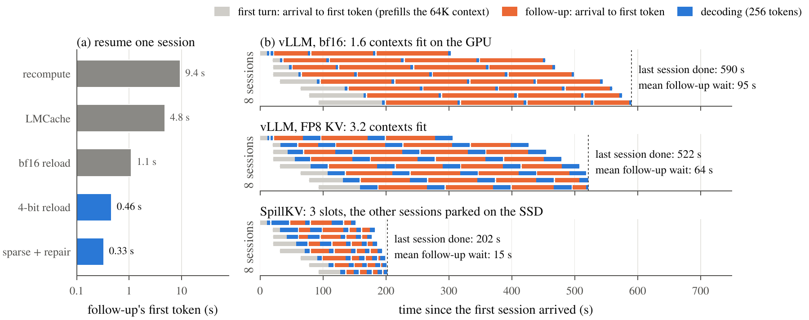
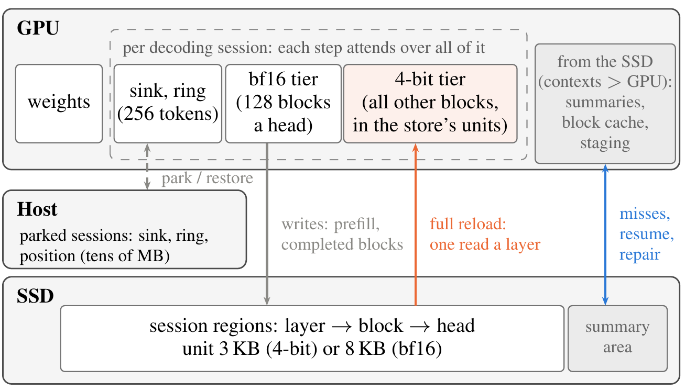
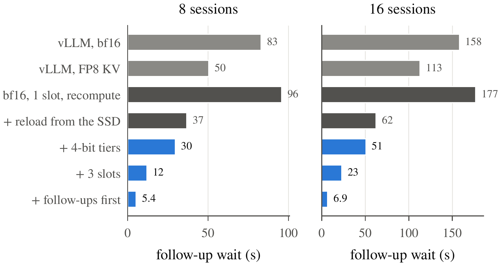
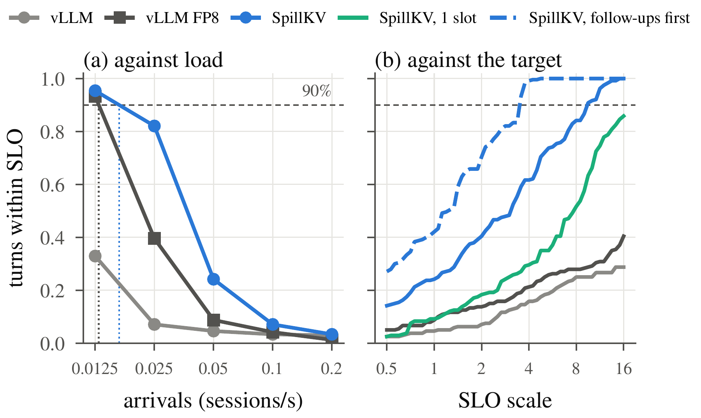

  
SpillKV

  
An SSD session store for long-context, multi-turn inference on one GPU. Every session's KV cache lives
    on the SSD in a 4-bit format that the GPU attends over directly, so a parked session holds no GPU memory and a
    follow-up reloads its context instead of recomputing it.

  

    Under review
    LLM inference
    KV cache
    SSD offloading
  

  

    
      <svg viewBox="0 0 24 24" aria-hidden="true"><path d="M6 2h8l6 6v12a2 2 0 0 1-2 2H6a2 2 0 0 1-2-2V4a2 2 0 0 1 2-2zm7 1.5V9h5.5L13 3.5zM8 13h8v1.6H8V13zm0 3.4h8V18H8v-1.6z"/></svg>
      Paper (coming soon)
    
      <svg viewBox="0 0 24 24" aria-hidden="true"><path d="M8.7 16.6 4.1 12l4.6-4.6L7.3 6 1.3 12l6 6 1.4-1.4zm6.6 0 4.6-4.6-4.6-4.6L16.7 6l6 6-6 6-1.4-1.4z"/></svg>
      Code (coming soon)
    <a class="skv-btn" href="#replay">
      <svg viewBox="0 0 24 24" aria-hidden="true"><path d="M8 5v14l11-7z"/></svg>
      Replay a run</a>
    <a class="skv-btn" href="#results">
      <svg viewBox="0 0 24 24" aria-hidden="true"><path d="M4 19h16v2H4v-2zm1-8h3v6H5v-6zm5-6h3v12h-3V5zm5 3h3v9h-3V8z"/></svg>
      Results</a>
  

  

    <a href="#overview">Overview</a><a href="#the-problem">Problem</a><a href="#how-spillkv-works">Design</a><a href="#replay">Replay</a>
    <a href="#results">Results</a><a href="#where-vllm-does-better">Where vLLM does better</a><a href="#faq">FAQ</a><a href="#citation">Citation</a>
  

  
  
<b>Figure 1.</b> (a) Time to a follow-up's first token when a Llama-3.1-8B session resumes (LongBench v2,
    52K tokens on average; LMCache reloads one 64K-token session from disk). (b) Measured timelines of 8 concurrent
    Llama-3.1-8B sessions on one 32 GB GPU, each of five turns over its own 64K-token repository (arrival seed 0; the gaps
    are think time). vLLM's follow-ups recompute their evicted contexts, while SpillKV decodes three sessions on the GPU
    and reloads a parked one's 4-bit context from the SSD. The <a href="#replay">replay</a> below plays these runs and
    the other seeds.

  

6.9–7.6×

less waiting for a follow-up's first token than with vLLM in bf16 (8 and 16 sessions, two models)

  

1.5–3.1×

less than with vLLM's FP8 KV and LMCache, the strongest baseline, with turns admitted in arrival order

  

0.46 s

to reload a parked Llama-3.1-8B session from the SSD, against 9.4 s to recompute its context

  

&lt; 0.001

nats added over dense attention by decoding from the 4-bit tiers, 3.6 GB per 64K-token session instead of 8.6 GB

  <h2>Overview</h2>
  
Means over three arrival seeds on one RTX 5090 (32 GB) whose host has 23 GB of memory.

  

    
<b>Problem</b>
A user loads a repository, a contract or a book and asks about it again and again. Each turn
      attends to the same long context, whose KV cache outgrows the GPU. A 64K-token Llama-3.1-8B session holds 8.6 GB,
      so a 32 GB GPU that also holds 16 GB of weights has room for 1.6 of them. Every other session is evicted, and its
      follow-up prefills the whole context again.

    
<b>Idea</b>
A session needs its cache on the GPU only while it answers, and not in bf16. SpillKV keeps every
      session's KV cache on the SSD in a 4-bit format for the session's whole life. A session that is answering holds its
      whole context on the GPU in that same format; a parked session holds nothing there, and its follow-up reads the
      4-bit units back in one sequential pass.

    
<b>Result</b>
With 8 and 16 concurrent 64K-token sessions on distinct contexts, whose KV exceeds GPU and host
      memory together, follow-ups wait less than with vLLM in bf16, with FP8 KV, and with LMCache reloading contexts from
      the same SSD. The price is time per output token, since three or four sessions decode at once, and vLLM is faster
      when sessions share one context.

  

  

    
Abstract

    
Multi-turn sessions over long contexts keep KV caches that outgrow GPU memory: a 64K-token Llama-3.1-8B session
    holds 8.6 GB, so a 32 GB GPU has room for 1.6 of them, and every other session's follow-up waits and recomputes its
    context. We present SpillKV, a session store that keeps every session's KV cache on an SSD in a 4-bit format that
    the GPU attends over directly. A session that is answering holds its whole context on the GPU in that format, 3.6 GB
    at 64K tokens, and decodes within 0.001 nats of dense attention; a parked session holds nothing on the GPU and tens
    of MB of host memory, and a follow-up reloads it in one sequential read, in 0.46 s instead of 9.4 s to recompute.
    With 8 and 16 concurrent 64K-token sessions on distinct contexts, whose KV exceeds GPU and host memory together,
    follow-ups wait 6.9–7.6× less than with vLLM, 3.7–4.9× less than with vLLM's FP8 KV and 1.5–3.1× less when LMCache
    also reloads its contexts from the SSD, and at 128K tokens 3.9–4.9× less than with FP8 KV, at up to 2.4× the time per
    output token of vLLM in bf16. When sessions share a context, vLLM's prefix cache shares its KV on the GPU across them,
    SpillKV only its stored units, and vLLM with FP8 KV is faster.

  

  <h2>The problem</h2>
  
Long contexts outgrow the GPU, and on rented single-GPU machines the host has even less memory than the GPU.

  
Existing remedies trade capacity against other costs. Quantizing the cache, to FP8 in vLLM or to 2–4
    bits as in KIVI, raises capacity by a constant factor, but a session that does not fit is still evicted and
    recomputed. Evicting tokens, as H2O, SnapKV and StreamingLLM do, keeps a fixed budget but discards what a later
    question may need; on RULER, SnapKV and H2O lose 17 and 52 points. Offloading to host memory assumes more host memory
    than context. Systems that reuse context across turns, such as CachedAttention and LMCache, reload the whole bf16 or
    FP8 cache before each turn, which takes LMCache about 5 s from disk for a 64K-token session, and the GPU must hold
    that cache while decoding.

  <figure class="skv-live" id="skv-cap">
    

      
Model

      
Live sessions

    

    

    

      on the GPU
      evicted, prefilled again on its next turn
      parked on the SSD in 4 bits, reloaded on its next turn
    

    <figcaption>Interactive<b>How many 64K-token sessions one 32 GB GPU keeps.</b> Each square
      is one session. vLLM's counts are the contexts its KV cache holds beside the weights (a partly filled square is a
      fraction of one). SpillKV's are its decode slots, each sized for a 64K-token context in the 4-bit tiers. With
      LMCache, vLLM's evicted contexts are stored on the SSD too, in bf16 or FP8, and reloaded whole before a turn.</figcaption>
  </figure>

  

    
<b>Session and turn</b>One user's conversation over one long context, here a 64K-token repository (or a book cut
      to 128K tokens). Its first turn carries the context, and four follow-ups ask about it.

    
<b>Follow-up wait (TTFT)</b>The time from a follow-up's arrival to its first output token, averaged over all
      follow-ups. It includes queueing and the recompute or reload of the context.

    
<b>Time per output token</b>The mean gap between two output tokens of a turn once it is decoding (TPOT).

    
<b>Slot</b>A batch row of SpillKV's decode step, sized for the longest context. Three fit beside Llama-3.1-8B on a
      32 GB GPU, four beside Qwen3-4B.

    
<b>Park, reload, recompute</b>Parking takes a finished session off the GPU. Reloading reads its stored KV back;
      recomputing prefills the whole context again.

    
<b>INT4-resident decoding</b>Decoding a session from its whole context held on the GPU, mostly as 4-bit units in
      the store's format. It is SpillKV's main configuration.

    
<b>Prefix caching</b>vLLM keeps the KV of earlier requests on the GPU and reuses it for a request with the same
      prefix, until the memory is needed elsewhere.

    
<b>LMCache</b>A KV cache layer for vLLM that stores KV in host memory or on disk and loads it back before a turn.

  

  <h2>How SpillKV works</h2>
  
One 4-bit format on the SSD and on the GPU, so blocks move between the two without being re-encoded.

  

    
    
<b>Figure 2.</b> A decoding session holds its whole context on the GPU, most of it as 4-bit
      units in the store's format. Parking writes nothing and leaves tens of MB in host memory; a follow-up reloads the
      units one layer at a time. When the active contexts exceed the GPU, sessions decode from the SSD instead (gray).

  

  

    

1Write as it computes

      
Prefill runs one layer at a time over the whole prompt. A writer thread encodes each finished layer's KV to 4 bits
        and writes it while the next layer computes, and decoding writes each 16-token block when it completes. Every
        block on the GPU is also on the SSD, so nothing is written on eviction.

    

2Decode from 4-bit tiers

      
A decoding session holds the sink and its last 256 tokens in bf16, the 128 highest-ranked blocks of each head in
        bf16 and every other block as a 4-bit unit (keys quantized per channel, values per token). One Triton kernel per
        layer attends over all of it for every active slot and dequantizes on the fly.

    

3Park and reload

      
When another turn needs the slot, the session leaves the GPU and keeps its position and last tokens in host
        memory. Its follow-up reads the 4-bit units back one layer at a time, the next layer's while it attends over the
        current one. For 64K tokens that is 3.2–3.6 GB, and the first token comes 0.6–0.7 s after the follow-up gets a slot.

    

+Decode from the SSD

      
The fallback for when even the 4-bit contexts exceed the GPU. Each step attends over the cached blocks that
        block-sparse selection picks, reads the misses after the step and installs them two steps later. This mode costs
        quality (+0.015 nats at a budget of 8K tokens).

  

  
Slots are batch rows of one CUDA graph, and a slot serves whichever session is restored into it.
    Turns are admitted first come, first served, or optionally with arrived follow-ups first, since a follow-up costs a
    reload of about half a second and a first turn a prefill of the whole context (about 10 s at 64K tokens). The engine
    is about 3.7K lines of Python and Triton on the Hugging Face model code, plus a 145-line C++ io_uring extension.

  <h2>Replay a measured run</h2>
  
Every bar is a measured turn from the paper's runs. Nothing on this plot is simulated.

  
Each row is a session, and each turn a bar from its arrival to its first token and on to its last
    token; the gaps are the users' 2 s think time. Pick a model, the number of sessions, an arrival seed and the admission
    order, then press Play to watch the systems serve the same arrivals. The strip under the plot shows which session
    holds each of SpillKV's GPU slots.

  <figure class="skv-live" id="skv-replay">
    

      
Model

      
Sessions

      
Arrival seed

      
Admission

    

    

      <button type="button" class="skv-act" data-role="play">&#9654;&#xFE0E; Play</button>
      <input type="range" min="0" max="1000" value="1000" step="1" data-role="time" aria-label="Time in the run">
      
    

    
<svg data-role="plot" role="img" aria-label="Per-session timelines of the selected run for each system"></svg>

    

      first turn, arrival to first token (prefills the context)
      follow-up, arrival to first token
      SpillKV only: reload and the follow-up's prefill
      decoding 256 tokens
    

    

    

    <figcaption>Interactive<b>The runs behind Table 1.</b> All systems replay the same
      token ids, arrivals (0.05 sessions/s) and think times on one RTX 5090. In vLLM a follow-up's wait includes queueing
      and the recompute or reload of its context; in SpillKV it splits into waiting for a free slot (orange) and the
      reload with the follow-up's own prefill (dark). "Follow-ups first" uses vLLM's priority scheduling and SpillKV's
      admission option. Hover a bar for its numbers, or click the plot to jump to a moment.</figcaption>
  </figure>

  <h2>Results</h2>
  
Baselines are vLLM 0.23 with prefix caching, in bf16 and with FP8 KV, alone and with LMCache 0.4.7.

  <h3 class="skv-h3" id="all-systems">Every system, three arrival seeds</h3>
  <figure class="skv-live" id="skv-results">
    

      
Model

      
Sessions

      
Metric

    

    
<svg data-role="plot" role="img" aria-label="Bar chart of the selected metric for every system"></svg>

    

    <figcaption>Interactive<b>Table 1 as a chart.</b> Bars are means over arrival seeds
      0–2 and circles the three seeds. RepoQA sessions of five turns, each on its own 64K-token repository. LMCache runs
      disk-only and layer-wise on Llama-3.1-8B; on Qwen3-4B it uses a 12 GB CPU tier and the disk at 8 sessions and the
      disk only at 16. "One slot" is SpillKV decoding one session at a time.</figcaption>
  </figure>
  
The arrival seed decides how sessions overlap, so a seed's mean follow-up wait lies within
    ±66% of the mean over seeds. Per seed, SpillKV's follow-ups wait 5.8–14.1× less than vLLM's in bf16 and 2.7–9.7×
    less than with FP8 KV. RepoQA scores stay within 0.05 of vLLM's in bf16 on both models.

  <h3 class="skv-h3" id="where-the-gain-comes-from">Where the gain comes from</h3>
  

    
    
<b>Figure 4.</b> Mean wait for a follow-up's first token, 8 and 16 Llama-3.1-8B sessions on
      distinct repositories, three arrival seeds. Our engine one step at a time (blue is SpillKV), vLLM for reference.

  

  
In bf16 with one slot, recomputing every follow-up, our engine waits a little longer than vLLM,
    so the gain does not come from a faster engine. Reloading from a bf16 store on the SSD instead of recomputing is the
    largest step (2.6–2.8× less wait). The 4-bit tiers shrink the reload and the bytes a decode step reads; their larger
    effect is fitting three slots, which cuts the wait by another 2.2–2.5× at 2.2× the time per output token.

  <h3 class="skv-h3" id="resuming-one-session">Resuming one session</h3>
  
Time to a follow-up's first token and NLL over recompute, Llama-3.1-8B at 64K tokens (LongBench v2, 30 samples)

  

    <table>
      <thead><tr><th>Resume</th><th class="num">First token (s)</th><th class="num">ΔNLL (nats)</th><th class="num">Read (GB)</th></tr></thead>
      <tbody>
        <tr><td>Recompute the context</td><td class="num">9.41</td><td class="num">0</td><td class="num dim">–</td></tr>
        <tr><td>LMCache, one 64K session from disk</td><td class="num">4.8</td><td class="num dim">–</td><td class="num dim">–</td></tr>
        <tr><td>Full reload of a bf16 store</td><td class="num">1.11</td><td class="num">−0.0003</td><td class="num">6.8</td></tr>
        <tr class="ours"><td>4-bit reload, INT4-resident decoding (main)</td><td class="num">0.46</td><td class="num">+0.0008</td><td class="num">2.6</td></tr>
        <tr><td>Sparse resume (2K) + progressive repair</td><td class="num">0.33</td><td class="num">+0.0005</td><td class="num">0.2</td></tr>
      </tbody>
    </table>
  

  
ΔNLL of the 4-bit reload is over dense attention. The sparse resume decodes from the SSD
    afterwards, and its repair reads the whole context again in the background (1.3 s). On Qwen3-4B at 96K tokens the
    4-bit reload takes 0.74 s against 12.6 s to recompute.

  <h3 class="skv-h3" id="decoding-quality">Decoding quality</h3>
  
Llama-3.1-8B at 64K tokens. ΔNLL over dense attention on LongBench v2 (30 samples); RULER accuracy (60 samples)

  

    <table>
      <thead><tr><th>Method</th><th class="num">ΔNLL (nats)</th><th class="num">RULER %</th><th class="num">GPU GB per session</th></tr></thead>
      <tbody>
        <tr><td>Dense attention, bf16</td><td class="num">0</td><td class="num">79.0</td><td class="num">8.6</td></tr>
        <tr><td>FP8</td><td class="num">+0.006</td><td class="num">78.3</td><td class="num">4.3</td></tr>
        <tr><td>KIVI, 4 bits</td><td class="num">+0.002</td><td class="num">78.5</td><td class="num">2.7</td></tr>
        <tr><td>KIVI, 2 bits</td><td class="num">+0.073</td><td class="num">76.4</td><td class="num">1.6</td></tr>
        <tr><td>ShadowKV</td><td class="num">+0.046</td><td class="num">85.0*</td><td class="num">1.5</td></tr>
        <tr><td>Quest, budget 2048</td><td class="num">+0.058</td><td class="num">74.3</td><td class="num">9.1</td></tr>
        <tr><td>SnapKV, 2048 tokens</td><td class="num">+0.123</td><td class="num">61.7</td><td class="num">0.3</td></tr>
        <tr><td>H2O, 2048 tokens</td><td class="num">+0.159</td><td class="num">26.6</td><td class="num">0.3</td></tr>
        <tr><td>StreamingLLM, 2048 tokens</td><td class="num">+0.235</td><td class="num">6.2</td><td class="num">0.3</td></tr>
        <tr class="ours sep"><td>SpillKV, INT4-resident (main)</td><td class="num">+0.001</td><td class="num">79.2</td><td class="num">3.6</td></tr>
        <tr><td>SpillKV from the SSD, per head 8192, 4-bit store</td><td class="num">+0.015</td><td class="num">78.0</td><td class="num">3.0</td></tr>
      </tbody>
    </table>
  

  
* ShadowKV is ahead of dense attention on variable tracking only (0.90 against 0.44, 10
    samples). GPU memory is the KV state per session, from each format for the baselines and measured per slot for SpillKV.

  
INT4-resident decoding is equivalent to dense attention within 0.01 nats and 5 RULER points
    (two one-sided tests on paired bootstrap intervals). KIVI at 4 bits takes less GPU memory at the same quality, but
    every session it serves must keep its cache on the GPU, while SpillKV's parked sessions hold none there.

  <h3 class="skv-h3" id="under-load">Under load and latency targets</h3>
  

    
    
<b>Figure 3.</b> 16 concurrent Llama-3.1-8B sessions on distinct 64K-token repositories, three
      arrival seeds. A turn meets the SLO when its first token comes within 30 s (a first turn) or 5 s (a follow-up) and
      its tokens are at most 100 ms apart on average. (a) Share of turns within the SLO against the arrival rate. (b) The
      same at 0.05 sessions/s with all three targets scaled.

  

  
At 0.05 sessions/s, 24% of SpillKV's turns meet all three targets (42% admitting follow-ups
    first), against 9% with FP8 KV and 5% for vLLM in bf16. Most of its misses are follow-ups waiting for a slot, while
    97% of its turns keep tokens within 100 ms. It keeps 90% of turns within the targets up to 0.017 sessions/s, and FP8
    KV up to 0.013.

  <h3 class="skv-h3" id="beyond-one-card">Longer contexts, larger models, other machines</h3>
  

    

128K-token sessions

      
With whole books from En.QA, vLLM in bf16 cannot serve Llama-3.1-8B at all, since one 128K request needs 16.0 GiB
        of KV and 13.6 GiB are left. SpillKV serves it with one slot, and a follow-up reloads its context in 1.0 s. Against
        FP8 KV, follow-ups wait 3.9× less on Llama-3.1-8B (55.0 against 213 s).

    

Llama-3.1-70B on a B200

      
Beside 141 GB of weights on a 180 GB GPU, a 64K session's KV weighs against free memory as Llama-3.1-8B's does on
        the 5090. Follow-ups wait 3.7× less than with vLLM in bf16 and 1.6× less than with FP8 KV (29.9 against 47.3 s at 8
        sessions), at 73 against 91 ms per token.

    

Six other GPUs

      
From an RTX 3090 to the B200, with models from 4B to 70B parameters, follow-ups wait 2.4–5.9× less than with vLLM
        in bf16 and 1.5–4.2× less than with its FP8 KV.

    

Capped host memory

      
With the serving process limited to 8 or 4 GB of host memory, SpillKV's runs finish within 1 s of uncapped ones
        on both models. LMCache ran at 16 GB and hung at 8 and 4 GB.

  

  <h2>Where vLLM does better</h2>
  
SpillKV targets distinct long contexts on one GPU whose host has little memory. Outside that setting, or for other metrics, the baselines can win.

  

    
vLLM ahead
Sessions that share a context

      
With two sessions on each repository, vLLM's prefix cache serves the second from the first one's KV on the GPU,
        and with FP8 KV it then holds every live context at 8 Llama-3.1-8B sessions. Its follow-ups wait 0.65 s against
        SpillKV's 12.0 s. An option that reloads a stored session's units for a shared prefix cuts SpillKV's to 5.3 s.

    
vLLM ahead
Sessions of mixed lengths

      
A slot is sized for the longest context and is not paged. With 16 Llama-3.1-8B sessions of 16–55K tokens,
        follow-ups wait 2.8 s against 0.4 s with vLLM's FP8 KV and LMCache, and on Qwen3-4B 0.9 against 0.4 s.

    
trade-off
Time per output token

      
Three slots decoding together make a Llama-3.1-8B token take 36 ms against vLLM's 15.5 ms in bf16. With one slot
        SpillKV decodes about as fast (16.5 ms) and its follow-ups still wait 2.8× less. On Qwen3-4B its tokens are faster
        than vLLM's in bf16.

    
about even
Both admit follow-ups first

      
With priority scheduling, vLLM with FP8 KV and LMCache waits 0.9–1.3× as long as SpillKV for a follow-up.
        SpillKV's first turns still start sooner, with medians of 24.9 and 51.1 s against 43.0 and 84.3 s at 8 and 16
        Llama-3.1-8B sessions.

    
trade-off
Pauses in decoding

      
A 64K prefill stops the resident sessions for about 10 s. At 8 Llama-3.1-8B sessions, 34% of SpillKV's turns
        (32–38% per seed) have a gap above 1 s between two tokens, against 70% (42–85%) with vLLM's FP8 KV and LMCache.
        Prefilling in 20 ms pieces leaves no gap above 0.9 s at the same follow-up wait, but first turns wait longer
        (median 32.6 against 21.0 s).

    
trade-off
Hosts with ample DRAM

      
On a server with 503 GB of memory, vLLM with a 100 GB LMCache CPU tier waits 62.0 s for a follow-up and SpillKV
        41.6 s at 3.4× its time per token (73.0 s with one slot, at 1.2×). A DRAM tier reloads faster than an SSD, and
        SpillKV's 4-bit units can sit there too.

  

  <h2>FAQ</h2>
  

    
Why not keep parked sessions in host memory?

    
Rented single-GPU instances and workstations often have less host memory than GPU memory; the three cloud machines
      we used had 23 GB beside a 32 GB GPU. Eight 64K-token sessions already hold 68 GB of KV in bf16 on Llama-3.1-8B.
      When the host has the memory, a DRAM tier (or the page cache of the store file) can hold SpillKV's 4-bit units as
      well as the SSD.

  

  

    
How many reloads can one SSD serve?

    
A full reload is one sequential read, 3.2–3.6 GB for a 64K-token Llama-3.1-8B session, so a drive that reads
      6 GB/s serves about two per second. Two SpillKV instances on two RTX 3090s sharing one drive lengthened a 3.6 GB
      reload from 1.10 to 1.40 s and left the mean follow-up wait unchanged (41.9 against 41.6 s).

  

  

    
Does it wear out the drive?

    
Parking writes nothing, since every block is written once when it is computed. A 64K-token Llama-3.1-8B session
      writes 3.3 GB over five turns, so a drive rated for 600 TB written per TB of capacity absorbs about 180K such
      sessions per TB.

  

  

    
Do the 4-bit tiers change the answers?

    
RepoQA scores are 0.03–0.05 below vLLM's in bf16 on Llama-3.1-8B and 0.01–0.02 above on Qwen3-4B. These scores are
      coarse, since an answer reproduces a function verbatim and one changed token sends the rest elsewhere; vLLM with FP8
      KV alone scores 0.597 to 0.643 across arrival seeds. Teacher-forced on vLLM's answers in the same sessions,
      INT4-resident decoding adds 0.0007 nats on Llama-3.1-8B and 0.0009 on Qwen3-4B.

  

  

    
Could this live inside vLLM or SGLang?

    
A store unit, one KV head of a 16-token block, maps to a KV block, and the tiers to a block pool in a 4-bit format
      with per-channel key scales, which current attention backends lack (they take FP8). Parking would free a session's
      blocks once they are written, and a reload would read its units into new blocks layer by layer beside the other
      requests' decode steps. SpillKV itself is a single-GPU engine on the Hugging Face model modules.

  

  

    
What does it not handle yet?

    
There is no preemption, and the choice between INT4-resident and SSD decoding is static. Slots are not paged. The
      main measurements use one GPU type and a virtualized NVMe-backed disk, with a bare-metal check on RTX 3090s; the main
      models have at most 8B parameters, and the sessions come from two tasks (RepoQA and En.QA).

  

  <h2>Citation</h2>
  
The paper is under review. The PDF, code and BibTeX will be linked here when they are public.

