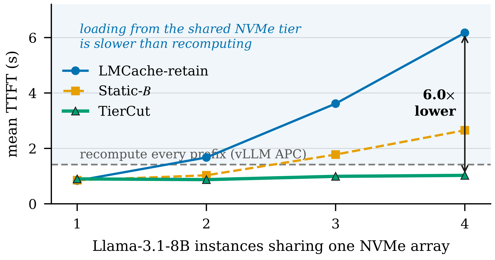
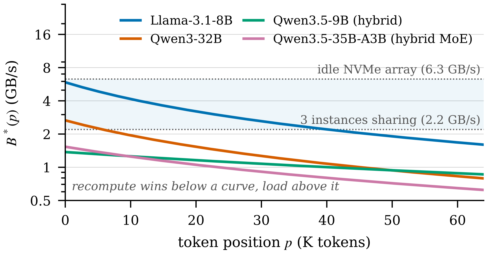
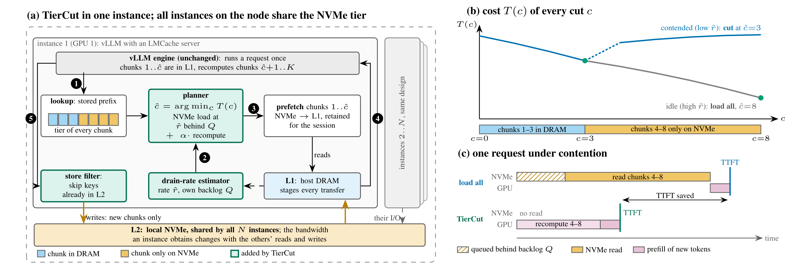
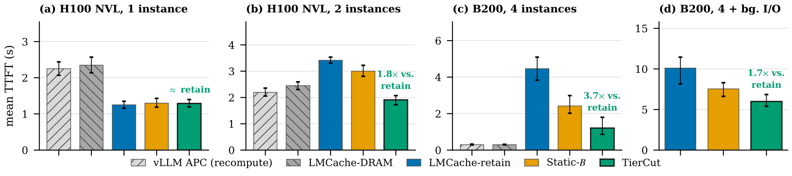
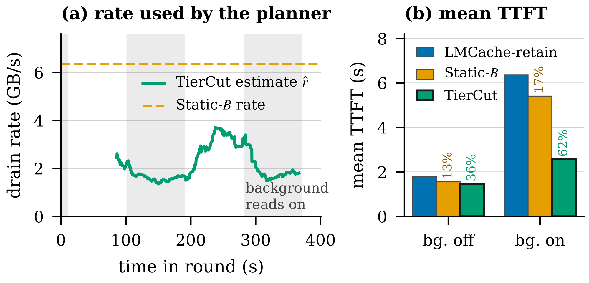
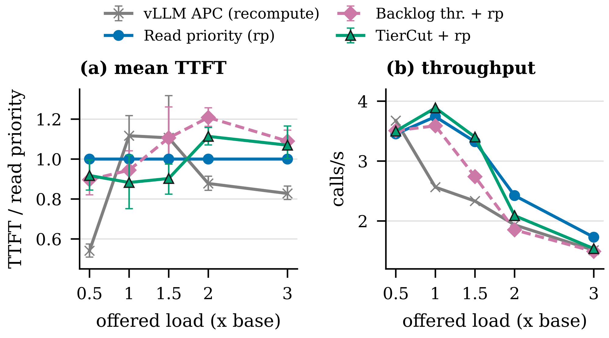
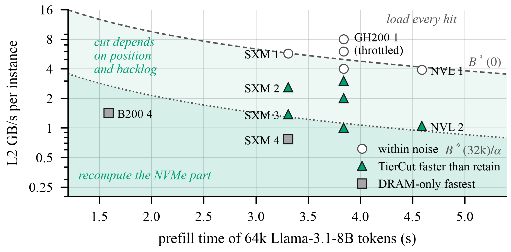

LLM servingKV cacheTiered storageAgent workloads

Serving stacks keep evicted KV caches in DRAM and on local NVMe so that an agent's next call can restore its prefix instead of recomputing it. On a multi-GPU node every instance shares that NVMe, and restoring soon becomes <b>slower than recomputing</b>. <b>TierCut</b> decides per request how much of a stored prefix to load, and a study on five platforms shows when cutting, read priority or bypassing the tier is the right control.

<a class="tc-btn" href="#try-the-planner">▶&nbsp; Try the planner</a><a class="tc-btn ghost" href="#how-tiercut-works">How it works</a><a class="tc-btn ghost" href="#results">Results</a><a class="tc-btn ghost" href="#which-control-when">Decision map</a>Paper &amp; code: coming soon

<figure class="tc-fig narrow"><figcaption>Figure 1<b class="tc-title">A shared NVMe tier turns from a shortcut into the bottleneck.</b>Mean time to first token (TTFT) of agent calls with 64k-token contexts as more Llama-3.1-8B instances share one NVMe array (8×H200 node). LMCache with retention loads every hit and its TTFT grows from 0.84 s to 6.17 s; above the dashed line it is slower than recomputing every prefix. A planner that assumes the idle disk's bandwidth (Static-<i>B</i>) falls behind as well. TierCut stays between 0.87 and 1.03 s.</figcaption></figure>

## At a glance

1.6×

the mean TTFT of recomputing every prefix, when two Llama-3.1-8B instances on one disk load every hit instead

−44%

mean TTFT against LMCache with retention in that setting (H100 NVL node, 95% CI −49 to −40)

−31%

against a planner with a constant bandwidth while background reads on the disk come and go

19–24%

faster than a backlog threshold and than read priority with four instances; with two, both simple policies match TierCut

## Why restoring can lose to recomputing

1<b>Agents leave long prefixes behind.</b>
An agent session makes tens of LLM calls, and each prompt is the previous context plus a tool result. In the deep-research traces we replay, the final context has a median of 26k tokens. While a session waits for its tool, the GPU evicts its KV cache to serve others.

2<b>Evicted KV goes to DRAM and NVMe.</b>
LMCache keeps evicted KV in host DRAM (L1) and on local NVMe (L2) and loads it back on a hit. From DRAM this takes about 0.2 s for a 64k-token context. From NVMe, nearly all of the time is the disk read.

3<b>Every instance shares the disk.</b>
Each GPU runs its own instance, and all of them read and write the same devices. With four Llama instances, one prefix read takes up to 20–26 s. Recomputing a 64k-token prefix takes 3.4 s.

Table 1 **Mean TTFT (ms) of agent calls with 64k-token contexts, by restoration path** (8×H200 node, LMCache default policy).

| Model | All KV in DRAM | Recompute only | NVMe, 1 instance | NVMe, 4 instances sharing |
|---|---|---|---|---|
| Qwen3.5-9B (hybrid, 32 KB of KV per token) | 186–222 | 2891 | 320 | 800–4510 |
| Llama-3.1-8B (dense, 128 KB of KV per token) | 182 | 1416 | 1698 | 4482–7717 |

Read each row from left to right. DRAM is always cheap. For Llama, four instances sharing the array make NVMe restoration 3–5× slower than recomputing. Qwen3.5-9B stores a quarter of the bytes per token, so loading still pays when it runs alone, but not under heavy sharing.

Whether loading one token's KV beats recomputing it depends on a single number. Loading costs the KV size <i>s</i> divided by the bandwidth; recomputing costs the marginal prefill time at the token's position <i>p</i>, which grows with <i>p</i> because attention is quadratic. Recomputation wins below the <b>crossover bandwidth</b>:

\[ B^{*}(p) = \frac{s}{k_1 + k_2\,p} \]

<figure class="tc-fig narrow"><figcaption>Figure 3<b class="tc-title">The break-even point depends on the model, the position and the load.</b>Each curve is the bandwidth below which recomputing the token at position <i>p</i> is faster than loading it (prefill measured on one H200). At the same position the four models differ by up to 4.3×. The shaded band is what one instance obtains from the array, from idle (6.3 GB/s) to three instances sharing it (about 2.2 GB/s). Llama's curve crosses the band: the right decision for a long prefix flips with contention, so no fixed rule such as "always load" is right for every model and load.</figcaption></figure>

The tiered cache adds side effects of its own. By default it reads a session's prefix from NVMe again on every call, and it writes recomputed chunks back to NVMe although they are already there, which adds to the contention. The terms used on this page:

<b>TTFT.</b> Time to first token: from sending a call to its first output token. Lower is better.

<b>Prefill.</b> The GPU pass that computes the KV cache of the prompt. Recomputing a prefix means prefilling it again.

<b>L1, L2.</b> LMCache's two tiers: host DRAM and a file system on local NVMe. KV is stored in chunks of 528 tokens.

<b>Cut.</b> The point in a stored prefix up to which KV is restored. Everything after it is recomputed.

<b>Drain rate.</b> The rate at which one instance's own reads complete. It already reflects what the other instances read and write.

<b>Backlog.</b> The bytes an instance has asked the disk for that have not arrived yet. A new read waits behind them.

<b>LMCache-retain.</b> LMCache that loads every hit and keeps chunks read from NVMe in DRAM. Our main baseline.

<b>Static-<i>B</i>.</b> TierCut with the rate fixed at the idle disk's bandwidth: a stand-in for planners that assume a constant bandwidth.

<b>vLLM APC.</b> vLLM's GPU prefix cache alone: every evicted prefix is recomputed.

<b>LMCache-DRAM.</b> LMCache with the DRAM tier only, no NVMe.

## How TierCut works

Existing restoration planners such as Cake and CacheFlow treat each request's restoration on its own, inside a modified engine. They do not charge a request's reads for the delay they cause other instances on the same storage, or its recomputation for the decodes it stalls. TierCut plans in the storage layer and changes four things:

Load every hitTierCutWhy it matters
Decision
restore the longest stored prefix
→
choose a cut per request, before any disk read is issued

a read that has been issued cannot be cancelled

Bandwidth
a constant, measured on the idle disk
→
the drain rate of the instance's own reads, plus its backlog

the constant underestimates load time by a median factor of 4.9 with four instances

Recompute cost
the request's own prefill time
→
prefill time × α, with α = 2

a recompute prefill stalls the decodes of other requests in the same batch

The tier
re-reads each call, writes recomputed chunks back
→
keep loaded chunks in DRAM, skip writes of chunks already on NVMe

87% of NVMe writes disappear with three instances

<figure class="tc-fig"><figcaption>Figure 2<b class="tc-title">TierCut decides, before any read, how much of a stored prefix to restore.</b>(a) The green boxes are added to each instance's LMCache server. A lookup finds the stored prefix and the tier of every chunk (1); the planner combines it with the estimator's rate and backlog (2) and picks the cut ĉ (3); only chunks up to ĉ are read, and the unchanged vLLM engine recomputes the rest (4); the store filter skips chunks NVMe already holds (5). (b) Illustrative cost of every cut: under contention the cheapest cut is the end of the DRAM part; on an idle disk it is the full prefix. (c) One request's timeline under contention.</figcaption></figure>

For a stored prefix of <i>K</i> chunks of <i>t</i> tokens, the planner estimates the time until prefill can finish for every cut <i>c</i> and takes the cheapest:

\[ T(c) \;=\; \underbrace{\mathbf{1}[A_{\mathrm{N}}(c) &gt; 0]\;\frac{Q + A_{\mathrm{N}}(c)}{\hat r}}_{\text{load from NVMe}} \;+\; \underbrace{\alpha\,\bigl(f(Kt) - f(ct)\bigr)}_{\text{recompute the rest}}, \qquad f(x) = k_1 x + \tfrac{1}{2} k_2 x^2 \]

<b>Load term.</b> <i>A</i>N(<i>c</i>) is the bytes cut <i>c</i> must read from NVMe; chunks in DRAM cost nothing. They are charged at the measured drain rate r̂ and wait behind the backlog <i>Q</i>.

<b>Recompute term.</b> The prefill time of the dropped tokens from a one-time profile of the GPU (<i>k</i>1, <i>k</i>2), weighted by the threshold α for the decode stalls it causes.

1<b>Measure the drain rate.</b>
The estimator divides the bytes of completed reads by the time during which a read was in flight, both decayed over 10 s. A small prior pulls the estimate back up after a pause, so the planner loads again and finds out whether contention has gone.

2<b>Price a few cuts.</b>
Only cuts where the whole model can resume are candidates, which covers hybrid models with recurrent state. Within a run of chunks on one tier the cost is concave, so the best cut is at an end of a run. Planning takes under a millisecond.

3<b>Report a shorter prefix.</b>
TierCut runs as two LMCache policy plugins, about 350 lines of Python. vLLM is unchanged: the cache simply reports the prefix up to the cut, and the engine recomputes the rest as it would after any partial hit.

<b>One rule falls out of the cost.</b> Without backlog, reading a whole NVMe run is cheaper than recomputing it exactly when r̂ &gt; <i>B</i>*(<i>m</i>) / α, where <i>m</i> is the token position at the middle of the run. For a 64k-token Llama prefix entirely on NVMe and α = 1, that threshold is 2.52 GB/s on an H200: between the idle array and the array shared three ways.

## Try the planner

The figure below evaluates the cost model above in your browser, with the prefill profiles measured on one H200. It shows what the planner would decide for one request; its numbers are the model's estimates, not measurements from the paper.

<figure class="tc-fig" id="tc-demo">

Situation
<button type="button" data-p="idle">Idle array</button><button type="button" data-p="share">Three instances sharing</button><button type="button" data-p="queue">Reads queued</button>

Model
<button type="button" data-v="llama">Llama-3.1-8B</button><button type="button" data-v="q32">Qwen3-32B</button>

Threshold α
<button type="button" data-v="1">1</button><button type="button" data-v="2">2</button><button type="button" data-v="3">3</button>

<label class="l" for="tc-r">Drain rate r̂</label><input type="range" id="tc-r" min="0" max="100" step="1"><output id="tc-r-o"></output>

<label class="l" for="tc-q">Backlog <i>Q</i></label><input type="range" id="tc-q" min="0" max="12" step="0.5"><output id="tc-q-o"></output>

<label class="l" for="tc-len">Stored prefix</label><input type="range" id="tc-len" min="8" max="64" step="4"><output id="tc-len-o"></output>

<label class="l" for="tc-dram">Already in DRAM</label><input type="range" id="tc-dram" min="0" max="100" step="5"><output id="tc-dram-o"></output>

<svg class="tc-chart" id="tc-chart" viewBox="0 0 680 330" role="img" aria-label="Estimated cost of every cut: load term, recompute term and their sum, with the chosen cut marked"></svg>

<svg width="26" height="10"><line x1="1" y1="5" x2="25" y2="5" stroke="var(--tc-acc)" stroke-width="3"/></svg>cost <i>T</i>(<i>c</i>)
<svg width="26" height="10"><line x1="1" y1="5" x2="25" y2="5" stroke="var(--tc-nvme-fill)" stroke-width="2" stroke-dasharray="5 3"/></svg>load from NVMe
<svg width="26" height="10"><line x1="1" y1="5" x2="25" y2="5" stroke="var(--tc-gpu)" stroke-width="2" stroke-dasharray="2 3"/></svg>α × recompute
<svg width="12" height="10"><rect width="12" height="9" rx="2" fill="var(--tc-dram)"/></svg>chunk in DRAM
<svg width="12" height="10"><rect width="12" height="9" rx="2" fill="var(--tc-nvme-fill)"/></svg>chunk only on NVMe

<figcaption>Interactive<b class="tc-title">The cost of every cut for one request.</b>The horizontal axis is the cut: tokens to the left are restored, tokens to the right are recomputed. The bar under the axis shows where each chunk is stored; the first part of the prefix is in DRAM, as after an earlier call of the same session. The dot marks the cut the planner picks. Lower the drain rate or add backlog and the dot jumps from the right end (load everything) to the end of the DRAM part. Both models are dense, with prefill profiles from one H200. "Three instances sharing" uses the 2.2 GB/s of Figure 3; there, set "Already in DRAM" to 0% and α to 1, and the planner recomputes, because 2.2 GB/s is below Llama's threshold of 2.52 GB/s. "Reads queued" is a made-up state with one earlier 4 GB read still in flight.</figcaption>
</figure>

## Results

We replay agent trajectories with contexts cut at 64k tokens on five single-node platforms, with every instance on its own GPU and all instances sharing one local disk. Systems run in balanced rounds, and we compare systems only within a platform. The main results below are from nodes allocated to us alone, with α = 2 and three rounds per system.

Table 2 **The five platforms.** All run vLLM 0.29.0, LMCache 0.5.6rc5 and PyTorch 2.13. Prefill is the time for 64k Llama-3.1-8B tokens on one GPU; *B*\* is Llama's crossover bandwidth at positions 0 and 32k.

| Node | Shared L2 device | Idle read | Prefill | *B*\* (GB/s) | Allocation |
|---|---|---|---|---|---|
| 8×H200 | 2 NVMe, RAID0 | 6.3 GB/s | 3.42 s | 5.89 / 2.52 | shared with other users |
| 2×H100 NVL | 1 NVMe | 6.3 GB/s | 4.59 s | 3.94 / 1.81 | exclusive |
| 4×H100 SXM | 1 local SSD | 5.1–5.5 GB/s | 3.31 s | 5.71 / 2.60 | exclusive |
| 8×B200 | 2 NVMe, RAID1 | 7.1 GB/s | 1.59 s | 11.9 / 5.43 | exclusive |
| 4×GH200 | RAM disk, reads throttled | 0.5–8 GB/s | 3.84 s | 5.04 / 2.24 | exclusive |

Workload: OpenResearcher deep-research trajectories replayed as sessions of up to 60 calls. Each instance serves 16 sessions (24 for Qwen3.5-9B) that arrive at 0.2 per second, wait a simulated tool latency between calls and generate 32 output tokens per call. GPU memory is set so that the GPU cache cannot hold all sessions, and DRAM (32 GB per instance for Llama, 16 GB for Qwen3.5-9B) can stage a full prefix but holds only a few sessions. Means are over all calls of all instances and rounds, with 95% bootstrap confidence intervals.

<figure class="tc-fig"><figcaption>Figure 4<b class="tc-title">The same planner on a slow-prefill and a fast-prefill node.</b>Mean TTFT with 95% confidence intervals, Llama-3.1-8B. (a) One instance on the H100 NVL node: every system that uses the disk is within noise, so planning costs nothing when the disk is free. (b) Two instances share the disk: LMCache-retain rises to 3.42 s and TierCut is at 1.91 s, also 13% faster than recomputing everything. (c, d) On the B200 node a 64k-token prefill takes 1.59 s instead of 4.59 s. TierCut is still the fastest system that reads the disk, but serving from DRAM alone is fastest overall: here the NVMe tier should not be used at all.</figcaption></figure>
<figure class="tc-fig narrow"><figcaption>Figure 5<b class="tc-title">The estimate follows contention that changes within a run.</b>Two Llama instances on the H100 NVL node while another process reads the same disk in 90 s bursts (grey bands). (a) TierCut's rate estimate falls while the bursts are on and recovers after them; Static-<i>B</i> keeps its 6.4 GB/s. (b) With the bursts off, the three systems are close. With them on, TierCut cuts 62% of its decisions and has a mean TTFT of 2.56 s, against 5.41 s for Static-<i>B</i> and 6.37 s for LMCache-retain. Over whole runs TierCut is 31% faster than Static-<i>B</i> and 42% faster than LMCache-retain.</figcaption></figure>

Table 3 **Simple node-level policies are strong.** Mean TTFT (s), Llama-3.1-8B. Each column is a separate experiment with its own balanced rounds, so compare within a column only. NVL: two instances on the H100 NVL node; SXM: four instances on the H100 SXM node.

| System | NVL, A | NVL, B | NVL, 2× load | NVL, 256 output tokens | SXM, A | SXM, B |
|---|---|---|---|---|---|---|
| vLLM APC (recompute) | – | – | – | – | **1.28** | – |
| LMCache-DRAM | – | – | – | – | 1.37 | – |
| LMCache-retain | 3.09 | – | 14.4 | – | 6.60 | – |
| Deadline fallback | 3.58 | – | – | – | 6.49 | – |
| Write-back cap | 2.81 | – | – | – | 5.05 | – |
| Backlog threshold | 2.07 | 2.05 | 10.4 | 0.49 | 2.05 | 2.07 |
| Read priority | 2.00 | 2.08 | **7.98** | 0.56 | 2.17 | 1.96 |
| Read priority + backlog threshold | – | 2.04 | – | – | – | 1.54 |
| TierCut | **1.97** | 1.89 | 9.64 | 0.54 | 1.66 | **1.38** |
| TierCut + read priority | – | **1.77** | 8.69 | **0.48** | – | 1.42 |

The backlog threshold serves only the DRAM part whenever the instance has disk reads in flight. Read priority lets no instance write back while any instance on the node is reading. With two instances both are within noise of TierCut (column A), and TierCut combined with read priority is the fastest (column B). With four instances an instance's own backlog says less about the node, and TierCut is 19% and 24% faster than the two (SXM, A). At twice the load, read priority alone leads.

<figure class="tc-fig narrow"><figcaption>Figure 6<b class="tc-title">Under heavy load the GPU, not the disk, is the bottleneck.</b>Two Llama instances on the H100 NVL node, with session rate and session count scaled together. (a) Mean TTFT relative to read priority; below 1.0 is faster. (b) Completed calls per second. Up to 1.5× the base load, TierCut with read priority is 8–12% faster than read priority alone. At 2× and 3× it is 11% and 7% slower: every cut adds prefill to a GPU that already has 9–15 requests waiting. Letting α grow with that queue brings TierCut back within noise of read priority at 2×, but at 3× read priority alone is the right policy.</figcaption></figure>

−53%

TTFT for the hybrid Qwen3.5-9B with five instances; with one or three it rarely cuts and matches LMCache-retain, because its KV is small

−65%

TTFT on OpenSeeker search-agent traces (median final context 68.5k tokens), three Llama instances

&lt; 1 ms

median planning time per request (0.63–0.94 ms), about 0.1% of TTFT

218 / 218

forced cuts on Llama give the same first 32 greedy tokens as full recomputation (H100 NVL node)

<b>About the 8×H200 numbers.</b> Figure 1 and the two cards on Qwen3.5-9B and OpenSeeker come from a server shared with other users, whose disk I/O we did not control. Those runs used α = 1 and two rounds per system. Everything else on this page is from exclusively allocated nodes with α = 2 and three rounds.

## Which control, when

Cutting is one of three controls a node has over its shared tier. The others act on the tier's writes (read priority over write-back) or switch the tier off (bypass). The decision map places every configuration we ran by how fast its GPU prefills and how much bandwidth one instance obtains.

<figure class="tc-fig narrow"><figcaption>Figure 7<b class="tc-title">A decision map for Llama-3.1-8B.</b>Each point is one configuration (node and number of instances). Horizontal: prefill time of 64k tokens on that GPU. Vertical: the median bandwidth of an instance's reads when it loads nearly every hit. The two curves are the crossover bandwidth at position 0 and at 32k tokens divided by α = 2. Circles: TierCut within noise of LMCache-retain. Triangles: TierCut faster. Squares: DRAM-only or recompute-only serving is fastest.</figcaption></figure>

Above the upper curve<b>Load every hit.</b>
The disk is fast enough for every position. TierCut matches LMCache-retain here, so no planning is needed: one instance per disk on both H100 nodes.

Near and between the curves<b>Cut, with read priority.</b>
The best cut depends on each request's positions and backlog. A per-request plan pays, and read priority removes the write-back that competes with reads.

Far below<b>Bypass the tier.</b>
Nearly every read would be cut, and the tier still costs its write-back. Serving from DRAM alone or recomputing has the lowest TTFT: the B200 node, and four instances on the H100 SXM node.

## Using TierCut

TierCut is a research prototype for stacks that already run vLLM with LMCache. It registers one prefetch policy and one store policy through LMCache's plugin interfaces; nothing in vLLM changes. Each instance runs its own planner; the drain rate it measures on its own reads already reflects what the other instances read and write.

| What you provide | Value in the paper | What it does |
|---|---|---|
| Prefill profile *k*1, *k*2 | one profile per GPU model | Single requests of 1k–64k random tokens on one GPU, fitted once. Gives the recompute cost of any suffix. |
| Benefit threshold α | 2 | Weight on recompute time for the decodes it stalls. α = 1 cut too eagerly and raised end-to-end latency by 11–26% on one uncontended instance. |
| Estimator window τ | 10 s | Decay of the drain-rate estimate. 10 s was 14% faster than 2 s and equal to 30 s. |
| Prior | 3 GB/s for 0.5 s | About half the idle disk's bandwidth. Used before the first reads and after a pause. |
| Tested with | vLLM 0.29.0, LMCache 0.5.6rc5 | LMCache in multi-process mode, chunks of 528 tokens, L2 on local NVMe with O_DIRECT. |

<b>Pair it with read priority.</b> Read priority acts on the tier's writes and TierCut on its reads, so the two combine: together they were the fastest system with two instances at the base load. Read priority needs the instances of a node to publish their in-flight bytes in shared memory.

## What TierCut does not do

<ul>
<li><b>It is not always needed.</b> With two instances and steady load, a rule that stops loading while the instance's own reads queue decides nearly as TierCut does. The measured rate matters with four instances, under background bursts, and across models with different break-even points.</li>
<li><b>It does not fix an overloaded GPU.</b> From twice the base load, cutting delays the requests queued for the GPU. A threshold that follows the queue helps at 2×; at 3× read priority alone is faster.</li>
<li><b>It cannot make a slow tier pay.</b> Where prefill is fast or DRAM holds the working set, the NVMe tier should be bypassed. With 64 or 128 GB of DRAM per instance on the H100 SXM node, DRAM-only serving is fastest.</li>
<li><b>It only chooses a prefix length.</b> It does not overlap loading with computation as Cake does, choose layers or devices, or change admission or eviction. A request-level emulation of overlap matches TierCut's mean TTFT at the base load and falls behind at twice the load.</li>
<li><b>The estimator is simple.</b> A constant rate tuned per node can beat it under steady load, and the plugin wraps three internal LMCache methods, which ties it to LMCache 0.5.6.</li>
</ul>

## Paper and code

Abstract

LLM agents issue tens of calls per session over contexts of tens of thousands of tokens, and serving stacks keep evicted KV caches in host DRAM and local NVMe so that later calls can restore them instead of recomputing them. On a multi-GPU node, however, all serving instances share the NVMe tier, and restoring from it soon becomes slower than recomputing: with two Llama-3.1-8B instances on one disk, loading every hit has 1.6× the mean time to first token (TTFT) of recomputing every prefix. We characterize this contention and the tier's side effects, and study the controls a node can apply to it: cutting how much of a prefix to read, giving reads priority over write-back, and bypassing the tier. For the first, we present TierCut, a storage-layer planner that picks per request how much of a stored prefix to restore from the tier of every chunk, an online estimate of the instance's drain rate and backlog, and the GPU's prefill cost weighted by a threshold for the decode stalls that recomputation causes. Implemented as LMCache plugins with vLLM unchanged, TierCut reduces mean TTFT by 44% relative to LMCache with retention when two instances share an H100 node's disk, by 48–83% with 2–4 instances on an H200 node, and by 31% relative to a constant-bandwidth planner under fluctuating I/O. Simple node-level policies are strong: with two instances, a backlog threshold and read priority come within noise of TierCut, while with four instances on an H100 SXM node TierCut is 19–24% faster than both. Under heavy load the GPU, not the tier, becomes the bottleneck and cutting stops paying; a threshold that grows with the GPU's queue keeps TierCut with read priority on par with read priority at twice the load and keeps its gain at the base load, but at three times the load read priority alone is faster. A decision map over prefill speed and per-instance bandwidth summarizes when each control pays, including nodes where serving from DRAM alone or recomputing every prefix is fastest.

The manuscript is under review. Paper, code and BibTeX will be linked here once the preprint is public.

