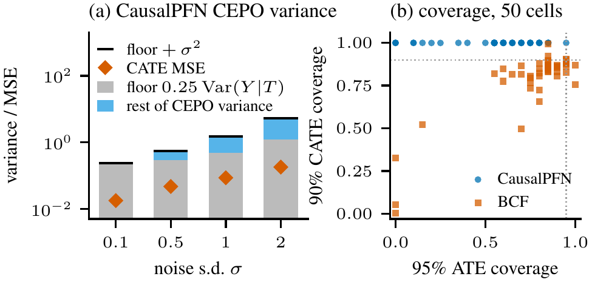
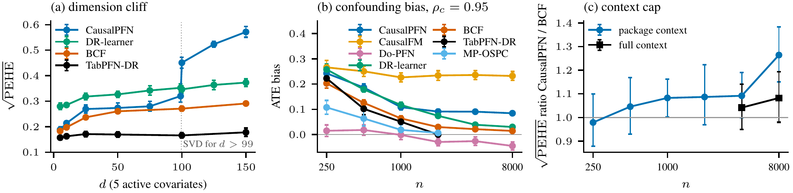
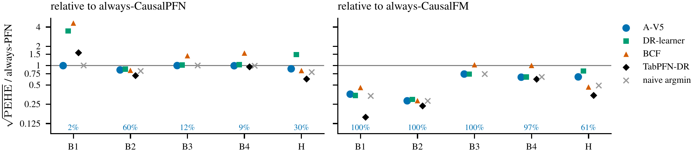

Causal inferenceTabular foundation modelsPre-registered evaluation

A causal PFN returns treatment effects in one forward pass, but nothing in its output says whether your data fit its prior. We diagnose the three released models and build <b>certify-or-defer</b>, a test that replaces the PFN only where the data show it is worse than a classical estimator. The evaluation was fixed in advance, its verdict is mixed, and we report all of it.

<a class="tbv-btn" href="#the-diagnosis">The diagnosis</a><a class="tbv-btn ghost" href="#certify-or-defer">The method</a><a class="tbv-btn ghost" href="#the-pre-registered-verdict">The verdict</a><a class="tbv-btn ghost" href="#takeaways">Takeaways</a>Paper &amp; code: coming soon

37 of 50

simulation designs where a generic TabPFN inside a doubly robust learner beats the best classical method (worse in 2). It also has the best mean rank of all methods.

1.00 and 0.55

actual coverage of CausalPFN's 90% CATE intervals and 95% ATE intervals in the base design: one far too wide, the other too narrow

8 of 8

non-inferiority checks passed: on four benchmarks and for both PFNs, the wrapper never loses accuracy to the model it wraps

18.9%

of the wrapper's replacements for CausalPFN made the estimate worse. The bound we registered was 10%, so this claim failed.

<figure class="tbv-fig" id="tbv-final">

Causal PFN

Benchmark

<figcaption>Interactive<b class="tbv-title">The final benchmarks, run once: who has the lowest error?</b>Mean √PEHE over the benchmark's tasks (lower is better; hover a bar for the standard error). On the right: whether the wrapped PFN is significantly better or worse than that row (paired Wilcoxon test with Holm correction, and a bootstrap interval that excludes zero). The naive argmin picks whichever estimator has the smallest estimated risk, without a test.</figcaption></figure>

## Background

Estimating how a treatment changes an outcome from observational data usually means fitting and tuning several models per dataset. <b>Causal prior-data fitted networks (PFNs)</b> replace this with a transformer pretrained on large collections of simulated datasets: given a table of covariates, treatments and outcomes, it returns effect estimates in a single forward pass. Three have been released: CausalPFN, Do-PFN and CausalFM. Their guarantees are conditional, though. The model approximates a posterior under its training prior, and the effect is identified only if the data have no hidden confounders and enough overlap. The output does not say whether either holds.

<b>CATE</b>The conditional average treatment effect τ(x): the mean effect of the treatment for units with covariates x. The ATE is its average over the population.

<b>√PEHE</b>Root mean squared error of the estimated CATE on held-out units, against the true CATE that only simulated or semi-synthetic benchmarks provide. Lower is better.

<b>Ignorability and overlap</b>The two conditions that identify the CATE from observed data: all confounders are measured, and every kind of unit has some chance of receiving either treatment.

<b>DR-learner, BCF</b>The classical references. A doubly robust learner with cross-fitted, tuned gradient-boosting models, and Bayesian causal forests.

<b>TabPFN-DR</b>A generic TabPFN, pretrained for prediction and not for causal inference, used for the regression and propensity models inside a cross-fitted DR-learner.

<b>Pre-registration</b>Hypotheses, benchmarks, baselines and pass/fail criteria were committed before the corresponding runs. The final benchmarks and a held-out suite were run once, at the end.

We ask three questions. When, and why, do causal PFNs fail on data they were not trained on? Can such failures be detected from the observed data alone? And can detection be turned into a decision that does no harm, keeping the PFN when it is good and replacing it when it is not?

## The diagnosis

The diagnosis uses a simulation platform with a base design (1,000 training units, 10 covariates of which 5 matter) and one-factor-at-a-time sweeps along 15 axes: 50 designs with 20 seeds each. Each hypothesis was registered with a refutation criterion before its runs.

### 1. Accuracy depends on prior fit, and the most accurate estimator is not a causal PFN

Against BCF, the best classical method in 46 of the 50 designs, CausalPFN is on par in the base design and wins clearly only with strong effect heterogeneity or simple outcome surfaces. Do-PFN and CausalFM are 1.6–5× worse than BCF almost everywhere: they shrink the CATE toward a constant, and their error does not fall with more data. <b>TabPFN-DR</b> is significantly better than the best classical method in 37 designs and worse in 2. Explore the sweeps:

<figure class="tbv-fig" id="tbv-plat">

Vary

Show these values as a table

<figcaption>Interactive<b class="tbv-title">One design factor at a time: √PEHE of six estimators on the development platform.</b>Mean over 20 seeds; log scale, lower is better; the base design is marked. Colored lines are the three causal PFNs, gray lines the classical references, and the thick neutral line TabPFN-DR. Values are those of the paper's per-design accuracy table; the two axes that only rescale the outcome are left out.</figcaption></figure>

### 2. CausalPFN's uncertainty is aleatoric

CausalPFN's 90% CATE intervals cover the truth in 100% of cases in all 50 designs. That is not good calibration: in the base design they are 3.64 wide for an error of 0.214, and BCF covers 0.87 with intervals six times narrower. The reason is in how the model was trained. Its per-arm variance is, to first order, a fixed smoothing floor plus the outcome noise, so the interval describes how much an individual outcome varies, not how uncertain the effect estimate is.

<figure class="tbv-fig narrow"><figcaption>Figure 1<b class="tbv-title">The variance CausalPFN reports is mostly outcome noise.</b>(a) Its per-arm variance splits into a smoothing floor (gray) and a remainder (blue); the black tick is floor + σ², and the diamonds are the realized CATE error, one to two orders of magnitude below. (b) Coverage in the 50 designs: CausalPFN's CATE intervals sit at 1.00 while its ATE intervals range from 0 to about 0.95; BCF is closer to nominal on both.</figcaption></figure>

The ATE interval fails the other way. It is formed from independent per-unit draws, so any error shared across units is averaged away: nominal 95% intervals cover 0.55 in the base design, 0.10 with 100 or more covariates, and 0.00 under hidden confounding. The package's temperature calibration narrows them further (0.35).

### 3. Native signals do not flag violated prerequisites; the data partly can

None of the PFNs' own signals (interval width, variance, CausalPFN's calibration statistic) detects a hard overlap violation, and under hidden confounding the raw signals move the wrong way: the reported variance falls while the error grows 4.4×. The observed data say more. The share of units with an estimated propensity outside [0.05, 0.95] separates overlap violations almost perfectly (AUROC 0.95 and 0.99), and a cross-fitted doubly robust estimate of the PFN's excess risk over a reference is unbiased per design, though noisy per dataset. Hidden confounding stays undetectable by any statistic of the observed data, as it must.

### 4. Two silent limits and a bias that does not vanish

<figure class="tbv-fig wide">

<figcaption>Figure 3<b class="tbv-title">Two limits of the released CausalPFN wrapper act without warning, and a confounding bias stays.</b>(a) Above 99 covariates the wrapper projects them with an unsupervised SVD: one extra irrelevant covariate raises the error 1.41×. (b) Under strong observed confounding, the ATE bias of CausalPFN stops shrinking after n = 1,000 and CausalFM's never shrinks, while the classical and TabPFN-based estimators keep improving. (c) The context is capped at 2,048 units per arm; with every unit in context, the loss to BCF at n = 8,000 disappears.</figcaption></figure>

Both limits could be fixed in software, and the ranking above does not rest on them: on the 46 designs they leave untouched, TabPFN-DR is still better than the best classical method in 33 and better than CausalPFN in 37. The bias is a property of the models. CausalPFN keeps about 9% of the naive bias at n = 8,000 and CausalFM about 24% at every n; TabPFN-DR removes it.

### 5. Evaluation choices decide the winner

Our harness reproduces the published CausalPFN errors on IHDP, ACIC-2016 (10 settings) and both LaLonde samples within one standard error, and CausalFM and Do-PFN on Jobs within 4%. Reproducing them also showed how much the ranking depends on evaluation choices: which ground truth an error is scored against, whether a benchmark provides noiseless or noisy effects, and how many of its settings are used. The benchmark alone can decide the winner: the CausalPFN / BCF error ratio is 0.22 on IHDP and 1.30 on a 10-setting subset of ACIC-2016.

The final evaluation therefore uses all 77 settings of ACIC-2016 (770 tasks), states for each benchmark what the error is measured against, and re-runs every baseline in one harness. The paper's appendix documents the benchmark audit in detail.

## Certify-or-defer

The diagnosis leaves a user with a frozen PFN that may be excellent or badly wrong on their data. Certify-or-defer answers a question the user can act on: <i>is the PFN's CATE worse than a classical reference on this dataset, and if so, where?</i> It wraps any causal PFN, needs no retraining, and uses only the observed data.

<b class="h">Observed data (X, T, Y), split into K = 5 folds</b>Every estimate below is out of fold: made for units the model did not see.

↓

<b class="h">The frozen PFN</b>For each fold, pass the other folds as context and query the held-out units. K forward passes, no refitting: <i>in-context cross-fitting</i>.

<b class="h">Classical references</b>DR-learner and BCF, fit on the other folds and predicting the held-out one.

<b class="h">A doubly robust score φ</b>Propensity and outcome models give a pseudo-outcome whose mean, given x, is the true effect when those models are right.

↓

<b class="h">Paired excess-risk statistic</b>For PFN estimate g and reference r on unit i:δi = (g − r)(Xi) · [ (g + r)(Xi) − 2φi ]Its mean estimates how much larger the PFN's CATE risk is than the reference's. The unknown true effect cancels, and the outcome noise enters only where the two estimators disagree, which keeps the variance small enough for a single dataset.

↓

<b class="h">Region with good overlap</b>Units with estimated propensity in [0.1, 0.9]. One-sided test of "the PFN is not worse", against each reference.

<b class="h">Region with poor overlap</b>The remaining units, tested separately so that their heavy-tailed scores do not drown the first region.

↓ Holm correction over the four tests, α = 0.05

<b class="h">No rejection: keep the PFN (certificate)</b>The data show no excess risk of the PFN over the references in this region.

<b class="h">Rejection: defer in that region</b>Use the reference that the test found significantly better there.

<b>What a certificate does and does not say.</b> It says that a test finds no excess risk relative to the references. It is not evidence that the PFN is accurate: if the PFN and every reference are equally poor, the PFN is kept. Hidden confounding biases the score itself, so no certificate can rule it out. Under standard conditions (overlap, bounded outcomes, a product rate for the nuisance models) the deferral rule has asymptotic size α and power 1, and does no harm in expectation beyond α times the worst loss.

## The pre-registered verdict

<b>Protocol frozen</b>Benchmarks, metrics, baselines, tests and the success criterion, before the method was implemented. A held-out suite of six mechanisms was written and frozen first.

<b>Two pilots</b>On simulated development data only. The second pilot's detection criterion failed for CausalPFN; the method went to the final test unchanged.

<b>Final run, once</b>IHDP, the full ACIC-2016 (770 tasks), two LaLonde samples and the held-out suite: 13,517 job records, all completed.

<b>Post-verdict analyses</b>Planned in writing before they were computed, and unable to change any verdict. They locate where the test went wrong.

<b>New confirmatory run</b>The variant those analyses point to, tested under a new frozen protocol on 160 fresh ACIC-2017 tasks.

Table 1 <b>Every pre-registered claim, as it came out.</b> H: held-out suite. A "failure event" is a task where the PFN's error exceeds the DR-learner's by at least 10%.

<table>
<thead><tr><th>Claim and criterion</th><th>CausalPFN</th><th>CausalFM</th></tr></thead>
<tbody>
<tr><td><b>Detection.</b> The test statistic separates failure events with AUROC ≥ 0.80 on H and on ACIC-2016, and beats the PFN's best native signal.</td><td>✕ Fail<small>H: 0.944 (native 0.555). ACIC-2016: 0.783, below 0.80 (native 0.591).</small></td><td>✕ Fail<small>H: 0.859 (native 0.650). ACIC-2016: 0.788, below 0.80; margin over native not significant.</small></td></tr>
<tr><td><b>Do no harm.</b> Mean error no larger than the PFN's on H and ACIC-2016, significantly lower on one of them, and at most 10% of the replacements make a task worse.</td><td>✕ Fail<small>Error significantly lower on both (2.130 → 1.901, 1.424 → 1.220), but 18.9% of replacements were harmful (101 of 535).</small></td><td>✓ Pass<small>Error significantly lower on both (3.839 → 2.562, 4.227 → 1.196); 3.3% harmful (30 of 917).</small></td></tr>
<tr><td><b>Non-inferiority.</b> On each of the four benchmarks, the 95% upper bound of the error ratio to the PFN alone is at most 1.02.</td><td>✓ Pass<small>Upper bounds 1.000, 0.875, 1.004, 0.999.</small></td><td>✓ Pass<small>Upper bounds 0.381, 0.297, 0.743, 0.676.</small></td></tr>
<tr><td><b>Generality.</b> Detection and do-no-harm hold for both PFNs.</td><td colspan="2">✕ Fail</td></tr>
</tbody>
</table>

<figure class="tbv-fig wide">

<figcaption>Figure 2<b class="tbv-title">Accuracy on the final benchmarks, relative to the PFN alone.</b>Mean √PEHE of the wrapper (A-V5 in the paper), the DR-learner, BCF, TabPFN-DR and the naive argmin, divided by that of the PFN each wraps (left CausalPFN, right CausalFM; log scale, below 1 is better). Percentages: share of tasks where the wrapper replaced the PFN in some region. B1 IHDP, B2 ACIC-2016, B3 / B4 LaLonde CPS / PSID, H the held-out suite. TabPFN-DR is not run on B3, whose size exceeds TabPFN's limit.</figcaption></figure>

Three results outside the registered claims matter as much. <b>TabPFN-DR is more accurate than the wrapper</b> on every benchmark where it runs, for both PFNs, with one exception (IHDP with CausalPFN). <b>The naive argmin has a lower mean error than the wrapper</b> on the held-out suite and ACIC-2016 for CausalPFN: the test cuts the share of harmful switches from 19% to 6% on the held-out suite but not on ACIC-2016 (22% against 21%). And the wrapper <b>costs 8.8–27× the PFN's own run time</b>, most of it for the reference models.

## Why it failed where it failed

The post-verdict analyses use the true CATE of the benchmarks to check each test decision. For CausalPFN on ACIC-2016, 65 of the 97 harmful replacements come from one pattern: the test rejects the PFN only in the poor-overlap region, in favor of the DR-learner. There the test is not conservative but badly oversized:

109 of 249

true null hypotheses rejected in that region (the PFN was in fact no worse), where a valid test rejects about 5%

2 of 249

rejections left once the bias of the score is removed; removing its noise instead leaves 98

+2.95 SE

median bias of the statistic, mostly from clipping the propensity where the true one is below 0.01; it favors the DR-learner

31 of 227

rejected with an R-loss score in place of the doubly robust one (median bias +0.14 SE); pooled harm falls from 18.9% to 9.8%

So the harm is a bias, not bad luck: where overlap fails, clipping makes the bias of the doubly robust score first-order, and the score sides with the estimator built like itself. We therefore recommend the <b>R-loss variant</b>, which the development data alone would also have favored, and tested it under a new frozen protocol on data that no method had seen: ACIC-2017, 160 tasks.

Table 2 **The confirmatory run on ACIC-2017.** Mean √PEHE over 160 tasks; in parentheses, harmful replacements out of the tasks with a replacement. Registered criterion for the R-loss variant: error-ratio bound ≤ 1.02 and at most 10% harmful, for both PFNs.

| Estimator | wrapping CausalPFN | wrapping CausalFM |
|---|---|---|
| PFN alone | 0.666 | 1.052 |
| **Certify-or-defer, R-loss score (the tested claim)** | **0.489 (1 of 129)** | **0.388 (0 of 122)** |
| Certify-or-defer, doubly robust score (as in the final run) | 0.427 (0 of 129) | 0.373 (0 of 121) |
| Naive argmin, R-loss | 0.341 (3 of 156) | 0.343 (5 of 142) |
| Always BCF | 0.341 | 0.341 |
| Always DR-learner | 0.561 | 0.561 |

<b>How to read it.</b> The R-loss variant passed both conditions for both PFNs (ratio bounds 0.768 and 0.401). But the doubly robust version did no harm on these data either and was more accurate, and simply using BCF was better still: both PFNs are weak on ACIC-2017, so deferring is easy. The run shows that the recommended variant does no harm on new data. It cannot show that it is better than the original.

## Takeaways

<ul class="tbv-take">
<li><b>Choosing an estimator for tabular CATE.</b> A generic in-context regressor inside an orthogonal estimator (TabPFN-DR) is a better default than a causal PFN, wrapped or not. Causal pretraining should be judged against it.</li>
<li><b>If you keep a causal PFN.</b> Certify-or-defer bounds the loss where the PFN is good (non-inferior on all four benchmarks) and repairs large errors where it is not, which the naive argmin does not guarantee. Use the R-loss score, and budget 8.8–27× the PFN's run time.</li>
<li><b>Reading a causal PFN's intervals.</b> CausalPFN's CATE interval is a predictive interval for an outcome, not a posterior for the effect, and its ATE interval is too narrow. Neither should be used as a confidence statement.</li>
<li><b>Building causal PFNs.</b> Report epistemic uncertainty apart from the spread of the outcome, form the ATE from joint draws, and warn when preprocessing changes the input, the dimension exceeds the pretraining range or overlap is weak.</li>
<li class="scope"><b>Limits.</b> No statistic of the observed data reveals hidden confounding. The guarantees are asymptotic and assume overlap, which a tenth of the units of ACIC-2016 violate. The registration is internal to our repository until its history is released. The R-loss variant was chosen after the verdicts, and its confirmatory run could not separate it from the original.</li>
</ul>

Abstract

Causal prior-data fitted networks (PFNs) estimate conditional average treatment effects in one forward pass, but nothing in their output tells a user whether the data fit the prior and satisfy the identifying assumptions that their guarantees rest on. We diagnose the three released causal PFNs on a 50-cell simulation platform and four benchmarks. A generic TabPFN inside a doubly robust learner (TabPFN-DR) is more accurate than all three on most designs, so causal pretraining should be judged against it. CausalPFN's uncertainty is aleatoric: its 90% CATE intervals cover 1.00 in every cell, while its 95% ATE intervals cover 0.55 in the base design. No native signal flags violated overlap, CausalPFN's wrapper has two silent limits, and a confounding bias in CausalPFN and CausalFM does not vanish with n. We also propose certify-or-defer, a wrapper that needs no retraining: in-context cross-fitting yields a paired doubly robust estimate of the PFN's excess CATE risk over classical references, and a region-wise one-sided Holm test replaces the PFN only where it is significantly worse. A certificate states only that this test finds no excess risk relative to the references, not that the PFN is accurate. Under a protocol frozen before the method was built, a confirmatory test on four benchmarks and six held-out mechanisms gives a mixed verdict. Certify-or-defer is non-inferior to the PFN on all four benchmarks and significantly more accurate on ACIC-2016 and the held-out suite, but its detection AUROC on ACIC-2016 misses the pre-registered 0.80 (0.783 and 0.788), and 18.9% of its deferrals for CausalPFN do harm, above the 10% bound. TabPFN-DR remains more accurate than the wrapper on most benchmarks; post-verdict analyses trace most of the harm to a bias of the doubly robust score where overlap fails. A run pre-registered on 160 new ACIC-2017 tasks confirms the R-loss variant we recommend, though there the registered test did no harm either.

## Paper and code

Paper, code, the frozen protocol and the held-out suite will be linked here once the preprint is public.




