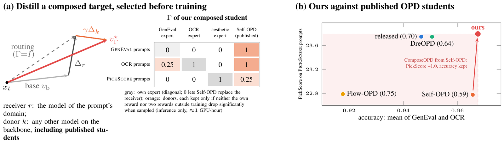
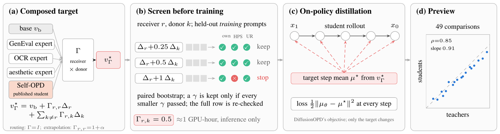
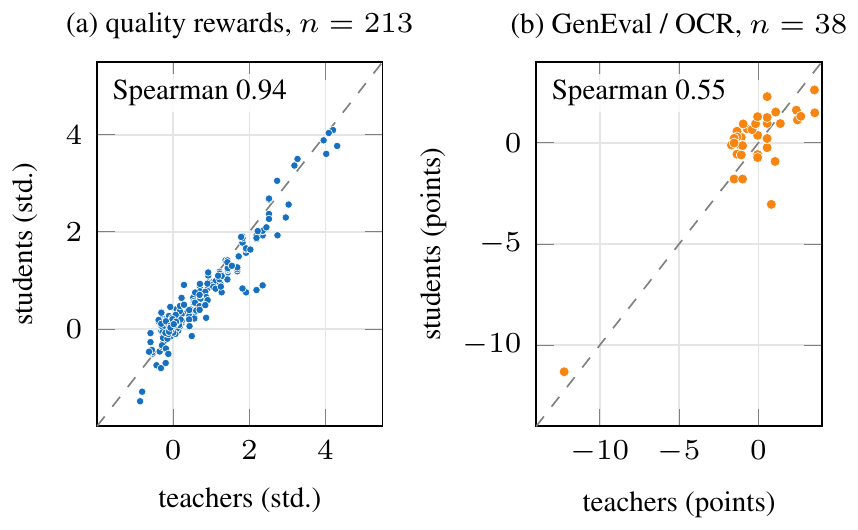

**Status:** Under review · **Code:** submitted with the paper; to be released

## Summary

Reward fine-tuning has left many models on one diffusion backbone, from single-reward experts to published distilled
students, each strongest on a different kind of prompt. On-policy distillation (OPD) usually routes each prompt to one of
them, so their strengths never combine. **ComposeOPD** distills a composed target instead, the receiver's velocity plus
weighted velocity deltas of every other model, and chooses the weights Γ before any training: a student learns to
reproduce its target, so sampling the composed target previews the student. Composed from Self-OPD and the DiffusionOPD
teachers, our student matches or exceeds four published OPD students on all three in-domain scores.

## Key results

{: .align-center}

**Figure 1.** (a) The student regresses onto the base velocity plus the receiver's delta plus weighted donor deltas;
routing is Γ = I. (b) Published OPD students trade accuracy against preference, and ours lies above and to the right of
all four. In parentheses: how often a VLM judge, used neither in training nor in selection, prefers ours.

{: .align-center}

**Figure 2.** Every model on the backbone contributes a velocity delta, weighted per prompt domain by Γ (a). Before
training, a probe samples the composed teacher and keeps a donor weight only if the receiver's own reward, HPSv2.1 and
UnifiedReward all stay within noise (b). The student then regresses each rollout step onto the composed target (c).

{: .align-center}

**Figure 5.** What the probe measures on a composed teacher tracks the student trained toward it: Spearman 0.94 over
213 image-quality cells and 0.85 over all 49 comparisons, and 0.98 on eight compositions trained only after the rule was
fixed. Accuracy changes mostly sit within the noise of a 128-prompt probe.

**Table 2. Probe-selected composition minus routing (test prompts, 3 seeds).**

| Setting | GenEval | OCR | PickScore (in-domain) | PickScore, GenEval prompts | PickScore, OCR prompts | Judge win rate |
|---|---|---|---|---|---|---|
| Setting 1, from scratch | +0.002 | +0.004 | **+0.127** | **+0.347** | **+0.975** | **0.678** |
| Setting 2, fine-tuned | +0.002 | +0.003 | −0.006 | **+0.461** | **+0.152** | **0.626** |
| Setting 2, from scratch (300 updates) | +0.003 | −0.002 | **−0.021** | **+0.449** | **+0.065** | **0.627** |
| Setting 2, from scratch (1000 updates) | +0.010 | −0.003 | +0.002 | **+0.500** | **+0.108** | **0.622** |

Composition lifts image quality on the other domains' prompts in every setting, and the 95% intervals exclude GenEval or
OCR losses above 1.5 points (bold: the interval excludes 0, or 0.5 for the judge).

**Table 4. All models under one protocol (test prompts, means).**

| Model | GenEval | OCR | PickScore | PickScore, OCR prompts | HPSv2.1, DrawBench |
|---|---|---|---|---|---|
| DiffusionOPD student | 0.944 | 0.949 | 23.75 | 22.36 | 0.338 |
| Self-OPD | **0.981** | 0.950 | 22.78 | **24.46** | 0.316 |
| DreOPD | 0.957 | 0.944 | 23.75 | 22.21 | **0.349** |
| Flow-OPD | 0.901 | 0.934 | 22.79 | 23.31 | 0.306 |
| **ComposeOPD (ours)** | 0.973 | **0.962** | **23.79** | 23.97 | 0.338 |

Each published student leads somewhere and trails elsewhere; ours is among the top two in every column of the paper's
table, and no published model is (bold: highest).

{: .align-center}

**Figure 6.** Columns: the DiffusionOPD student, DreOPD, Flow-OPD, Self-OPD and ours (framed); rows: GenEval, OCR,
PickScore and DrawBench prompts. The requested text on the OCR prompt is partly hidden for the DiffusionOPD student and
DreOPD and complete for the other three.

## Interactive demo

Replay the inference-only screen on the paper's probe tables, sweep the composition strength of composed teachers, filter
the 262 teacher-versus-student cells behind Figure 5, and compare the five models on any two metrics.

<iframe src="/files/projects/2026-11-composeopd/demo/index.html" width="100%" height="720" loading="lazy" title="ComposeOPD interactive demo" style="border:1px solid #e1e4e8;border-radius:8px"></iframe>

## Links and citation

- **Paper:** under review; the PDF and code will be linked here after review.

"ComposeOPD: Composing Diffusion Teachers and Published Students, Screened Before Training." Manuscript under review, 2026.
