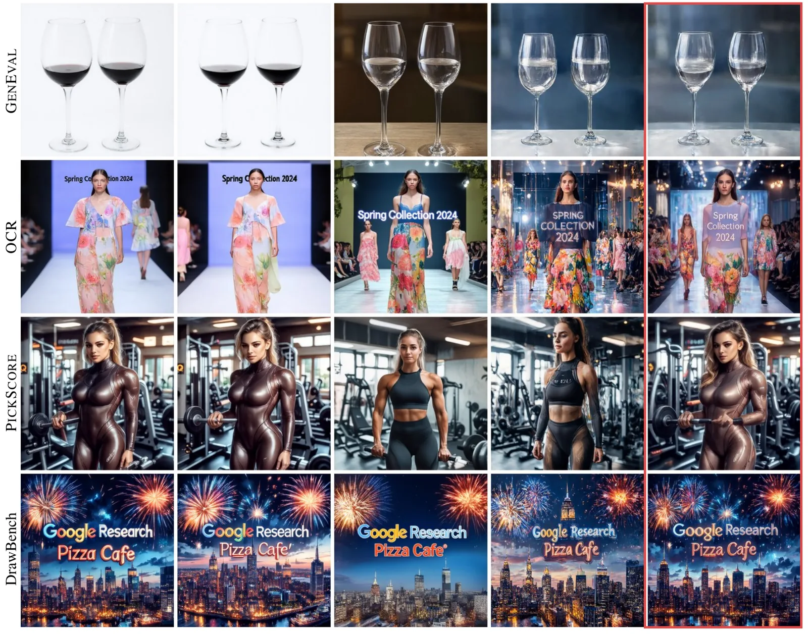

  
Distill every model on a diffusion backbone into one student, and <em>pick the mix before training</em>.

  
Under review · 2026On-policy distillationSD3.5-Medium

  

    <a class="pill" href="#try-the-screen"><svg viewBox="0 0 16 16"><path d="M4 2.5v11l9-5.5z"/></svg>Try the screen</a>
    <a class="pill" href="#visual-comparison"><svg viewBox="0 0 16 16"><path d="M1 3h6v10H1zM9 3h6v10H9z"/></svg>Compare samples</a>
    <a class="pill" href="#results"><svg viewBox="0 0 16 16"><path d="M2 13h12v1H2zM3 8h2v4H3zM7 5h2v7H7zM11 2h2v10h-2z"/></svg>Results</a>
    <svg viewBox="0 0 16 16"><path d="M3 1h7l3 3v11H3zM9 2v3h3"/></svg>Paper · after review
    <svg viewBox="0 0 16 16"><path d="M5.5 4 1.5 8l4 4 1-1-3-3 3-3zm5 0-1 1 3 3-3 3 1 1 4-4z"/></svg>Code · after review
  

  

  
<b>Figure 1.</b> (a) The student regresses onto the base velocity plus the receiver's delta plus weighted donor deltas;
  routing is Γ = I. (b) Published OPD students trade accuracy against preference; ours lies above and to the right of all four.
  In parentheses: how often a VLM judge, used neither in training nor in selection, prefers ours.

  

0.85 / 0.98

rank correlation between composed teachers and trained students (49 comparisons / prospective test)

  

≈1 GPU-hour

to screen one donor for all three receivers, against ≈8.5 to fine-tune and evaluate one candidate

  

11 / 12

in-domain comparisons with four published OPD students significantly higher; none lower

  

0.59–0.75

VLM-judge win rate of ours against each published student

TL;DR
Reward fine-tuning has left many models on one diffusion backbone, from single-reward experts to published distilled
students, each strongest on a different kind of prompt. On-policy distillation (OPD) usually routes each prompt to one of them, so their
strengths never combine. <b>ComposeOPD</b> distills a composed target instead, the receiver's velocity plus weighted velocity deltas of every
other model, and chooses the weights Γ before any training: a student learns to reproduce its target, so sampling the composed target
previews the student. Composed from Self-OPD and the DiffusionOPD teachers, our student matches or exceeds four published OPD students on all
three in-domain scores.

<h2 class="sec" id="method">How it works</h2>

One composed target, one inference-only screen, then standard on-policy distillation.

  
1<h4>Compose</h4>
Every model on the backbone contributes a velocity delta, weighted per prompt domain by a receiver-by-donor matrix Γ.
  Routing, task arithmetic, convex mixing and extrapolation are special cases, and published students enter without their data or rewards.

  
2<h4>Screen before training</h4>
Sample the composed teacher on held-out training prompts and keep a donor weight only if the
  receiver's own reward, HPSv2.1 and UnifiedReward all stay within noise, with every smaller weight passing too.

  
3<h4>Distill</h4>
Roll out the student on-policy and regress each step mean onto the composed target, with DiffusionOPD's objective;
  only the target changes.

<b>Figure 2.</b> ComposeOPD: (a) the composed target, (b) the screen before training, (c) on-policy distillation onto the
target, and (d) the preview of the trained students by the composed teachers.

<h3 class="sec3" id="try-the-screen">Try the screen</h3>

Algorithm 1 replayed on the paper's probe tables: each donor is added to the receiver's own model at γ = 0.25, 0.5 and 1 on 128 held-out
training prompts; a γ is harmful if a check is significantly lower (90% interval), and kept only if every smaller γ also passed.

  
Teachers

  
Receiver

  

Selected Γ

    
Rows: receivers; columns: donors.

  

<h2 class="sec" id="results">Results</h2>

The composed teacher previews the student, composition lifts image quality across domains, and composing published students
combines their strengths.

<h3 class="sec3" id="composition-strength">Composition strength at inference</h3>

Composed teachers sampled before any training (setting 1, 512 test prompts per domain). A symmetric gate gives every donor the same
weight γ: γ = 0 is routing and γ = 1 the plain additive target.

  
Target

  
<table class="mini" id="cpd-inf-table"></table>

  

<h3 class="sec3" id="preview">The teacher previews the student</h3>

  
Metrics

  
Family

  

  

  

<b>Figure 5, interactive.</b> Each point is one metric of one change of Γ, measured on composed teachers (training prompts, inference
only) against the same change in the trained students (test prompts); hover for details, click the chips to filter. Image quality is previewed
closely (Spearman 0.94 over 213 cells, 0.85 over all 49 comparisons, 0.98 on eight compositions trained after the rule was fixed); accuracy
changes mostly sit within the noise of a 128-prompt probe.

Table 2. Probe-selected composition minus routing (test prompts, 3 seeds)

| Setting | GenEval | OCR | PickScore (in-domain) | PickScore, GenEval prompts | PickScore, OCR prompts | Judge win rate |
|---|---|---|---|---|---|---|
| Setting 1, from scratch | +0.002 | +0.004 | **+0.127** | **+0.347** | **+0.975** | **0.678** |
| Setting 2, fine-tuned | +0.002 | +0.003 | −0.006 | **+0.461** | **+0.152** | **0.626** |
| Setting 2, from scratch (300 updates) | +0.003 | −0.002 | **−0.021** | **+0.449** | **+0.065** | **0.627** |
| Setting 2, from scratch (1000 updates) | +0.010 | −0.003 | +0.002 | **+0.500** | **+0.108** | **0.622** |

Composition lifts image quality on the other domains' prompts in every setting, and the 95% intervals exclude GenEval or OCR
losses above 1.5 points (bold: the interval excludes 0, or 0.5 for the judge).

Table 4. All models under one protocol (test prompts, means)

| Model | GenEval | OCR | PickScore | PickScore, OCR prompts | HPSv2.1, DrawBench |
|---|---|---|---|---|---|
| DiffusionOPD student | 0.944 | 0.949 | 23.75 | 22.36 | 0.338 |
| Self-OPD | **0.981** | 0.950 | 22.78 | **24.46** | 0.316 |
| DreOPD | 0.957 | 0.944 | 23.75 | 22.21 | **0.349** |
| Flow-OPD | 0.901 | 0.934 | 22.79 | 23.31 | 0.306 |
| **ComposeOPD (ours)** | 0.973 | **0.962** | **23.79** | 23.97 | 0.338 |

Each published student leads somewhere and trails elsewhere; ours is among the top two in every column of the paper's table,
and no published model is (bold: highest).

  
x axis<select id="cpd-mx" aria-label="x axis"></select>y axis<select id="cpd-my" aria-label="y axis"></select>

  

  

Pick any two metrics of Table 4: published students trade one domain against another. Hover a model for the VLM judge's preference.

<h2 class="sec" id="visual-comparison">Visual comparison</h2>

Unselected samples: the first prompt of each test set, with the same initial noise for every model. Drag the slider to compare
ours with a published student.

  
Prompt

  
Compare

  

    
    

⇆

    ComposeOPD (ours)
  

  

The requested text on the OCR prompt is partly hidden for the DiffusionOPD student and DreOPD and complete for Flow-OPD,
Self-OPD and ours. Figure 6 in the paper shows all five models side by side:

<b>Figure 6.</b> Columns: the DiffusionOPD student, DreOPD, Flow-OPD, Self-OPD and ours (framed); rows: GenEval, OCR, PickScore
and DrawBench prompts.

<h2 class="sec" id="citation">Citation</h2>

The paper is under review; the PDF and code will be linked here after review.

<button type="button" id="cpd-copy">Copy</button>"ComposeOPD: Composing Diffusion Teachers and Published Students, Screened Before Training." Manuscript under review, 2026.

