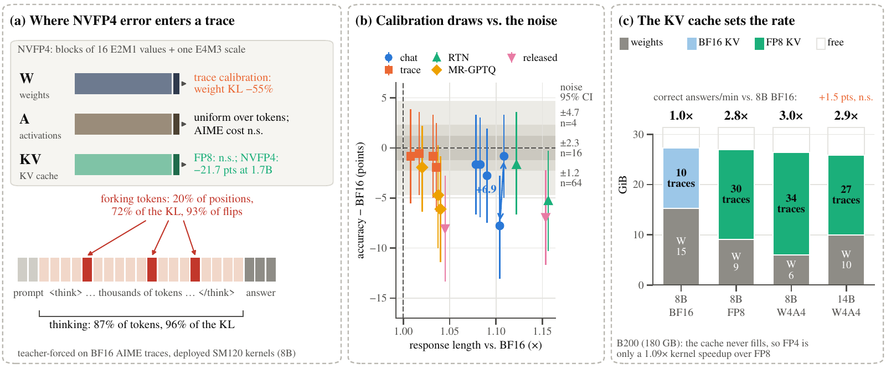
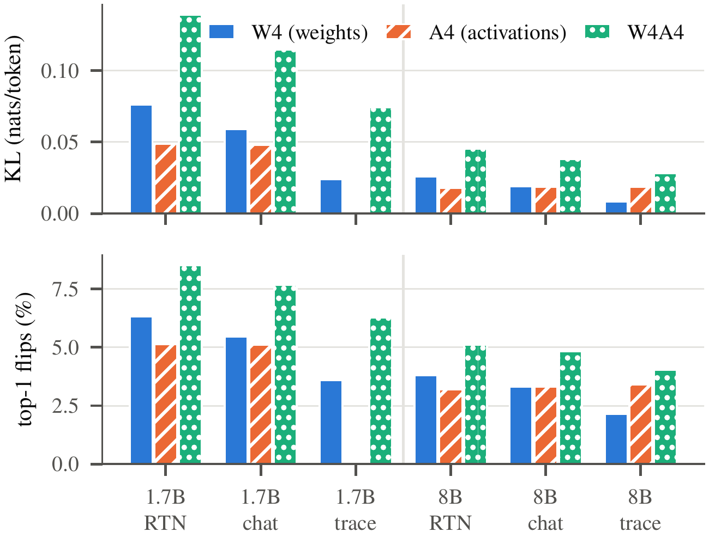
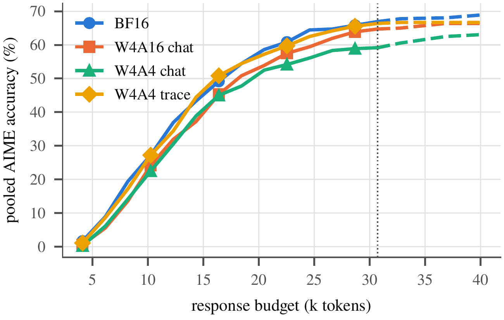
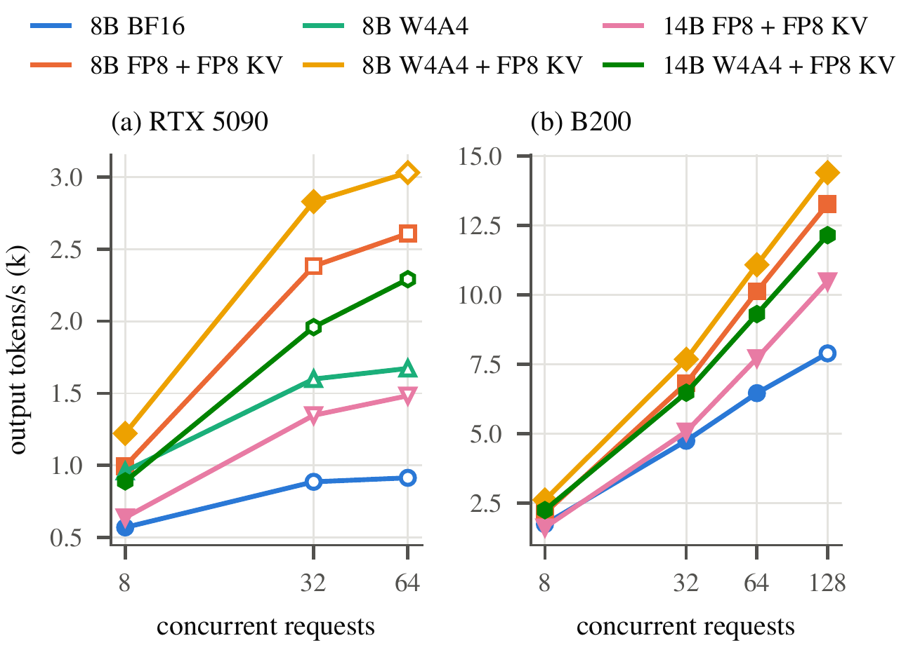

Under reviewLLM quantizationReasoning modelsNVFP4 on BlackwellMeasurement study

Blackwell GPUs run 4-bit floating point (NVFP4) natively. We measure what it costs reasoning models that write tens of thousands of
tokens per answer, with enough repeated runs to tell an effect from noise. <b>What holds up is about trace length and memory, not accuracy</b>: calibrating on
reasoning traces removes most of the extra length that 4-bit weights add, and on a 32&nbsp;GB card the KV cache, not the weight format, sets the serving rate.

  <a class="fp4-btn" href="/files/fp4-long-reasoning.pdf"><i class="fa-solid fa-file-pdf" aria-hidden="true"></i> Paper (PDF)</a>
  <a class="fp4-btn fp4-btn--ghost" href="#the-measurement-problem">The noise</a>
  <a class="fp4-btn fp4-btn--ghost" href="#findings">Findings</a>
  <a class="fp4-btn fp4-btn--ghost" href="#serving-the-kv-cache-sets-the-rate">Serving</a>
  <a class="fp4-btn fp4-btn--ghost" href="#what-to-do">What to do</a>
  <a class="fp4-btn fp4-btn--ghost" href="#paper-and-citation"><i class="fa-solid fa-quote-right" aria-hidden="true"></i> BibTeX</a>

<figure class="fp4-fig" id="fp4-noise">
  

    
Samples per problem

    
Problems

  

  

    <svg class="fp4-chart" data-role="plot" role="group" aria-label="Accuracy change against response length for sixteen 4-bit checkpoints of Qwen3-8B, with the noise band of a paired comparison"></svg>
    

  

  

  

  <figcaption>Interactive<b class="fp4-title">Sixteen 4-bit checkpoints of one model, and how little of their spread is signal.</b>
  Each point is one W4A4 checkpoint of Qwen3-8B against the unquantized model on AIME 2024&ndash;2026, with its paired 95% interval (the data of the paper's
  Figure&nbsp;1b). The gray band is the difference a paired comparison can resolve; change the number of samples or problems to see it move. Horizontally the
  groups separate: every chat-calibrated checkpoint (blue) writes longer answers than every trace-calibrated one (orange). Vertically most of them sit inside
  the band, and the dotted line joins two runs of the <i>same</i> checkpoint that differ only in the sampling seed.</figcaption>
</figure>

  

&plusmn;4.7 pts

what a paired comparison resolves on 90 AIME problems with 4 samples each

  

6.9 pts

between two runs of one GPTQ checkpoint that differ only in the sampling seed

  

0.94&times;

the tokens of chat calibration after calibrating on reasoning traces, in every draw on both GPUs

  

1.09&times;

correct answers per minute from FP4 over FP8 weights at 8B; the FP8 KV cache under both about doubles the rate

## Background

A reasoning model answers a competition problem by first writing thousands to tens of thousands of tokens, so its serving cost is decode
cost: paid per generated token, and per byte of KV cache held while the trace grows. NVIDIA's Blackwell GPUs add tensor cores that multiply 4-bit
floating-point numbers directly, which promises several times the throughput of 16-bit inference on one card, or a larger model in the same memory. Three
questions were open: whether a reasoning model keeps its accuracy at 4 bits, which part of the error matters, and what each fix costs when serving.

  
<b>NVFP4</b>A 4-bit floating-point format: values with magnitudes 0, 0.5, 1, 1.5, 2, 3, 4 or 6, stored in blocks of 16 that share
    one 8-bit scale, plus one scale per tensor. Blackwell GPUs (RTX 50 series, B200) multiply it natively.

  
<b>W4A4, W4A16, FP8, BF16</b>W4A4 stores weights and activations in NVFP4; W4A16 only the weights. FP8 is the 8-bit alternative
    (weights and activations), BF16 the unquantized 16-bit reference.

  
<b>GPTQ and calibration draws</b>GPTQ rounds the weights layer by layer so that each layer's output changes as little as possible on
    a small calibration set. A <i>draw</i> is one checkpoint made from one sample of calibration data; two draws of one recipe are two different checkpoints.

  
<b>Chat and trace calibration</b>Chat: 256 ordinary conversations (UltraChat), the usual choice. Trace: reasoning traces the model
    writes itself in thinking mode on training-set math problems, or public DeepSeek-R1 traces, at the same token budget.

  
<b>KV cache</b>The attention keys and values of every token of a request so far. A reasoning trace holds its whole context there for
    tens of thousands of steps, so cache memory limits how many traces decode at once. It can be stored in BF16, FP8 or NVFP4.

  
<b>AIME, and how differences are written</b>90 competition problems (AIME 2024&ndash;2026) on which Qwen3 writes 14&ndash;19k tokens
    per answer; 4 samples per problem, 16 for the decisive comparisons. &ldquo;&minus;2.6 [&minus;4.8, &minus;0.4]&rdquo; is a paired difference in accuracy
    points with its 95% interval.

  
<b>Teacher-forced error (KL)</b>The quantized model is replayed along traces the BF16 model wrote, with the rounding of
    the deployed kernels, and its next-token distribution is compared with BF16's at every position. This per-token divergence has no sampling noise, so it
    shows where the error enters; the end-to-end runs show whether it matters.

## The measurement problem

Quantization methods are usually ranked by one checkpoint each, on a benchmark of 30 problems a year with a handful of samples per
problem. On AIME this resolves about &plusmn;4.7 points even with three years pooled and paired comparisons, and single runs of one checkpoint differ by as
much as the published NVFP4 recipes differ from one another.

Table 1, excerpt **What moves a Qwen3-8B AIME result when nothing should.** Paired differences between runs that differ only in the factor named (RTX 5090, 4 samples per problem unless noted).

| Only this changed | Δ AIME [95% CI] |
|---|---|
| Sampling seed, one trace-calibrated checkpoint | −0.3 [−4.4, +3.9] |
| Sampling seed, chat-calibrated draw 1 | **+6.9 [+2.5, +11.7]** |
| Chat calibration draw (1 vs. 2), one run each | **+6.1 [+1.7, +10.6]** |
| … with both seeds of draw 1 | +2.6 [−1.2, +6.4] |
| … the same two checkpoints on the B200 | +1.1 [−3.6, +6.1] |
| RTN (two seeds) vs. NVIDIA ModelOpt | +3.5 [+0.1, +6.8] |
| … the same on the B200, 16 samples | −1.5 [−4.0, +0.8] |

<b>How to read it.</b> Every row compares runs that a single-run leaderboard would treat as the same thing, or as a clear win. The two
bold intervals exclude zero, and both came from one low run: a second seed of that checkpoint closed the gap. Beyond sampling, the spread between
calibration draws is small (standard deviation 2.5 points for chat with an upper bound of 8.4, and 0.0 for trace with an upper bound of 2.8).

## How the study measures

  
<b>Pair and pool</b>Every comparison is a per-problem difference, pooled over three AIME years and resampled over problems. A
    variance model gives the samples and problems a claim needs: &plusmn;4.7 points at 4 samples, &plusmn;2.3 at 16.

  
<b>Repeat the draw</b>A method is several calibration draws and seeds where we can make them (4 chat, 3 trace, 2 MR-GPTQ), and the
    decisive comparisons are rerun with 16 samples per problem on a second GPU.

  
<b>Every budget from one run</b>A sample that finishes within a token budget is generated identically under any larger cap, so one
    run gives exact accuracy at every budget. Samples that hit the cap are continued to 40,000 tokens.

  
<b>Bit-identical controls</b>The W4A4 and W4A16 trace checkpoints hold the same weights, tensor by tensor, so comparing them
    isolates activation quantization. KV formats are compared with a BF16 cache on the same attention kernel.

  
<b>Correct for many claims</b>Every claimed difference enters one of two Holm-corrected families (9 comparisons on the RTX 5090, 6
    on the B200). Claims of <i>no</i> difference come with the margin within which equivalence is shown.

  
<b>Deployed kernels</b>Everything runs in vLLM on the kernels a user gets: Qwen3-1.7B, 8B and 14B on an RTX 5090 (32 GB, SM120),
    replicated on a B200 (180 GB, SM100).

<figure class="fp4-fig">
  
  <figcaption>Figure 1<b class="fp4-title">The study at a glance.</b>(a) NVFP4 quantizes each layer's weights, its
  activations and, optionally, its KV cache; the divergence concentrates in the thinking segment and at its high-entropy &ldquo;forking&rdquo; tokens.
  (b) Every 8B W4A4 checkpoint against BF16, with the bands a paired comparison resolves at 4, 16 and 64 samples per problem. (c) Memory of the 32 GB
  RTX 5090 per configuration, the traces its cache holds, and the measured rate of correct answers relative to 8B BF16.</figcaption>
</figure>

## Findings

### 1. Calibration data decides which error dominates, and the activation error does not cost accuracy

<figure class="fp4-fig fp4-fig--narrow">
  
  <figcaption>Figure 2<b class="fp4-title">Trace calibration removes most of the weight error; the activation error stays.</b>
  Per-token divergence from BF16 (top) and changed top-1 tokens (bottom) with only the weights in 4 bits (W4), only the activations (A4), and both. With
  chat-calibrated GPTQ the two halves are equal at 8B (KL 0.018 each). Calibrating on reasoning traces cuts the weight part by 55% at 8B and 60% at 1.7B,
  after which activations carry 70% of the 8B divergence.</figcaption>
</figure>

The share does not predict the cost. On bit-identical weights, quantizing the activations changes 8B AIME accuracy by &minus;0.3
[&minus;2.8, +2.3] points over both GPUs, equivalent to none within 2.4. Activation error is also spread evenly over tokens: giving extra precision to the
10% of rows picked by any online score recovers 12&ndash;15% of it, no more than random rows (12%), so token-adaptive precision has nothing to target.

### 2. Reasoning traces as calibration data shorten the output; the accuracy gain stays inside the noise

Table 2, excerpt **Qwen3-8B on AIME 2024–2026, RTX 5090 (90 problems, 4 samples each).** Samples that hit the 30,720-token cap count as wrong.

| Configuration | AIME (%) | Δ to BF16 [95% CI] | Response tokens vs. BF16 |
|---|---:|---|---:|
| BF16 | 66.9 | – | 1.00× |
| FP8 (W8A8) | 64.4 | −2.5 [−7.5, +2.5] | 1.02× |
| W4A4, chat GPTQ, 4 draws pooled | 63.5 | −3.5 [−7.7, +0.6] | 1.09× |
| **W4A4, trace GPTQ, 3 draws pooled** | 65.8 | −1.1 [−4.9, +2.6] | **1.02×** |
| MR-GPTQ (published recipe) | 60.8 | −6.1 [−11.7, −0.8] | 1.04× |
| ISTA QAT (released checkpoint) | 58.9 | −8.1 [−13.6, −2.8] | 1.05× |
| NVIDIA ModelOpt (released checkpoint) | 60.0 | −6.9 [−11.9, −2.2] | 1.15× |

<b>How to read it.</b> The last column is measured precisely by one run; the Δ column is not. Trace over chat calibration is
+2.4 [−0.2, +5.1] points at 0.94× the tokens on the RTX 5090 and +1.8 [−1.1, +4.6] at 0.94× on the B200: the length effect appears in every draw on both
GPUs, the accuracy effect is not significant on either.

With enough samples the cost of 4-bit weights does show: over both GPUs' samples, trace-calibrated 8B W4A4 is &minus;2.6
[&minus;4.8, &minus;0.4] points from BF16, where FP8 with an FP8 cache is +0.2. The loss is in the weights (W4A16 with the same weights: &minus;2.6
[&minus;5.0, &minus;0.3]). What GPTQ needs to see is the model's thinking-mode text, from any domain: traces on programming problems shorten the output as
much as math traces, and public DeepSeek-R1 traces calibrate as well as the model's own. On a Llama-based distilled model, chat calibration adds no
measurable length, so the effect is not universal.

### 3. No published NVFP4 recipe beats trace-calibrated GPTQ

Section 5.5 **Trace GPTQ minus each published recipe, Qwen3-8B, AIME 2024–2026.** On the B200 every method runs on its native kernel.

| Trace GPTQ minus … | RTX 5090, 4 samples | Holm p | B200, 16 samples | Holm p |
|---|---|---:|---|---:|
| MR-GPTQ, FineWeb-Edu draws | +4.3 [+1.2, +7.4] | 0.047 | +3.1 [+0.4, +5.9] | 0.095 |
| ISTA QAT (released) | +6.9 [+2.9, +11.4] | **0.014** | +8.1 [+5.0, +11.3] | **< 0.001** |
| NVIDIA ModelOpt (released) | +5.8 [+2.3, +9.4] | **0.013** | +5.1 [+2.2, +8.1] | **0.004** |
| MR-GPTQ calibrated on our traces | +0.8 [−2.5, +4.6] | – | – | – |

<b>How to read it.</b> Positive means trace GPTQ is more accurate. Holm p is the p-value after correction over all the paper's claims of
a difference on that GPU; bold survives on both. The lead over MR-GPTQ survives on one GPU only, and it closes when MR-GPTQ is calibrated on the same
traces, so most of it is the calibration data. At 14B the two are equal (+0.3 [−2.0, +2.6], 16 samples).

Plain rounding (RTN) shows why single runs mislead. Its first four-sample run on the RTX 5090 placed it above every published recipe;
a second seed moved it by &minus;3.6 points, and with 16 samples on the B200 it trails trace GPTQ by 6.7 [3.8, 9.6].

### 4. The extra tokens go to trajectories that fail

<figure class="fp4-fig fp4-fig--narrow">
  
  <figcaption>Figure 4<b class="fp4-title">Accuracy at every token budget, Qwen3-8B.</b>Exact from one run up to the
  30,720-token cap (dotted line), and beyond it from continuing the truncated samples. Chat-calibrated W4A4 (draw 1) trails BF16 at every budget
  (&minus;5.3 at 8k, &minus;4.2 at 16k, &minus;7.8 at the cap), while trace GPTQ stays within +1.7 at 16k and &minus;0.6 at the cap.</figcaption>
</figure>

Continuing every truncated sample to 40,000 tokens leaves the gaps where they were (chat &minus;5.8, trace &minus;2.2). Continued
samples rarely end correct (99 of 962 over the quantized 8B configurations) and many of those still running at 40k repeat themselves, so a higher cap
only changes whether a failing trajectory counts as truncated or as wrong.

### 5. An FP8 KV cache costs nothing measurable; an NVFP4 cache has to be checked per model and per kernel

Sections 5.4, 6.5 **AIME change from quantizing only the KV cache**, against a BF16 cache on the same attention kernel (W4A4 trace-GPTQ weights).

| Model · cache format | RTX 5090 (SM120), 4 samples | B200 (SM100), 16 samples |
|---|---|---|
| Qwen3-8B · FP8 | +1.9 [−2.2, +6.1] | −1.0 [−3.3, +1.2], equivalent within 2.8 |
| Qwen3-8B · NVFP4 | −0.6 [−5.0, +3.9] | **−5.9 [−8.8, −3.2]** |
| Qwen3-1.7B · FP8 (AIME 2024) | +1.7 [−7.5, +10.8] | – |
| Qwen3-1.7B · NVFP4 (AIME 2024) | **−21.7 [−32.5, −11.7]** | – |

<b>How to read it.</b> Bold marks a loss whose interval excludes zero. The per-token error orders these cases in advance: an NVFP4
cache adds 0.023 nats per token at 8B, less than W4A4 itself (0.027), but 0.193 at 1.7B, more than twice W4A4's 0.078. The 1.7B outputs stay fluent while
their arithmetic and self-checks fail. On SM100, vLLM also quantizes the queries to FP8 whenever the cache is quantized, which is where the 8B loss
appears.

## Serving: the KV cache sets the rate

For long traces, kernel speed matters less than memory. A trace keeps its whole context in the KV cache, so on a 32 GB card the number
of traces the cache can hold sets how many decode at once. A four-quantity model captures it: a cache of <i>K</i> tokens holds
<i>C*</i>&nbsp;=&nbsp;<i>K</i>&nbsp;/&nbsp;(<i>p</i>&nbsp;+&nbsp;<i>L</i>/2) traces of final length <i>L</i> (with <i>p</i> prompt tokens); each decode
step streams the weights and the whole cache, so it takes &tau;&nbsp;=&nbsp;<i>M</i>/<i>B</i>&nbsp;+&nbsp;<i>g&thinsp;C*</i> for <i>M</i> bytes in use; the
card then produces <i>C*</i>/&tau; tokens per second, and 60&thinsp;(<i>C*</i>/&tau;)&thinsp;<i>a</i>/<i>L</i> correct answers per minute at accuracy
<i>a</i>. One fit of the bandwidth <i>B</i> (1,292 GB/s, 72% of the card's peak) and the per-sequence cost <i>g</i> (0.20 ms) predicts all 11
configurations within 5% on average, and the four 14B configurations within 7% when fitted on 8B alone.

<figure class="fp4-fig" id="fp4-capacity">
  

    
ConfigurationCard memory, of 30 GiB shownCorrect answers per minute

    

    

      <i class="fp4-swatch" style="background:#8a8a86"></i>weights (GiB)
      <i class="fp4-swatch" style="background:#6ea6de"></i>BF16 KV cache
      <i class="fp4-swatch" style="background:#12956a"></i>FP8 KV cache
      <i class="fp4-swatch" style="background:#7a5bd6"></i>NVFP4 KV cache
      <i class="fp4-swatch" style="background:#2a78d6"></i>measured rate
      <i class="fp4-swatch" style="background:#1f2933;width:2px"></i>capacity-model prediction
    

  

  

  <figcaption>Interactive<b class="fp4-title">Where the 32 GB go, and what that buys (Table 3).</b>AIME runs on the RTX 5090,
  years pooled; select a row to follow the capacity model through it. The colored segment is the memory left for the KV cache, labelled with the traces it
  holds at once. Halving the bytes per cached token (BF16 to FP8) doubles the traces and nearly doubles the rate. Shrinking the weights from FP8 to FP4
  frees only a few GiB at 8B: 34 traces instead of 30.</figcaption>
</figure>

Longer traces cost twice, in fewer concurrent traces and in more tokens per answer, so the rate falls with the square of the length:
the 6% longer traces of chat calibration cost about 12% of the rate before any accuracy loss. Once the cache is FP8, FP4 weights add 1.09&times; correct
answers per minute at 8B, and 1.05&times; at the accuracies measured over both GPUs, where W4A4 with an FP8 cache is &minus;3.9 [&minus;5.7, &minus;2.2]
points behind FP8 with an FP8 cache.

<figure class="fp4-fig fp4-fig--narrow">
  
  <figcaption>Figure 5<b class="fp4-title">Steady state at fixed concurrency.</b>Output tokens per second with 8, 32 or 64
  requests in flight (256 prompt and 8,192 output tokens each); hollow markers are levels at which the cache was full. On the RTX 5090 throughput flattens
  once the cache fills, and at 64 requests the ratios between configurations equal their cache-size ratios within 6%. On the B200 (180 GB) the cache never
  fills with an FP8 cache, so FP4 weights are only a kernel speedup: 1.09&times; over FP8 at 8B and 1.16&times; at 14B.</figcaption>
</figure>

<b>A larger model at the same rate is not more accurate.</b> FP4 weights matter where FP8 weights would crowd out the cache:
Qwen3-14B in NVFP4 with an FP8 cache runs at 1.04&times; the rate of 8B in FP8. But with 16 samples per problem its accuracy is +1.5 [&minus;1.1, +4.1]
points from that 8B configuration (Holm-adjusted p = 0.304), and +0.4 [&minus;2.3, +3.1] on the B200. In FP8 the 14B model leads 8B by +4.0 [+1.6, +6.6];
W4A4 costs it &minus;2.6 [&minus;4.6, &minus;0.6], most of that lead.

## What to do

<ul class="fp4-take">
  <li><b>Calibrate GPTQ on reasoning traces</b>, the model's own or public ones.Removes most of chat calibration's extra length on Qwen3 in every
    draw on both GPUs; the accuracy gain is within the noise.</li>
  <li><b>On a cache-bound card, always use an FP8 KV cache.</b>It doubles the traces held at once and is equivalent to a BF16 cache within 2.8
    points.</li>
  <li><b>Use W4A4, not W4A16, once batches reach 64.</b>W4A16 dequantizes in the kernel and computes in BF16: at batch 256 a decode step takes 23.9 ms
    against 26.3 for BF16 and 11.4 for W4A4.</li>
  <li><b>Skip residual activation rows on trace-calibrated weights.</b>Activation error is equivalent to none within 2.4 points; the rows add decode
    time (9.3 instead of 7.7 ms per step at batch 128).</li>
  <li class="fp4-take--check"><b>Turn on an NVFP4 KV cache only after checking it for the model and the kernel.</b>It collapses Qwen3-1.7B
    (&minus;21.7 points) and costs 8B 5.9 points on SM100, although it costs 8B nothing measurable on SM120.</li>
  <li class="fp4-take--check"><b>Choose FP4 weights to fit a larger model only if its lead exceeds its FP4 cost.</b>At 8B, FP4 is 3.9 points behind
    FP8 with an FP8 cache for 1.05&times; the rate; 14B in FP4 runs at the 8B FP8 rate but loses most of its AIME lead.</li>
  <li class="fp4-take--method"><b>Compare quantization methods over several draws, with at least 16 samples per problem, paired, and past the token
    cap.</b>Single four-sample runs have tails as large as the gaps between published recipes.</li>
</ul>

  <b>Limits of the study</b>
  <ul>
    <li><strong>Models and tasks.</strong> Qwen3 at three sizes, plus one Llama-based distilled model for calibration only. The end-to-end evaluation is
      competition mathematics, with GPQA-Diamond, IFEval and MMLU-Pro as checks in other domains; code generation is untested.</li>
    <li><strong>Capacity model.</strong> Fitted on one consumer GPU and assumes a full cache. It does not cover multi-GPU serving, prefix sharing or
      speculative decoding.</li>
    <li><strong>Resolution.</strong> With 30 problems a year, paired intervals stay several points wide even pooled. The 1.7B KV-cache results cover one
      year, and the released QAT and ModelOpt checkpoints are single checkpoints by construction.</li>
  </ul>

Abstract

Blackwell GPUs run NVFP4 natively, but reasoning models must stay accurate over tens of thousands of
generated tokens, and the single-checkpoint, single-benchmark comparisons that rank quantization methods are noisier than the gaps they report: on AIME, one
GPTQ checkpoint scores 6.9 points apart in two four-sample runs that differ only in the sampling seed, and at four samples per problem a paired comparison
over 90 problems resolves only &plusmn;4.7 points. We measure Qwen3-1.7B, 8B and 14B on the kernels vLLM deploys on an RTX 5090 (SM120) and a B200 (SM100),
with repeated calibration draws, paired tests and exact accuracy-versus-budget curves. The effects that hold up concern length and memory more than accuracy.
Calibrating GPTQ on reasoning traces removes most of the extra length that chat calibration adds to Qwen3, in every draw on both GPUs; no published NVFP4
recipe beats trace-calibrated GPTQ, and few accuracy differences between 8B FP4 checkpoints survive multiple-comparison correction. Even trace-calibrated, 8B
W4A4 is &minus;2.6 [&minus;4.8, &minus;0.4] points from BF16 over both GPUs' samples, where FP8 with an FP8 cache is +0.2, and the loss is in the weights:
activation error is uniform over tokens and, on trace-calibrated weights, equivalent to none within 2.4 points, as is an FP8 KV cache within 2.8, while NVFP4
KV collapses the 1.7B model, as its teacher-forced error predicts. On a 32 GB card long-trace serving is bound by KV-cache capacity, and a capacity model
built on it predicts the serving rate, also when fitted on 8B and applied to 14B. At 8B, FP4 weights give only 1.09&times; the correct answers per minute of
FP8 with an FP8 cache on the RTX 5090's samples and 1.05&times; at the accuracies of both GPUs, and Qwen3-14B, which FP4 fits at the rate of 8B, is no more
accurate on AIME, because W4A4 costs it most of its lead over 8B.

## Paper and citation

  <a class="fp4-btn" href="/files/fp4-long-reasoning.pdf"><i class="fa-solid fa-file-pdf" aria-hidden="true"></i> Paper (PDF)</a>
  <a class="fp4-btn fp4-btn--ghost" href="/files/bibtex/li2026fp4reasoning.bib"><i class="fa-solid fa-quote-right" aria-hidden="true"></i> BibTeX file</a>

The calibration traces, every raw sample and all scripts, including the planner that turns the noise model into sample sizes and the capacity model into
serving rates, will be released with the paper.

<button class="fp4-copy" type="button" data-target="fp4-bibtex">Copy</button>
<pre><code id="fp4-bibtex">@unpublished{li2026fp4reasoning,
  title  = {What {FP4} Costs Long Reasoning on {Blackwell}, Measured Above the Noise},
  author = {Li, Runguo},
  year   = {2026},
  note   = {Manuscript under review}
}</code></pre>

