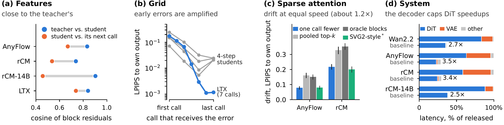

<p style="text-align:center;margin:0.4em 0 0.6em"><strong>Runguo Li</strong> · University of Illinois Urbana-Champaign</p>
<p style="text-align:center">
  <a class="btn" style="background:#1f2933;color:#fff;border:0;border-radius:999px;text-decoration:none;padding:0.5em 1.15em;margin:0.15em" href="/files/gmsa-distillation-acceleration.pdf"><i class="fas fa-file-pdf"></i> Paper</a>
  <a class="btn" style="background:#1f2933;color:#fff;border:0;border-radius:999px;text-decoration:none;padding:0.5em 1.15em;margin:0.15em" href="#videos"><i class="fas fa-film"></i> Videos</a>
  <a class="btn" style="background:#1f2933;color:#fff;border:0;border-radius:999px;text-decoration:none;padding:0.5em 1.15em;margin:0.15em" href="#key-findings"><i class="fas fa-chart-bar"></i> Findings</a>
  <a class="btn" style="background:#1f2933;color:#fff;border:0;border-radius:999px;text-decoration:none;padding:0.5em 1.15em;margin:0.15em" href="#bibtex"><i class="fas fa-quote-right"></i> BibTeX</a>
</p>

**TL;DR.** Distilled video models keep their teachers' features; what changes is the few wide sampling steps and the system
around the network. Tricks tuned on the teacher therefore misfire on the student, and a few GPU-minutes of measurement on the
student itself do better: they pick the right step to skip and guide a **2.5–3.5×** end-to-end speedup.
{: .notice--info}

{: .align-center style="max-width:640px;width:100%"}

**Figure 2.** StudentProbe in three parts: (1) compare each student with its own teacher on the same states, (2) probe a new
student in minutes, (3) build a faster baseline from what the probe finds.

<link rel="stylesheet" href="/files/projects/2026-11-gmsa-distillation/demo/explore.css">

## Overview

**The setting.** Video generators are now shipped as *distilled students*: models trained to imitate a slow *teacher* that
needs 30–50 denoising steps, while producing a clip in only 4–7 network calls. To make them faster still without retraining,
people reuse *training-free accelerators*: feature caches that skip a call when little seems to change, sparse attention, and
quantization.

**The problem.** All of these accelerators were designed and tuned on the many-step teachers. Whether they still work after
distillation has been assumed rather than measured, and several papers conclude that distillation leaves little redundancy or sparsity to exploit.

**What StudentProbe does.** It measures each student against its own teacher under controlled conditions: at the same noise
level, on the states the student actually visits, and on one GPU type. The study covers six students from three model families
(Wan2.1, LTX-Video, FLUX.2-klein). Predictions were written down before the tests on a held-out family, model scale, prompt
set and GPU, and the paper reports every outcome.

**Reading the numbers.** *LPIPS* (drift, fidelity cost) is the perceptual distance between an accelerated video and the
unaccelerated video of the same prompt and seed; lower means closer. *Δ aesthetics* is the change in a reference-free quality
score; bold marks a change whose 95% confidence interval excludes zero. Low drift and preserved quality are not the same thing.
{: .notice}

## Videos

Released student (left) against the StudentProbe-guided baseline (right): two calls, a lightweight decoder and compilation.
Same prompt and seed; times are seconds per video on one PRO6000 BW.

<div class="sp-pills" id="sp-vb-pills"></div>
<div class="sp-video" id="sp-vb">
  <video autoplay muted loop playsinline controls preload="metadata"></video>
  <div class="sp-video-labels"><span></span><span></span></div>
</div>
<p class="sp-note sp-center" id="sp-vb-note"></p>

For each student, the clip is the held-out prompt whose drift is closest to the median, not one chosen by appearance.

## Key findings

[{: .align-center}](/images/projects/2026-11-gmsa-distillation/fig1-at-a-glance.png)

**Figure 1.** The four findings at a glance: (a) features stay close to the teacher's, (b) early errors are amplified,
(c) sparse attention drifts further than running one call fewer, (d) the decoder caps any DiT speedup.

### 1. Students keep their teachers' features

At the same noise level, a student's attention is as concentrated as its teacher's (within 0.018 in all three families). Fed
the same input, a student's features are closer to its teacher's than to its own features one call later (Fig. 1a). The
network changed little; what changed is the path it takes.

{: .align-center style="max-width:620px;width:100%"}

**Figure 3.** Share of attention held by the top 10% of keys. Teacher and student curves coincide at matched noise level,
including the held-out LTX-Video pair, so distillation leaves intact the concentration that sparse attention exploits.

### 2. A few wide steps amplify early errors

A student covers the whole denoising path in a handful of wide steps. Run on a 50-step grid with the same weights, AnyFlow is
as redundant between steps as its teacher, so the lost redundancy comes from the step size. The wide steps also amplify
errors made early: on LTX-Video, the same small error moves the final video by LPIPS 0.114 at the first call and by 0.003 or
less from the fourth call on (Fig. 1b). An accelerator that only looks at how much a feature changes locally cannot see this.

### 3. Teacher-calibrated caches skip the wrong call

A step cache skips a network call when its signal says little has changed. Each bar below is the measured cost of skipping
one call on the student; the line is the signal FBCache uses. Pick a student and hover over a bar for its values.

<div class="sp-pills" id="sp-skip-pills"></div>
<div class="sp-figure">
  <div class="sp-legend"><span><span class="sp-sw" style="background:#b9c4d0"></span>cost of skipping the call (LPIPS)</span><span><span class="sp-sw" style="background:#eb6834"></span>skip lowers aesthetics</span><span><span class="sp-sw" style="background:#2a78d6"></span>FBCache signal (it skips the lowest first)</span></div>
  <svg id="sp-skip-svg" viewBox="0 0 600 300" role="img" aria-label="Fidelity cost of each skipped call and FBCache's signal"></svg>
</div>
<p class="sp-note" id="sp-skip-note"></p>

**Figure 4 (interactive).** The names mark the call each method skips. The cache signal follows the cost on the image student
but inverts it on LTX-Video and on rCM.

**Table 3. StudentProbe's measured skip against FBCache tuned on each student (66 held-out videos).**

| Student | StudentProbe skips | LPIPS ↓ | Δ aesthetics | FBCache skips | LPIPS ↓ | Δ aesthetics |
|---|---|---|---|---|---|---|
| AnyFlow | call 2 | .074 | −.015 | call 2 (57 of 66 videos) | .069 | **−.058** |
| rCM | call 2 | .284 | −.054 | call 3 | .300 | **−.555** |
| LTX-Video (held out) | call 6 | **.009** | **+.055** | call 3 | .117 | +.029 |

Even with its threshold tuned on the student, FBCache drifts 13× as far on LTX-Video and lowers aesthetics on AnyFlow and
rCM. TeaCache, tuned the same way, skips AnyFlow's first call at almost three times the drift.

What these skips look like, same prompt and seed:

<div class="sp-pills" id="sp-vs-pills"></div>
<div class="sp-video" id="sp-vs">
  <video autoplay muted loop playsinline controls preload="metadata"></video>
  <div class="sp-video-labels"><span></span><span></span></div>
</div>
<p class="sp-note sp-center" id="sp-vs-note"></p>

### 4. Sparse attention loses to one call fewer

Because students keep their attention concentration, sparse attention should transfer. At equal measured speed (about 1.2×),
block-sparse attention over position blocks still drifts 1.6–2× as far as simply running one call fewer, even when an oracle
picks the blocks (Fig. 1c). With four calls, each call carries a large share of the denoising, so dropping a call the student
was trained to support costs less than approximating every remaining call. A semantic-aware selector closes the gap in drift
under an ideal kernel, which makes it the promising direction.

### 5. The decoder caps the gain

A video is produced in three stages: a text encoder, the DiT denoiser (run once per call) and a VAE decoder that turns
latents into frames. With only four DiT calls, the decoder takes 26–35% of a 1.3B student's time, against 3% for the teacher.
Move the slider to speed up the DiT and see where the end-to-end gain stops.

<div class="sp-pills" id="sp-speed-pills"></div>
<div class="sp-figure">
  <div class="sp-legend"><span><span class="sp-sw" style="background:#2a78d6"></span>DiT</span><span><span class="sp-sw" style="background:#eb6834"></span>VAE decoder</span><span><span class="sp-sw" style="background:#b9c4d0"></span>text encoder and other</span></div>
  <div class="sp-lane" id="sp-lane-0"><span>as released</span><div class="sp-stack"><span></span><span></span><span></span></div><b></b></div>
  <div class="sp-lane" id="sp-lane-1"><span>accelerated</span><div class="sp-stack"><span></span><span></span><span></span></div><b></b></div>
  <div class="sp-controls">
    <label for="sp-dit">DiT speedup: <b id="sp-dit-v"></b></label>
    <input id="sp-dit" type="range" min="1" max="10" step="0.05" value="2">
    <label><input id="sp-light" type="checkbox"> use the released lightweight decoder</label>
    <span><button type="button" class="sp-pill" id="sp-preset">Show the StudentProbe-guided baseline</button></span>
  </div>
  <p class="sp-result" id="sp-speed-result"></p>
</div>

**Figure 1d (interactive).** Measured latency split per video on one PRO6000 BW. Replacing the decoder moves the ceiling;
speeding up the DiT alone does not.

## StudentProbe on a new student

Three measurements on the student replace teacher-side calibration:

1. **Latency split.** Time the text encoder, DiT and decoder once. Amdahl's law then predicts the end-to-end speedup of any
   accelerator before it is run; predictions fell within 5% on the held-out family, at 14B and on two other GPUs.
2. **Skip sweep.** Skip each call in turn on 8 prompts (0.6–6.9 GPU-minutes) and pick the lowest-drift call, then confirm
   quality on 30 prompts and move to the next call if a score falls. The sweep orders 22 of 23 call pairs as the full
   evaluation does; the whole calibration takes under half an hour.
3. **Kernel speed.** Time the sparse-attention kernel at the student's attention shape to see whether sparsity can pay at all.

Guided by these, a baseline built only from released components (two calls, a lightweight decoder, block-wise compilation)
reaches 2.5–3.5× end to end:

**Table 4. StudentProbe-guided baseline against each released student (PRO6000 BW, 66 held-out videos).**

| Student | Speedup | Predicted by the probe | LPIPS |
|---|---|---|---|
| Wan2.2 A14B | 2.69× | 2.67× | .414 |
| AnyFlow | 3.45× | 3.46× | .256 |
| rCM | 3.36× | 3.33× | .288 |
| rCM-14B (held out) | 2.52× | 2.50× | .260 |

Every measured speedup is within 1% of the probe's prediction. The speed comes at a measured cost in motion on all four
students and in aesthetics on three; smoothness and flickering improve. It is a reference point for future accelerators:
a method for students should beat one call fewer, not the teacher's redundancy.

<script src="/files/projects/2026-11-gmsa-distillation/demo/explore.js"></script>
<script>
  /* keep the long title clear of the fixed table of contents on 1200-1500 px screens */
  (function () {
    function fit() {
      var t = document.querySelector(".page__title"), toc = document.getElementById("toc-sidebar");
      if (!t || !toc) return;
      var r = toc.getBoundingClientRect();
      t.style.maxWidth = (r.width && getComputedStyle(toc).display !== "none")
        ? Math.max(320, r.left - t.getBoundingClientRect().left - 24) + "px" : "";
    }
    window.addEventListener("load", fit); window.addEventListener("resize", fit); fit();
  })();
</script>

## Links and citation
{: #bibtex}

- **Paper:** [PDF](/files/gmsa-distillation-acceleration.pdf), with the supplementary material
- **BibTeX:** [li2026gmsa.bib](/files/bibtex/li2026gmsa.bib)
- **Code:** the measurement code and the full registration record will be released with the paper.


```bibtex
@unpublished{li2026gmsa,
  title  = {{StudentProbe}: What Survives Distillation in Training-Free Video Diffusion Acceleration},
  author = {Li, Runguo},
  year   = {2026},
  note   = {Preprint}
}
```

