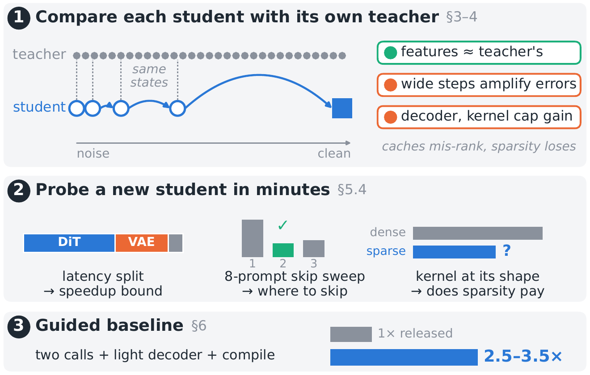
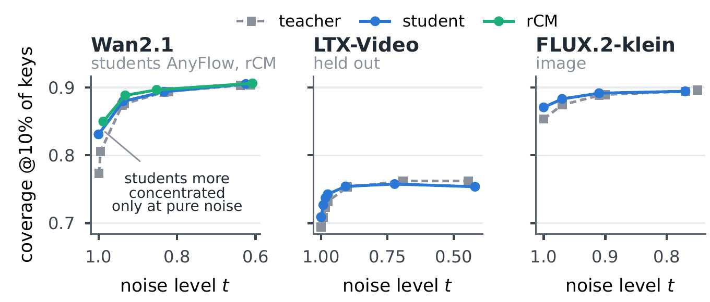
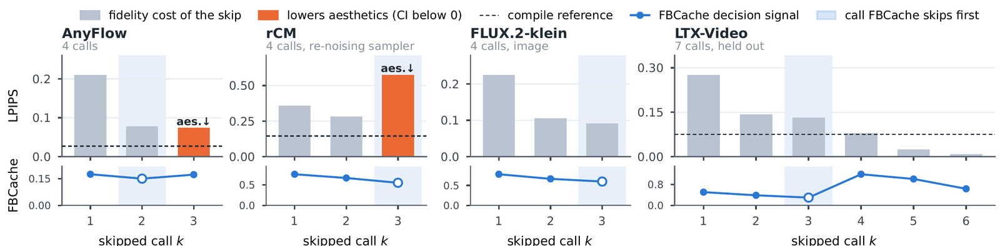

**Status:** Preprint, under review · **PDF:** [Download](/files/gmsa-distillation-acceleration.pdf) · **BibTeX:** [li2026gmsa.bib](/files/bibtex/li2026gmsa.bib)

## Summary

Video generation is served by distilled students that produce a clip in 4–7 network calls, yet the training-free
accelerators deployed on them were calibrated on 30–50-step teachers. **StudentProbe** measures each student against its
own teacher at matched noise level, on the states the student visits and on one GPU type, with predictions registered
before held-out tests on a new family, scale, prompt set and GPU. Students keep their teachers' attention concentration
and features; the few wide steps amplify early errors and the decoder caps the gain, which is why teacher-calibrated
caches skip the wrong calls. A few minutes of measurement on the student replaces teacher-side calibration, and released
components guided by it reach **2.5–3.5×** end to end on four students.

## Key results

{: .align-center}

**Figure 2.** StudentProbe has three parts. A controlled teacher–student comparison on the same states, a minutes-long
probe of a new student, and the baseline that the two guide.

{: .align-center}

**Figure 1.** On the same states, a student's block residuals are closer to its teacher's than to its own next call (a).
A small error at an early call moves the output the most (b). Position-block sparse attention drifts further than simply
running one call fewer at equal speed (c), and the decoder bounds any DiT accelerator (d).

{: .align-center}

**Figure 3.** At matched noise level, teacher and student attention is equally concentrated in all three families,
including the held-out LTX-Video pair. Distillation leaves intact the concentration that sparse attention exploits.

**Table 3. StudentProbe's measured skip vs FBCache and TeaCache tuned on each student (66 held-out videos).**

| Student | Method | Call skipped | LPIPS ↓ | Δ aesthetics |
|---|---|---|---|---|
| AnyFlow | **StudentProbe** | 2 | .074 | −.015 |
| AnyFlow | FBCache | 2 (57 of 66 videos) | .069 | **−.058** |
| rCM | **StudentProbe** | 2 | .284 | −.054 |
| rCM | FBCache | 3 | .300 | **−.555** |
| LTX-Video (held out) | **StudentProbe** | 6 | .009 | **+.055** |
| LTX-Video (held out) | FBCache | 3 | .117 | +.029 |

Even when tuned on the student, FBCache drifts 13× as far on LTX-Video and lowers aesthetics on AnyFlow and rCM; the
measured skip shows no significant decline on any student (bold: 95% CI excludes 0).

{: .align-center}

**Figure 4.** The cache signal tracks the fidelity cost on the image student but inverts it on the held-out LTX-Video
student and on rCM. The shaded call is the one FBCache skips first.

**Table 4. Two calls + lightweight decoder + block-wise compilation (PRO6000 BW, 66 held-out videos).**

| Student | Speedup | Predicted | LPIPS |
|---|---|---|---|
| Wan2.2 A14B | 2.69× | 2.67× | .414 |
| AnyFlow | 3.45× | 3.46× | .256 |
| rCM | 3.36× | 3.33× | .288 |
| rCM-14B (held out) | 2.52× | 2.50× | .260 |

The probe predicts each end-to-end speedup within 1% from separately timed parts. The paper reports the full quality
trade-off, measured on untouched prompts.

## Interactive demo

Pick a student to see where it can skip, compare the latency split with any DiT speedup, and view the frames behind Fig. 5.

<iframe src="/files/projects/2026-11-gmsa-distillation/demo/index.html" width="100%" height="640" loading="lazy" title="StudentProbe interactive demo" style="border:1px solid #e1e4e8;border-radius:8px"></iframe>

## Links and citation

- **PDF:** [Download](/files/gmsa-distillation-acceleration.pdf)
- **BibTeX:** [li2026gmsa.bib](/files/bibtex/li2026gmsa.bib)

Runguo Li. (2026). "StudentProbe: What Survives Distillation in Training-Free Video Diffusion Acceleration." Preprint, under review.
