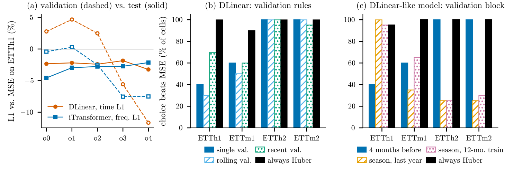

<section class="hl-hero" aria-label="Overview">
  
In preparationTime-series forecasting · Training losses · Analysis

  
The L1 norm, not <s>decorrelation</s>

  
Horizon-aware forecasting losses help because of the norm they use, not because of the basis they move to.

  
FreDF, Time-o1 and QDF replace the mean squared error (MSE) in direct multi-step forecasting, on the argument that correlation among the future values biases it. We re-ran their official code and wrote each loss as a <strong>transform</strong> of the forecast error followed by a <strong>norm</strong>. With an L2 norm, every transform we tried matches or trails the MSE. With an L1 norm, the gains appear in every basis, and at a lookback of 96 they are much larger, on most datasets, for models that do not normalize their input windows.

  

    <a class="hl-btn primary" href="#l2-is-the-mse"><svg width="13" height="13" viewBox="0 0 13 13" aria-hidden="true"><circle cx="3" cy="9.5" r="1.7" fill="currentColor"/><circle cx="6.5" cy="5.5" r="1.7" fill="currentColor"/><circle cx="10.5" cy="3" r="1.7" fill="currentColor"/></svg>Explore the results</a>
    <a class="hl-btn ghost" href="#predictions"><svg width="13" height="13" viewBox="0 0 13 13" aria-hidden="true"><path d="M2 6.8l3 3 6-6.6" fill="none" stroke="currentColor" stroke-width="1.6"/></svg>Predictions and outcomes</a>
    <svg width="13" height="13" viewBox="0 0 13 13" aria-hidden="true"><path d="M3 1h5l3 3v8H3z M8 1v3h3" fill="none" stroke="currentColor" stroke-width="1.3"/></svg>Paper · coming soon
    <svg width="13" height="13" viewBox="0 0 13 13" aria-hidden="true"><path d="M4.5 3 1.5 6.5l3 3.5M8.5 3l3 3.5-3 3.5" fill="none" stroke="currentColor" stroke-width="1.4"/></svg>Code · coming soon
  

  

    

    
Time domain<small>no transform</small>

    
Fourier<small>real FFT of the error</small>

    
Label PCA<small>principal components of the labels</small>

    
L2<small>norm</small>

    

<b>MSE</b>reference

    

<b>FFT L2</b><i class="eq"></i>0.0%

<b>rFFT L2</b><i class="up"></i>+0.4 to +3.9%

    

<b>PCA L2</b><i class="up"></i>+0.1 to +1.7%

    
L1<small>norm</small>

    

<b>Time L1</b><i class="dn"></i>−2.0 to −5.4%

<b>Huber</b><i class="dn"></i>−1.5 to −5.3%

<b>Window L2,1</b><i class="dn"></i>−1.2 to −4.7%

    

<b>Frequency L1</b><i class="dn"></i>−4.0 to −4.6%

<b>FreDF ★</b><i class="dn"></i>−2.7 to −4.5%

    

<b>PCA L1</b><i class="dn"></i>−0.6 to −4.1%

<b>Time-o1 ★</b><i class="dn"></i>−0.6 to −4.2%

  

  
Change in test MSE against the same official script trained with the MSE, as the range over ETTh1, ETTh2, ETTm1 and Weather (standard split, 4 horizons × 3 seeds; FFT L2 on ETTh1 and ETTh2 only). <i class="dn"></i>lower error on every dataset <i class="up"></i>higher error on every dataset. ★ Published losses, framed: in their official settings both are L1 losses in a rotated basis.

</section>

  

0 <small>of 3</small>

L2 losses in a Fourier or PCA basis improve on the MSE (0.0% to +3.9%)

  

−4.3%

test MSE with frequency L1 alone, mean of four datasets; FreDF itself reaches −3.9%

  

−14.3 → −0.5%

time-L1 gain of DLinear on ETTh2 before and after adding RevIN

  

34

predictions recorded before their runs: 14 held, 8 partly, 12 failed

<h2 id="the-question">The question</h2>

A <strong>direct multi-step forecaster</strong> predicts the next H values of a series from a lookback window in one pass, and is usually trained with the MSE over the horizon. A recent line of work argues that this objective is biased because it ignores the autocorrelation among the H future values. <strong>FreDF</strong> aligns forecasts and labels in the frequency domain, <strong>Time-o1</strong> aligns them in a principal-component basis of the labels, and <strong>QDF</strong> learns a quadratic weight matrix. All three report consistent gains over the MSE.

The motivation conflicts with a basic property of the squared error: its minimizer is the conditional mean, however the coordinates of the target are correlated. Yet the gains are real. When we re-run the official code, FreDF improves on the same script trained with the MSE by 4.1–4.5% on the standard split of ETTh1, ETTh2 and ETTm1, and by 2.0–5.4% on average over five rolling origins of the four ETT datasets. So what do these losses change, and when do they help?

  

<i></i>Official code, one change at a time
The FreDF, Time-o1 and QDF repositories at pinned commits, with their scripts and hyper-parameters. Our patches only add options: loss variants, rolling borders and normalization switches. Every change is reported against the same script trained with the MSE.

  

<i></i>Models and data
iTransformer and DLinear at a lookback of 96 on ETTh1/2, ETTm1/2, Weather, electricity, traffic and (DLinear) exchange rates; Fredformer and FreTS for Time-o1, TQNet for QDF, and PatchTST and a lookback of 336 as checks. Horizons 96 to 720, three to five seeds, about 1,180 GPU job-hours.

  

<i></i>Evaluation
Five rolling origins per dataset, model selection on validation MSE only, and Diebold–Mariano tests on per-window errors whose size we checked by simulation (5–7.5% at the nominal 5%), with Holm correction.

Terms used below

<dl class="hl-terms">
  
<dt>Change vs. MSE.</dt> <dd>Paired relative change in test MSE against the same script trained with the MSE, averaged over horizons and seeds. Negative is better.</dd>

  
<dt>Transform and norm.</dt> <dd>A loss applies a linear map T to the error e = ŷ − y and then a norm. The MSE is T = I with a squared L2 norm.</dd>

  
<dt>Frequency L1.</dt> <dd>The L1 norm of the real FFT of the error. FreDF is this loss plus a small MSE term (weight 0.1 to 0.4).</dd>

  
<dt>Instance normalization.</dt> <dd>Subtracting each input window's own mean (and scale) before the model and adding it back to the forecast: RevIN, the built-in normalization of iTransformer, or centring a linear model.</dd>

  
<dt>Forecast level (DC).</dt> <dd>The mean of the forecast over the horizon, which is the zero-frequency coefficient of its FFT.</dd>

  
<dt>Level offset.</dt> <dd>How far the mean of a period lies from the training mean, in training standard deviations, averaged over channels.</dd>

  
<dt>Rolling origins.</dt> <dd>Five versions of the train/validation/test borders, each shifted by a further 30 days on ETT, so results do not rest on one test period. The origins overlap and are not independent replicates.</dd>

  
<dt>Recorded prediction.</dt> <dd>An expected result written into the version-control history before the corresponding runs started.</dd>

</dl>

<h2 id="what-the-theory-says">What the theory says</h2>

That quadratic losses share the minimizer of the MSE is classical, and An et al. (2026) already called FreDF's decorrelation argument inaccurate. We extend the equivalence to weighted losses such as QDF and to misspecified models, and it leaves exactly one ingredient that can matter.

  

1Weighting cannot remove a bias
For any positive definite weight matrix Ω, the risk of a forecast f splits into a noise term and a distance to the conditional mean m:
    
\(\mathbb{E}\lVert y-f\rVert_\Omega^2=\mathbb{E}\lVert\varepsilon\rVert_\Omega^2+\mathbb{E}\lVert m-f\rVert_\Omega^2\)

    Correlated labels change the first term, not the minimizer. If every horizon step uses the same function class, the solution is the same for every Ω, also when the model is misspecified.Propositions 1–2

  

2A rotation changes nothing under L2
For an orthonormal transform T, such as the full FFT or a full-rank PCA,
    
\(\lVert Te\rVert_2^2=\lVert e\rVert_2^2\)

    so these losses <em>are</em> the MSE. With a shared design, weighted least squares returns the ordinary least-squares solution for every Ω, and weighting only acts as a separate ridge penalty per output direction, with signal-to-noise ratios as the optimal weights.Theorem 1, Corollary 1

  

3What remains is the norm
An L1 norm is not invariant to rotation:
    
\(\lVert Te\rVert_1\neq\lVert e\rVert_1\)

    Under symmetric noise it still targets the conditional mean, and in finite samples it bounds the influence of large residuals. The transforms of FreDF and Time-o1 can therefore matter only through re-weighting or through the L1 norm.Proposition 3

<h2 id="findings">Findings</h2>

Finding 1

<h3 class="hl-h" id="l2-is-the-mse">L2 in any basis is the MSE; the L1 norm carries the gain</h3>

We swap the norm while keeping the transform, inside the official scripts. The full-spectrum <strong>FFT L2 coincides with the MSE</strong>. PCA L2 and the half-spectrum rFFT L2 used in the FreDF code are slightly <em>worse</em>, although their minimizer is unchanged. Replacing the L2 norm by an L1 norm recovers the full gain: frequency L1 alone matches FreDF, and PCA L1 without Time-o1's standardization matches Time-o1. Plain time-domain L1 and Huber help too.

<figure class="hl-fig" id="hl-dec" style="--accent:var(--c-b)">
  
<label><input type="checkbox" id="hl-dec-more"> Add electricity and traffic (iTransformer, six losses)</label>

  

  

  <figcaption><strong>Decomposition of FreDF and Time-o1</strong> (paper Figure 2; standard split, mean ± SEM over 4 horizons × 3 seeds). Bars and the bottom row give the mean over ETTh1, ETTh2, ETTm1 and Weather. PCA losses and Time-o1 are relative to the Time-o1 script (Fredformer on ETT, FreTS on Weather), all others to the FreDF script (iTransformer). Hover a column for the values.
    On these four datasets no L2 variant improves on the MSE and every L1-type loss does. On electricity and traffic FFT L2 stays within 0.2% of the MSE, while the L1 gain shrinks on electricity (−2.0% and −0.6% for frequency and time L1) and turns into a loss on traffic (+0.4% and +2.0%).</figcaption>
</figure>

  

+0.3 to +3.9%

Why the rFFT L2 is worse
The half spectrum weights the DC direction, the mean level of the forecast, twice. Most of its extra error lies along that direction, and doubling only the DC weight of the MSE raises the test MSE by 0.3–3.9%.

  

−2.9% after tuning

A tuned MSE does not catch up
With the same validation-based budget for both losses, tuned FreDF still beats tuned MSE by 2.9% and 2.8% on ETTh1 and ETTh2, at every rolling origin.

Finding 2

<h3 class="hl-h" id="normalization">The size of the gain depends on instance normalization</h3>

Under rolling origins, DLinear gains far more from L1 than iTransformer on ETTh2 and ETTm2. DLinear does not normalize its inputs; iTransformer does. So we varied only the normalization and kept each model otherwise fixed. <strong>Adding RevIN to DLinear almost removes its large gains</strong>, and MSE-trained DLinear with RevIN matches L1-trained DLinear without it (test MSE 0.386 vs. 0.388 on ETTh2). Switching off iTransformer's built-in normalization does the opposite.

<figure class="hl-fig" id="hl-norm" style="--accent:var(--c-w)">
  
Loss

  

  

  <figcaption><strong>L1 gain without and with instance normalization</strong> (paper Figure 3; mean over 5 origins × 4 horizons × seeds, lookback 96). The linear model is the same model with or without lookback-mean centring; DLinear is official vs. RevIN; iTransformer is its built-in normalization switched off vs. official.
    Without normalization the gain reaches 6–18% on ETTh2 and ETTm2 in all three models; with it, at most 5.5%. At a lookback of 336 DLinear behaves the same, but iTransformer gains 4–15% with its normalization, so for iTransformer this holds at a lookback of 96 only.</figcaption>
</figure>

Finding 3

<h3 class="hl-h" id="largest-errors">Without normalization, the L1 norm discounts a few windows with large level errors</h3>

A squared loss lets the windows with the largest errors dominate the fit; an L1 loss bounds their influence. The toy calculation below shows the size of that difference when a tenth of the windows have errors several times larger than the rest.

<figure class="hl-fig" id="hl-toy" style="--accent:var(--c-b)">
  

    
Errors of the worst 10% of windows are<input type="range" id="hl-toy-c" min="1" max="6" step="0.1" value="3.1" aria-label="Error ratio of the worst 10% of windows"><b id="hl-toy-v">3.1×</b>the rest

    
Squared loss (MSE)

    
Absolute loss (L1)

    

  

  <figcaption><strong>Toy calculation, not an experiment.</strong> Share of the training loss held by the worst 10% of windows if their errors are c times those of the other 90%: 0.1c² / (0.1c² + 0.9) for the squared loss and 0.1c / (0.1c + 0.9) for the absolute loss.
    Measured: on ETTh2 and ETTm2 the 10% of training windows with the largest errors hold 51% and 56% of DLinear's squared training error. A concentrated error is not sufficient, though. The share is as high with RevIN (52% and 59%), where the L1 norm gains almost nothing, and the tails of the training level errors do not predict the gain across settings (ρ = −0.19).</figcaption>
</figure>

What decides is which windows these are. On ETTh2 and ETTm2, MSE-trained DLinear is <em>better</em> than its L1 counterpart on the 10% of test windows with the largest level offset (−11.6% and −22.4%) but worse on the remaining 90% (+22.5% and +19.1%). On the training windows the L1 fit is worse where the offset is largest (+16% and +21%) and about equal elsewhere, so the L1 advantage appears only out of sample. Interventions on the training loss single out the same windows:

<figure class="hl-fig" id="hl-itv" style="--accent:var(--c-b)">
  
Model

  

  <figcaption><strong>Which change to the squared loss reproduces the L1 gain?</strong> Change in test MSE against the plain MSE (rolling origins; Weather on the standard split). The vertical line marks time L1. Linear model: DLinear-like, without centring. iTransformer keeps its built-in normalization.
    </figcaption>
</figure>

  

85% vs. 20%

The discounted errors are level errors
In the linear model, an L1 norm on the DC coefficient of the horizon alone, with a running-scaled square on the other frequencies, recovers 85% of the gap between a frequency-balanced L2 loss and frequency L1. An L1 norm on every coefficient except the DC recovers 20%.

  

+9.7% with a shift

A test-period shift alone does not produce the gain
In a seasonal AR(1) simulation with week-long level excursions in the training period, time L1 gains 2.9–3.5% when the test period is not shifted and loses up to 9.7% when it is, because the excursion windows it discounts then resemble the test period. Our predictions assumed the opposite and failed, so the correlation between drift and gain across ETT origins (ρ = −0.88) is not causal evidence.

Finding 4

<h3 class="hl-h" id="forecast-level">With normalization, a smaller gain remains, again in the forecast level</h3>

L1-type losses still improve iTransformer at every origin, by 1.3–5.5% on average, and the gain survives tuning and oracle stopping. Trimming recovers 82% of the time-L1 gain over 21 dataset × origin cells, but an L2 loss balanced per frequency recovers as much (86%), so those two interventions cannot tell a robust-estimation account from an optimization account. Restricting the L1 norm to the forecast level separates them.

  

57–62%

of the frequency-L1 gain lies along DC
On the standard split, more than half of the gain is a smaller error in the mean level of the forecast, in all four datasets.

  

73–109%

recovered by L1 on the DC coefficient alone
With a running-scaled square on all other frequencies, an L1 norm on the forecast level reaches most of the frequency-L1 gain on the four ETT datasets, as predicted before the runs.

  

none

recovered by L1 everywhere except DC
The complementary loss, L1 on every frequency but the DC, recovers nothing. At a lookback of 336 the DC-only loss recovers all of the gap.

Finding 5

<h3 class="hl-h" id="rolling-origins">Under rolling origins the gains are stable, the best basis is not</h3>

On iTransformer, all four L1-type losses improve on the MSE at every origin of every ETT dataset, and no origin × horizon cell is significantly worse. The basis gives no consistent advantage: frequency L1 is 0.1–1.5% better than time L1 on iTransformer, but 0.8–4.4% worse on DLinear, on every dataset and at every origin.

<figure class="hl-fig" style="--accent:var(--c-b)">
  
<table class="hl-table hl-heat" id="hl-roll"></table>

  <figcaption><strong>Change in test MSE against the MSE, mean over five rolling origins</strong> (paper Table 2; 4 horizons, 3 to 5 seeds, lookback 96). Small print: origins with a negative mean, and origin × horizon cells that are significantly better / worse after Holm correction (of 20 per dataset). The last row of each block compares frequency L1 with time L1.</figcaption>
</figure>

Can the loss be chosen on validation data instead? On iTransformer the loss with the lowest validation MSE beats the MSE in 80–100% of the origin × horizon cells. On DLinear it does so in only 40% (ETTh1) and 60% (ETTm1) of them. The failure follows the season: validation periods in summer and autumn favour the MSE, the winter test periods favour L1.

<figure class="hl-fig" style="--accent:var(--c-w)">
  

  <figcaption><strong>Selecting the loss on validation data</strong> (paper Figure 4). (a) Validation (dashed) and test (solid) change of L1 against the MSE on ETTh1 across origins. (b, c) How often each rule's choice beats the MSE on test.
    Neither pooling earlier windows nor a same-season validation block fixes the choice. Always using time Huber beats the MSE in 90–100% of the DLinear cells, which, judged on test results, only justifies a default.</figcaption>
</figure>

<h2 id="what-did-not-hold">What did not hold</h2>

The theory predicted the first finding before any run. The roles of normalization, of the largest training errors and of the forecast level emerged from the experiments and were then tested by predictions written down in advance. Several of our own readings were overturned along the way.

  

6.8% → 1.1%

A missing-value code inflated the Weather gains
The training period of Weather contains the code −9999 in 81 cells of three channels. Interpolating them shrinks iTransformer's time-L1 gain from 6.8% to 1.1%, while the linear models change by less than 0.9 points. iTransformer's Weather gains largely reflect this code.

  

+1.5 to +35%

Frequency L1 hurts PatchTST
On PatchTST, FFT L2 again coincides with the MSE and time L1 is better on four of five datasets. Frequency L1 is worse on all five, also after equal-budget tuning. The basis that suits the L1 norm depends on the backbone.

  

−2.2%, not −10%

More drift did not mean more gain
Exchange rates drift more than ETT, and we predicted an L1 gain of 10% or more for DLinear. It gains 2.2% (time L1) and 7.2% (frequency L1), and trimming does not reproduce the gain there. The account of Finding 3 is established on ETT only.

  

0.4–1.8%

QDF's learned weighting is not irrelevant
We predicted that QDF's learned Ω would do no better than an identity or a random Ω. On TQNet it beats the MSE by 0.4–1.8% while those two do not. An absolute value with Ω = I helps as much on ETT and Weather. The learned weights down-weight the forecast level like GLS weights, where our theory predicts a loss for a linear head, which points to an effect on the learned representation.

Recorded predictions

<h3 class="hl-h">All 34 predictions and their outcomes</h3>

Each row was committed to the version-control history before the corresponding runs. Round 0 is the initial analysis; rounds 1 to 5 followed five rounds of revision, each after the earlier results were known. The outcome column is the paper's; the grouping into held, partly and failed is ours for this page.

<figure class="hl-fig" style="--accent:var(--c-good)">
  

  

  
<table class="hl-table hl-pred" id="hl-pred"></table>

  <figcaption><strong>Predictions and outcomes</strong> (paper Appendix, Table of recorded predictions). DL: DLinear without normalization; LM: DLinear-like linear model; iTr: iTransformer with its normalization.</figcaption>
</figure>

<h2 id="in-practice">In practice</h2>

For iTransformer and DLinear at a lookback of 96, where most of our runs are:

  

1Decide the normalization first
Whether each input window is normalized or centred matters more than the loss. MSE-trained DLinear with RevIN matches L1-trained DLinear without it.

  

2Then consider a robust loss
With normalization, robust losses still give modest gains on iTransformer and small or none on DLinear. Without it, a robust loss such as time Huber is the safer default.

  

3Check the data and the backbone
Look for coded missing values before crediting a loss. The gains do not transfer unchanged to iTransformer at a lookback of 336, to frequency L1 on PatchTST, or to a test period that resembles the discounted training windows.

Scope: the ETT family, Weather, electricity and traffic under rolling origins with iTransformer and DLinear; exchange rates with DLinear only; Fredformer and FreTS in the Time-o1 decomposition; PatchTST and a lookback of 336 on the standard split only. The link between L1 gain and level drift is a correlation across overlapping ETT origins. The interventions on deep models ran on ETT and Weather only, and the account of QDF on TQNet is descriptive. Open question: MSE-trained iTransformer stays 0–8% above the exact linear MSE solution on the same windows, while FreDF closes that gap; we do not know why.

<h2 id="links-and-citation">Links and citation</h2>

  

Paper

Manuscript in preparation; the PDF and BibTeX will be linked here when they are public.

  

Code and run records

Patches to the official repositories, configurations, per-run results and the dated prediction records will be released with the paper.

