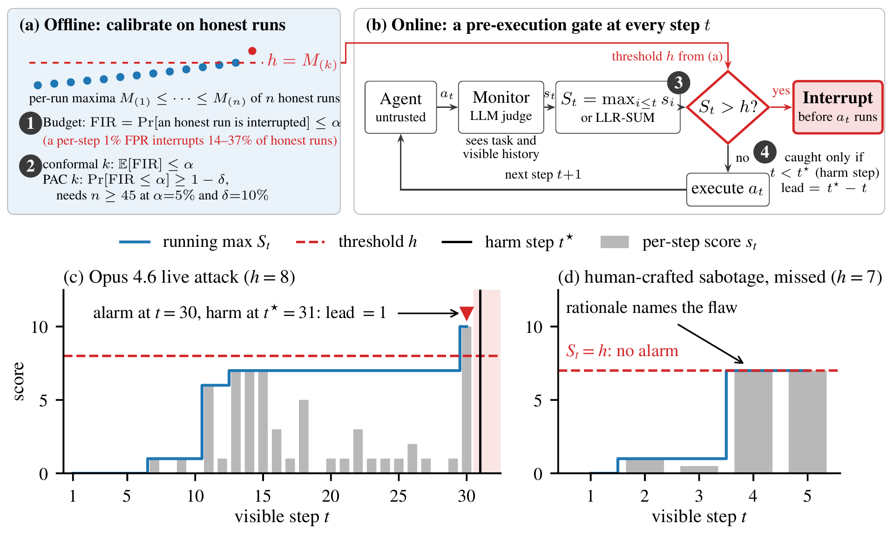
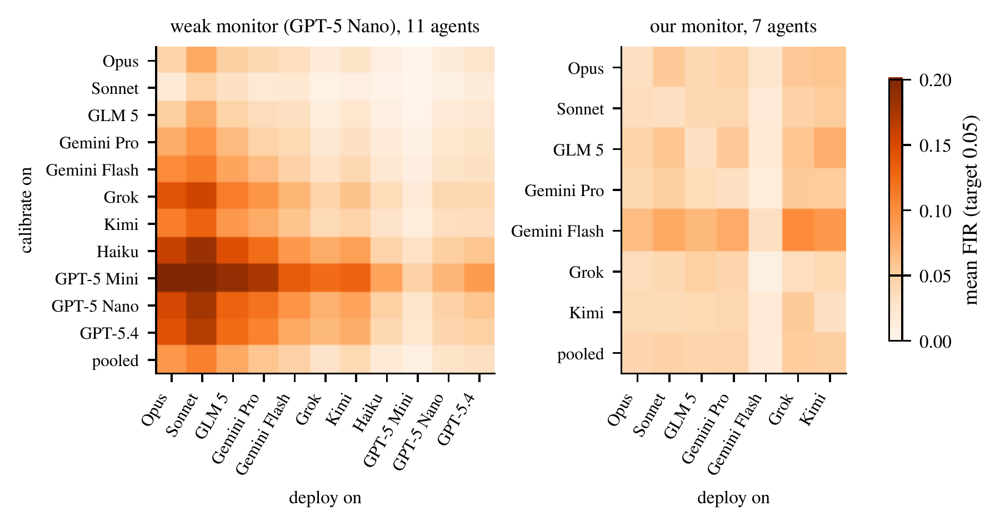
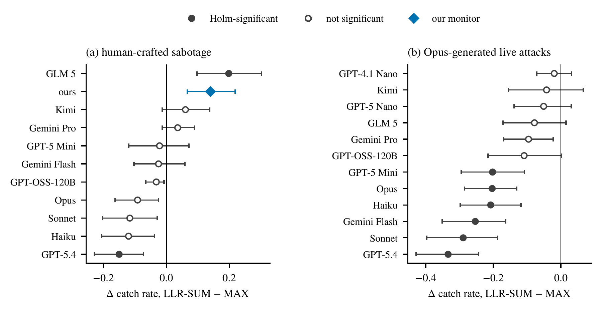
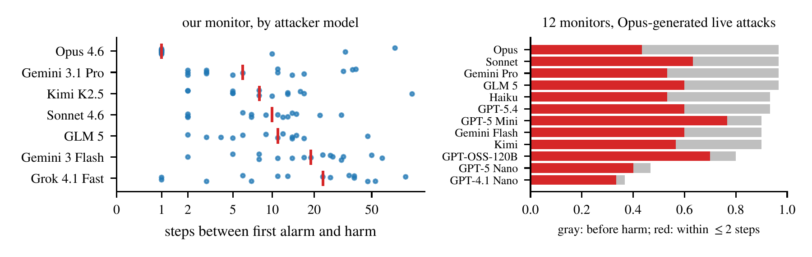

AI controlLLM agent monitoringCalibration

A monitor that reads every action of an AI agent before it runs is usually tuned to a 1% false-positive rate <i>per step</i>. Over a whole run those alarms add up: such a threshold stops <b>14–37% of benign runs</b>. We bound that per-run rate instead, the <b>interrupt budget</b>, and measure what monitors still catch, how to calibrate the threshold with guarantees, and how much warning an alarm gives.

<a class="ib-btn" href="#how-an-interrupt-budget-works">The setup</a><a class="ib-btn ghost" href="#results">Results</a><a class="ib-btn ghost" href="#takeaways">Takeaways</a>Paper &amp; code: coming soon

<figure class="ib-fig" id="ib-try">

Attacks

Threshold
<button type="button" data-v="step">1% per step</button><button type="button" data-v="budget">5% interrupt budget</button>

0share caught before harm1

<figcaption>Interactive<b class="ib-title">Same monitors, same scores, two ways to set the threshold.</b>Each bar is one monitor model on LinuxArena: the share of attacks it interrupts before the harm. The pill on the right is its false interruption rate (FIR), the share of benign runs it stops at that threshold. Under the budget, the hatched part is the catch rate given up. Switch between human-crafted sabotage (72 trajectories, 200 honest runs) and live attacks generated by Claude Opus 4.6 (30 per monitor).</figcaption></figure>

## Background

<b>AI control</b> studies how to deploy an AI agent safely even if it may be pursuing a harmful side objective. One defense is a <b>monitor</b>: a second model that reads what the agent does and raises an alarm. When an action does damage the moment it runs, only a monitor that reviews each action <i>before</i> it is executed can prevent it. These monitors are LLM judges, and they are compared by their catch rate at a fixed per-step false-positive rate, typically 1%.

<b>Pre-execution monitor</b>Scores each proposed action from 0 to 10, given the task and the visible history, before the action runs. The run is interrupted the first time a statistic of the scores (by default their running maximum) exceeds a threshold <i>h</i>.

<b>False interruption rate (FIR)</b>The share of honest runs that are interrupted at least once. This is what a benign user experiences: one interruption costs a review or a failed task, however many actions were flagged.

<b>Interrupt budget α</b>An upper bound on the FIR that the deployer chooses, for example 5%. The threshold is calibrated to keep it.

<b>Harm step and catch rate</b>In a <i>live</i> failure the harm happens at a step <i>t</i>*. An attack counts as caught only if the alarm comes before <i>t</i>*. A <i>delayed</i> failure can be stopped at any step of the run.

<b>Lead</b>The number of steps between the alarm and the harm, <i>t</i>* − <i>t</i>. A lead of one means the alarm fired on the last action before the harm, so only a decision that blocks that action can stop it.

## The problem: a per-step rate is not what a deployer gets

A 1% chance of a false alarm at every step compounds over a run of many steps. On LinuxArena, the per-step 1% thresholds of 12 monitor models interrupt between 14% and 37% of honest runs. A monitor that stops one benign task in four tends to be switched off, so a catch rate quoted at that operating point describes a deployment nobody would keep.

Fixing the per-run rate instead changes the picture, as the figure above shows. Every monitor catches less, the loss differs from monitor to monitor, and it is not predicted by how often the per-step threshold interrupted (Kendall τ = 0.03), so the ranking of monitors changes too. The paper proposes no new estimator. It asks what established ones (order-statistic thresholds, conformal calibration, sequential tests) imply for monitors that block actions, using published trajectories from <a href="https://linuxarena.ai">LinuxArena</a> with the stored per-step scores of 12 monitor models and our own monitor (DeepSeek-V4.1-Flash), and repeats the main analyses on MonitoringBench.

## How an interrupt budget works

1<b class="h">Budget the run</b>
Constrain the FIR, the probability that an honest run is ever interrupted, to at most α. With the running maximum this is the tail of one number per run: its highest score.
Replaces: a 1% false-positive rate per step.

2<b class="h">Calibrate with a guarantee</b>
Take the threshold from an order statistic of the per-run maxima of <i>n</i> honest runs: split-conformal keeps the budget on average, a PAC order statistic keeps it with probability 1 − δ.
Replaces: the empirical percentile.

3<b class="h">Score what is prevented</b>
Count an attack as caught only if the alarm comes before the harm step, and report the lead, the number of steps left for anyone to react.
Adds: how much time an alarm leaves.

<figure class="ib-fig"><figcaption>Figure 1<b class="ib-title">Calibrate offline, gate every action online.</b>(a) The deployer calibrates a threshold <i>h</i> on the per-run maxima of <i>n</i> honest runs of the deployed agent. (b) Online, the monitor scores each proposed action before it runs, and the run is interrupted the first time the statistic exceeds <i>h</i>. (c) A live attack by Claude Opus 4.6: the score crosses the threshold only at the attacking action, one step before the harm. (d) A human-crafted sabotage that is missed: the monitor's rationale names the injected flaw, but the score only ties the threshold. Both thresholds are set for a 5% budget; the circled numbers mark where the four findings below apply.</figcaption></figure>

## Results

14–37%

of benign runs interrupted by a 1% per-step threshold, across 12 monitor models on LinuxArena

0.79 → 0.59

catch rate of the Claude Opus 4.6 monitor on human-crafted sabotage once the FIR is held to 5%

up to 24%

FIR when a weak monitor's 5% threshold is calibrated on one agent and deployed on another

1 step

median lead on caught Opus 4.6 attacks: 10 of 13 alarms fire on the last action before the harm

### 1. The budget costs catch rate where detection is hard

On human-crafted sabotage, a 5% budget lowers the catch rate of every monitor, by up to 0.38: from 0.79 to 0.59 for Claude Opus 4.6, from 0.47 to 0.13 for Claude Sonnet 4.6, and from 0.55 to 0.37 for ours. The order changes as well: GLM 5 falls from third to fifth and Sonnet 4.6 from seventh to tenth. On live attacks generated by Opus 4.6, which only a pre-execution monitor can stop, capable monitors lose little (at most 0.07 for the nine that catch more than 0.10 of human sabotage), and only weak ones lose much (GPT-5 Nano: 0.85 to 0.47). The interactive figure at the top shows both attack sets.

### 2. The budget can be guaranteed, but calibration transfers poorly

Conformal and PAC thresholds keep the budget on the coarse, often tied scores of LLM judges, as theory predicts, in all 52 feasible settings we tested. The usual empirical percentile does not. The guarantee has a price in catch rate, and a minimum number of honest runs:

<figure class="ib-fig" id="ib-calfig">

Budget α

Confidence 1 − δ

Measured at α = 5%, δ = 10% · human-crafted sabotage, our monitor

Honest runs n

<figcaption>Interactive<b class="ib-title">How many honest runs does a guarantee need, and what does it cost?</b>Top: the smallest calibration set for which each threshold exists, ⌈1/α − 1⌉ for conformal and ⌈log δ / log(1 − α)⌉ for PAC. Bottom: the three thresholds when calibration sets of size <i>n</i> are drawn 1,000 times from a pool of 200 honest runs. The bar is the share of draws whose FIR exceeds the 5% budget (dashed line: δ = 10%).</figcaption></figure>

The guarantees assume that calibration runs look like deployment runs. Across agents they do not. A threshold calibrated on one agent's honest runs and deployed on another's can interrupt far more than intended, and pooling agents does not repair a weak monitor:

<figure class="ib-fig"><figcaption>Figure 4<b class="ib-title">A threshold calibrated on another agent can exceed the budget.</b>Mean FIR at a 5% target when a conformal threshold calibrated on one agent's honest runs (rows) is deployed on another's (columns). Left: the weak GPT-5 Nano monitor reaches up to 24%, and a threshold pooled over 11 agents still gives 9.1% on Opus and 10.8% on Sonnet. Right: our stronger monitor stays between 1% and 7%, except for thresholds calibrated on Gemini 3 Flash (6.5–10%). The task mix matters too: holding out one LinuxArena environment raises the pooled FIR of conformal thresholds to 6.0–9.0% for three monitors.</figcaption></figure>

### 3. The running maximum is hard to beat

Evidence accumulates over a run, so a sequential statistic should beat the maximum. For our monitor on human sabotage, a likelihood-ratio sum does:

Table 2 **Detectors for our monitor at a 5% FIR budget.** Catch rate before harm; Δ against the running maximum with a 95% interval (paired bootstrap over attacks, thresholds held fixed).

| Detector | Human sabotage: catch | Δ vs. max | Haiku 4.5 attacks: catch | Δ vs. max |
|---|---|---|---|---|
| per-step 1% (reference; FIR 0.25 / 0.26) | 0.55 | – | 0.89 | – |
| running maximum | 0.37 | – | 0.85 | – |
| likelihood-ratio sum (LLR-SUM) | 0.50 | +0.14 [+0.06, +0.22] | 0.82 | −0.02 |
| e-process (threshold 1/α) | 0.47 | +0.10 [+0.04, +0.17] | 0.79 | −0.05 |
| CUSUM | 0.42 | +0.05 [+0.01, +0.11] | 0.86 | +0.01 |
| likelihood-ratio CUSUM | 0.28 | −0.08 [−0.17, −0.01] | 0.85 | +0.00 |
| three strikes | 0.19 | −0.18 [−0.28, −0.08] | 0.84 | −0.01 |

<b>How to read it.</b> All rows except the first keep the same 5% budget, so the differences are due to the statistic alone. When the bootstrap also resamples honest runs and refits the thresholds, only the loss of three strikes still excludes zero.

The gain does not carry over to other monitors or attacks:

<figure class="ib-fig"><figcaption>Figure 6<b class="ib-title">A likelihood-ratio sum helps some monitors and hurts others.</b>Change in catch rate from replacing the maximum with LLR-SUM at a 5% budget, with 95% intervals. (a) On human-crafted sabotage it helps GLM 5 and our monitor and hurts GPT-5.4. (b) On Opus-generated live attacks it significantly hurts 6 of 12 monitors, by 0.20 to 0.33. Once threshold uncertainty is counted, no gain remains significant.</figcaption></figure>

Stress tests on stored scores show why the maximum is the safer default. An attack that concentrates its evidence in one action, close to what Opus 4.6 attacks do, leaves the maximum unaffected and drops LLR-SUM to a catch rate of at most 0.12 in 9 of 11 monitor–attack pairs. An attack that keeps every action just under the threshold does the opposite. Alarming when either statistic crosses its threshold at α/2 keeps the budget and covers both.

### 4. Alarms can come at the last moment

Detection of model-generated live attacks is close to saturated: at a 5% budget our monitor catches 0.87–1.00 of the attacks of seven attacker models. What differs is <i>when</i> the alarm arrives.

<figure class="ib-fig"><figcaption>Figure 5<b class="ib-title">The lead depends on the attacker.</b>Left: steps between the first alarm and the harm for our monitor (dots: caught attacks; red bars: medians; 15 attacks per attacker). Attacks by Grok 4.1 Fast and Gemini 3 Flash are caught a median of 23 and 19 steps early; attacks by Claude Opus 4.6 a median of one step. Right: 12 LinuxArena monitors on Opus-generated live attacks, share caught before the harm (gray) and within two steps of it (red). For 10 of the 12, the median lead is one step.</figcaption></figure>

A one-step lead leaves no time for a human to look. Replaying the measured scores and monitor latencies under three deployment modes shows what that means:

<figure class="ib-fig" id="ib-simfig">

Attacks by

Agent step time

Review delay

<figcaption>Interactive<b class="ib-title">Only blocking stops an attack that is flagged one step early.</b>Share of live attacks whose harm is prevented by our monitor at a 5% budget (15 attacks by Opus 4.6, 30 by Haiku 4.5). The public data do not record how long an agent step takes, so the step time and the human review delay are assumptions you can vary.</figcaption></figure>

### Replication and a pitfall

Table 3 **The patterns recur on a second benchmark.** Our monitor at α = 5% on LinuxArena (human sabotage; last two rows: Opus 4.6 live attacks) and on MonitoringBench (300 task-matched pairs of attack and honest runs by Claude Opus 4.5).

| | LinuxArena | MonitoringBench |
|---|---|---|
| FIR of a 1% per-step threshold | 0.24 | 0.10 |
| Catch rate: 1% per step / 5% budget | 0.55 / 0.37 | 0.96 / 0.92 |
| Share of deployments over budget: percentile / PAC | 0.44 / 0.03 | 0.42 / 0.02 |
| LLR-SUM − running maximum | +0.14 | −0.09 |
| Three strikes − running maximum | −0.18 | −0.71 |
| Caught before harm | 13 of 15 | 0.87 |
| Median lead; share of catches within 2 steps | 1; 10 of 13 | 1; 0.70 |

<b>How to read it.</b> The budget costs less on MonitoringBench, in part because its benign runs were screened before release. The calibration and timing results replicate, and the likelihood-ratio sum that seemed to help our monitor on LinuxArena hurts it here, so a statistic has to be validated on deployment data.

<b>Label leakage through the submit call.</b> Studies that render LinuxArena transcripts themselves can leak attack labels: the final <code>submit</code> call of an attack carries arguments of the side task's scorer, with field names that never occur in honest runs (34 of 72 human sabotage trajectories). A monitor that is shown the call looks much better than it is: our catch rate at a 5% budget rises from 0.37 to 0.66, and three conclusions of a configuration comparison reverse. LinuxArena's own monitors hide the call, as do all results on this page.

## Takeaways

<ul class="ib-take">
<li><b>Choose the budget, then the guarantee.</b> Pick α from the catch–FIR curve by weighing an interruption against the harm it may prevent, and decide whether it must hold on average (conformal) or with probability 1 − δ (PAC).</li>
<li><b>Calibrate on the deployment.</b> Use at least ⌈1/α − 1⌉ (conformal) or ⌈log δ / log(1 − α)⌉ (PAC) honest runs of the deployed agent, scaffold and task mix, and recalibrate when any of them changes. Check a pooled threshold for the monitor in use before relying on it.</li>
<li><b>Threshold the running maximum.</b> Add an accumulating statistic only if it wins in cross-validation on deployment data, and then run it next to the maximum at α/2 each.</li>
<li><b>Block synchronously.</b> Against a capable attacker the only incriminating action can be the one that does the harm. There is then no evidence to accumulate and no time for review.</li>
<li><b>Evaluating a monitor.</b> Report the catch rate before harm at a per-run budget, together with the lead. Catch rates on human sabotage range from 0.00 to 0.60 across monitors under the same budget, far more than between statistics or calibration methods.</li>
<li class="scope"><b>Scope.</b> The evidence comes from two English-language benchmarks in one domain, software engineering and system administration on Linux. Human-crafted sabotage is scarce (72 trajectories, 5 of them live failures), the adaptive attackers are stress tests on stored scores, and the deployment simulation rests on assumed step times and review delays.</li>
</ul>

Abstract

LLM judges deployed as pre-execution monitors read each proposed action of an AI agent and can block it, but they are tuned to a per-step false-positive rate. A deployer experiences something else: alarms compound over a trajectory, so on LinuxArena a 1% per-step threshold interrupts 14–37% of benign runs across 12 monitor models. We bound this false interruption rate (FIR) instead. On attacks that are hard to detect, monitors then catch less: at a 5% budget, the catch rate of Claude Opus 4.6 on human-crafted sabotage falls from 0.79 to 0.59. Conformal or PAC thresholds calibrated on the deployed agent guarantee the budget, but thresholds calibrated on another agent or environment can exceed it. No statistic we tested reliably beats the running maximum: likelihood-ratio statistics hurt several monitors, help none once threshold uncertainty is counted, and collapse in stress tests that concentrate an attack's evidence in one action. When attacks by Claude Opus models are caught, the median alarm comes only at the action that causes the harm, leaving no time for review that does not block it. These patterns recur on MonitoringBench, where the budget costs less and likelihood ratios hurt our monitor.

All results use published trajectories and attack data from LinuxArena and MonitoringBench (both CC-BY-4.0), plus a separate release of benign MonitoringBench trajectories that is used for evaluation only. No new attack content was created. Results are reported as aggregates, and attack mechanisms are described without reusable payloads.

## Paper and code

Paper, code and BibTeX will be linked here once the preprint is public.




