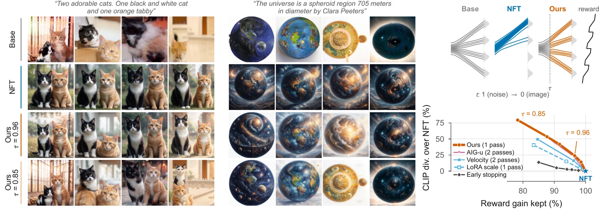
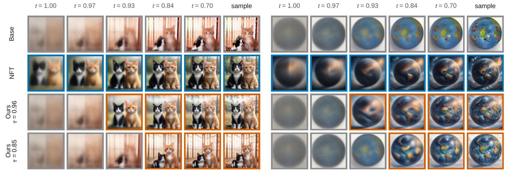
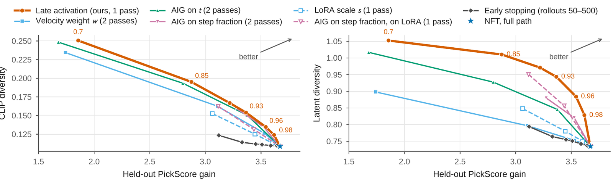
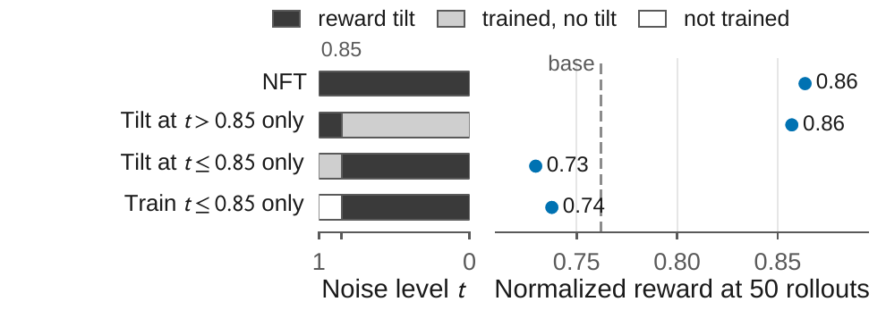

## Summary

RL tuning makes text-to-image flow models return nearly the same composition for every seed. Switching the RL-tuned
adapter off by noise level shows where this happens: the collapse comes from the first, high-noise sampling steps, while
the reward the adapter adds there is largely recovered by the later steps. **Late activation** therefore samples the
first steps with the base model and switches the adapter on below a noise level τ. On SD3.5-Medium tuned with
DiffusionNFT it keeps 96% of the reward gain with 25% higher CLIP diversity and 23% less drift, with no retraining and one
network evaluation per step.

## Key results

{: .align-center}

**Figure 1.** With the adapter on the whole path, NFT gives nearly one image for every seed; switching it on only below
τ = 0.96 brings back the base model's colors and backgrounds, and τ = 0.85 its layouts. At about the same reward, late
activation raises CLIP diversity over NFT by 24%, against 16% for velocity scaling and 2% for early stopping.

{: .align-center}

**Figure 2.** NFT's very first prediction already shows the layout of its final sample, for every seed. Under late
activation the base model's prediction sets the layout and the adapter refines it.

{: .align-center}

**Figure 4.** On the same adapter, late activation traces the best reward–diversity trade-off. Early stopping and
velocity or LoRA-weight scaling weaken the adapter everywhere and give up reward where it costs little diversity; AIG
comes closest but needs two network evaluations per step.

| Sampling (16 seeds per prompt) | Passes / step | ΔPickScore | Latent div. | CLIP div. | DINO Vendi |
|---|:-:|--:|--:|--:|--:|
| Base model | 1 | 0.00 | 1.073 | 0.275 | 8.24 |
| NFT, whole path | 1 | 3.38 | 0.729 | 0.097 | 2.48 |
| **Late activation, τ = 0.96** | **1** | 3.22 | **0.881** | **0.123** | 3.04 |
| AIG-u, p = 0.25 | 2 | 3.20 | 0.817 | 0.123 | 3.05 |
| Velocity weight 0.75 | 2 | 3.23 | 0.748 | 0.115 | 2.81 |
| Late activation, τ = 0.85 | 1 | 2.56 | 1.009 | 0.182 | 4.48 |

**Table 2 (excerpt).** At about the same reward, late activation leads on latent and CLIP diversity at half the passes of
AIG-u and velocity scaling, which it matches or beats on the perceptual measures.

{: .align-center}

**Figure 5.** Training cannot skip the high-noise steps: the reward tilt above t = 0.85 alone nearly matches NFT, while
the tilt below it alone ends below the base model. High noise is where the adapter learns, not where it should act.

{: .align-center}

**Figure 6.** Over ten training seeds per arm, NFT with β = 0.5 and late activation at τ = 0.98 beats default NFT in
reward (+0.11), CLIP diversity (+5%) and drift (−12%) at the same training and sampling cost.

## Interactive demo

Drag τ to see the switch on a 1-d toy with exact flows, browse samples from the same noise under each schedule, and
follow reward and diversity along the trade-off.

<iframe src="/files/projects/2026-11-late-activation/demo/index.html" width="100%" height="1400" loading="lazy" title="Late activation interactive demo" style="border:0"></iframe>

## Links

The paper is under review; the PDF, code and citation will be linked here once they are public.
