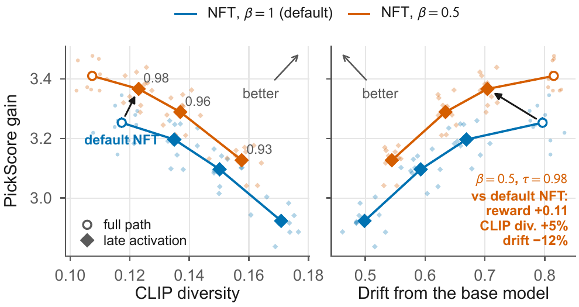

  Under review · 2026
  Text-to-image
  RL fine-tuning
  Sample diversity

RL-tuned flow models draw the same picture for every seed. Let the base model take the first few
sampling steps and the variety comes back: <b>almost the same reward, more diverse images, no retraining and no extra
compute.</b>

  <a class="la-btn is-primary" href="#demo"><svg viewBox="0 0 24 24"><path d="M8 5v14l11-7z"/></svg>Interactive demo</a>
  <a class="la-btn" href="#results"><svg viewBox="0 0 24 24"><path d="M5 9h3v10H5zm5.5-4h3v14h-3zM16 13h3v6h-3z"/></svg>Key results</a>
  <svg viewBox="0 0 24 24"><path d="M6 2h9l5 5v15H6zm8 1.5V8h4.5z"/></svg>Paper · coming soon
  <svg viewBox="0 0 24 24"><path d="M9.4 16.6 4.8 12l4.6-4.6L8 6l-6 6 6 6zm5.2 0 4.6-4.6-4.6-4.6L16 6l6 6-6 6z"/></svg>Code · coming soon

  

96%

of NFT's reward gain kept (τ = 0.96)

  

+25%

CLIP diversity over the RL-tuned model

  

−23%

drift from the base model's image

  

0

extra network evaluations, no retraining

  

    Drag to compare: four seeds, the same noise
    
      <button aria-pressed="true" data-v="cats">Two cats</button><button aria-pressed="false" data-v="universe">Spheroid universe</button>
    
    
      <button aria-pressed="true" data-v="tau096">τ = 0.96</button><button aria-pressed="false" data-v="tau085">τ = 0.85</button><button aria-pressed="false" data-v="base">Base model</button>
    
  

  

    
    
    NFT, whole pathLate activation, τ = 0.96
    

⇆

  

  
SD3.5-Medium tuned with DiffusionNFT on PickScore. Left of the handle: the adapter on the whole
  sampling path. Right: the same adapter switched on only below τ. NFT gives nearly one image for every seed; τ = 0.96
  brings back the base model's colors and backgrounds, τ = 0.85 its layouts.

<b>TL;DR</b> The diversity that RL tuning destroys is lost in the first, high-noise sampling steps,
where the reward it adds is largely redundant. Training needs those steps; sampling does not.

<h2 id="summary">01Summary</h2>

Online RL has become a standard way to align text-to-image flow models with human preferences, but it erodes
variety: after tuning SD3.5-Medium with DiffusionNFT, held-out CLIP diversity falls to 38% of the base model's.
Switching the RL-tuned adapter off by noise level shows where this happens. The collapse comes from the first, high-noise
steps, where the adapter steers every seed toward the same layout, while the reward it adds there is largely recovered
by the later steps. <b>Late activation</b> therefore samples the first steps with the base model and switches the
adapter on below a noise level τ. It keeps 96% of the reward gain with 25% higher CLIP diversity and 23% less drift,
beats early stopping and velocity or LoRA-weight scaling at matched reward, matches annealed guidance at half its
sampling time, and holds across three rewards and four RL methods.

<h2 id="method">02How it works</h2>

<svg class="la-schematic" viewBox="0 0 760 150" role="img" aria-label="Sampling path: base model above tau, adapter below">
  <text x="20" y="28" font-size="13" fill="currentColor" opacity=".65">noise  t = 1</text>
  <text x="740" y="28" font-size="13" fill="currentColor" opacity=".65" text-anchor="end">t = 0  image</text>
  <rect x="20" y="44" width="150" height="34" rx="8" fill="#8c8c8c"/>
  <rect x="176" y="44" width="564" height="34" rx="8" fill="#D55E00"/>
  <text x="95" y="66" font-size="13" font-weight="700" fill="#fff" text-anchor="middle">base model</text>
  <text x="458" y="66" font-size="13" font-weight="700" fill="#fff" text-anchor="middle">RL-tuned adapter</text>
  <line x1="173" x2="173" y1="36" y2="92" stroke="currentColor" stroke-width="1.5" stroke-dasharray="4 3"/>
  <text x="173" y="108" font-size="14" font-weight="700" fill="currentColor" text-anchor="middle">τ</text>
  <text x="95" y="132" font-size="12" fill="currentColor" opacity=".7" text-anchor="middle">composes the layout</text>
  <text x="458" y="132" font-size="12" fill="currentColor" opacity=".7" text-anchor="middle">refines it toward the reward, one pass per step</text>
</svg>

  
1<b>Locate the collapse</b>Switch the adapter off by noise level on a finished
  checkpoint: alone above t = 0.85 it reproduces 97% of NFT's loss of latent diversity.

  
2<b>Find the redundancy</b>Alone below t = 0.85, starting from the base
  model's composition, the adapter still reaches 79% of the reward gain.

  
3<b>Switch late</b>Sample above τ with the base model and below it with
  the adapter: a one-line change to the sampler, the same number of network evaluations.

<h2 id="results">03Key results</h2>

<figure class="la-fig la-card">
  
  <figcaption>Figure 4On the same adapter, late activation traces the best reward–diversity
  trade-off. Early stopping and velocity or LoRA-weight scaling weaken the adapter everywhere and give up reward where it
  costs little diversity; AIG comes closest but needs two network evaluations per step.</figcaption>
</figure>

<table class="la-table">
  <thead><tr><th>Sampling, 16 seeds per prompt</th><th>Passes / step</th><th>ΔPickScore</th><th>Latent div.</th><th>CLIP div.</th><th>DINO Vendi</th></tr></thead>
  <tbody>
    <tr><td>Base model</td><td>1</td><td>0.00</td><td>1.073</td><td>0.275</td><td>8.24</td></tr>
    <tr><td>NFT, whole path</td><td>1</td><td>3.38</td><td>0.729</td><td>0.097</td><td>2.48</td></tr>
    <tr class="ours sep"><td>Late activation, τ = 0.96</td><td class="best">1</td><td>3.22</td><td class="best">0.881</td><td class="best">0.123</td><td>3.04</td></tr>
    <tr><td>AIG-u, p = 0.25</td><td>2</td><td>3.20</td><td>0.817</td><td class="best">0.123</td><td class="best">3.05</td></tr>
    <tr><td>Velocity weight 0.75</td><td>2</td><td>3.23</td><td>0.748</td><td>0.115</td><td>2.81</td></tr>
    <tr class="ours sep"><td>Late activation, τ = 0.85</td><td>1</td><td>2.56</td><td>1.009</td><td>0.182</td><td>4.48</td></tr>
  </tbody>
</table>

<b>Table 2 (excerpt).</b> At about the same reward, late activation leads on latent and CLIP
diversity with half the network passes of AIG-u and velocity scaling; for more variety, τ = 0.85 nearly doubles DINO
Vendi over NFT.

<figure class="la-fig la-card">
  
  <figcaption>Figure 2NFT's very first prediction already shows the layout of its final
  sample, for every seed. Under late activation the base model's prediction sets the layout and the adapter refines it.</figcaption>
</figure>

<figure class="la-fig la-card is-narrow">
  
  <figcaption>Figure 5Training cannot skip the high-noise steps: the reward tilt above
  t = 0.85 alone nearly matches NFT, while the tilt below it alone ends below the base model. High noise is where the
  adapter learns, not where it should act.</figcaption>
</figure>

<figure class="la-fig la-card is-narrow">
  
  <figcaption>Figure 6Over ten training seeds per arm, NFT with β = 0.5 and late activation at
  τ = 0.98 beats default NFT in reward (+0.11), CLIP diversity (+5%) and drift (−12%) at the same training and sampling
  cost.</figcaption>
</figure>

<h2 id="demo">04Interactive demo</h2>

Drag τ on a 1-d toy with exact flows, browse samples from the same noise under each schedule, and follow reward and
diversity along the trade-off.

  <iframe id="la-demo-frame" src="/files/projects/2026-11-late-activation/demo/index.html?embed=1" height="1500" loading="lazy" title="Late activation interactive demo"></iframe>

<h2 id="citation">05Paper and citation</h2>

The paper is under review. The PDF, code and BibTeX will be
linked here once they are public.

