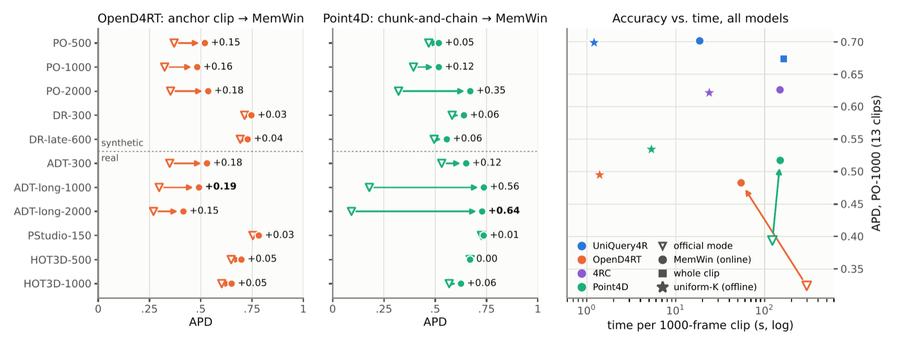
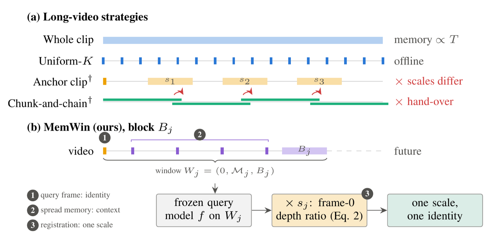
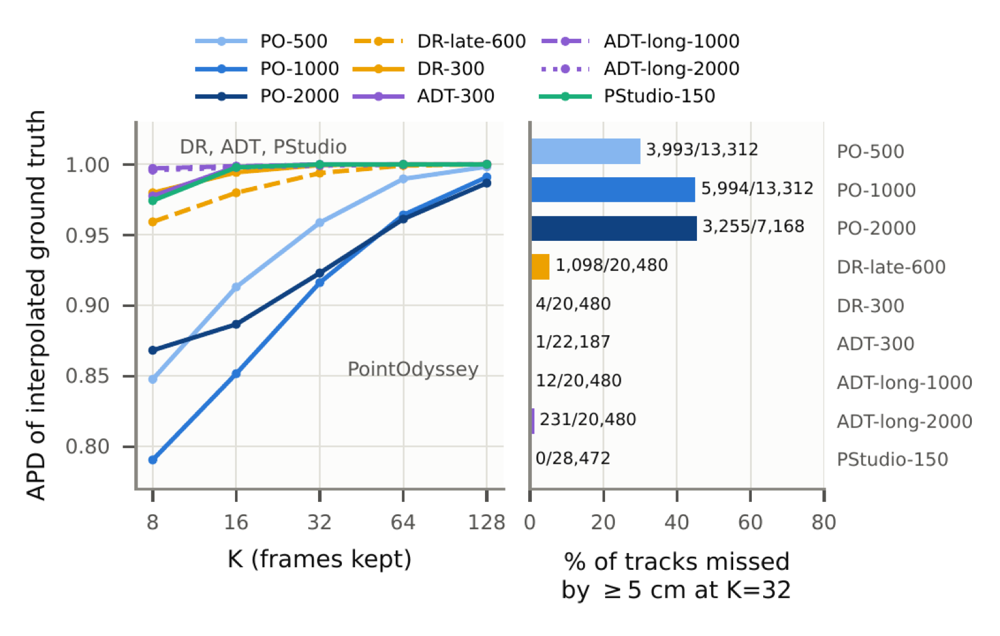

Feed-forward 4D query models reconstruct dynamic scenes and track any point in 3D, but they are trained on clips of tens
of frames, and their official long-video modes lose accuracy between chunks: each mode breaks one of two requirements of
point tracking, namely that every track keeps its identity from the query frame and that all predictions share one scale.
**MemWin** restores both without retraining: every window keeps the query frame and a memory of keyframes spread over the
entire past, and all windows are registered to one scale through the query frame. It raises the APD of both official
modes on 21 of 22 model–set pairs, by up to 0.64, at constant GPU memory. A controlled study, confirmed with predictions
fixed in advance on unseen data, also shows that current benchmarks contain little motion that interpolation misses, and
introduces HOT3D-Long, real hand–object videos whose short motion bursts do.

## Key results

{: .align-center}

**Figure 1.** On all eleven test sets, MemWin raises OpenD4RT's anchor-clip mode by 0.03–0.19 APD and Point4D's
chunk-and-chain mode by up to 0.64; for both models the largest gain (+0.19, +0.64) is on a real
ADT-long video. Offline, one encoding of a
few evenly spread frames (uniform-K, stars) is about as accurate at a fraction of the time.

{: .align-center}

**Figure 2.** Each official mode breaks one requirement: anchor clips predict every clip at its own scale, and
chunk-and-chain hands tracks over between chunks. MemWin encodes each block with the query frame and memory frames spread
over the past, runs the frozen model once per window, and registers every window to one scale.

**Table 1 (excerpt). APD on long videos, and time / GPU memory per 1000-frame clip.**

| Model | Inference | PO-1000 | PO-2000 | ADT-long-1000 | ADT-long-2000 | s / GiB (PO-1000) |
|---|---|---:|---:|---:|---:|---:|
| OpenD4RT | Anchor clip (official) | 0.324 | 0.352 | 0.297 | 0.269 | 297.3 / 8.3 |
| OpenD4RT | **MemWin** | **0.483** | **0.536** | **0.491** | **0.415** | 54.3 / 7.6 |
| Point4D | Chunk-and-chain (official) | 0.394 | 0.321 | 0.179 | 0.091 | 122.2 / 25.9 |
| Point4D | **MemWin** | **0.517** | **0.671** | **0.737** | **0.729** | 149.7 / 17.9 |
| UniQuery4R | **MemWin** | 0.702 | 0.799 | 0.757 | 0.740 | 18.6 / 12.7 |

MemWin's GPU memory does not grow with the video, whereas whole-clip encoding needs 95 GiB for UniQuery4R at 1000 frames
and runs out of memory at 2000; GPU types per row are listed in the paper.

**Table 2 (excerpt). What each component adds (APD, PointOdyssey validation, 1000 frames).**

| Variant | UniQuery4R | OpenD4RT |
|---|---:|---:|
| **MemWin** | **0.625** | **0.392** |
| without scale registration | 0.494 | 0.378 |
| 8 most recent instead of spread memory | 0.557 | 0.321 |
| without memory | 0.521 | 0.268 |

The memory helps because it spans the whole past: a memory of the most recent block ends recovers only 34% and 43% of the
loss without memory.

{: .align-center}

**Figure 3.** On a 2000-frame PointOdyssey clip chosen by rule (median gain), 6% of the visible point-frames of strongly
moving tracks lie within 0.3 m with chunk-and-chain and 43% with MemWin.

{: .align-center}

**Figure 4.** Ground-truth tracks kept at only 32 frames and linearly interpolated already score 0.92–1.00 APD, so current
benchmarks measure little temporal interpolation difficulty. This is why a sparse offline encoding keeps up, and why the
paper adds hard tracks, a beyond-interpolation score and burst point-frames.

## Interactive demo

Build a MemWin window for any block of a long video, compare spread and recent memory, and browse the per-set gains over
the official modes.

<iframe src="/files/projects/2026-11-memwin/demo/index.html" width="100%" height="640" loading="lazy" title="MemWin interactive demo"></iframe>

## Links and citation

- **Paper:** under review; the PDF will be linked here when it is public.
- **Code:** will be released with the paper.
