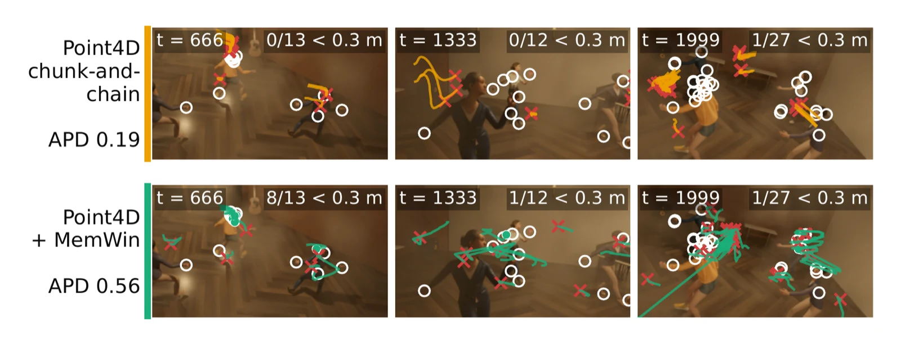

  
MemWin

  
Clip-trained 4D models track points through videos of thousands of frames,
    training-free and online, by keeping the query frame, a memory of the whole past and one scale in every window.

  

    Under review
    3D point tracking
    Long videos
    Training-free
  

  

    
      <svg viewBox="0 0 24 24" aria-hidden="true"><path d="M6 2h8l6 6v12a2 2 0 0 1-2 2H6a2 2 0 0 1-2-2V4a2 2 0 0 1 2-2zm7 1.5V9h5.5L13 3.5zM8 13h8v1.6H8V13zm0 3.4h8V18H8v-1.6z"/></svg>
      Paper (coming soon)
    
      <svg viewBox="0 0 24 24" aria-hidden="true"><path d="M8.7 16.6 4.1 12l4.6-4.6L7.3 6 1.3 12l6 6 1.4-1.4zm6.6 0 4.6-4.6-4.6-4.6L16.7 6l6 6-6 6-1.4-1.4z"/></svg>
      Code (coming soon)
    <a class="mw-btn" href="#try">
      <svg viewBox="0 0 24 24" aria-hidden="true"><path d="M8 5v14l11-7z"/></svg>
      Interactive demo</a>
  

  

    <a href="#abstract">Abstract</a><a href="#method">Method</a><a href="#results">Results</a>
    <a href="#benchmarks">What benchmarks miss</a><a href="#try">Try it</a><a href="#citation">Citation</a>
  

  
  
<b>Figure 1.</b> On all eleven test sets, MemWin raises OpenD4RT's anchor-clip mode by 0.03–0.19 APD and
    Point4D's chunk-and-chain mode by up to 0.64; for both models the largest gain is on a real ADT-long video. Offline,
    one encoding of a few evenly spread frames (uniform-K, stars) is about as accurate at a fraction of the time.

  

21 / 22

model–set pairs where MemWin beats the official long-video mode

  

+0.64

largest APD gain (Point4D, 2000-frame real videos)

  

12.7 GiB

constant GPU memory for UniQuery4R, even at 2000 frames

  

4 models

run with MemWin without any retraining

  <h2>Abstract</h2>
  

    
Feed-forward 4D models reconstruct dynamic scenes by answering point queries, but they are trained on clips of tens
    of frames, while real videos run to thousands. Encoding a long video whole exhausts GPU memory, and the official
    long-video modes split it into chunks that each predict at their own scale or hand tracks from chunk to chunk, so
    their accuracy drops sharply as videos grow. Each mode breaks one of two requirements of point tracking: every track
    keeps its identity from the query frame, and all predictions share one scale.

    
We propose <b>MemWin</b>, a training-free online inference scheme that restores both: every window keeps the query
    frame and a memory of keyframes spread over the entire past, and is registered to one scale through the query frame.
    MemWin runs at constant GPU memory, plugs into four 4D models without retraining, and improves both official modes on
    nearly every test set, raising 3D tracking accuracy (APD) by up to 0.64 at 2000 frames. A controlled study, confirmed
    by predictions fixed in advance on unseen data, also exposes a blind spot of current benchmarks, and we build
    HOT3D-Long, real hand–object videos whose short bursts of motion defeat interpolation.

  

  <h2>Method</h2>
  
Two requirements, three parts, no training.

  

    
    
<b>Figure 2.</b> (a) Each official mode breaks one requirement: anchor clips predict every clip at its
      own scale, and chunk-and-chain hands tracks over between chunks. (b) MemWin encodes each block with the query frame
      and memory frames spread over the past, runs the frozen model once per window, and registers every window to one scale.

  

  

    
<h3>1Query frame</h3>
      
Frame 0 is in every window, so each track is always queried from its own frame and is never handed over.

    
<h3>2Spread memory</h3>
      
Up to M earlier block-end frames, spread evenly over the whole past, give every block long-range context.

    
<h3>3Registration</h3>
      
Each window is rescaled by the median ratio of the query points' frame-0 depth, so all blocks share one scale.

  

  <h3 class="mw-h3" id="try">Try it: which frames does one window encode?</h3>
  
Move through the blocks of a long video. The window always holds 1 + M + L frames, however long the
    video gets; switch to recent memory to see how much of the past it loses.

  

    <label>Video length T<b id="mwvT"></b><select id="mwT"><option>500</option><option selected>1000</option><option>2000</option></select></label>
    <label>Block length L<b id="mwvL"></b><input id="mwL" type="range" min="8" max="64" value="32"></label>
    <label>Memory frames M<b id="mwvM"></b><input id="mwM" type="range" min="0" max="16" value="8"></label>
    <label>Current block j<b id="mwvJ"></b><input id="mwJ" type="range" min="0" max="30" value="20"></label>
    
<label>Memory</label>

      <button id="mwSpread" aria-pressed="true">spread (MemWin)</button><button id="mwRecent" aria-pressed="false">most recent</button>

  

  
<svg id="mwTl" viewBox="0 0 1000 110" role="img" aria-label="Frames of one MemWin window on the video timeline"></svg>

  
query frame 0memory frames
    current blockfuture (not used)

  

    

frames in this window

    

of the past spanned by the memory

    

past frames before this block

  

  

  <h2>Results</h2>
  
APD (higher is better) on long videos, with time and GPU memory per 1000-frame clip.

  

    <table>
      <thead><tr><th>Model</th><th>Inference</th><th class="num">PO-1000</th><th class="num">PO-2000</th>
        <th class="num">ADT-long-1000</th><th class="num">ADT-long-2000</th><th class="num">s / GiB</th></tr></thead>
      <tbody>
        <tr><td>OpenD4RT</td><td>Anchor clip (official)</td><td class="num">0.324</td><td class="num">0.352</td><td class="num">0.297</td><td class="num">0.269</td><td class="num">297.3 / 8.3</td></tr>
        <tr class="ours"><td>OpenD4RT</td><td>MemWin</td><td class="num">0.483+.16</td><td class="num">0.536+.18</td><td class="num">0.491+.19</td><td class="num">0.415+.15</td><td class="num">54.3 / 7.6</td></tr>
        <tr><td>Point4D</td><td>Chunk-and-chain (official)</td><td class="num">0.394</td><td class="num">0.321</td><td class="num">0.179</td><td class="num">0.091</td><td class="num">122.2 / 25.9</td></tr>
        <tr class="ours"><td>Point4D</td><td>MemWin</td><td class="num">0.517+.12</td><td class="num">0.671+.35</td><td class="num">0.737+.56</td><td class="num">0.729+.64</td><td class="num">149.7 / 17.9</td></tr>
        <tr class="ours"><td>UniQuery4R</td><td>MemWin</td><td class="num">0.702</td><td class="num">0.799</td><td class="num">0.757</td><td class="num">0.740</td><td class="num">18.6 / 12.7</td></tr>
      </tbody>
    </table>
  

  
<b>Table 1 (excerpt).</b> MemWin's GPU memory does not grow with the video, whereas whole-clip
    encoding needs 95 GiB for UniQuery4R at 1000 frames and runs out of memory at 2000. GPU types per row are in the paper.

  <h3 class="mw-h3">Gains on every test set</h3>
  
APD of each model's official long-video mode (triangle) and of MemWin with the same frozen model
    (dot); hover a value for both numbers.

  

    <button id="mwOD" aria-pressed="true">OpenD4RT · anchor clip</button><button id="mwP4D" aria-pressed="false">Point4D · chunk-and-chain</button>

  
<svg id="mwDb" viewBox="0 0 1000 470" role="img" aria-label="Official mode vs MemWin per test set"></svg>

  

    

sets where MemWin is higher

    

largest APD gain

    

mean APD gain

  

  

    

      

        <table>
          <thead><tr><th>Variant (PO-val-1000)</th><th class="num">UniQuery4R</th><th class="num">OpenD4RT</th></tr></thead>
          <tbody>
            <tr class="ours"><td>MemWin</td><td class="num">0.625</td><td class="num">0.392</td></tr>
            <tr><td>without registration</td><td class="num">0.494</td><td class="num">0.378</td></tr>
            <tr><td>8 most recent instead of spread</td><td class="num">0.557</td><td class="num">0.321</td></tr>
            <tr><td>without memory</td><td class="num">0.521</td><td class="num">0.268</td></tr>
          </tbody>
        </table>
      

      
<b>Table 2 (excerpt).</b> The memory helps because it spans the whole past: the most recent block
        ends recover only 34% and 43% of the loss without memory.

    

    

      
      
<b>Figure 3.</b> On a 2000-frame clip chosen by rule (median gain), 6% of the visible points of
        strongly moving tracks lie within 0.3 m with chunk-and-chain, and 43% with MemWin.

    

  

  <h2>What benchmarks miss</h2>
  
How much of a long video must a model actually see?

  

    

      
      
<b>Figure 4.</b> Ground-truth tracks kept at only 32 frames and linearly interpolated already score
        0.92–1.00 APD on current benchmarks.

    

    

      
<b>Offline, sparse coverage suffices on today's benchmarks.</b> One encoding of 32–128 evenly
        spread frames with interpolated tracks comes within 0.012 APD of dense inference up to 1000 frames, with 6–39× faster
        model inference, because their motion is largely interpolable at the standard thresholds.

      
<b>Where interpolation fails, density pays off.</b> On 2000-frame PointOdyssey videos and on the
        short motion bursts of <b>HOT3D-Long</b>, our new set of real hand–object videos, MemWin's dense inference is more
        accurate. We add hard tracks, a beyond-interpolation score and burst point-frames to measure this motion.

    

  

  <h2>Citation</h2>
  
The paper is under review; the PDF, code and BibTeX will be linked here when they are public.

