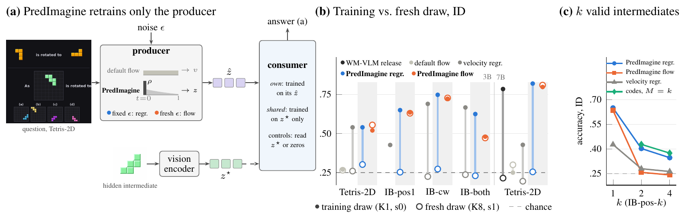
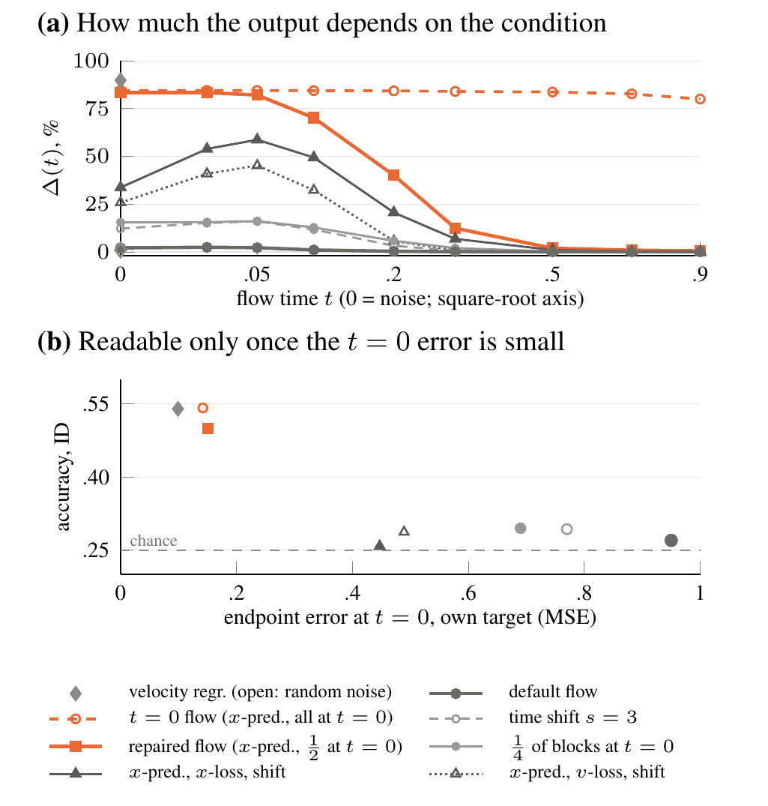

  
Vision-language models · latent visual reasoning · flow matching

  
Latent visual imagination needs prediction more than generation.

  

    <a class="pi-btn" href="#interactive-demo"><i class="fa-solid fa-play" aria-hidden="true"></i> Interactive demo</a>
    <a class="pi-btn" href="#key-results"><i class="fa-solid fa-chart-column" aria-hidden="true"></i> Key results</a>
    <i class="fa-solid fa-file-pdf" aria-hidden="true"></i> Paper <small>· soon</small>
    <i class="fa-brands fa-github" aria-hidden="true"></i> Code <small>· soon</small>
  

<b>TL;DR</b> &nbsp;<b>PredImagine</b> trains the latent producer of a VLM to predict the clean intermediate state, with training focused where the question decides the target. It repairs two hidden failures of flow-matching imagination, and its own variants show that generation adds robustness to the noise draw, not accuracy.

  

.870→.233

Released WM-VLM-7B on Tetris-2D when only the noise seed changes

  

≤ 2.4%

How much the default flow's output depends on the question, at any flow time

  

.798→.810

PredImagine's flow variant at 7B, from the training draw to a fresh one

  

95%

Samples where two noise draws of the flow land on the same placement (k = 2)

## Summary

Vision-language models can reason about space by imagining an intermediate visual state as latent tokens before they answer, and flow-matching generators of these latents are credited with large gains. We isolate the generative objective in WM-VLM with a controlled protocol: only the producer of the latent changes, every producer is read by one consumer trained on oracle latents, and new rotation tasks fix how many intermediate states are valid. The protocol exposes two hidden failures: the released model behaves as a fixed-noise regressor whose accuracy falls from 0.87 to chance when only its noise seed changes, and a default rectified flow largely ignores the question. **PredImagine** trains the producer to predict the clean intermediate state, with training concentrated where the question decides the target. It repairs both failures, lifts our 7B reproduction to the release's accuracy, and as a flow holds that accuracy under every noise draw we tested; its regression and flow variants show that generation contributes robustness to the noise draw, but neither accuracy nor the ability to commit to one of several valid states.

## Key results

Overview

{: .pi-shot}

**Figure 1.** PredImagine changes only the producer's stage-1 training, and every producer is read by one shared consumer. At a fresh noise draw every fixed-noise regressor, the release included, falls to chance, while the flow variant of PredImagine keeps its accuracy on every task (b). With several equally valid intermediates, every producer falls toward chance (c).
{: .pi-cap}

Tasks

{: .pi-shot}

**Figure 2.** All tasks are rotation analogies with four options. ImagineBench-rotation sets the number of valid intermediates: one clockwise strip (IB-cw), either of two strips (IB-both), or the answer shape at any of *k* placements (IB-pos-*k*).
{: .pi-cap}

Failure 1 · the release depends on its noise seed

| Released WM-VLM-7B, Tetris-2D | K1 | K8 |
|---|---|---|
| Noise seed 0 | 0.870 / 0.736 | 0.738 / 0.620 |
| Noise seed 1 | 0.233 / 0.216 | 0.220 / 0.204 |
| Oracle latents | 0.860 / 0.884 | |
| Zeroed latents | 0.150 / 0.166 | |
{: .pi-table}

**Table 2.** Accuracy ID / OOD. The release reproduces its reported accuracy at noise seed 0 and falls near chance at seed 1, the behaviour of a network trained on one fixed noise tensor.
{: .pi-cap}

Failure 2 · the default flow ignores the question

{: .pi-shot .pi-narrow}

**Figure 3.** At no flow time does matching the question lower the default flow's error by more than 2.4%. Single ingredients of PredImagine raise this gap only to 16–59%; a producer becomes readable only when it predicts the clean target and trains half or all of its blocks at *t* = 0, which brings its *t* = 0 error near the regressor's.
{: .pi-cap}

What generation adds · robustness, not accuracy

| Shared consumer, K1 s0 | *x*-pred. regression | *t* = 0 flow | Repaired flow | Velocity regression |
|---|---|---|---|---|
| Tetris-2D | 0.578 / 0.524 | 0.542 / 0.458 | 0.537 / 0.528 | 0.562 / 0.482 |
| IB-pos1 (*k* = 1) | 0.653 / 0.725 | 0.590 / 0.675 | 0.593 / 0.656 | 0.354 / 0.415 |
| IB-cw (*k* = 1) | 0.768 / 0.791 | 0.628 / 0.655 | 0.698 / 0.765 | 0.721 / 0.775 |
| IB-both (*k* = 2) | 0.598 / 0.642 | 0.468 / 0.518 | 0.483 / 0.550 | 0.649 / 0.672 |
{: .pi-table}

**Table 4.** Same consumer for every producer of a task; training draw, mean over trainer seeds, ID / OOD. At its training draw the regression variant of PredImagine is as accurate as the flow variants or more in distribution; the flows' advantage is robustness to the noise draw, which fresh training noise alone provides.
{: .pi-cap}

Several valid states · the noise does not choose

{: .pi-shot}

**Figure 5.** With two valid placements, two noise draws of the flow land on the same placement for 95% of samples, and its latents carry the answer's rotation at about chance rate. Hypothesis codes with as many codes as valid states each commit to one placement.
{: .pi-cap}

## Interactive demo

Draw fresh noise and watch which producers keep answering, build each PredImagine variant from its two training choices, and see how many intermediate states each task accepts. All numbers are from the paper.

<iframe src="/files/projects/2026-11-predimagine/demo/index.html" height="900" loading="lazy" title="PredImagine interactive demo"></iframe>

## Links and citation

  <i class="fa-solid fa-file-pdf" aria-hidden="true"></i> Paper <small>· under review</small>
  <i class="fa-brands fa-github" aria-hidden="true"></i> Code <small>· will be released</small>

The protocol, the ImagineBench-rotation generator, the stage-1 configurations of PredImagine and every arm, and the evaluation code will be released. The citation will be added with the author list once the paper is public.
