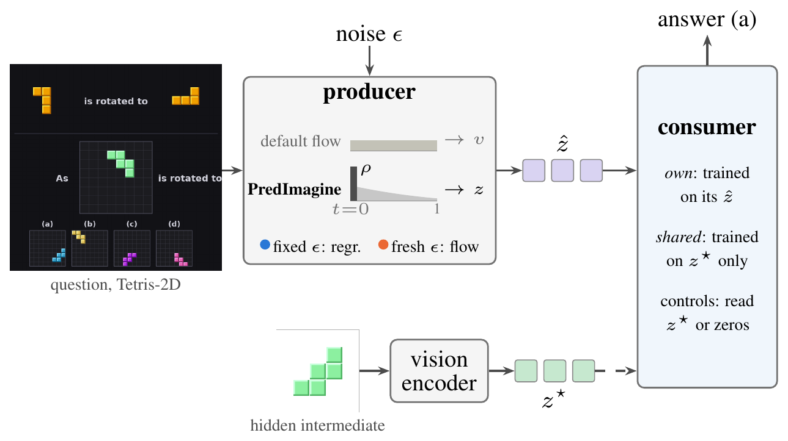
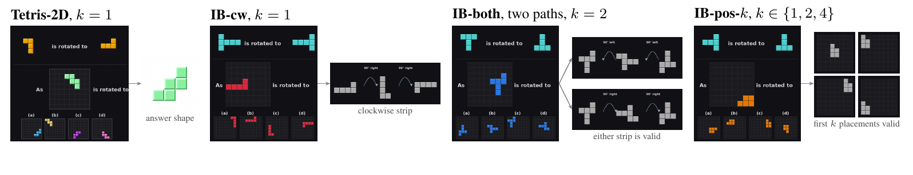
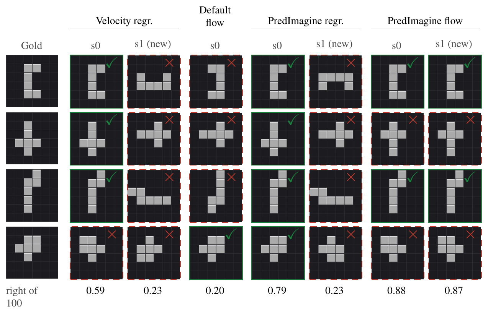
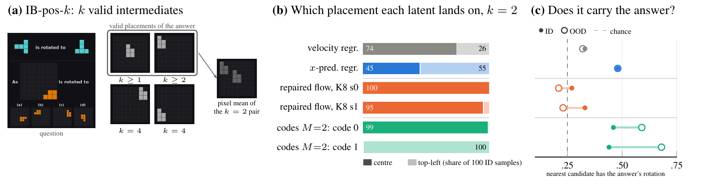

  
Vision-language models · latent visual reasoning · flow matching

  
Latent visual imagination needs prediction more than generation.

  

    <a class="pi-btn" href="#pi-try"><i class="fa-solid fa-play" aria-hidden="true"></i> Try it</a>
    <a class="pi-btn" href="#method"><i class="fa-solid fa-diagram-project" aria-hidden="true"></i> Method</a>
    <a class="pi-btn" href="#key-results"><i class="fa-solid fa-chart-column" aria-hidden="true"></i> Key results</a>
    <i class="fa-solid fa-file-pdf" aria-hidden="true"></i> Paper <small>· soon</small>
    <i class="fa-brands fa-github" aria-hidden="true"></i> Code <small>· soon</small>
  

<b>TL;DR</b> &nbsp;<b>PredImagine</b> trains the latent producer of a VLM to predict the clean intermediate state, with training focused where the question decides the target. It repairs two hidden failures of flow-matching imagination, and its own variants show that generation adds robustness to the noise draw, not accuracy.

  

Failure 1

.870→.233

Accuracy of the released WM-VLM-7B on Tetris-2D when only its noise seed changes (chance is .25)

  

Failure 2

≤ 2.4%

How much a default flow's imagined latent depends on the question, at any flow time

  

Repair

.798→.810

PredImagine's flow variant at 7B, from the training noise to a fresh draw: it holds

  

Still open

95%

Questions where two noise draws of the flow imagine the same state although two are valid

## Summary

Vision-language models can answer spatial questions by first *imagining* an intermediate image as latent tokens, and flow-matching generators of these latents are credited with large accuracy gains. We test where the gains come from with a controlled protocol in WM-VLM and find two hidden failures: the released model is in effect a fixed-noise regressor that collapses when its noise seed changes, and a default flow barely uses the question. **PredImagine** repairs both by training the producer to predict the clean intermediate state where the question decides it. Its regression and flow variants then show what generation adds: robustness to the noise draw, but neither accuracy nor the ability to commit to one of several valid states.

## Background

WM-VLM answers a spatial question in two parts. A **producer**, a small generation branch inside the VLM, imagines the hidden intermediate image as 361 latent tokens. A **consumer**, the rest of the VLM, reads those tokens and answers. The producer is a flow model: it starts from Gaussian noise and takes *K* Euler steps toward the latent of the intermediate image, so every answer depends on a noise draw.

[{: .pi-shot}](/images/projects/2026-11-predimagine/fig1a-pipeline.png)

**Figure 1a.** The producer imagines the hidden intermediate image as latent tokens for the consumer to read. PredImagine changes only how the producer is trained (stage 1). To compare producers fairly, each is read by one *shared* consumer trained on oracle latents, the encodings of the true intermediate image.
{: .pi-cap}

  
<b>Noise draw: K and s</b>A read takes K Euler steps from noise seed s. <i>K1 s0</i> is the setting the release reports and the draw every fixed-noise regressor was trained on. <i>K8 s1</i> is a fresh draw.

  
<b>Shared and own consumers</b>The shared consumer never saw any producer's output, so accuracy on it reflects the latents alone. An own consumer is trained together with its producer.

  
<b>Oracle and zeroed latents</b>Two controls: the consumer reads the encoding of the true intermediate image, or all zeros. They show whether the answer goes through the latents.

  
<b>ID, OOD and chance</b>Accuracy in distribution and on held-out shapes, written ID / OOD. Every question has four options, so chance is 0.25.

[{: .pi-shot}](/images/projects/2026-11-predimagine/fig2-tasks.png)

**Figure 2.** All tasks are rotation analogies: apply the rotation from A to B to C and pick one of four options. Tetris-2D is WM-VLM's dataset. Our ImagineBench-rotation sets the number *k* of valid intermediates: one clockwise strip (IB-cw), either of two strips (IB-both), or the answer shape at any of *k* placements (IB-pos-*k*).
{: .pi-cap}

## Method

Both failures concern *where* the producer learns the question. At flow time *t* = 0 the producer sees only noise and the question, so only the question can lower its error. There the squared-error optimum is the conditional mean of the target given the question, and one Euler step returns it for any noise (Proposition 1 of the paper). A default flow samples *t* uniformly and spends most of its training denoising the state instead.

PredImagine therefore makes two changes to the producer's training:

<ol class="pi-steps">
  <li><b>Predict the clean target.</b> The producer outputs the intermediate latent itself, not the velocity, which stays well conditioned in high dimension.</li>
  <li><b>Train at <i>t</i> = 0.</b> A share ρ of the training blocks sits exactly at <i>t</i> = 0, where the question decides the target; the rest is shifted toward noise.</li>
</ol>

\[ \min_\theta\ \mathbb{E}\,\lVert f_\theta(z_t, c, t) - z \rVert^2, \qquad z_t = (1-t)\,\epsilon + t\,z, \qquad t \sim \rho\,\delta_0 + (1-\rho)\,\pi_s \]

Here *z* is the latent of the intermediate image, *c* the question, ε the noise, and πs uniform *t* under the time shift *s* = 3. PredImagine adds no parameters and leaves inference unchanged. The noise and the share ρ give three variants, and neighbouring variants differ in one choice, which separates what fresh noise and training over *t* each add.

The three variants · click a cell

  

    

      

      
Noise it trains on

      

      
Training timesteps

      <svg id="piB-t" viewBox="0 0 260 104" width="100%" style="max-width:300px;display:block" role="img" aria-label="training timestep distribution"></svg>
    

    

      
Accuracy at the training draw

      

      

      

    

  

<strong>Interactive B.</strong>  Bars: shared consumer, K1 s0, mean over trainer seeds (Table 4). The timestep plot applies the time shift <i>s</i> = 3 to uniform <i>t</i>.

## Key results

Failure 1 · the release depends on its noise seed

| Released WM-VLM-7B, Tetris-2D | K1 | K8 |
|---|---|---|
| Noise seed 0 | 0.870 / 0.736 | 0.738 / 0.620 |
| Noise seed 1 | **0.233 / 0.216** | **0.220 / 0.204** |
| Oracle latents | 0.860 / 0.884 | |
| Zeroed latents | 0.150 / 0.166 | |
{: .pi-table}

**Table 2.** Accuracy ID / OOD. The release reproduces its reported accuracy at noise seed 0 and falls near chance at seed 1, as a network trained on one fixed noise tensor would; the public reproduction script defaults to exactly that. Its gain at seed 0 is real and goes through the latents (zeroed: 0.150), but it is a regressor's gain, not generation's.
{: .pi-cap}

Failure 2 · the default flow ignores the question

[{: .pi-shot .pi-narrow}](/images/projects/2026-11-predimagine/fig3-cond-gap.png)

**Figure 3.** The conditional gap Δ(*t*) measures how much matching the question to its target lowers the producer's error at flow time *t*; Δ = 0 means the question adds nothing. For the default flow Δ never exceeds 2.4%, and it stays near chance on all four 3B datasets. Single ingredients of PredImagine raise the gap only to 16–59%. A producer becomes readable only when it predicts the clean target and trains half or all of its blocks at *t* = 0, which brings its *t* = 0 error near the regressor's (b).
{: .pi-cap}

PredImagine repairs both · switch the noise draw

  

    <canvas class="pi-noise" id="piA-noise" width="16" height="16" aria-label="noise tensor"></canvas>
    Noise 
  

  

    Task 
    Split 
  

  

  
<i style="background:var(--r)"></i>PredImagine, regression variant<i style="background:var(--f)"></i>PredImagine, flow variant<i style="background:var(--b)"></i>baselines<i style="background:var(--g);width:2px"></i>value at the other draw

<strong>Interactive A.</strong>  Every producer is read by its task's shared consumer (trainer seed 42). Gray ticks mark the value at the other draw. Values from Figure 1b and Table S5.

[{: .pi-shot}](/images/projects/2026-11-predimagine/fig4-qualitative.png)

**Figure 4.** What each producer imagines on four random IB-pos1 questions, read in one step at the regressors' training noise (s0) and at a new one (s1). Latents are not decoded: each cell shows the candidate, the answer shape at one of four rotations, that is nearest to the generated latent (✓ marks the answer's rotation). What the regressors imagine changes with the noise seed, and the share with the right rotation falls from 0.59 and 0.79 to 0.23, near chance; what the flow variant of PredImagine imagines does not change (0.88 and 0.87).
{: .pi-cap}

| 7B, Tetris-2D, own consumer | Training draw (K1 s0) | Fresh draw (K8 s1) |
|---|---|---|
| WM-VLM release | 0.858 / 0.732 | 0.220 / 0.204 |
| Velocity regression (our reproduction) | 0.502 / 0.438 | 0.275 / 0.258 |
| Default flow | 0.278 / 0.298 | 0.305 / 0.248 |
| PredImagine, *x*-prediction regression | 0.880 / 0.724 | 0.230 / 0.208 |
| PredImagine, repaired flow | 0.920 / 0.726 | **0.917 / 0.692** |
{: .pi-table}

**Table 3 (excerpt).** Each producer with the consumer trained on it, trainer seed 42, ID / OOD. PredImagine lifts our 7B pipeline from 0.502 (velocity regression) to the release's level (0.880 and 0.920 against 0.858); on the shared consumer the release and both PredImagine variants are statistically level in distribution. Only the flow variant keeps its accuracy at a fresh draw.
{: .pi-cap}

What generation adds · robustness, not accuracy

| Shared consumer, K1 s0 | *x*-pred. regression | *t* = 0 flow | Repaired flow | Velocity regression |
|---|---|---|---|---|
| Tetris-2D | 0.578 / 0.524 | 0.542 / 0.458 | 0.537 / 0.528 | 0.562 / 0.482 |
| IB-pos1 (*k* = 1) | 0.653 / 0.725 | 0.590 / 0.675 | 0.593 / 0.656 | 0.354 / 0.415 |
| IB-cw (*k* = 1) | 0.768 / 0.791 | 0.628 / 0.655 | 0.698 / 0.765 | 0.721 / 0.775 |
| IB-both (*k* = 2) | 0.598 / 0.642 | 0.468 / 0.518 | 0.483 / 0.550 | 0.649 / 0.672 |
{: .pi-table}

**Table 4.** Same consumer for every producer of a task; training draw, mean over trainer seeds, ID / OOD. The first three columns are PredImagine's variants. At its training draw the regression variant is as accurate as the flow variants or more in distribution, so the flows' advantage is robustness to the noise draw, which fresh training noise alone provides.
{: .pi-cap}

Several valid states · the noise does not choose

[{: .pi-shot}](/images/projects/2026-11-predimagine/fig5-valid-states.png)

**Figure 5.** A generator could, in principle, commit to one of several valid intermediates. Ours does not: with two valid placements, two noise draws of the flow land on the same placement for 95% of samples, and its latents carry the answer's rotation at about chance rate. Hypothesis codes with as many codes as valid states each commit to one placement.
{: .pi-cap}

  

  

    

    

      <svg id="piC-k" viewBox="0 0 300 180" width="100%" style="display:block" role="img" aria-label="accuracy against the number of valid placements k"></svg>
      
<i style="background:var(--r)"></i>PI regr.<i style="background:var(--f)"></i>PI flow<i style="background:var(--b)"></i>velocity regr.<i style="background:var(--c)"></i>codes, M = k

    

  

<strong>Interactive C.</strong>  Click a task to see its valid intermediates. The example is drawn with the ImagineBench-rotation generator (90° clockwise); pixel averages are an illustration, since the paper's mean is over latent encodings. Curve: IB-pos4 shared consumer, K1 s0 (Figure 1c, Table S7).

## Takeaways

<ul class="pi-take">
  <li style="--kc:#2a78d6"><b>For accuracy, predict.</b> In this architecture and on these tasks, the accuracy that latent imagination adds comes with training the producer to predict the intermediate state. At its training draw, a regressor with the same target is as accurate as the flow or more in distribution.</li>
  <li style="--kc:#eb6834"><b>For robustness to noise, train on fresh noise.</b> A fixed seed avoids the collapse at deployment, but any use that draws new noise, such as search or policy gradients over imagined states, needs the flow variant.</li>
  <li><b>Sampling distinct valid states is still open.</b> None of our flows selects among valid states, and winner-take-all codes commit to them only when their number equals the number of valid states.</li>
  <li><b>How to evaluate generated latents.</b> We suggest one consumer trained on oracle latents for all producers, oracle and zeroed reads beside own-consumer accuracy, reads at fresh seeds and step counts, a regressor with the flow's target at equal steps, a set number of valid intermediates before claiming sampling, and multiplicity-corrected paired tests.</li>
</ul>

The study covers one architecture (WM-VLM) on one backbone family and rotation analogies; most cells have one to three training seeds, and small differences are settled by paired tests in the paper.
{: .pi-scope}

## Links and citation

  <i class="fa-solid fa-file-pdf" aria-hidden="true"></i> Paper <small>· under review</small>
  <i class="fa-brands fa-github" aria-hidden="true"></i> Code <small>· will be released</small>

The protocol, the ImagineBench-rotation generator, the stage-1 configurations of PredImagine and every arm, and the evaluation code will be released. The citation will be added with the author list once the paper is public.
