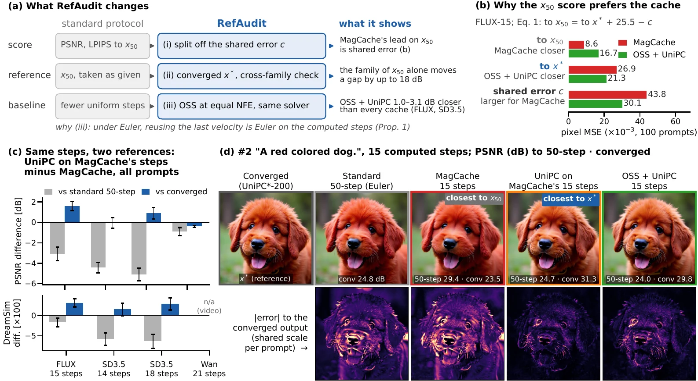

Training-free step caching (TeaCache, MagCache and their successors) speeds up diffusion transformers by reusing the
transformer's last result at some sampling steps, and it is judged by fidelity to the default 50-step output and
compared with sampling at fewer uniform steps. We show that this protocol favors caching: the 50-step output is itself a
coarse ODE solve, so fidelity to it rewards samplers that share its error, and under Euler a reuse cache is exactly or
nearly Euler on its computed steps, so its fair baseline is an optimized timestep schedule. **RefAudit** splits the
standard score into accuracy and shared error, checks the reference across solver families, and compares methods at
equal NFE under the same solver; under it, optimized static schedules with UniPC match or beat every cache we ran on
FLUX.1-dev and SD3.5, with no run-time decisions or extra memory.

## Key results

{: .align-center}

**Figure 1.** RefAudit: the 50-step reference favors the cache, which shares its error. On FLUX.1-dev at 15 steps,
MagCache is closer than OSS + UniPC to the 50-step output only because more of its error points the same way as the
reference's (shared error 43.8 vs 30.1, ×10⁻³ MSE). Against a converged reference the order reverses.

{: .align-center style="max-width:min(100%, 520px)"}

**Figure 2.** The reference's solver family sets the sign. Against 50-step references, the gap between the same two
samplers follows the reference's solver family on every model, by 4–10 dB either way. From 200 steps on, references of
both families give the same sign, which is the cross-family check RefAudit asks of a reference.

**Table 3.** At equal NFE, OSS matches or beats every cache on FLUX.1-dev and SD3.5. Paired PSNR differences (dB), OSS +
UniPC minus the cache, against the 50-step output (x₅₀) and the converged reference (x\*); speeds are end-to-end on one
H100.

| Model | Cache (steps) | Speed: cache / OSS | vs x₅₀ | vs x\* | LPIPS vs x\* | vs best cache under UniPC |
|---|---|---|---|---|---|---|
| FLUX.1-dev | MagCache (15) | 3.22× / 3.19× | −3.00 | **+1.90** | **−0.101** | +0.29 |
| FLUX.1-dev | TeaCache (20) | 2.41× / 2.43× | +1.61 | **+3.72** | **−0.163** | +3.18 |
| SD3.5-Large | MagCache (14) | 3.38× / 3.39× | −3.06 | **+1.43** | **−0.140** | +0.25 (tie) |
| SD3.5-Large | MagCache (18) | 2.66× / 2.67× | −4.46 | **+1.82** | **−0.123** | −0.11 (tie) |
| Wan2.1-1.3B | MagCache (21) | 2.20× / 2.22× | +2.72 | −0.44 | +0.016 | (caches already use UniPC) |

The standard score and RefAudit disagree in sign on most image-model rows; giving the caches the same solver closes
most of the gap, and on Wan2.1, whose default sampler is already UniPC, caching keeps a small edge on the default grid.

{: .align-center}

**Figure 3.** RefAudit reverses the ranking. Ranked against the 50-step output, OSS + UniPC is last of four runs at
FLUX-15 and SD3.5-14; ranked against the converged reference it is first and MagCache is last. On the image models it
stays above every cache shown at every budget.

{: .align-center}

**Figure 4.** PSNR can select a visible artifact. A uniform grid tuned for PSNR to the converged reference has the
highest PSNR of these four runs but shows a periodic 16-pixel pattern, one transformer token, which distribution metrics
register (ΔFD +35.6 against at most +19.0 for any other run). RefAudit therefore reads fidelity together with a
distribution metric.

## Interactive demo

Switch the reference and watch the ranking change, see how the shared error builds the 50-step score (Eq. 1), and
compare one prompt's 15-step runs under both references. All numbers are the paper's logged results.

<iframe src="/files/projects/2026-11-refaudit/demo/index.html" width="100%" height="680" loading="lazy" title="RefAudit interactive demo" style="border:1px solid #ddd;border-radius:6px"></iframe>

## Links and citation

Paper, code and BibTeX will be linked here once the preprint is public.
