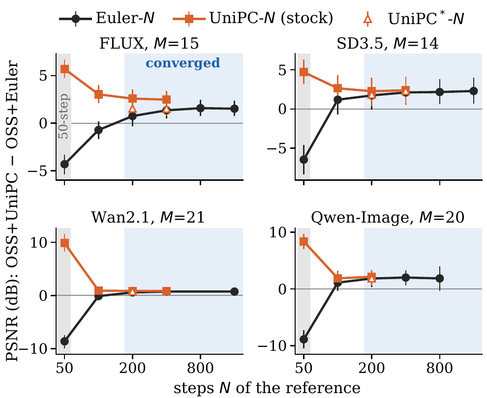
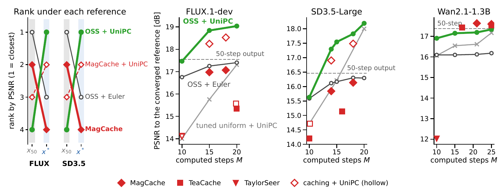
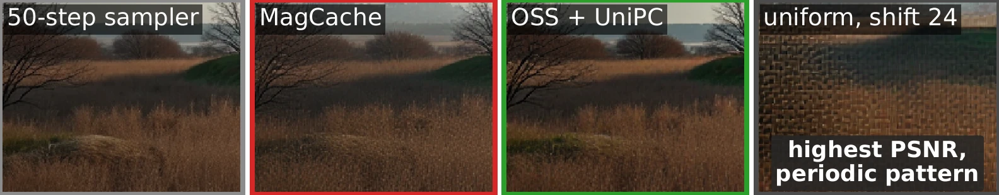

Diffusion transformersTraining-free accelerationEvaluation protocol

Diffusion step caches are scored by their fidelity to the 50-step output, and that score rewards sharing the 50-step sampler's error. <b>RefAudit</b> scores against a converged reference instead, and an optimized static schedule with UniPC then matches or beats every cache we ran on FLUX.1-dev and SD3.5.

<a class="ra-btn" href="#interactive-demo">▶&nbsp; Interactive demo</a><a class="ra-btn ghost" href="#key-results">Key results</a><a class="ra-btn ghost" href="#what-refaudit-changes">The protocol</a>Paper &amp; code: coming soon

<figure class="ra-fig"><figcaption>Figure 1<b class="ra-title">RefAudit: the 50-step reference favors the cache, which shares its error.</b>On FLUX.1-dev at 15 steps, MagCache is closer than OSS + UniPC to the 50-step output only because more of its error points the same way as the reference's (shared error 43.8 vs 30.1, ×10⁻³ MSE). Against a converged reference the order reverses.</figcaption></figure>

## At a glance

up to 18 dB

change in the gap between two fixed samplers when only the solver family of the 50-step reference changes

1.0–3.1 dB

OSS + UniPC closer to the converged reference than every cache as shipped on FLUX.1-dev and SD3.5, at the same speed

#4 → #1

rank of OSS + UniPC among four runs, against the 50-step output vs. the converged reference (FLUX-15, SD3.5-14)

84 / 100

prompts on which DreamSim puts OSS-15 + UniPC closer than MagCache-15 to the converged reference (34 against the 50-step output)

## What RefAudit changes

Standard protocolRefAuditWhat it shows
Score
PSNR, LPIPS to the 50-step output x₅₀
→
(i) split the score: error to x* + constant − shared error

MagCache's lead on x₅₀ is shared error, not accuracy

Reference
x₅₀, taken as given
→
(ii) converged x*, checked across solver families

the reference's family alone moves a gap by up to 18 dB

Baseline
fewer uniform steps
→
(iii) optimized schedule (OSS) at equal NFE, same solver

OSS + UniPC 1.0–3.1 dB closer than every cache

<b>Why (iii):</b> under Euler, a step cache that reuses the last velocity <i>is</i> Euler on its computed steps, and residual reuse nearly so. Step caching is step scheduling, so its fair competitor is the best schedule with the same number of steps.

## Summary

Training-free step caching (TeaCache, MagCache and their successors) speeds up diffusion transformers by reusing the transformer's last result at some sampling steps, and it is judged by fidelity to the default 50-step output and compared with sampling at fewer uniform steps. We show that this protocol favors caching: the 50-step output is itself a coarse ODE solve, so fidelity to it rewards samplers that share its error, and under Euler a reuse cache is exactly or nearly Euler on its computed steps, so its fair baseline is an optimized timestep schedule. <b>RefAudit</b> splits the standard score into accuracy and shared error, checks the reference across solver families, and compares methods at equal NFE under the same solver; under it, optimized static schedules with UniPC match or beat every cache we ran on FLUX.1-dev and SD3.5, with no run-time decisions or extra memory.

## Key results

<figure class="ra-fig narrow"><figcaption>Figure 2<b class="ra-title">The reference's solver family sets the sign.</b>Against 50-step references, the gap between the same two samplers follows the reference's solver family on every model, by 4–10 dB either way. From 200 steps on, references of both families give the same sign: the cross-family check RefAudit asks of a reference.</figcaption></figure>
<figure class="ra-fig"><figcaption>Figure 3<b class="ra-title">RefAudit reverses the ranking; on the image models, OSS + UniPC is above every cache shown and the tuned grids, at every budget.</b>Ranked against the 50-step output, OSS + UniPC is last of four runs at FLUX-15 and SD3.5-14; ranked against the converged reference it is first and MagCache is last.</figcaption></figure>

Table 3 **At equal NFE, OSS matches or beats every cache on FLUX.1-dev and SD3.5.** Paired PSNR differences (dB), OSS + UniPC minus the cache, against the 50-step output (x₅₀) and the converged reference (x\*); speeds are end-to-end on one H100.

| Model | Cache (steps) | Speed: cache / OSS | vs x₅₀ | vs x\* | LPIPS vs x\* | vs best cache under UniPC |
|---|---|---|---|---|---|---|
| FLUX.1-dev | MagCache (15) | 3.22× / 3.19× | −3.00 | **+1.90** | **−0.101** | +0.29 |
| FLUX.1-dev | TeaCache (20) | 2.41× / 2.43× | +1.61 | **+3.72** | **−0.163** | +3.18 |
| SD3.5-Large | MagCache (14) | 3.38× / 3.39× | −3.06 | **+1.43** | **−0.140** | +0.25 (tie) |
| SD3.5-Large | MagCache (18) | 2.66× / 2.67× | −4.46 | **+1.82** | **−0.123** | −0.11 (tie) |
| Wan2.1-1.3B | MagCache (21) | 2.20× / 2.22× | +2.72 | −0.44 | +0.016 | (caches already use UniPC) |

The standard score and RefAudit disagree in sign on most image-model rows; giving the caches the same solver closes most of the gap, and on Wan2.1, whose default sampler is already UniPC, caching keeps a small edge on the default grid.

<figure class="ra-fig">

⇆OSS + UniPCuniform, shift 24 · highest PSNR

<figcaption>Figure 4<b class="ra-title">PSNR can select a visible artifact.</b>Drag the divider. A uniform grid tuned for PSNR to the converged reference has the highest PSNR of these four runs but shows a periodic 16-pixel pattern, one transformer token, which distribution metrics register (ΔFD +35.6 against at most +19.0 for any other run). RefAudit therefore reads fidelity together with a distribution metric. FLUX.1-dev, 15 computed steps, one PartiPrompts image.</figcaption>
</figure>

## Interactive demo

Switch the reference and watch the ranking change, see how the shared error builds the 50-step score (Eq. 1), and
compare one prompt's 15-step runs under both references. All numbers are the paper's logged results.

RefAudit · interactive demo<a href="/files/projects/2026-11-refaudit/demo/index.html" target="_blank" rel="noopener">Open full screen ↗</a>
<iframe id="ra-demo-frame" src="/files/projects/2026-11-refaudit/demo/index.html" height="720" loading="lazy" title="RefAudit interactive demo"></iframe>

## Links and citation

Paper, code and BibTeX will be linked here once the preprint is public.

