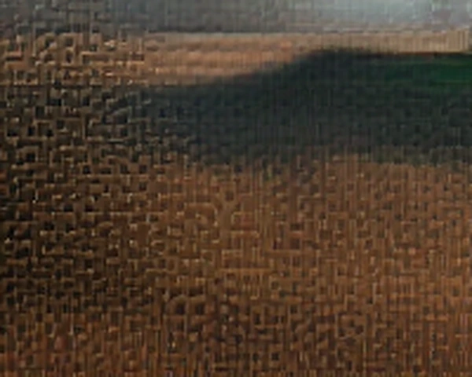

Diffusion transformersTraining-free accelerationEvaluation protocol

Diffusion step caches are scored by their fidelity to the 50-step output, and that score rewards sharing the 50-step sampler's error. <b>RefAudit</b> scores against a converged reference instead, and an optimized static schedule with UniPC then matches or beats every cache we ran on FLUX.1-dev and SD3.5.

<a class="ra-btn" href="#how-refaudit-works">The protocol</a><a class="ra-btn ghost" href="#results">Results</a><a class="ra-btn ghost" href="#takeaways">Takeaways</a>Paper &amp; code: coming soon

<figure class="ra-fig" id="ra-try">

Model

Budget

Reference
<button data-v="x50">50-step output x₅₀</button><button data-v="conv">converged x* (RefAudit)</button>

<figcaption>Interactive<b class="ra-title">Same runs, two references: switch the reference and the ranking flips.</b>Each bar is one sampler at the same number of computed steps; longer means closer to the selected reference (mean PSNR; DrawBench-100 for the image models, 60 VBench prompts for Wan2.1). Red: caches as shipped (outline: the same cache run with UniPC); green: an optimized schedule (OSS) with UniPC; plain outline: OSS with Euler; gray: a uniform grid with a tuned time shift. Try the other models and budgets.</figcaption></figure>

## Background

A diffusion transformer generates an image or a video by integrating a learned velocity field over about 50 steps, and every step is a full pass through a multi-billion-parameter network. <b>Training-free step caches</b> such as TeaCache, MagCache and TaylorSeer skip the network at some steps and reuse or extrapolate its last result, so only <i>M</i> of the 50 steps are computed. A cache is then judged by how close its output stays to the default 50-step output, and compared with simply sampling at fewer uniform steps.

<b>x₅₀</b>The output of the model's default 50-step sampler (Euler for FLUX.1-dev and SD3.5, UniPC for Wan2.1). The standard reference.

<b>x*</b>A converged reference: the same sampling ODE, same prompt and noise, solved until the answer stops changing. It is the sample the model defines. Here: UniPC with exact time conditioning at 200 steps, checked against 1,600-step Euler and an adaptive RK45 solver.

<b>NFE</b>Number of network evaluations, the cost of a sampler. All comparisons are at equal computed steps <i>M</i>, with end-to-end wall-clock measured as well.

<b>UniPC</b>A second-order multistep predictor–corrector ODE solver (Zhao et al., 2023). Euler, the default of FLUX.1-dev and SD3.5, is first-order.

<b>OSS</b>Optimal Stepsize (Pei et al., 2025): an existing dynamic program that chooses which <i>M</i> of the 50 timesteps to compute. It is not our method. RefAudit uses it as the baseline a cache should be compared with; our contribution is the evaluation protocol and the analysis behind it.

## The problem: two biases in the standard protocol

<b>1. The reference shares the cache's error.</b> The 50-step output is itself a coarse solve, 16.5–19.3 dB from converged solutions. The squared error to it splits exactly into three terms (Eq. 1 below): the error to the converged reference, a constant, and a cross term <i>c</i>(<i>x</i>) = 2⟨<i>x</i> − x*, x₅₀ − x*⟩ / <i>d</i>, the part of a run's error that points the same way as the reference's own error. A run can therefore score well against x₅₀ in two ways: by being accurate, or by making the same mistakes as the reference.

<figure class="ra-fig" id="ra-eq">

Setting

MSE(x, x₅₀) = MSE(x, x*) + MSE(x₅₀, x*) − c(x)

<figcaption>Interactive<b class="ra-title">Where the 50-step score comes from (Eq. 1).</b>For each run: its error to the converged reference (blue), the error it shares with the 50-step output (red, subtracted) and what is left, the standard score (gray; smaller looks better). The middle term is the same for every run. Pixel MSE ×10⁻³, mean over prompts. On Wan2.1 the default sampler is UniPC, so there the UniPC run is the one that shares the reference's error.</figcaption></figure>

The shared error is larger for samplers of the reference's own solver family. So if it drives the ranking, changing only that family should flip the verdict. We logged this prediction before the runs, and it held:

<figure class="ra-fig narrow"><figcaption>Figure 2<b class="ra-title">The reference's solver family sets the sign.</b>Each point scores the same two samplers (OSS + UniPC minus OSS + Euler, equal steps) against a reference with <i>N</i> steps from the Euler family (black) or the UniPC family (orange); above zero, OSS + UniPC is closer. At <i>N</i> = 50 (gray band) the sign follows the reference's family, by 4–10 dB either way. From 200 steps on (blue band) both families give the same answer: this is the cross-family check RefAudit asks of a reference. On Qwen-Image the predictions were registered before any run and held in 5 of 6 pairs.</figcaption></figure>

<b>2. The baseline is weak.</b> Under Euler, a cache that reuses the last velocity computes exactly Euler on the steps it evaluates, and the residual reuse of TeaCache and MagCache comes within 0.04–0.08 dB of it. Such a cache does not approximate the skipped evaluations; it removes them and takes longer steps. <b>Step caching is step scheduling</b>, so its fair competitor is the best schedule with the same number of steps, not uniform steps at the default time shift.

## How RefAudit works

1<b class="h">Split the score</b>
Report the error to a converged reference and the shared error separately (Eq. 1), so that accuracy and resemblance to the reference are not mixed.
Replaces: PSNR and LPIPS to x₅₀ only.

2<b class="h">Check the reference</b>
Accept a converged reference only after a solver of another family agrees with it. Refining one solver is not enough: on FLUX.1-dev, stock UniPC agrees with its own refinements to 35–36 dB yet stays 26 dB from fine Euler, because it conditions the network on integer timesteps.
Replaces: x₅₀, taken as given.

3<b class="h">Compare at equal NFE</b>
Give the baseline what the cache has: an optimized schedule (OSS) at the same number of steps, under the same solver. Also run the cache itself with that solver.
Replaces: fewer uniform steps.

The audit script needs only saved outputs. A converged reference costs about one GPU-hour per 100 prompts on FLUX.1-dev and SD3.5.

<figure class="ra-fig"><figcaption>Figure 1<b class="ra-title">RefAudit: the 50-step reference favors the cache, which shares its error.</b>The paper's overview. (a) The three choices RefAudit replaces and what each change shows. (b) Eq. 1 on FLUX.1-dev at 15 steps: MagCache is closer to x₅₀ than OSS + UniPC but farther from x*, because it shares more of x₅₀'s error (43.8 vs 30.1, ×10⁻³ MSE). (c) On the <i>same</i> computed steps, the 50-step reference favors the cache and the converged one favors UniPC or ties; on Wan2.1 the cache keeps a small lead. (d) One prompt, with the run closest to each reference marked.</figcaption></figure>

## Results

up to 18 dB

change in the gap between two fixed samplers when only the solver family of the 50-step reference changes

1.0–3.1 dB

OSS + UniPC closer to the converged reference than every cache as shipped on FLUX.1-dev and SD3.5, at the same speed

#4 → #1

rank of OSS + UniPC among four runs, against the 50-step output vs. the converged reference (FLUX-15, SD3.5-14)

84 / 100

prompts on which DreamSim puts OSS-15 + UniPC closer than MagCache-15 to the converged reference (34 against the 50-step output)

<figure class="ra-fig"><figcaption>Figure 3<b class="ra-title">RefAudit reverses the ranking; on the image models, OSS + UniPC is above every cache shown and the tuned grids, at every budget.</b>Left: four runs at FLUX-15 and SD3.5-14, ranked against x₅₀ and against x*. OSS + UniPC goes from last to first and MagCache from second to last. Right: PSNR to x* against computed steps. On FLUX.1-dev and SD3.5, OSS + UniPC (green) is above every cache (red) at every budget, and from 15 and 18 steps it is closer to x* than the 50-step sampler itself (dashed). On Wan2.1, whose default sampler is already UniPC, it leads at 10 steps and the caches are 0.2–0.4 dB ahead at 21–25 steps on the default grid; on a grid with a tuned time shift, OSS beats every cache run there by 0.9–1.5 dB.</figcaption></figure>

Table 3 **At equal NFE, OSS matches or beats every cache on FLUX.1-dev and SD3.5.** Paired differences, OSS + UniPC minus the cache at the cache's budget; speeds are end-to-end over the 50-step sampler on one H100.

| Model | Cache (steps) | Speed: cache / OSS | PSNR vs x₅₀ | PSNR vs x\* | LPIPS vs x\* | PSNR vs x\*, best cache under UniPC |
|---|---|---|---|---|---|---|
| FLUX.1-dev | MagCache (15) | 3.22× / 3.19× | −3.00 | **+1.90** | **−0.101** | +0.29 |
| FLUX.1-dev | TeaCache (20) | 2.41× / 2.43× | +1.61 | **+3.72** | **−0.163** | +3.18 |
| SD3.5-Large | MagCache (14) | 3.38× / 3.39× | −3.06 | **+1.43** | **−0.140** | +0.25 (tie) |
| SD3.5-Large | MagCache (18) | 2.66× / 2.67× | −4.46 | **+1.82** | **−0.123** | −0.11 (tie) |
| Wan2.1-1.3B | MagCache (21) | 2.20× / 2.22× | +2.72 | −0.44 | +0.016 | (caches already use UniPC) |

<b>How to read it.</b> PSNR in dB: positive means OSS + UniPC is closer to that reference. LPIPS: negative means OSS + UniPC is closer. Green marks the RefAudit verdict where it favors OSS + UniPC. The last column gives the cache the same solver (the closest of four ways of running it under UniPC); "tie" means the paired 95% interval covers zero.

On the MagCache rows of the image models the two references disagree in sign: the standard score prefers the cache by 3.0–4.5 dB although it is farther from the converged reference. Giving the caches the same solver closes most of the gap, and OSS + UniPC keeps the lower LPIPS.

<figure class="ra-fig" id="ra-one">

Reference
<button data-v="x50">50-step output x₅₀</button><button data-v="conv">converged x*</button>
Show
<button data-v="img">images</button><button data-v="err">|error| to x*</button>

<figcaption>Interactive<b class="ra-title">One prompt, two references.</b>FLUX.1-dev, DrawBench prompt #2 “A red colored dog.”, seed 0, 15 computed steps. Under each image: its PSNR to the selected reference; the frame marks the 15-step run closest to it. The error maps (brighter = larger error to x*) share one color scale: MagCache's error looks like the 50-step output's. The same prompt as Figure 1(d).</figcaption></figure>

## PSNR can mislead too

A converged reference fixes the reference, not the metric. A uniform grid whose time shift is tuned for PSNR to x* gets the highest PSNR of all, and a visible artifact with it. RefAudit therefore reads fidelity together with LPIPS and a distribution metric.

<figure class="ra-fig">

⇆OSS + UniPCuniform, shift 24 · highest PSNR

<figcaption>Figure 4<b class="ra-title">PSNR can select a visible artifact.</b>Drag the divider: the grid on the right has the highest PSNR to x* of the four runs below (19.8 dB against 18.9 for OSS + UniPC, DrawBench means) but shows a periodic pattern with a 16-pixel period, the footprint of one transformer token. PSNR, an average over pixels, barely penalizes it; a distribution metric does (ΔFD +35.6 against at most +19.0 for any other run). FLUX.1-dev, 15 computed steps; a 200×160-pixel crop of one 1024² PartiPrompts image, enlarged.</figcaption>
</figure>

## Takeaways

<ul class="ra-take">
<li><b>Sampling an Euler-default model (FLUX.1-dev, SD3.5).</b> An OSS schedule sampled with UniPC runs at the speed of MagCache and TeaCache with no run-time decisions, cached tensors or extra memory. One offline search of about 25 GPU-minutes covers every budget up to 28 steps.</li>
<li><b>Evaluating an accelerator.</b> Score it against a converged reference that a second solver family confirms, compare it with an optimized schedule under the same solver at equal NFE, and read PSNR together with LPIPS and a distribution metric.</li>
<li><b>Reproducing the default render.</b> If the goal is the 50-step output itself, for instance a fast preview, x₅₀ is the right target, and there OSS with Euler beats the caches by 1.2–7.0 dB.</li>
<li class="scope"><b>Models with a multistep default sampler (Wan2.1).</b> Tune the grid's time shift first, then search the schedule on that grid. On the default grid caches keep a 0.2–0.4 dB edge, because the outputs they reuse enter UniPC's history: a design space worth studying.</li>
</ul>

The audit runs on directories of saved outputs (numpy and Pillow only) and will be released with the paper:

refaudit.py validate  --refs euler1600=DIR unipc200=DIR --family euler1600=euler unipc200=unipc
refaudit.py decompose --std REF50_DIR --conv UNIPC200_DIR --runs magcache=DIR oss_unipc=DIR
refaudit.py flips     --std REF50_DIR --conv UNIPC200_DIR --runs magcache=DIR oss_unipc=DIR

Abstract

Training-free step caching, which skips the transformer at some sampling steps and reuses its last result, is a popular way to accelerate diffusion transformers. Methods such as TeaCache and MagCache are judged by their fidelity to the default 50-step output and compared with sampling at fewer uniform steps. We show that this protocol favors caching, for two reasons. First, the 50-step output is itself a coarse ODE solve, and fidelity to it rewards samplers that share its error rather than samplers that are accurate. Second, under Euler, reusing the last velocity is exactly Euler on the computed steps, and reusing residuals nearly so: step caching is step scheduling, and its fair baseline is an optimized timestep schedule. RefAudit (i) splits the standard score exactly into the error to a converged reference, a constant and the error shared with the reference, (ii) accepts a reference only after checking it against a solver of another family, and (iii) compares methods at equal NFE under the same solver. On FLUX.1-dev and SD3.5, optimized static schedules with UniPC match or beat every cache we ran, with no run-time decisions or extra memory, and on Wan2.1 they do so on a grid with a tuned time shift. RefAudit also shows that PSNR alone can select a grid with a visible artifact.

## Paper and code

Paper, code and BibTeX will be linked here once the preprint is public.




