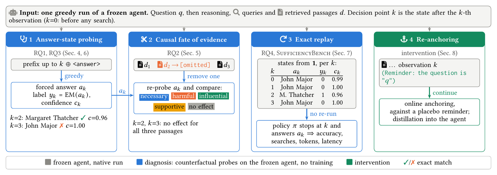
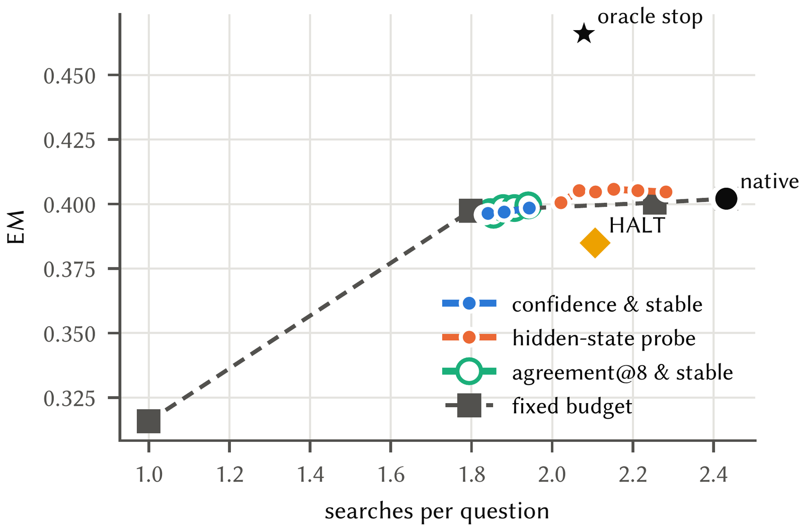

Search agentsReinforcement learningEvaluation protocolBenchmark

RL-trained search agents decide on their own when to stop searching. Forcing an answer at every decision point of a frozen agent shows that they <b>often hold the right answer and then lose it</b>. Their confidence does not reveal when this happens, none of the stopping methods we evaluate gains significantly, and a one-line reminder of the question recovers part of the loss.

<a class="sa-btn" href="#protocol">The protocol</a><a class="sa-btn ghost" href="#findings">Findings</a><a class="sa-btn ghost" href="#reanchoring">Re-anchoring</a><a class="sa-btn ghost" href="#sufficiencybench">SufficiencyBench</a>Paper &amp; code: coming soon

<figure class="sa-fig" id="sa-traj">

Example

Stop the agent

<figcaption>Figure 1 · Interactive<b class="sa-title" id="sa-ttitle"></b>Real trajectories of Search-R1-7B. Each column is a decision point <i>k</i>: the gray box is what the agent searched and retrieved to get there, and the blue box is the answer we force from the frozen agent at that point, with its confidence. Pick a point to stop the agent there. The first example is Figure 1 of the paper; the second, from the released data, shows the more common case of an answer the agent knew before searching.</figcaption></figure>

5–8%

of questions are answered correctly at some decision point but wrongly at the end, with the agents' own reasoning allowed

84–93% vs. 23–30%

mean confidence of the RL agents' forced answers against the share that is correct

≤ +0.4 vs. +6.6–9.4

accuracy points gained by the best stopping rule (not significant) against an oracle that stops at the first correct point

+0.5 to +1.7

accuracy points from restating the question after every observation; a placebo reminder gives −1.3 to +0.6

## Background {#background}

Search agents such as Search-R1, ZeroSearch and AutoRefine are language models trained with reinforcement learning to answer questions by interleaving reasoning with calls to a search engine. They decide on their own when to stop and answer. Every extra search costs latency and money, so many recent methods try to make them stop earlier, by penalising tool calls in the reward or by attaching a controller that stops a frozen agent once its evidence looks sufficient. These methods assume that the agent's state (its confidence, its attention to retrieved passages, its hidden representations) <b>reveals when the evidence already suffices</b>. For search agents this assumption is rarely tested, and this work tests it.

<b>Decision point <i>k</i></b>The state of a run before any search (<i>k</i> = 0) and right after the <i>k</i>-th retrieved observation. At each one the agent chooses between searching again and answering.

<b>Forced answer <i>ak</i></b>The answer the frozen agent gives when we append its answer tag at decision point <i>k</i>. Decoding is greedy and the prefix is identical, so this is exactly what the agent would output if stopped there.

<b>Reasoning-allowed forcing</b>A second variant that keeps the agent's own reasoning text after point <i>k</i>, up to where it would search or answer, and forces the answer there. Both variants are reported.

<b>Closed-book</b>Correct at <i>k</i> = 0: the agent would have answered correctly from its own knowledge, before any search.

<b>Abandoned question</b>The forced answer is correct at some decision point, but the agent's final answer is wrong. The agent had the answer and lost it.

<b>Oracle stop</b>Stop at the first decision point whose forced answer is correct. No real method can do this; it is the headroom a stopping method could recover.

<b>Agents studied</b>Four public RL-trained agents: Search-R1 (Qwen2.5-7B and 3B), ZeroSearch (Qwen2.5-7B) and AutoRefine (Qwen2.5-7B). An untrained reference, Qwen2.5-7B-Instruct with the Search-R1 prompt, shows what is there without RL, and Search-R1-14B serves as a scale check. Each agent keeps its own training-time prompt, loop protocol and search budget.

## The diagnostic protocol {#protocol}

The protocol asks two questions at every decision point of a frozen agent: <i>what would the agent answer if it stopped now</i>, and <i>which retrieved passages actually shape that answer</i>. Because the agents decode greedily, both counterfactuals are exact, and everything is computed from one native run per question, with no training.

1<b class="h">Probe the answer state</b>
Force an answer at every decision point, with and without the agent's reasoning. Record whether it is correct and how confident the agent is.
Answers: when is the answer already there, and does the agent know?

2<b class="h">Trace the evidence</b>
Remove each newly retrieved passage, one at a time and jointly, and force the answer again. A passage is <i>necessary</i>, <i>harmful</i>, <i>influential</i>, <i>supportive</i> or has no effect.
Answers: where does retrieved evidence go?

3<b class="h">Replay stopping policies</b>
Stopping only truncates a greedy run, so any stopping policy can be replayed exactly on the recorded states, each one charged for the probes it uses.
Answers: how much headroom do stopping methods recover?

4<b class="h">Re-anchor</b>
An intervention, not a diagnosis: restate the question after every observation, and compare with a placebo reminder that leaves the question out.
Tests: does the question fade as the agent reads?

<figure class="sa-fig"><figcaption>Figure 2<b class="sa-title">The diagnostic protocol and re-anchoring.</b>The paper's overview. From one greedy run of a frozen agent, we (1) force an answer at every decision point and record its correctness and confidence, (2) remove newly retrieved passages and probe again to label their causal fate, and (3) replay any stopping policy exactly on the recorded states, which we release as SufficiencyBench. (4) Re-anchoring restates the question after every observation. The example values are those of the trajectory in Figure 1.</figcaption></figure>

<b>Setup.</b> 6,125 questions from seven QA benchmarks (NQ, TriviaQA, PopQA, HotpotQA, 2WikiMultihopQA, MuSiQue, Bamboogle), all agents in one retrieval environment: E5-base over the 21M passages of the Wikipedia-2018 dump, top-3 passages per query, as in Search-R1's training. Accuracy is exact match (EM). The findings are checked with a strict LLM judge, a second question sample, top-5 retrieval, sampled trajectories and Search-R1-14B.

## Findings {#findings}

### 1. Agents hold the right answer and then lose it

For every RL-trained agent, the answer is often available long before the agent stops. Between 17.6% and 23.1% of questions are answered correctly before the first search, yet the agents still search, and 20–27% of all search calls are issued after the forced answer is already correct. On 6.8–9.1% of questions the agent is correct at some decision point and wrong at the end. When it may first write its own reasoning, 5.2–8.2% remain.

<figure class="sa-fig">

Agent

Share of the 6,125 questions

Where the wrong final answer of an abandoned question comes from

<figcaption>Interactive<b class="sa-title">When is the answer already there, and how is it lost? (Tables 1 and 9)</b>Top: forced answers under direct forcing unless stated. "Beyond sampling" counts an abandoned question only if none of 8 answers sampled at the last decision point is correct, a conservative rate. Bottom: abandoned questions whose final answer also fails a lenient match, split by where that wrong answer appears.</figcaption></figure>

Table 1 **When is the answer already there?** Excerpt; shares in % of 6,125 questions.

| Agent | EM | Searches | Correct before any search | Abandoned | with reasoning | beyond sampling | Oracle: Δ searches |
|---|---|---|---|---|---|---|---|
| Search-R1-7B | 42.0 | 2.42 | 22.0 | 9.1 | 8.2 | 5.4 | −27% |
| Search-R1-3B | 32.8 | 1.50 | 17.6 | 9.0 | 7.0 | 3.9 | −20% |
| ZeroSearch-7B | 33.8 | 1.06 | 20.4 | 7.9 | 5.2 | 3.6 | −21% |
| AutoRefine-7B | 43.6 | 1.81 | 23.1 | 6.8 | 5.3 | 3.8 | −25% |
| Qwen2.5-7B-Inst. (untrained) | 32.8 | 1.38 | 16.0 | 6.7 | 3.2 | 3.2 | −15% |

<b>How to read it.</b> The oracle stops at the first correct decision point; its accuracy gain equals the abandoned share by construction, so stopping at the right time would raise accuracy by 6.8–9.1 points for the RL agents while cutting searches by 20–27%.

Most abandoned questions were correct before any search (56–71%; 67–90% with reasoning), and in 66–76% of these the wrong final answer appears in a later passage: retrieved text overrides a correct answer the model already had. Answers found by searching and then lost, as in Figure 1, are rarer: 2.3–4.0% of questions, and 0.5–2.7% with reasoning. Sampling at the final state recovers about half of the oracle's gain, which leaves 3–5% of questions lost beyond what sampling recovers.

### 2. Single passages rarely decide the answer

Removing one newly retrieved passage has no marginal effect on the agent's current answer for 70–80% of passages across the four RL agents. Only 2.6–4.2% are necessary (removing them turns a correct answer wrong) and 1.6–3.0% are harmful (removing them turns a wrong answer right). Gold supporting passages behave the same way, because the answer was already settled or another passage carries the same fact.

<figure class="sa-fig">

Agent

Effect of removing one newly retrieved passage on the current forced answer

<figcaption>Interactive<b class="sa-title">Causal fate of retrieved passages (Table 2).</b>Each passage of the newest observation is replaced by an omission marker and the answer is forced again. <i>Influential</i>: the answer changes without flipping correctness. <i>Supportive</i>: the answer stays but its log-probability drops by more than one nat. Measured on 300 questions per dataset.</figcaption></figure>

Single removal cannot see redundancy, so we also remove whole observations. That changes the forced answer in 46–64% of observations, and for 20–23% of observations only a joint removal changes it. Passages matter together more than one by one. These measures concern the current answer only: a passage can still steer the next query or the final answer.

### 3. Confidence does not tell right from wrong

A stopping rule needs the agent's state to reveal whether its current answer is right. Two properties matter. <b>Calibration</b> is poor but repairable: forced answers are 84–93% confident and 23–30% correct, and Platt scaling fitted on other questions lowers the calibration error from 0.54–0.67 to 0.05 or less. <b>Discrimination</b>, which a stopping rule needs and recalibration cannot change, is only moderate.

<figure class="sa-fig">

Agent

Forced answers over all decision points

How well each signal separates right from wrong answers (AUC)

bars run from 0.5 (chance) to 1.0 (perfect)

<figcaption>Interactive<b class="sa-title">Do agents know when they know? (Table 3)</b>Confidence is the geometric mean of the answer's token probabilities. Agreement is the share of 8 sampled answers that match the forced one. The probe is a linear classifier on the agent's hidden state, trained on a disjoint pool of questions.</figcaption></figure>

Sampling does not help either: all eight samples coincide at 40–65% of the RL agents' decision points, including 31–57% of those with a wrong answer. The untrained reference is equally miscalibrated, but its uncertainty is more informative (agreement AUC 0.82 against 0.66–0.72, probe 0.84 against 0.74–0.77). With a single untrained model, this is only suggestive evidence that outcome-reward RL collapses the variability that uncertainty-based stopping would need.

### 4. No stopping method recovers the headroom

We replay each stopping method exactly on the recorded states. The label-free rules trace nearly the same accuracy–cost curve as a fixed search budget. None improves accuracy by more than 0.4 points and none of the gains is significant, whereas 13 of the 36 comparisons with the native agent are significant losses after Holm correction. The oracle gains 6.6–9.4 points while saving 16–27% of searches.

<figure class="sa-fig">

Agent

Change in exact match against the native agent (points)

<figcaption>Interactive<b class="sa-title">Stopping methods replayed on SufficiencyBench (Table 4).</b><b>Budget-2</b>: at most two searches. <b>Conf.+stable</b>: stop when confidence ≥ 0.95 and the forced answer equals the previous one. <b>Agree+stable</b>: all 8 samples agree and the answer is stable. <b>Probe</b>: hidden-state probe ≥ 0.5. <b>Probe (closed-book)</b>: probe ≥ 0.8, also allowed to answer before the first search. <b>HALT</b>: an external verifier attached to the same trajectories; our setting differs from the original, so this does not test HALT as published. Stars: paired exact McNemar test against the native agent, Holm-adjusted (* <i>p</i> &lt; 0.05, ** <i>p</i> &lt; 0.01, *** <i>p</i> &lt; 0.001). 300 questions per dataset.</figcaption></figure>
<figure class="sa-fig narrow"><figcaption>Figure 3<b class="sa-title">Accuracy–cost frontier of stopping methods for Search-R1-7B.</b>Each curve sweeps the threshold of one signal; "stable" requires the same forced answer at the previous decision point. The sweeps stay on the fixed-budget curve next to the native agent, and the oracle sits far above all of them. The best operating points save 15–26% of searches at a loss of at most half a point.</figcaption></figure>

Supervised baselines do no better. A learned stopping head reaches AUC 0.78–0.86 for "answering now is correct", but under risk control it never stops early, and its best threshold in hindsight gains at most 0.4 points. Search-R1-14B is more accurate than the 7B agent and repeats every pattern: 7.4% of its questions are abandoned, and every stopping method loses accuracy.

## Re-anchoring: keeping the question in view {#reanchoring}

More than half of the abandoned questions end with an answer taken from a passage retrieved after the agent was already correct, and in Figure 1 the agent ends up answering a question next to the one it was asked. <b>Online anchoring</b> restates the question after every observation and lets the agent continue as usual:

&lt;information&gt; ...retrieved passages... &lt;/information&gt;
(Reminder: the question is "What United Kingdom Prime Minister was succeeded in the 1990s by the Leader of the Conservative Party?")

# placebo, same form and position, without the question
(Reminder: read the information carefully before you continue.)

We use the reminder as a probe of the mechanism behind abandonment, not as a new method. It raises the accuracy of every agent, significantly for five of six. The placebo reminder does not help, so the gain comes from the question itself.

<figure class="sa-fig">

Change in exact match against the native agent (points, 6,125 questions)

<figcaption>Table 5<b class="sa-title">The question reminder helps; a placebo reminder does not.</b>Green: reminder with the question. Gray: placebo reminder without it. Stars: paired exact McNemar test against the native agent (* <i>p</i> &lt; 0.05, ** <i>p</i> &lt; 0.01, *** <i>p</i> &lt; 0.001). The reminder beats the placebo for every agent, by 0.6–2.9 points (Holm-adjusted <i>p</i> ≤ 0.041).</figcaption></figure>

Table 5 **Online anchoring on the 6,125 test questions.** Changes against the native agent.

| Agent | Native EM | Reminder: Δ EM | Δ searches | Placebo: Δ EM | Reminder − placebo |
|---|---|---|---|---|---|
| Search-R1-7B | 42.8 | **+1.7**\*\*\* | +5% | +0.3 | +1.4\*\*\* |
| Search-R1-3B | 32.9 | **+1.6**\*\*\* | −3% | +0.6 | +1.1\* |
| ZeroSearch-7B | 33.8 | +0.5 | −2% | −0.3 | +0.8\* |
| AutoRefine-7B | 44.0 | **+0.9**\*\* | −3% | +0.3 | +0.6\* |
| Search-R1-14B | 45.6 | **+1.2**\*\*\* | 0% | +0.2 | +1.0\*\* |
| Qwen2.5-7B-Inst. (untrained) | 33.0 | **+1.6**\*\*\* | +4% | −1.3\*\* | +2.9\*\*\* |

<b>How to read it.</b> Native EM here scores a run that ends without an answer by its last forced answer, so it differs slightly from Table 1. Green marks significant gains. The reminder changes the number of searches by −3% to +5%: it is not a stopping rule.

**No measurable query drift.** If the agents' queries drifted away from the question, the queries of abandoned questions should move away from it and the reminder should change them. Neither happens: after the first correct point, the similarity to the question of the queries of abandoned and retained questions differs by −0.006 to +0.002, every 95% interval covers zero, and anchoring leaves query similarity unchanged. Our query measures cannot detect a changed relation, such as the query for Thatcher's successor in Figure 1, so we conclude only that the queries show no measurable drift, which points to the agents' reasoning over what they have read.

**Distilling the reminder.** Fine-tuning Search-R1-7B on its own reminded trajectories, with the reminder removed, gains 1.0 points with no reminder at test time and beats a self-training control by 0.95 points (<i>p</i> = 0.004). Training against abandonment directly with preference optimization lowered abandonment but taught premature stopping.

## SufficiencyBench {#sufficiencybench}

We release the decision states behind these findings as <b>SufficiencyBench</b>: 97,841 decision points on 6,125 questions from six agents (the four RL agents, HiPRAG and the untrained reference). Each point records the question and gold answers, the query and retrieved passages, the forced answers with and without reasoning and their oracle labels (string match and LLM judge), the outcome and token cost of the native continuation, and the baseline signals studied here.

<b>Exact replay</b>The evaluator replays a stop/continue policy in order, charges every forced answer it reads, and reports accuracy, searches, tokens and latency. Under greedy decoding this equals re-running the agent under the policy.

<b>Fixed split</b>Methods are fit on a calibration pool (train), may be tuned on 4,200 questions outside the replay subset (dev), and are evaluated once on the replay subset of 1,925 questions (test).

<b>Cost</b>A new stopping method is compared with the others on identical states in seconds on a CPU, without running an agent or a retriever.

<b>Scope</b>Replay covers policies that truncate the native trajectory. Interventions such as re-anchoring need new rollouts; our native, anchored and placebo runs are released for comparison.

One line per decision point. This is the record behind the correct answer in Figure 1 (abridged, values rounded):

{"agent": "sr1_7b", "qid": "hotpotqa-dev_6008", "dataset": "hotpotqa", "k": 2,
 "question": "What United Kingdom Prime Minister was succeeded in the 1990s by the Leader of the Conservative Party?",
 "golds": ["Margaret Thatcher"],
 "query": "Leader of the Conservative Party in the 1990s",
 "docs": [{"id": "6451293", "title": "1990 Conservative Party (UK) leadership election"}, ...],
 "answer_now": "Margaret Thatcher", "correct_now": 1.0,        # forced answer at this point and its oracle label
 "answer_final": "John Major", "correct_final": 0.0,           # what happens if the agent continues
 "n_search_native": 3, "prefill_so_far": 665, "decode_so_far": 137,
 "signals": {"conf": 0.960, "stable": false, "agree8": 1.0, "probe_p": 0.144},
 "split": "dev", ...}

A policy sees one decision point at a time, in order, and the first <code>True</code> ends the episode with the forced answer. The evaluator is a single script and will be released with the data:

python evaluate.py data/sr1_7b.jsonl.gz --policy budget:2
python evaluate.py data/sr1_7b.jsonl.gz --policy conf_stable:0.95
python evaluate.py data/sr1_7b.jsonl.gz --policy oracle --closed_book --coef latency/7b.json

from evaluate import load, evaluate
states = load("data/sr1_7b.jsonl.gz")
my_policy = lambda s: s["k"] >= 1 and s["signals"]["probe_p"] >= 0.6
print(evaluate(states, my_policy, closed_book=False))

Contents **Decision states per agent**, with the two reference rows a new method should be compared with (all 6,125 questions).

| Agent | Decision states | Native accuracy | Oracle stop |
|---|---|---|---|
| Search-R1-7B | 20,949 | 42.0 | 51.0 |
| Search-R1-3B | 15,323 | 32.8 | 41.8 |
| ZeroSearch-7B | 12,648 | 33.8 | 41.7 |
| AutoRefine-7B | 17,216 | 43.6 | 50.4 |
| HiPRAG-3B | 17,128 | 51.1 | 60.5 |
| Qwen2.5-7B-Inst. (untrained) | 14,577 | 32.8 | 39.4 |

<b>How to read it.</b> Accuracy is exact match, except for HiPRAG, which answers in free-form sentences and is scored by whether the answer contains a gold answer. The oracle stops at the first correct decision point, before any search if the agent is already correct.

## Takeaways {#takeaways}

<ul class="sa-take">
<li><b>Stopping can raise accuracy, not only save searches.</b> Most lost answers were known before the first search, and later searches often bring in the passage whose answer the agent ends with. Deciding whether and when to search is worth up to 9 points for these agents.</li>
<li><b>Confidence needs discrimination, not recalibration.</b> Recalibration fixes the level of the agents' confidence but cannot add the ranking it lacks. We suggest training agents or light heads on the oracle labels of SufficiencyBench to predict whether the answer at the current point is correct, and evaluating them by exact replay.</li>
<li><b>Keep the question in view.</b> A one-line reminder, which is not a stopping rule, recovers up to a quarter of the headroom. It could enter RL rollouts; preference optimization at decision points taught premature stopping or changed little.</li>
<li><b>Prune passages jointly.</b> Removing a single passage rarely changes the current answer, but whole observations matter. Pruning should remove only passages that have no effect also when removed together with others; detecting passages that would overturn an already correct answer is a second target.</li>
<li class="scope"><b>Scope.</b> Short-answer QA over a Wikipedia snapshot, with agents built on Qwen2.5 (3B to 14B); deep-research agents on the live Web may behave differently. Forced answers cannot show the effect of a search the agent did not make, and exact replay requires greedy decoding. Re-anchoring used one wording, and each training run a single seed.</li>
</ul>

Abstract

Search agents trained with reinforcement learning (RL) answer questions by querying a search engine and reading the returned pages until they decide to stop. Methods that make them stop earlier assume that the agent's own state reveals when its evidence suffices. We test this assumption with an exact diagnostic protocol. At every decision point of a frozen agent, we force the answer it would give if stopped, with or without its own reasoning, measure how retrieved passages change that answer, and replay any stopping policy offline. On seven QA benchmarks, public RL-trained agents often hold the right answer and then lose it: with reasoning allowed, 5–8% of questions are answered correctly at some point but wrongly at the end, two thirds or more of them already correct before any search, and 3–5% beyond what sampling at the final state recovers. Single retrieved passages rarely decide the current answer on their own. The agents' confidence, sample agreement and hidden-state probes separate right from wrong answers only moderately, and none of the stopping methods we evaluate gains significantly. Restating the question after every observation raises accuracy by 0.5–1.7 points (significantly for five of six agents), whereas a placebo reminder does not, and we find no measurable query drift, which points to the agents' reasoning rather than their search. These findings hold under an LLM judge and for a 14B agent. We release SufficiencyBench, 97,841 decision states with oracle labels and an exact replay harness.

## Paper and code {#paper-and-code}

Paper, code, SufficiencyBench and BibTeX will be linked here once the preprint is public.




