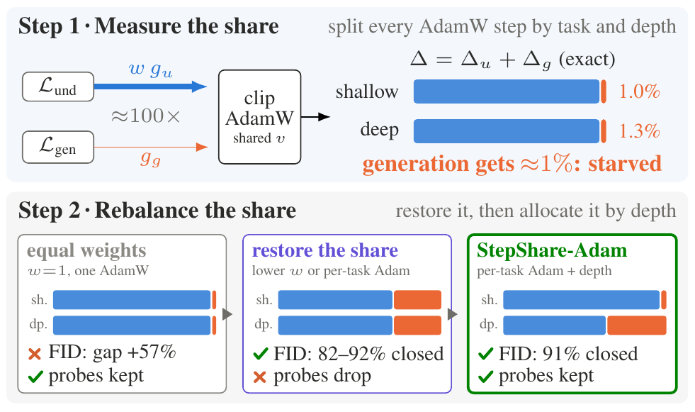
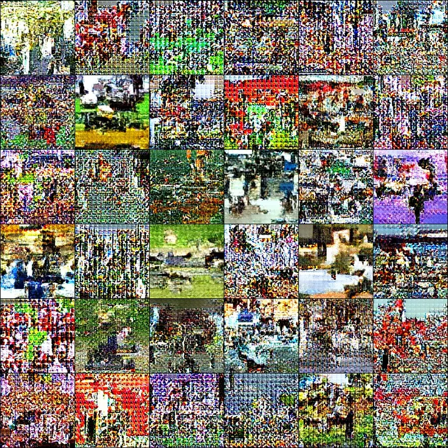
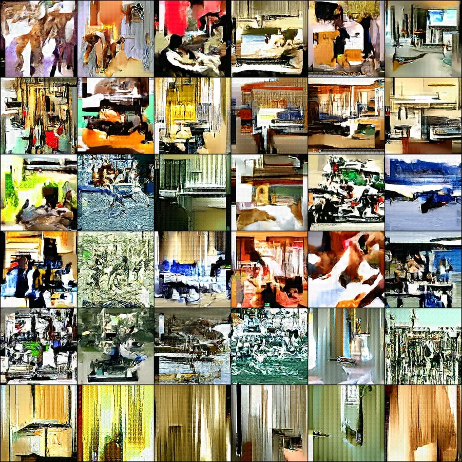

<section class="ss-hero" aria-label="Overview">
  
Under reviewUnified multimodal models · Multi-task optimisation

  
StepShare

  
In a native unified model, generation is <em>starved</em>, not conflicted.

  
Unified multimodal models read and generate images with one backbone, and the generation gap that joint training opens is usually blamed on parameter sharing. <strong>StepShare</strong> splits every AdamW step exactly into an understanding part and a generation part, by depth: at equal loss weights the two gradients are nearly orthogonal, but the understanding gradient is about 100 times larger, so generation receives under 1% of the update. Restoring the share closes most of the FID gap without added parameters, more than task-specific routing, yet quietly lowers intermediate-layer probe accuracy by up to 7 points. <strong>StepShare-Adam</strong>, which restores the share with per-task Adam and allocates it by depth, closes 91% of the gap with essentially no probe cost.

  

    <a class="ss-btn primary" href="#explore-every-arm"><svg width="13" height="13" viewBox="0 0 13 13" aria-hidden="true"><circle cx="3" cy="9.5" r="1.7" fill="currentColor"/><circle cx="6.5" cy="5.5" r="1.7" fill="currentColor"/><circle cx="10.5" cy="3" r="1.7" fill="currentColor"/></svg>Explore the results</a>
    <a class="ss-btn ghost" href="#compare-samples"><svg width="13" height="13" viewBox="0 0 13 13" aria-hidden="true"><rect x="1" y="1.5" width="11" height="10" rx="2" fill="none" stroke="currentColor" stroke-width="1.3"/><path d="M6.5 1.5v10" stroke="currentColor" stroke-width="1.3"/></svg>Compare samples</a>
    <svg width="13" height="13" viewBox="0 0 13 13" aria-hidden="true"><path d="M3 1h5l3 3v8H3z M8 1v3h3" fill="none" stroke="currentColor" stroke-width="1.3"/></svg>Paper · coming soon
    <svg width="13" height="13" viewBox="0 0 13 13" aria-hidden="true"><path d="M4.5 3 1.5 6.5l3 3.5M8.5 3l3 3.5-3 3.5" fill="none" stroke="currentColor" stroke-width="1.4"/></svg>Code · coming soon
  

  

    
<b>Equal weights, one AdamW</b>
<i style="width:99.1%;background:var(--c-und)">understanding</i><i style="width:0.9%;min-width:3px;background:var(--c-gen);padding:0"></i>
0.9%

    
<b>StepShare-Adam, deep half</b>
<i style="width:62.8%;background:var(--c-und)">understanding</i><i style="width:37.2%;background:var(--c-gen)">generation</i>
37.2%

    
Generation's share of the AdamW step's squared norm, as measured by StepShare (mean over training).

  

</section>

  

≈100×

larger understanding gradient, nearly orthogonal to generation's (|cos| ≤ 0.05)

  

0.9%

of each AdamW step goes to generation at equal loss weights

  

7 pts

hidden drop in intermediate-layer probes after naive reweighting

  

91%

of the FID gap closed by StepShare-Adam, worst probe layer −0.5, no added parameters

<h2 id="key-results">Key results</h2>

Finding

<h3 class="ss-h" id="starved-not-conflicted">Starved, not conflicted</h3>
<figure class="ss-fig" style="--accent:var(--c-gen)">
  

  <figcaption><strong>Figure 1.</strong> StepShare: at equal loss weights generation is starved, and restoring its share closes most of the gap.
    At equal weights the two gradients are nearly orthogonal and generation gets 0.9% of the AdamW step. Lowering the understanding weight restores the share and closes most of the FID gap, more than task routing does at equal weights, but costs up to 5.4 probe points in intermediate layers that the last layer and caption NLL do not show.</figcaption>
</figure>

Method

<h3 class="ss-h" id="measure-then-rebalance">Measure the share, then rebalance it</h3>
<figure class="ss-fig" style="--accent:var(--c-und)">
  

    

    

      

1Measure
With one AdamW, the first moment is a sum of one running average per task over a shared denominator, so every step splits exactly into Δu + Δg, logged by depth from the two backward passes joint training already runs.

      

2Restore
Lower the understanding weight or give each task its own Adam state: generation's share rises to 14–38% of the step, and the FID gap closes.

      

3Allocate by depth
StepShare-Adam scales generation's step by β = 0.3 in the shallow half, where the probe cost sits, and keeps it in the deep half, where most of the FID gain comes from.

    

  

  <figcaption><strong>Figure 2.</strong> StepShare. Step 1 splits every AdamW step exactly into an understanding part and a generation part, by depth; Step 2 restores the share and then allocates it by depth.</figcaption>
</figure>

Results

<h3 class="ss-h" id="closing-the-gap">Closing the gap without the hidden cost</h3>
<figure class="ss-fig" style="--accent:var(--c-spl)">
  

  <table class="ss-table">
    <thead><tr><th>Arm (0.6B, w = understanding weight)</th><th>Seeds</th><th>FID gap closed, guidance 1</th><th>Guidance 4</th><th>Worst COCO probe layer</th><th>Worst IN-100</th></tr></thead>
    <tbody>
      <tr><td>Dense, w = 1</td><td>5</td><td>
<i style="width:0%"></i>0% reference
</td><td>0%</td><td>
<i style="width:8%;background:var(--cost)"></i>−0.5
</td><td>−0.3</td></tr>
      <tr><td>Dense, w = 0.03</td><td>5</td><td>
<i style="width:82%;background:var(--c-wgt)"></i>82% ± 12
</td><td>78% ± 10</td><td>
<i style="width:90%;background:var(--cost)"></i>−5.4
</td><td>−5.1</td></tr>
      <tr><td>Task routing, w = 0.03</td><td>5</td><td>
<i style="width:93%;background:var(--c-rte)"></i>93% ± 5
</td><td>96% ± 5</td><td>
<i style="width:48%;background:var(--cost)"></i>−2.9
</td><td>−2.8</td></tr>
      <tr><td>Per-task Adam, w = 1</td><td>3</td><td>
<i style="width:92%;background:var(--c-opt)"></i>92% ± 9
</td><td>97% ± 5</td><td>
<i style="width:60%;background:var(--cost)"></i>−3.6
</td><td>−3.2</td></tr>
      <tr class="hl"><td>StepShare-Adam, w = 1</td><td>5</td><td>
<i style="width:91%;background:var(--c-spl)"></i>91% ± 14
</td><td>89% ± 8</td><td>
<i style="width:8%;background:var(--cost)"></i>−0.5
</td><td>−0.4</td></tr>
    </tbody>
  </table>
  

  <figcaption><strong>Table 2 (excerpt).</strong> Restoring generation's share: loss weight, routing and optimiser changes. Recovery is mean ± 95% CI over seeds, paired by seed; probe columns are points against understanding-only training of the same seed (grey bars: size of the deficit, full bar = 6 points).
    Reweighting and per-task Adam close most of the gap but cost 3 to 5 points in intermediate layers; StepShare-Adam keeps the gain, removes the cost, and adds no parameters.</figcaption>
</figure>

Interactive

<h3 class="ss-h" id="explore-every-arm">Explore every arm</h3>
<figure class="ss-fig" id="ss-explore" style="--accent:var(--c-spl)">
  

    <label>Arm <select id="ss-arm" aria-label="Arm"></select></label>
    <button type="button" data-probe="coco" aria-pressed="true">COCO probe</button><button type="button" data-probe="in" aria-pressed="false">ImageNet-100 probe</button>
  

  

    

FID gap closed vs. hidden cost · click a point to select it

    

Probe change by layer · COCO, vs. und.-only

  

  <figcaption><strong>StepShare-Adam.</strong> 91% ± 14 of the FID gap closed at guidance 1; worst COCO layer −0.5 points.
    Per-task Adam with generation's step scaled by β = 0.3 in the shallow half closes 91% of the gap with a worst COCO layer of −0.5 and no added parameters.</figcaption>
  

All 14 arms of Table 2
<table class="ss-all" id="ss-all"></table>

</figure>

Analysis

<h3 class="ss-h" id="share-follows-ratio">The share follows the gradient ratio</h3>
<figure class="ss-fig" style="--accent:var(--c-wgt)">
  

  <figcaption><strong>Figure 3.</strong> StepShare's gradient ratio and the trade-offs of restoring the share, 0.6B unless marked.
    At equal weights the gradient ratio rises from 11 to 60 as the generation loss falls, and FID recovery follows the training-average ratio across loss weights and clipping schemes. Along the weight sweep, more recovery comes with a deeper probe deficit; depth allocation and StepShare-Adam leave that trade-off.</figcaption>
</figure>

Samples

<h3 class="ss-h" id="same-noise-samples">Same captions, same noise</h3>
<figure class="ss-fig" style="--accent:var(--c-spl)">
  

  <figcaption><strong>Figure 4.</strong> Samples from the same noise.
    At equal weights the dense model produces saturated high-frequency texture; restoring generation's share with StepShare-Adam gives layouts close to generation-only training.</figcaption>
</figure>

<figure class="ss-fig" id="ss-compare" data-base="/images/projects/2026-11-stepshare/samples" style="--accent:var(--c-spl)">
  

    <label>Left <select id="ss-wa" aria-label="Left grid"></select></label>
    <label>Right <select id="ss-wb" aria-label="Right grid"></select></label>
    Drag across the grid to compare.
  

  

    
    
    

⇆

    
Dense, w = 1 · FID 340

StepShare-Adam · FID 142

    <input type="range" id="ss-wpos" min="0" max="100" value="50" step="0.5" aria-label="Comparison divider position">
  

  <figcaption><strong>Compare any two arms.</strong> The first 36 FID samples of each arm without selection (seed 0, guidance scale 4); every cell uses the same caption and initial noise in all grids, so cells compare one to one. FID is that seed's.</figcaption>
</figure>

<h2 id="links-and-citation">Links and citation</h2>

  

Paper

Under review; the PDF and BibTeX will be linked here when they are public.

  

Code

Will be released with the paper.

