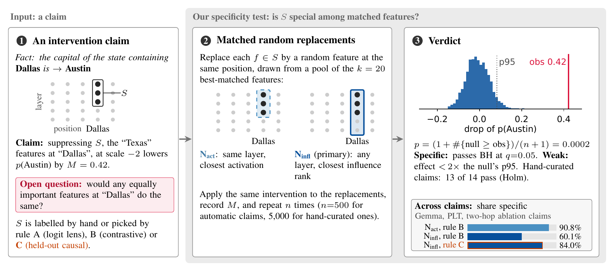
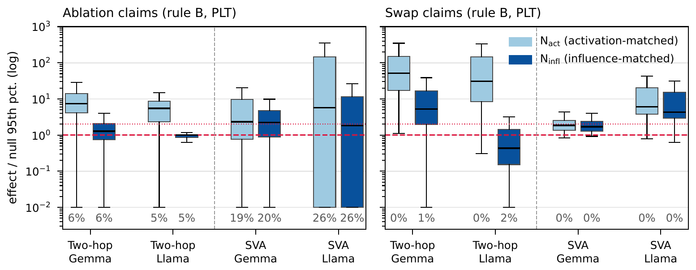

Mechanistic interpretabilityAttribution graphsStatistical testing

Circuit-tracing studies back their claims with interventions: suppress a labelled group of features, a <i>supernode</i>, and the answer changes. That shows these features matter, not that they are special. We test each claim against random features that the attribution graph ranks as equally important. <b>13 of 14 hand-curated claims pass</b>; for automatically selected supernodes, the verdict depends on the selection rule, on the null model and on which features the null may draw.

<a class="sn-btn" href="#how-the-test-works">The test</a><a class="sn-btn ghost" href="#results">Results</a><a class="sn-btn ghost" href="#what-to-report">What to report</a>Paper &amp; code: coming soon

<figure class="sn-fig" id="sn-try">

Claim

Null
<button type="button" data-v="act">activation-matched</button><button type="button" data-v="infl">influence-matched (primary)</button><button type="button" data-v="inject">inject-only</button>

<figcaption>Interactive<b class="sn-title">Is this supernode special? One published claim against its null.</b>Pick one of the 14 hand-curated claims (D, M: Gemma-2-2B, from the circuit-tracer tutorial; L: Llama-3.2-1B, from its demo). Gray bars: the claimed metric when every labelled feature is replaced by a matched random feature and the same intervention is applied (5,000 draws for the influence-matched and inject-only nulls, 500 for the activation-matched one). The marked line is the published supernode; short ticks on the axis are random draws that reach it. D3 is the “Texas” example of Figure 1, D4 the one claim that fails, and M1 passes although some random draws go further.</figcaption></figure>

## Background

An <b>attribution graph</b> explains one model output. The model's MLPs are replaced by sparse <i>transcoder</i> features, the output is attributed to those features, and the analyst groups the important ones into labelled supernodes such as “Texas”. The account is then checked by intervention. On the prompt <i>Fact: the capital of the state containing Dallas is</i>, suppressing the “Texas” supernode removes “Austin” from the output, and also injecting “California” features makes the model say “Sacramento”.

These interventions carry the evidence, but they answer a weaker question than the one they are used for. The last city token may host many active features that contribute to the answer, and suppressing ten of them may remove the answer whichever ten are chosen. Supernode interventions are usually reported without a null model, even as automated pipelines begin to build supernodes at scale.

The question this work makes testable: would any equally important features at “Dallas” do the same?

<b>Transcoder</b>Sparse features that replace a model's MLPs so that an output can be attributed to them: one set per layer (per-layer transcoder, <b>PLT</b>) or a single set that writes to all later layers (cross-layer transcoder, <b>CLT</b>).

<b>Supernode</b>A group of transcoder features under one label, chosen by hand or by a rule. Each member is a (layer, position, feature) triple.

<b>Ablation claim</b>Suppress the supernode at −2 times its activation. The metric is the drop in <i>p</i>(answer).

<b>Swap claim</b>Also inject a donor prompt's supernode at +2 at the same position. The metric is <i>p</i>(donor's answer).

<b>Activation-matched null</b>Replace each labelled feature by one of the 20 active features in the same layer and position with the closest activation. This is the familiar random-feature baseline.

<b>Influence-matched null</b>Replace it by one of the 20 features at the same position, in any layer, with the closest attribution-influence rank: features the graph itself treats as equally important. Our primary null.

<b>Specific, weak</b>A claim is <i>specific</i> if its effect beats the influence-matched null after multiple-comparison correction (Benjamini–Hochberg at <i>q</i> = 0.05 within a family of claims; Holm at α = 0.01 for the 14 hand-curated ones). A specific claim is <i>weak</i> if its effect is below twice the null's 95th percentile.

## How the test works

1<b class="h">Fix the claim</b>
A prompt, the feature groups with their scales, and one metric chosen before testing. The metric has to be the one the claim is about: suppressing French features looks non-specific under a generic drop in top-1 probability (<i>p</i> = 0.08) and specific under the claimed <i>p</i>(“big”) (<i>p</i> = 0.002), on the same 5,000 draws.

2<b class="h">Draw matched replacements</b>
Replace every labelled feature by a random feature at the same position, taken from its 20 best matches. Apply the same intervention, record the metric, and repeat <i>n</i> times: 500 for automatic claims, 5,000 for hand-curated ones. Labelled features are kept out of the pools.

3<b class="h">Compare and correct</b>
<i>p</i> = (1 + #{null ≥ observed}) / (<i>n</i> + 1), corrected within each family of claims. The effect-to-null ratio is reported as well: a pass by less than twice the null's 95th percentile is marked weak.

Every intervention uses circuit-tracer's <code>feature_intervention</code> unchanged, with attention frozen. Swap claims get a third null, <i>inject-only</i>, which keeps the real suppression and randomises only the injected features.

<figure class="sn-fig"><figcaption>Figure 1<b class="sn-title">Testing an intervention claim against matched nulls.</b>The paper's overview. (1) A claim: the “Texas” supernode at the last city token, suppressed at −2, with the drop in <i>p</i>(Austin) as the metric. (2) Each feature of the supernode is replaced by a random feature at the same position, matched on activation (Nact) or on attribution-influence rank (Ninfl). (3) The observed effect is compared with the null distribution. Inset: shares of specific Gemma per-layer two-hop ablation claims.</figcaption></figure>

<b>Where the automatic supernodes come from.</b> Besides the 14 hand-curated claims, we test 2,958 claims whose supernodes are picked by a rule at the position where the intermediate variable should be represented: the city token in two-hop recall, the subject noun in agreement.

<b>Rule B, contrastive</b>The ten features whose activation on the prompt most exceeds their activation on a donor prompt: a city from another region, or the same sentence with the subject's number flipped.

<b>Rule C, held-out causal</b>On a <i>sibling</i> prompt that shares the intermediate variable (the other city in the same state or country), ablate each active feature alone, keep the ten with the largest effect, and retain those active on the test prompt. The test prompt's output is never used.

<b>Rule C′</b>Rule C held out in the target as well: features are scored on the sibling's one-hop prompt, “Fact: {sibling} is a city in the state of”, by the drop in <i>p</i>(region).

<b>Tasks and models</b>Two-hop recall (“Fact: the capital of the {state|country} containing {city} is”, 200 prompts) and subject–verb agreement (“The {noun} that I saw yesterday”, 200 prompts), on Gemma-2-2B and Llama-3.2-1B with public per-layer and cross-layer transcoders. Only correctly answered prompts are kept.

The rules are simple heuristics that we constructed. Published annotation pipelines were not tested.

## Results

13 / 14

hand-curated claims from the circuit-tracer tutorial and demo pass the influence-matched null (5,000 draws, Holm at α = 0.01)

89–100% → 10–82%

contrastive per-layer two-hop claims judged specific under the activation-matched null, and under the influence-matched one

10–31 points

lower share of specific contrastive claims when the null may also draw features that other rules select (0–56% remain)

55–97%

of the two-hop ablation claims that pass beat their null's 95th percentile by less than a factor of two

### Hand-curated claims pass

Thirteen of the fourteen claims pass, and every swap claim also passes its inject-only null (<i>p</i> ≤ 0.0004), so it matters which donor features are injected. The one failure, D4, is a claim that the tutorial itself describes as largely ineffective. Its effect is 1.3 times its null's 95th percentile, and in bf16 arithmetic its verdict changes with the GPU type. The tutorial's two other unsuccessful interventions fail as negative controls (<i>p</i> = 0.91 and 0.32).

Passing does not mean that only the labelled features can produce the effect. For M1, some random suppressions exceed the observed effect (largest 0.67 against 0.49). The curated examples may also have been chosen because they worked.

Table 1 **The 14 hand-curated claims under the influence-matched null** (5,000 draws each). The figure at the top of this page shows the draws behind each row.

| Claim | Intervention → claimed metric | Observed | Null 95th pct. | *p* | Holm, α = 0.01 |
|---|---|---|---|---|---|
| D1 | “say a capital” ×(−2) → *p*(Texas) | 0.460 | 0.185 | 0.0002 | pass |
| D2 | “capital” ×(−2) → drop of *p*(Austin) | 0.407 | 0.106 | 0.0002 | pass |
| D3 | “Texas” ×(−2) → drop of *p*(Austin) | 0.423 | 0.083 | 0.0002 | pass |
| D4 | “state” ×(−2) → drop of *p*(Austin) | 0.051 | 0.039 | 0.016 | **fail** |
| D5 | Texas ×(−2) + California ×2 → *p*(Sacramento) | 0.364 | 0.005 | 0.0002 | pass |
| D6 | Texas ×(−2) + China ×2 → *p*(Beijing) | 0.212 | &lt;0.001 | 0.0002 | pass |
| M1 | French ×(−2) → *p*(“big”) | 0.486 | 0.075 | 0.002 | pass |
| M2 | French ×(−2) + Chinese ×2 → *p*(Chinese “big”) | 0.846 | &lt;0.001 | 0.0002 | pass |
| M3 | small ×(−2) + big ×2 → *p*(“petit”) | 0.863 | 0.012 | 0.0002 | pass |
| L1 | China ×0 → drop of *p*(yuan) | 0.381 | 0.031 | 0.0002 | pass |
| L2 | China ×0 + Thailand/SEA ×1 → *p*(“ba”) | 0.638 | 0.015 | 0.0002 | pass |
| L3 | China ×0 + Thailand ×2 at the colon → *p*(“ba”) | 0.275 | 0.002 | 0.0002 | pass |
| L4 | currency ×0 + language ×5 → *p*(Chinese) | 0.164 | 0.027 | 0.0002 | pass |
| L5 | US ×0 + Scandinavia/Denmark ×5 → *p*(Scandinavian languages) | 0.451 | 0.036 | 0.0002 | pass |

<b>How to read it.</b> D and M: Gemma-2-2B, from the circuit-tracer tutorial; L: Llama-3.2-1B, from its demo. Observed: the claimed metric under the published intervention. 0.0002 is the smallest <i>p</i> that 5,000 draws can give. “ba” is the first token of “baht”.

### The null model changes the verdict on two-hop recall

<figure class="sn-fig" id="sn-shares">

Claims
<button type="button" data-v="abl">ablation</button><button type="button" data-v="swap">swap</button>
Null
<button type="button" data-v="act">activation-matched</button><button type="button" data-v="infl">influence-matched</button>
Null pool excludes
<button type="button" data-v="common">features of every compared rule</button><button type="button" data-v="orig">only the rule's own run</button>

<i style="background:var(--sn-b)"></i>rule B, contrastive<i style="background:var(--sn-c)"></i>rule C, held-out causalWilson 95% interval

0%share of claims judged specific100%

<figcaption>Interactive<b class="sn-title">Same claims, two nulls: switch the null and the two-hop shares fall; agreement barely moves.</b>Share of automatically constructed claims judged specific (Benjamini–Hochberg at <i>q</i> = 0.05 within each family), by task, model and transcoder. The values are those of Figure 3 and Table 6 of the paper; hover or focus a bar for the counts. The third switch shows the original runs, in which a feature selected by one rule could be drawn as a replacement for the other rule's claims.</figcaption></figure>

On two-hop recall, between 11 and 77 claims per family are specific only under the activation-matched null, and at most one only under the influence-matched null (exact one-sided McNemar test, all <i>p</i> ≤ 0.001). On agreement the two nulls differ little: no family reaches <i>p</i> &lt; 0.01. A probe gives partial support for one explanation. At the city position, activation-matched replacements are nearly inert (median single-feature effect near zero, against 0.004 in the influence-matched pool), so beating them is an easy bar.

<b>What the null may draw matters too.</b> In the original runs, each rule's null pool excluded only the features of the rules run with it. There, 0–56% of contrastive per-layer two-hop claims were specific, against 10–82% once the pools exclude the features of every compared rule, while the observed effects barely changed. Features that other rules select are strong replacements, so absolute shares depend on what the pools exclude.

### The selection rule changes which claims pass

Table 2 **Two-hop recall under the influence-matched null: share of specific claims with rule B and with rule C.** Null pools exclude the features of all compared rules.

| Model · transcoder (prompts) | Ablation, B → C | C-only / B-only | *p* | Swap, B → C | C-only / B-only | *p* |
|---|---|---|---|---|---|---|
| Gemma-2-2B · PLT (163) | 60.1% → **84.0%** | 43 / 4 | 3·10⁻⁹ | 81.6% → 80.4% | 14 / 16 | 0.86 |
| Llama-3.2-1B · PLT (92) | 44.6% → **78.0%** | 40 / 10 | 2·10⁻⁵ | 9.8% → **56.7%** | 44 / 2 | 3·10⁻¹¹ |
| Gemma-2-2B · CLT (163) | 85.9% → 82.2% | 12 / 18 | 0.36 | 85.3% → **70.6%** | 10 / 34 | 4·10⁻⁴ |
| Llama-3.2-1B · CLT (92) | 83.7% → 77.8% | 8 / 13 | 0.38 | 48.9% → **72.2%** | 23 / 2 | 2·10⁻⁵ |

<b>How to read it.</b> C-only / B-only: claims that are specific under one rule and not the other. <i>p</i>: exact two-sided McNemar test on those counts; bold marks a difference at <i>p</i> &lt; 0.05, in either direction (for Gemma's cross-layer swaps, rule C is worse).

<b>Ablation claims.</b> With per-layer transcoders, rule C yields more specific claims than rule B (Gemma 60% → 84%, Llama 45% → 78%). Part of this advantage is built in: rule C selects features by their ablation effect on a prompt with the same answer, and the test asks whether they have a larger ablation effect than matched features. The advantage survives a rule-matched null that draws other features the same rule ranks highly (91% against 73%, and 95% against 52%), and rule C′, which never selects on the answer, behaves like rule C.

<b>Swap claims</b>, which no rule selects on, are the more informative comparison. Rule C helps for Llama (10% → 57%) and not for Gemma (82% against 80%). With cross-layer transcoders, contrastive supernodes are specific more often (49–86%), and rule C does not improve ablation claims. Across both transcoder types, the evidence that causal selection finds more specific features therefore rests on Llama.

### Most two-hop ablation claims that pass are weak

On two-hop recall, 55–58% (Gemma) and 92–95% (Llama) of the specific per-layer ablation claims beat their null's 95th percentile by less than a factor of two, and 72–97% of the cross-layer ones. Suppressing ten equally important features at the city position removes a similar share of the answer. Swap claims are rarely weak (0–18%), and on agreement most specific ablation claims are strong (5–16% weak).

<figure class="sn-fig"><figcaption>Figure 5<b class="sn-title">How far claims clear their null.</b>Effect divided by the null's 95th percentile (rule B, per-layer transcoders) under the activation-matched null (light) and the influence-matched null (dark). Dashed line: ratio 1. Dotted line: ratio 2, the threshold for a weak claim. On two-hop recall the ratios under the activation-matched null lie well above those under the influence-matched null; on agreement the two overlap. Gray numbers: share of claims below 0.01, which are clipped.</figcaption></figure>

## What a pass or a failure means

The test does not certify a label. It asks whether the labelled set changes the claimed output more than features that the attribution graph treats as equally important at the same position. <b>A pass</b> shows that not any such set would do. <b>A failure</b> shows only that the claim, as stated about these features, is not supported over that alternative: the label may be wrong, or the variable may be encoded redundantly by unlabelled features in the null pool. The test alone cannot tell these two apart.

## What to report

Because selection rules and nulls change verdicts, we suggest that an intervention result on an attribution graph comes with:

<ul class="sn-take">
<li><b>A claim-specific metric, fixed in advance.</b> Prefer swap claims, or metrics such as the answer's share among its alternatives, to a generic drop in <i>p</i>(answer), which any strong suppression produces.</li>
<li><b>The influence-matched <i>p</i>-value, with enough draws for the planned correction.</b> Holm over <i>m</i> claims at level α needs <i>n</i> ≥ <i>m</i>/α − 1 draws. Exclude from the pools every feature that any compared rule selects.</li>
<li><b>The effect-to-null ratio and the upper tail of the null.</b> Describe claims close to the null as borderline.</li>
<li><b>The supernode-selection rule, compared with at least one alternative.</b> Which rule was better depended on the transcoder.</li>
<li><b>Sensitivity to the intervention scale.</b></li>
<li><b>More than one task family</b> before generalising.</li>
</ul>

## Using the test

The test is a small library on top of circuit-tracer and will be released with the paper. Testing one ablation claim against the influence-matched null:

from spectest import Claim, Group, SpecificityTester

t = SpecificityTester(model)                 # model: a circuit-tracer ReplacementModel
claim = Claim(prompt,
              [Group(S, prompt, -2.0, None)],  # supernode S, taken from this prompt, suppressed at -2
              metric=lambda p: base - p[answer_id].item(),
              exclude=set(S))
t.test(claim, "influence", n=500, k=20, gen=torch.Generator().manual_seed(0))
# -> {"obs", "null_mean", "null_p95", "null_max", "p", "n"}

## Scope and limitations

<ul class="sn-take">
<li class="scope"><b>Small models, simple tasks.</b> Two open models, one template for two-hop recall and two for agreement, one intervention protocol with frozen attention, and public transcoders only. The two nulls may agree on our agreement task because it is simple.</li>
<li class="scope"><b>Our rules are heuristics.</b> We did not test published annotation pipelines, and the published claims we did test, those of the tutorial and demo, mostly pass.</li>
<li class="scope"><b>The null is drawn feature by feature.</b> Set-level properties such as the layer distribution of a supernode are not matched, and absolute shares depend on what the pools exclude.</li>
<li class="scope"><b>Verdicts near the threshold are fragile.</b> They depend on the number of draws, the correction and numerical details: in bf16, D4 fails on one GPU type and passes on another, and in float32 it fails on both.</li>
<li class="scope"><b>Confirmatory and exploratory analyses are marked in the paper.</b> The common exclusion sets and the robustness analyses were specified after the full results were known and are exploratory.</li>
</ul>

Abstract

Circuit-tracing studies support claims by suppressing or swapping labelled groups of transcoder features (supernodes), but a successful intervention does not show that these features are special. We compare such claims with random replacements matched on activation or attribution influence; a claim is specific if it beats the influence-matched null after multiple-comparison correction. We test 14 hand-curated claims and 2,958 automatically constructed ones from Gemma-2-2B and Llama-3.2-1B, with per-layer and cross-layer transcoders, on two-hop factual recall and subject–verb agreement. Thirteen of the 14 curated claims pass. On two-hop recall, 10–82% of the per-layer claims built by contrasting a prompt with a donor are specific (52–95% on agreement), and 0–56% if the null may draw features that other rules select. Selecting features by their causal effect on a sibling prompt yields more specific ablation claims with per-layer transcoders, partly by construction, and more specific swap claims only for Llama. The usual activation-matched null declares 89–100% of the contrastive per-layer two-hop claims specific; on agreement the two nulls differ little. Most passing two-hop ablation claims beat their null by less than a factor of two. Because selection rules and nulls change verdicts, we give reporting recommendations and provide the test as a library.

## Paper and code

Paper, code and BibTeX will be linked here once the preprint is public.




