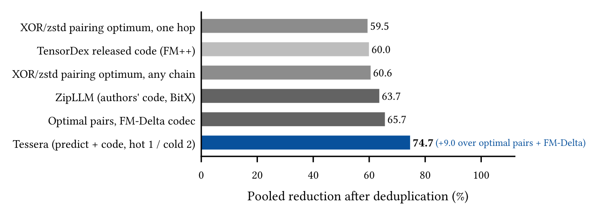
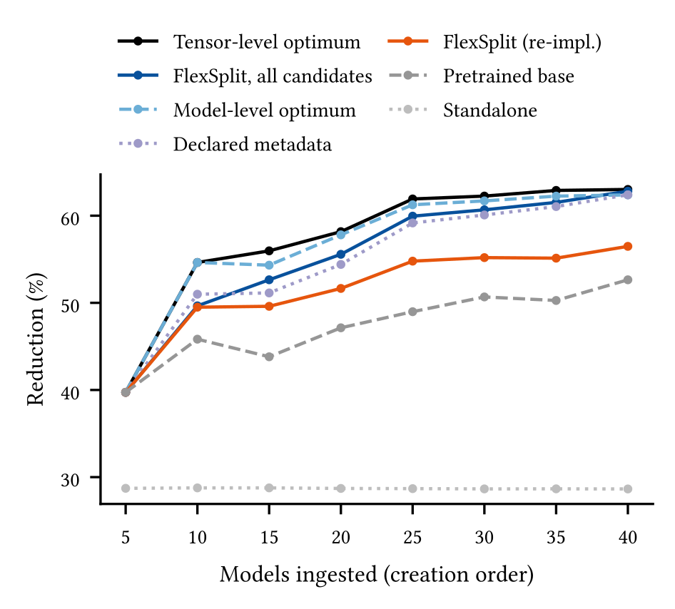
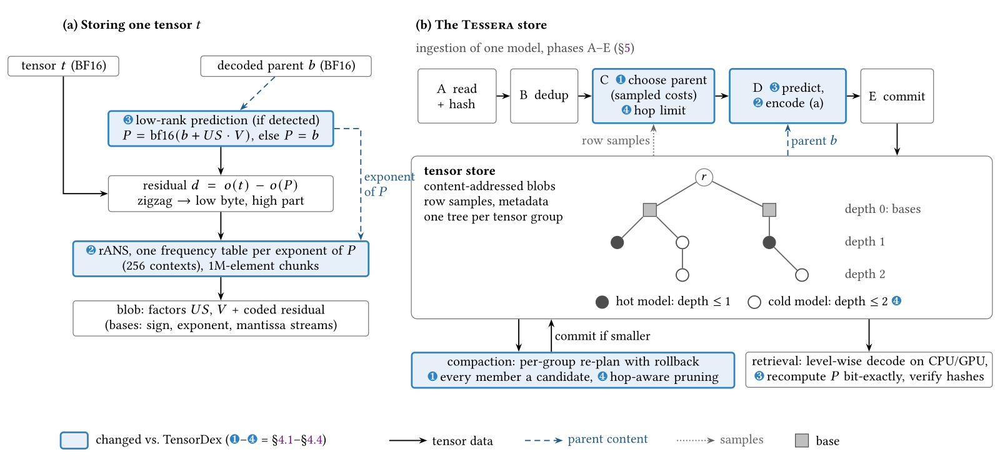
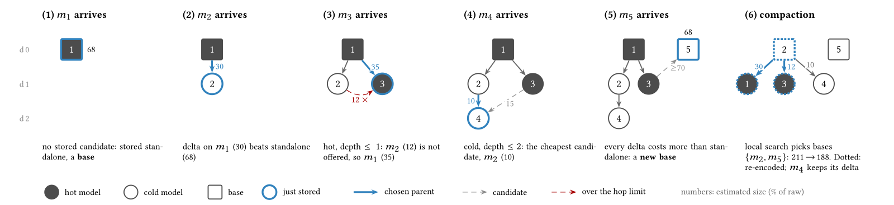
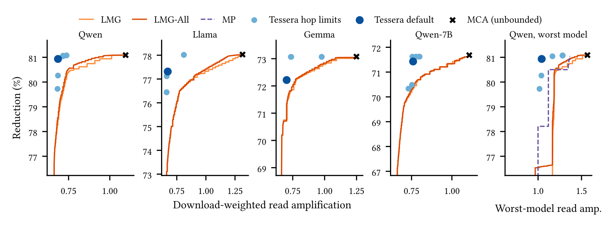
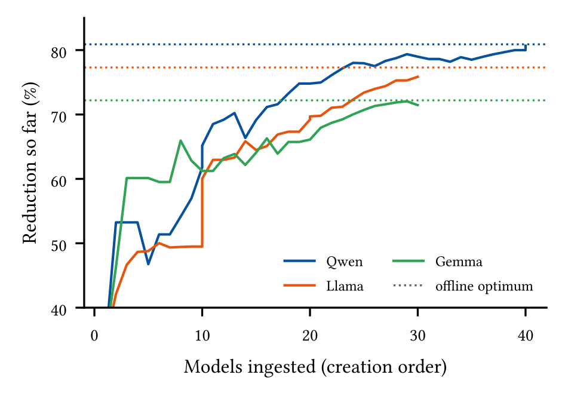

Model hubsLossless compressionDelta storageEntropy coding

Model hubs store millions of fine-tuned checkpoints that are near-copies of a few base models. Lossless stores treat this as a <i>pairing</i> problem: which stored tensor should each new tensor be delta-encoded against? Exhaustive ground truth on 130 checkpoints shows that pairing is nearly solved and still leaves most of the redundancy behind. <b>Tessera</b> predicts and codes the residual from the base instead, and reduces storage by <b>74.7%</b>, bit for bit.

<a class="ts-btn" href="#explorer">▶&nbsp; Try the residual explorer</a><a class="ts-btn ghost" href="#pairing">How much pairing matters</a><a class="ts-btn ghost" href="#how">How it works</a><a class="ts-btn ghost" href="#results">Results</a>Paper &amp; code: coming soon

<figure class="ts-fig" id="ts-hero">

Model family

0%reduction after deduplication (higher is better)90%

<noscript></noscript>
<figcaption>Figure 1 · interactive<b class="ts-title">Pairing alone stops near 60%; predicting and coding the residual reaches 74.7%.</b>Lossless reduction after content-hash deduplication, from Table 3 of the paper; pick a family. Gray: single-model coding and pairing with the XOR/zstd codec of prior systems. Amber: existing systems and codecs, run with their authors' code. Blue: Tessera's techniques, added one at a time on the optimal one-hop pairs. The dashed line is the exact optimum of pairing with XOR/zstd when chains may be of any length: no choice of bases gets past it without changing the codec. Every bar is a real encoded size, decoded and checked against content hashes.</figcaption>
</figure>

## At a glance

74.7%

lossless reduction over 130 fine-tunes of four model families: 206.3 GB stored instead of 816.9 GB, every tensor decoded and hash-checked

60.6%

the most that pairing can reach with the XOR/zstd codec of prior systems, with exact optima and chains of any length

0.2–1.4 pts

between the online store, which plans heuristically as models arrive, and the exact offline plan

76.4–80.9%

online, on random samples of 112 and 303 hub models from eight bases (median fine-tune: 10–14 downloads)

## Background: a hub is a versioned store {#background}

1<b>Hubs fill up with near-copies.</b>
Hugging Face's storage grew from 0.28 PB in 2023 to over 76 PB by the end of 2025, as TensorDex reports. A few base models spawn thousands of fine-tunes, and each one is uploaded as a full copy of the weights although it differs only slightly from its relatives.

2<b>Delta systems store the difference.</b>
After exact duplicates are removed by content hash, a tensor is stored as a residual against a similar stored tensor, and the residual is compressed. Coding one model alone saves about a third of the bytes. Deltas roughly double that.

3<b>The pairing view.</b>
Recent systems put their effort into choosing the base. TensorDex sketches every tensor, predicts how well each pair compresses and clusters tensors online. Once a tensor has its base, the residual goes to a generic coder such as zstd.

This work asks how much pairing matters: how far practical planners are from the best possible pairing, and how much redundancy the best pairing still leaves. The terms used on this page:

<b>BF16.</b> The 16-bit float format of most checkpoints: 1 sign bit, 8 exponent bits, 7 mantissa bits.

<b>Tensor group.</b> The tensors with the same name, type and shape across the fine-tunes of one base. A tensor is only encoded against a member of its own group.

<b>Base, delta.</b> A base is stored standalone. A delta is stored as a residual against its parent, which must be decoded first.

<b>Reduction.</b> 1 − stored / raw, with raw measured after content-hash deduplication. Higher is better.

<b>Hop.</b> One delta on the path from a tensor to its base. In a one-hop plan every delta points directly at a base.

<b>One-hop optimum.</b> The smallest storage any one-hop plan can reach for a given codec, solved exactly as an integer program per tensor group.

<b>Read amplification.</b> Bytes read to rebuild a model over its raw size, weighted by downloads. Below 1, fewer bytes are read than the model holds.

<b>XOR/zstd.</b> Bitwise XOR against the base, split into byte planes and compressed with zstd: the codec of TensorDex's TensorX.

<b>FlexSplit.</b> TensorDex's online planner. It attaches each new tensor to the best existing base and periodically splits clusters.

<b>LoRA merge.</b> A fine-tune trained as a low-rank adapter and merged into the weights before upload. It differs from its parent by a matrix of rank 4–32.

## How much does pairing matter? {#pairing}

Evaluations of delta systems usually measure a planner end to end, which cannot tell a bad plan from an inherent limit. We instead compress <b>every</b> ordered pair of same-group tensors with the codec under study, over a million directed pairs, and solve base selection exactly. The size of any plan is then an exact sum of real encoded sizes. The corpus has four families: Qwen2.5-3B (40 checkpoints), Llama-3.2-3B (30), Gemma-2-2B (30) and Qwen2.5-7B (30), 1,053 GB raw and 816.9 GB after deduplication.

Table 2 **Planners on the Qwen2.5-3B family with the XOR/zstd codec.** Reduction after deduplication (187.5 GB); all numbers are real encoded sizes.

| Planner | Reduction |
|---|---|
| Standalone coding (no deltas) | 28.6% |
| Every model against the pretrained base | 52.6% |
| FlexSplit with sketch-based prediction (our re-implementation) | 56.5% |
| FlexSplit with exact costs | 57.4% |
| Declared `base_model` metadata (multi-hop) | 62.4% |
| Model-level one-hop optimum | 62.4% |
| **FlexSplit, all members as split candidates** | **62.8%** |
| Tensor-level one-hop optimum | 63.0% |
| Greedy multi-hop chains (depth ≤ 6) | 64.7% |

Read it from top to bottom. Deltas more than double the savings of standalone coding, and a planner that may promote any member to a base is 0.2 points from the exact optimum. Deeper chains add less than two points.

Finding 1<b>Deltas and the choice of base matter.</b>
Delta coding lifts the Qwen family from 28.6% to 63.0%. Encoding every model against the pretrained base reaches only 52.6%, because many fine-tunes descend from the Instruct model instead.

Finding 2<b>One filter keeps FlexSplit from the optimum.</b>
FlexSplit, re-implemented as its paper describes it, trails the one-hop optimum by 6.5 points on Qwen and 16.9 on Llama. Its split phase only considers members that fall below the cluster average, so an Instruct model whose fine-tunes sit <i>at</i> the average is never promoted. Letting every member be a candidate closes the gap to 0.2 points in the three smaller families and 1.0 on Qwen-7B, without tuning.

Finding 3<b>Tensor granularity adds little within a family.</b>
Choosing a base per tensor beats choosing one base model per model by 0.3–1.0 points. For the average Qwen model, 83% of its tensors have their best base in one single other model.

Finding 5<b>Pairing barely depends on the codec.</b>
The pairs chosen under XOR/zstd stay within 0.06 points of the pairs re-optimized for Tessera's codec. The best partners stay the same; only their costs change.

<figure class="ts-fig narrow"><figcaption>Figure A3<b class="ts-title">The fixed planner tracks the optimum as models arrive.</b>Cumulative reduction as the 40 Qwen models arrive in creation order (XOR/zstd codec). FlexSplit as described (orange) falls behind once the Instruct sub-family forms and never recovers. With every member a split candidate (blue) it follows the tensor-level optimum (black) throughout.</figcaption></figure>

<b>What this implies.</b> With the XOR/zstd codec, no one-hop planner can exceed 63.0% (Qwen), 61.6% (Llama), 56.2% (Gemma) or 57.8% (Qwen-7B), and the fixed FlexSplit is already within 0.2–1.0 points of that. The remaining 37–44% of the bytes are residuals of well-chosen pairs. Shrinking them means changing how a residual is <b>predicted</b> and <b>coded</b>.

## How Tessera works {#how}

Tessera keeps the tensor groups and the one-hop default of FlexSplit and changes four things. The numbers match the blue stages of Figure 2.

Prior delta storesTesseraWhat it buys
<i>1</i>Choosing a base
TensorDex: a sketch of each tensor and a fitted regression predict the pair's ratio; only members below the cluster average may become bases
→
entropy of the codec's own symbols on a shared row sample (at most 32K elements); every member may become a base

10–12× lower regret in base choice than sketch + regression, with no fit to redo when the codec changes

<i>2</i>Coding the residual
XOR or integer difference, then a generic coder that ignores the base
→
order-preserving integer residual, rANS-coded with one frequency table per exponent of the base weight

+10.0 to +11.3 points in every family

<i>3</i>Predicting the tensor
the parent itself
→
for merged LoRA fine-tunes, the parent plus a low-rank update that the decoder recomputes bit for bit

+2.5 to +6.6 points, following how common LoRA merges are

<i>4</i>Chain depth
one hop for every model, as in FlexSplit
→
one hop for the more downloaded half, two for the rest, planned exactly per group

up to +1.2 points at nearly the same download-weighted read cost

<figure class="ts-fig"><figcaption>Figure 2<b class="ts-title">Storing one tensor, and the store around it.</b>(a) A tensor <i>t</i> is coded against its decoded parent <i>b</i>. If a merged low-rank update is detected, <i>t</i> is predicted as <i>P</i> = bf16(<i>b</i> + <i>US·V</i>), otherwise <i>P</i> = <i>b</i>. The order-preserving integer residual against <i>P</i> is split into a low byte and a high part, and each is rANS-coded with one frequency table per exponent of <i>P</i>. (b) A model is ingested in five phases. Each tensor group is a tree of blobs: tensors of hot models sit at depth at most 1, those of cold models at depth at most 2. Compaction re-plans a group and commits only if the group shrinks; retrieval decodes level by level on a CPU or GPU and verifies every tensor.</figcaption></figure>

Codec<b>The base is free context.</b>
Fine-tuning moves a weight by an amount that scales with the weight itself, so the exponent of the base weight predicts how large the residual is. The decoder rebuilds the base first anyway, so conditioning on it costs no stored bytes. Richer contexts (mantissa bits, neighbouring residuals, adaptive tables) add at most 0.03 points.

Prediction<b>Predict LoRA merges, bit for bit.</b>
A merged LoRA differs from its parent by a dense rank-<i>r</i> matrix: structured, but not small. Tessera detects it from 256 sampled rows, stores the factors and codes what is left. Losslessness now depends on the decoder recomputing the prediction exactly, so its kernel fixes the order of fp32 operations, without fused multiply-adds, and matches a scalar IEEE reference on x86-64, arm64 and a GPU.

Hops<b>Let cold models chain twice.</b>
In the Qwen corpus the top 20% of models receive 99.7% of the downloads. Models in the more downloaded half stay one hop from a base; the rest may sit two deltas deep. Unbounded chains add 0.01 points beyond two hops and read 1.5× as many bytes.

A hub receives models one at a time, so the store plans online. Each arriving tensor compares standalone coding with every stored member that its hop limit allows and takes the cheapest option. Compaction later re-plans the base set of a group:

<figure class="ts-fig"><figcaption>Figure 3<b class="ts-title">Parent choice in one tensor group, then one compaction.</b>Illustrative costs: the numbers are estimated sizes in % of the raw tensor. (1) The first tensor becomes a base. (2) A delta on <i>m</i>1 is cheaper than standalone. (3) <i>m</i>3 belongs to a hot model and must stay within one hop, so its cheapest candidate <i>m</i>2, already at depth 1, is not offered. (4) <i>m</i>4 is cold and takes <i>m</i>2 at depth 2. (5) No delta beats standalone coding, so <i>m</i>5 opens a new base. (6) Compaction makes <i>m</i>2 a base and re-encodes only <i>m</i>1 and <i>m</i>3; the group is committed only if its real encoded size shrinks.</figcaption></figure>

## Try the residual explorer {#explorer}

Prior delta stores take the bitwise XOR of a fine-tuned weight and its base. Tessera maps both BF16 values to integers that keep the order of the floats and stores their difference. The figure below computes both residuals for one weight in your browser, with exact BF16 arithmetic. It illustrates the codec's first stage; it is not a measurement from the paper.

<figure class="ts-fig" id="ts-demo">

Example
<button type="button" data-b="0.0200" data-d="1.5">Small update</button><button type="button" data-b="0.0311" data-d="1.0">Across an exponent boundary</button><button type="button" data-b="0.0200" data-d="8.0">Larger update</button><button type="button" data-b="-0.0620" data-d="1.0">Negative weight</button>

<label class="lab" for="ts-b">Base weight <i>b</i></label><input type="range" id="ts-b" min="-0.08" max="0.08" step="0.0001"><output id="ts-b-o"></output>

<label class="lab" for="ts-d">Fine-tuning change</label><input type="range" id="ts-d" min="-10" max="10" step="0.1"><output id="ts-d-o"></output>

<figcaption>Interactive<b class="ts-title">One weight, two residuals.</b>The three rows show the 16 bits of the base weight, of the fine-tuned weight and of their XOR, with flipped bits in red. When the fine-tuned value crosses a power of two, XOR flips most of the mantissa and part of the exponent although the value has moved by one or two representable steps. The integer residual <i>d</i> = <i>o</i>(<i>t</i>) − <i>o</i>(<i>b</i>) counts exactly those steps. Tessera then codes <i>d</i> with the frequency table of the base weight's exponent, which the decoder knows before it reads a byte.</figcaption>
</figure>

Table A1 **What each part is worth.** Points of reduction lost when one component is removed from Tessera, with real encoded sizes; the codec and low-rank rows keep the plan fixed, which is an upper bound on their cost.

| Removed | Qwen2.5-3B | Llama-3.2-3B | Gemma-2-2B | Qwen2.5-7B | Pooled |
|---|---|---|---|---|---|
| Exponent context | −3.0 | −4.0 | −3.8 | −3.3 | −3.4 |
| Integer residual (XOR instead) | −1.5 | −1.5 | −1.4 | −2.7 | −2.0 |
| rANS (zstd instead) | −6.4 | −8.1 | −7.6 | −6.3 | −6.8 |
| **Whole codec (XOR/zstd instead)** | **−8.6** | **−10.5** | **−10.0** | **−9.7** | **−9.6** |
| Low-rank prediction | −6.3 | −3.7 | −4.8 | −2.6 | −3.9 |
| Second hop | −1.2 | −0.9 | 0.0 | −1.1 | −0.9 |

The codec is the largest and most even contribution. Low-rank prediction follows the share of LoRA merges in a family, and the second hop helps where lineages are deep; the Gemma family is flat, so it gains nothing there.

## Results {#results}

Every storage number below comes from real encodes: each tensor is encoded as planned, decoded root-first along its chain, and compared with its content hash. Baselines run their authors' code and are round-trip checked as well.

Table 3 **Reduction (%) after deduplication, per family and pooled.** An excerpt; the first figure on this page shows more rows.

| Method | Qwen2.5-3B | Llama-3.2-3B | Gemma-2-2B | Qwen2.5-7B | Pooled |
|---|---|---|---|---|---|
| ZipNN (single model) | 33.1 | 33.6 | 33.6 | 33.3 | 33.4 |
| One-hop pairing optimum, XOR/zstd | 63.0 | 61.6 | 56.2 | 57.8 | 59.5 |
| TensorDex released code (bundle planner, FM++) | 61.7 | 61.8 | 60.6 | 58.3 | 60.0 |
| ZipLLM (declared bases, BitX) | 66.0 | 60.8 | 60.8 | 64.4 | 63.7 |
| Optimal pairs, FM-Delta codec | 69.1 | 68.2 | 62.6 | 64.0 | 65.7 |
| **Tessera** | **80.9** | **77.3** | **72.2** | **71.4** | **74.7** |

Pooled, Tessera stores 206.3 of 816.9 GB, TensorDex's released code 326.7 GB and the exact one-hop XOR/zstd optimum 331.2 GB. The strongest existing codec on the optimal pairs, FM-Delta, is 9.0 points below Tessera. The gains are not carried by a few models: the median fine-tune shrinks by 78.3–92.4% per family, against 58.8–65.1% under the optimal XOR/zstd pairing.

<b>Storage versus read cost.</b> Deeper chains save bytes but make a download read more blobs. This is the recreation/storage tradeoff of dataset versioning, and because tensor groups are small, Tessera can solve it exactly instead of heuristically.

Table 4 **Hop configurations on Qwen2.5-3B** (codec + low-rank, exact plans). Read amplification and blobs per tensor are weighted by downloads.

| Configuration | Reduction | Read amplification | Blobs per tensor |
|---|---|---|---|
| Hot models pinned as bases | 78.70% | 0.662 | 1.00 |
| All one-hop | 79.72% | 0.683 | 1.28 |
| **Top 50% one-hop, rest two-hop (default)** | **80.93%** | **0.686** | **1.25** |
| All two-hop | 81.08% | 0.737 | 1.55 |
| Unbounded chains | 81.09% | 1.096 | 3.93 |

The default saves 1.2 more points than the one-hop design at nearly the same read cost. Unbounded chains add 0.01 points beyond two hops and read 1.5× as many bytes.

<figure class="ts-fig"><figcaption>Figure 4<b class="ts-title">Exact hop-bounded plans against dataset-versioning heuristics.</b>Each panel plots reduction against read amplification on the same costs (codec + low-rank); up and to the left is better. Lines are the best plan of each heuristic (LMG, LMG-All, MP) at or below a read cost. At the read cost of Tessera's default plan (dark dot), the best LMG or LMG-All plan saves 2.4, 3.7, 0.9 and 1.1 fewer points on Qwen, Llama, Gemma and Qwen-7B, with chains 5 to 11 deep instead of 2.</figcaption></figure>

<b>Online operation.</b> The offline results assume that every model is known in advance. We also replayed each family through the store in creation order, with sampled-cost parent choice, the low-rank path and compaction every 10 models, and retrieved and hash-verified every model at the end.

<figure class="ts-fig narrow"><figcaption>Figure 5<b class="ts-title">Compaction repairs the early choices.</b>Reduction of the online store as models arrive; dotted lines are the offline optimum with the same techniques. A model can only attach to models that arrived before it, so the first ones are placed poorly. On Llama the store is at 49.5% after 10 models, and the first compaction lifts it to 60.0%. Later rounds add at most 0.7 points.</figcaption></figure>

Table 6 **Online replay in creation order against the offline optimum with the same techniques.**

| | Qwen2.5-3B | Llama-3.2-3B | Gemma-2-2B |
|---|---|---|---|
| Offline optimum (hot 1 hop, cold 2 hops) | 80.89% | 77.30% | 72.20% |
| **Online** | **80.68%** | **75.86%** | **71.45%** |
| Gap (points) | 0.20 | 1.44 | 0.75 |
| Compaction, all rounds | 52 s | 65 s | 11 s |
| Rolled back / attempted groups | 21 / 698 | 0 / 413 | 1 / 190 |

The online layout is already optimal in its own cost model. The remaining gap comes from the compaction schedule and from costs that estimate plain deltas, while the offline plan knows the real low-rank sizes. Compacting Llama every 3 models instead of 10 ends at 77.25%.

1.7 GB/s

ingestion of the 40 Qwen models (145 s), 14× the serial path, with the same parents and byte-identical blobs

1.55–3.72 s

to rebuild a 6.17 GB model on CPU from a cold local disk, every tensor verified

0.13–0.20 s

to decode a model's whole closure on one H200, including the upload of its compressed blobs; disk reads and hash checks excluded

33 / 33

kills at random times during ingestion and compaction recovered, in at most 0.29 s, with exactly the committed blobs

<b>A random, heterogeneous sample.</b> The four families favour popular fine-tunes. On 112 models drawn uniformly from the hub fine-tunes of eight bases, regardless of downloads, Tessera ingested online stores 92.7 of 392 GB, a 76.4% reduction, against 65.1% for ZipLLM and 63.1% for TensorDex's released code with its bundle planner and FM++. A second draw brings the sample to 303 models and the reduction to 80.9%: more fine-tunes per base give each group more candidate parents.

## What Tessera does not do {#limits}

<ul>
<li><b>It stores BF16 checkpoints only.</b> Of 2,000 fine-tunes sampled from those the hub lists for eight bases, 31.6% are pure BF16 at the base's size, which is 57.3% of the bytes. FP16 would need another context map and FP32 a wider residual split; neither is implemented. Entropy estimates on 58 sampled FP16 fine-tunes give 70.0% against 62.2% for XOR/zstd.</li>
<li><b>A model without relatives gains little.</b> A new base, or a fine-tune that changes the vocabulary, gets only the third that single-model coding saves. Low-rank prediction helps only merged adapters, and hop limits only skewed downloads.</li>
<li><b>It trades CPU for bytes.</b> Tessera encodes 3–6× slower than FM-Delta and ZipNN, and its CPU decoder does not beat a fast network file system. At list prices, ingesting and compacting the Qwen corpus pays for itself in 13–21 days of storage savings. A CPU decode, however, costs as much as storing a decoded copy for a month after 17–41 downloads, so popular models should be served from a decoded cache.</li>
<li><b>The exact planner is an evaluation tool.</b> The integer programs solve our groups in at most 0.34 s each but do not scale to hub-sized groups: the one-hop program does not prove optimality within 30 minutes at 640 versions. The store itself plans with local search on sampled costs.</li>
<li><b>The ground truth covers four families.</b> All-pairs costs are affordable only for 30–40 fine-tunes per family, here of 2–7B-parameter models. The XOR/zstd ground truth of the 112-model random sample reproduces Findings 2 and 3.</li>
<li><b>Bit-exact prediction is tested on three platforms.</b> x86-64 and arm64 CPUs and one GPU model. A scalar IEEE reference defines the format and every tensor is hash-checked, so a deviating kernel costs speed, not data.</li>
</ul>

## Paper and code

Abstract

Model hubs store millions of near-identical fine-tuned checkpoints. Lossless systems for them treat storage mainly as a <i>pairing</i> problem: which stored tensor should each new tensor be delta-encoded against? We revisit this view with exhaustive ground truth. For 130 checkpoints of four model families (817 GB after deduplication), we compress every candidate pair of same-named tensors and solve base selection exactly. Near-optimal pairing turns out to be easy to reach: letting every member be a split candidate in FlexSplit, the online planner described for TensorDex, brings it within 0.2–1.0 points of the one-hop optimum without tuning. Yet even optimal pairing with the XOR/zstd codec of prior systems leaves most of the redundancy unused. We present Tessera, a lossless tensor store that (1) entropy-codes each residual conditioned on the exponent of its base weight, (2) predicts LoRA-merged fine-tunes with a low-rank update whose decoder is bit-reproducible across machines, and (3) lets rarely downloaded models chain two deltas deep. Planned offline, Tessera reduces storage by 74.7%, against 65.7% for the optimal pairs coded with FM-Delta, 60.6% for optimal XOR/zstd pairing with chains of any length, 60.0% for TensorDex's released code, and 63.7% for ZipLLM. At equal download-weighted read cost, its exact plans save 0.9–3.7 more points than dataset-versioning heuristics. Its online store, which plans heuristically, ends within 0.2–1.4 points of the offline plan and ingests about 1.7 GB/s; a GPU decodes a 6 GB model from pinned host memory in 0.13–0.20 s, excluding disk reads and hash checks.

The manuscript is under review. Paper, code and BibTeX will be linked here once the preprint is public.




