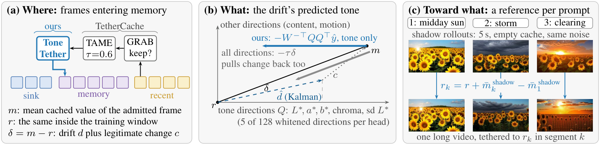
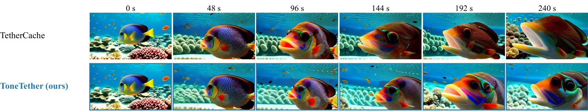

**Status:** Manuscript under review · **Publication:** [entry](/publication/2026-11-tonetether)

<a class="btn btn--primary" href="/files/projects/2026-11-tonetether/demo/">Open the interactive demo</a> <a class="btn btn--inverse" href="/files/bibtex/li2026tonetether.bib">BibTeX</a>

## Summary

Long autoregressive video generators drift in colour, texture and structure, and training-free corrections that anchor the KV cache are judged by drift scores that compare a video's ending with its opening. Such scores cannot tell a corrected video from one that has stopped changing, so the corrections with the lowest drift are the ones that freeze. An analysis of the KV cache shows that drift shares its directions with legitimate change. ToneTether therefore corrects only the predicted global tone of a Kalman drift estimate: added to TetherCache, it removes 23–34% of colour drift on two backbones and two horizons with no measurable loss of motion or new content.

## Key results

{: .align-center}

**Figure 1.** On the left, the lowest-drift baseline repeats nearly the same frame, while TetherCache's sky darkens after about two minutes. On the right, tethers on all directions and low-frequency injection lower drift only together with motion or new content; ToneTether lowers it with neither loss.

{: .align-center}

**Figure 2.** Drift in the cached statistics is systematic across prompts and exceeds in-shot change by orders of magnitude in its leading directions, yet those directions also carry a large share of legitimate change. Removing a "drift subspace" therefore removes content as well; what matters is which directions to correct.

{: .align-center}

**Figure 3.** ToneTether edits frames as they enter TetherCache's memory and removes only the tone that a Kalman estimate of the drift would produce, the smallest such edit in units of legitimate variation. After a prompt switch, a short empty-cache shadow rollout moves the reference to the new prompt's tone.

**Table 1 (excerpt).** 240 s rollouts on 128 prompts (H100); ΔE: CIELAB colour drift, Drop: image-quality drop between the first and last fifth, Dyn: dynamic degree, Nov.: novelty.

| Method | SF ΔE ↓ | SF Drop ↓ | SF Dyn ↑ | SF Nov. ↑ | CF ΔE ↓ | CF Drop ↓ | CF Dyn ↑ | CF Nov. ↑ |
|---|---|---|---|---|---|---|---|---|
| TetherCache | 4.67 | 0.54 | 73.0 | 9.7 | 7.46 | 0.81 | 86.0 | 15.0 |
| FreqForcing | 1.04 | 0.17 | 64.4 | 5.8 | 2.46 | 0.39 | 86.0 | 10.3 |
| Kalman tether, all directions | 3.60 | 1.15 | 67.2 | 8.8 | 4.81 | 1.44 | 79.5 | 14.0 |
| **TetherCache + ToneTether** | 3.10 | 1.39 | 73.7 | 9.7 | 5.16 | 1.47 | 86.5 | 14.9 |

The method with the lowest drift loses 31–40% of TetherCache's new content; ToneTether lowers drift on both Self-Forcing (SF) and Causal Forcing (CF) while keeping TetherCache's motion and novelty.

{: .align-center}

**Figure S4.** With TetherCache the water turns brown and the fish takes on a red cast after about 100 s; with ToneTether the water keeps its colour while the scene keeps changing (ΔE 15.5 → 5.1).

{: .align-center}

**Figure S3.** Long rollouts barely show a prompted change of tone, because a reference built from the opening pulls the change back like drift. Tethered to the shadow clips' tone, the model renders the storm and the sunset, and long videos show 87% of the prompted change instead of 25–30%.

## Interactive demo

The first part plays four caches on the same prompt in sync (240 s at 4–16× speed, prompts chosen by a fixed rule) and offers a swipe comparison of TetherCache and ToneTether. The second part plots the design ablations of Table 2: colour drift against motion, flow or image quality. The [full-page demo](/files/projects/2026-11-tonetether/demo/) also has the key numbers, the method in three steps and the BibTeX.

<iframe id="tonetether-demo" src="/files/projects/2026-11-tonetether/demo/?embed=1" width="100%" height="1900" loading="lazy" title="ToneTether interactive demo" style="border:0;display:block"></iframe>

## Citation

Runguo Li. (2026). "ToneTether: Lowering Drift Without Freezing in Long Autoregressive Video Generation." Manuscript under review. [BibTeX](/files/bibtex/li2026tonetether.bib)
