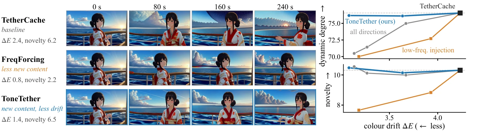
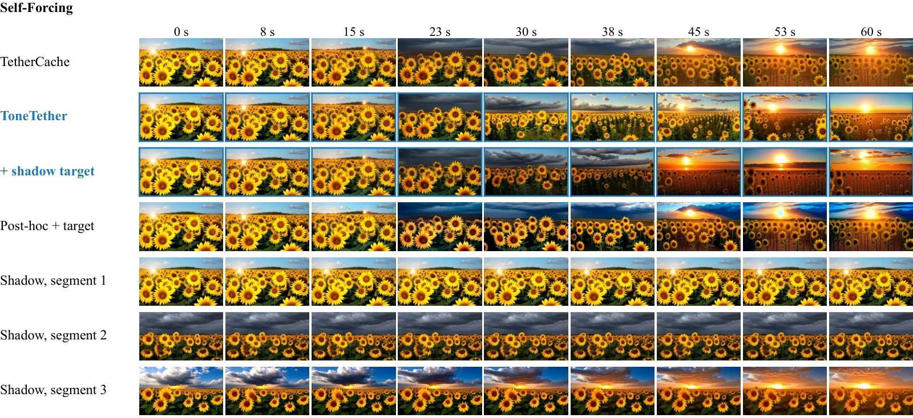

Video generationAutoregressive diffusionKV cacheTraining-free

Long-video corrections are judged by drift scores, and a drift score rewards a video that stops changing. <b>ToneTether</b> corrects only the predicted global tone of the drift in the KV cache, and removes 23–34% of TetherCache's colour drift without a measurable loss of motion or new content.

<a class="tt-btn" href="#videos">▶&nbsp; Videos</a><a class="tt-btn ghost" href="#key-results">Key results</a><a class="tt-btn ghost" href="#what-tonetether-changes">The idea</a><a class="tt-btn ghost" href="/files/bibtex/li2026tonetether.bib">BibTeX</a>Paper &amp; code: coming soon

<figure class="tt-fig"><figcaption>Figure 1<b class="tt-title">Correcting drift without freezing.</b>Left: the lowest-drift baseline repeats nearly the same frame, while TetherCache's sky darkens after about two minutes. Right: tethers on all directions and low-frequency injection lower drift only together with motion or new content; ToneTether lowers it with neither loss.</figcaption></figure>

## At a glance

23–34%

of TetherCache's colour drift removed on Self-Forcing and Causal Forcing at 60 s and 240 s, significant in all eight cases after Holm correction

≤ 0.7

points between ToneTether's and TetherCache's dynamic degree; the tether on all directions loses 4–7

31–40%

less new content than TetherCache for FreqForcing, the method with the lowest drift

87%

of a prompted tone change shown in long videos with a shadow reference, instead of 25–30%

## What ToneTether changes

Usual practiceToneTetherWhat it shows
Score
drift: the ending against the opening
→
drift and progression: motion, novelty, prompt following, scripted tone changes

the corrections with the lowest drift are the ones that freeze

Correction
every direction of the KV statistics, one strength
→
only the five directions per value head that predict the global tone

drift shares its directions with legitimate change; a uniform strength is optimal only for proportional second moments

Reference
the opening of the video
→
a 5 s empty-cache shadow rollout per prompt

a prompted change of tone is no longer pulled back like drift

## Summary

Long autoregressive video generators drift in colour, texture and structure, and training-free corrections that anchor the KV cache are judged by drift scores that compare a video's ending with its opening. Such scores cannot tell a corrected video from one that has stopped changing, so the corrections with the lowest drift are the ones that freeze. In the KV cache, drift shares its directions with legitimate change. ToneTether therefore removes only the predicted global tone of a Kalman drift estimate, the smallest such edit in units of legitimate variation. Added to TetherCache, it lowers colour drift on two backbones and two horizons while keeping motion and new content, adds 4 s to a 240 s video, and needs one calibration per backbone and no training.

## Key results

<figure class="tt-fig"><figcaption>Figure 2<b class="tt-title">Drift shares its directions with legitimate change.</b>Drift in the cached statistics is systematic across prompts and exceeds in-shot change by orders of magnitude in its leading directions, yet those directions also carry a large share of legitimate change. Removing a "drift subspace" therefore removes content as well: what matters is which directions to correct.</figcaption></figure>
<figure class="tt-fig"><figcaption>Figure 3<b class="tt-title">ToneTether removes only the tone of the drift.</b>It edits frames as they enter TetherCache's memory and removes the tone that a Kalman estimate of the drift would produce, the smallest such edit in units of legitimate variation. After a prompt switch, a short empty-cache shadow rollout moves the reference to the new prompt's tone.</figcaption></figure>

Table 1 **ToneTether lowers drift on both backbones and keeps TetherCache's motion and novelty.** 240 s rollouts on 128 prompts (H100). ΔE: CIELAB colour drift; Drop: image-quality drop between the first and last fifth; Dyn: dynamic degree; Nov.: novelty.

| Method | SF ΔE ↓ | SF Drop ↓ | SF Dyn ↑ | SF Nov. ↑ | CF ΔE ↓ | CF Drop ↓ | CF Dyn ↑ | CF Nov. ↑ |
|---|---|---|---|---|---|---|---|---|
| TetherCache | 4.67 | 0.54 | 73.0 | 9.7 | 7.46 | 0.81 | 86.0 | 15.0 |
| FreqForcing | 1.04 | 0.17 | 64.4 | 5.8 | 2.46 | 0.39 | 86.0 | 10.3 |
| Kalman tether, all directions | 3.60 | 1.15 | 67.2 | 8.8 | 4.81 | 1.44 | 79.5 | 14.0 |
| TetherCache + ToneTether | 3.10 | 1.39 | 73.7 | 9.7 | 5.16 | 1.47 | 86.5 | 14.9 |

The method with the lowest drift loses 31–40% of TetherCache's new content and the tether on all directions loses motion; ToneTether lowers drift on Self-Forcing (SF) and Causal Forcing (CF) with TetherCache's motion and novelty.

<figure class="tt-fig"><figcaption>Figure S4<b class="tt-title">A colour cast removed while the scene keeps changing.</b>With TetherCache the water turns brown and the fish takes on a red cast after about 100 s; with ToneTether the water keeps its colour while the scene keeps changing (ΔE 15.5 → 5.1).</figcaption></figure>
<figure class="tt-fig"><figcaption>Figure S3<b class="tt-title">A shadow reference lets prompted change through.</b>A reference built from the opening pulls a prompted change of tone back like drift. Tethered to the shadow clips' tone, the model renders the storm and the sunset, and long videos show 87% of the prompted change instead of 25–30%.</figcaption></figure>

## Videos

<figure class="tt-fig" id="tt-videos">

<button aria-pressed="true" data-i="0">Mammoths</button><button aria-pressed="false" data-i="1">Big Sur</button><button aria-pressed="false" data-i="2">Paper airplanes</button><button aria-pressed="false" data-i="3">Tokyo street</button>

<video muted loop playsinline preload="metadata" data-k="grab"></video>
<b>GRAB</b>

<video muted loop playsinline preload="metadata" data-k="tc06"></video>
<b>TetherCache</b>

<video muted loop playsinline preload="metadata" data-k="tc_kalcal"></video>
<b>Kalman tether, all directions</b>

<video muted loop playsinline preload="metadata" data-k="tc_kalcal_col_t1"></video>
<b>TetherCache + ToneTether</b>

<figcaption>Videos<b class="tt-title">Same prompt, four caches.</b>240 s Self-Forcing rollouts played at 8× speed, with each video's colour drift ΔE between the first and last fifth and its dynamic degree. The four prompts are those with the largest TetherCache colour drift among the first 32 evaluation prompts (RTX 4090 runs). On Big Sur the tether on all directions removes the drift by stopping the waves; ToneTether keeps them moving.</figcaption>
</figure>
<figure class="tt-fig">

<video muted loop playsinline preload="metadata" data-k="tc06"></video><video class="after" muted loop playsinline preload="metadata" data-k="tc_kalcal_col_t1"></video>
⇔TetherCache+ ToneTether

<figcaption>Compare<b class="tt-title">TetherCache against TetherCache + ToneTether.</b>Drag the divider; the prompt follows the selection above.</figcaption>
</figure>

Table 2 **Which directions, not how strongly.** Design ablations on 128 development prompts (Self-Forcing, 240 s), all added to TetherCache.

| Correction | ΔE ↓ | Dyn ↑ | Flow ↑ |
|---|---|---|---|
| TetherCache | 4.23 | 76.6 | 60.2 |
| Kalman tether, all directions, τ = 0.5 | 3.27 | 71.4 | 56.2 |
| Kalman tether, all directions, τ = 1 | 3.14 | 70.5 | 55.0 |
| Same correction, random 5-dim. subspace | 4.21 | 72.8 | 58.8 |
| Same correction, top-5 drift directions | 4.04 | 76.3 | 62.2 |
| ToneTether, τ = 1 | 3.08 | 76.2 | 59.6 |

Tethers on all directions trade motion for colour drift at every strength; ToneTether removes as much colour drift with TetherCache's motion and flow, which neither a random nor the top-drift subspace achieves.

## Links and citation

- Publication entry: [ToneTether](/publication/2026-11-tonetether)
- BibTeX: [li2026tonetether.bib](/files/bibtex/li2026tonetether.bib)
- Paper and code: coming soon

Runguo Li. (2026). "ToneTether: Lowering Drift Without Freezing in Long Autoregressive Video Generation." Manuscript under review.
