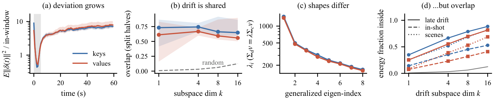

<style>
/* ToneTether project page: styles scoped to .tt / .tt-* so the rest of the site is untouched; colors follow the theme */
.tt{--tt-acc:#c85400;--tt-acc-soft:rgba(213,94,0,.09);--tt-blue:#1f5fa8;--tt-blue-soft:rgba(31,95,168,.08);--tt-gray:#6f767e;--tt-gray-soft:rgba(127,127,127,.09);--tt-line:rgba(127,127,127,.28);--tt-card:rgba(127,127,127,.05)}
html[data-theme="dark"] .tt{--tt-acc:#ff9a52;--tt-acc-soft:rgba(255,154,82,.14);--tt-blue:#78b0f0;--tt-blue-soft:rgba(120,176,240,.14);--tt-gray:#c3c9cf;--tt-gray-soft:rgba(255,255,255,.07);--tt-line:rgba(255,255,255,.2);--tt-card:rgba(255,255,255,.04)}
/* the fixed table of contents on wide screens would otherwise cover the end of the title */
@media screen and (min-width:1200px){.page__inner-wrap>header{padding-right:250px}}
.tt-kicker{display:flex;flex-wrap:wrap;gap:.4em;margin:.2em 0 .9em}
.tt-kicker span{font-size:.72em;font-weight:700;letter-spacing:.06em;text-transform:uppercase;padding:.25em .75em;border-radius:999px;background:var(--tt-acc-soft);color:var(--tt-acc)}
.tt-tldr{font-size:1.16em;line-height:1.6;margin:0 0 1em;font-weight:500}
.tt-tldr b{color:var(--tt-acc)}
.tt-btns{display:flex;flex-wrap:wrap;gap:.5em;margin:0 0 1.4em}
.tt-btn{display:inline-flex;align-items:center;gap:.45em;padding:.5em 1.05em;border-radius:999px;font-size:.85em;font-weight:600;text-decoration:none!important;background:#2b2f33;color:#fff!important;border:1px solid #2b2f33;transition:transform .15s,box-shadow .15s}
.tt-btn:hover{transform:translateY(-1px);box-shadow:0 4px 12px rgba(0,0,0,.18)}
.tt-btn.ghost{background:transparent;color:var(--global-text-color)!important;border-color:var(--tt-line)}
.tt-btn.muted{background:transparent;color:var(--tt-gray)!important;border:1px dashed var(--tt-line);cursor:default}
.tt-btn.muted:hover{transform:none;box-shadow:none}
html[data-theme="dark"] .tt-btn:not(.ghost):not(.muted){background:#f2f4f6;color:#1c1f22!important;border-color:#f2f4f6}
.tt-lead{margin:0 0 1em;line-height:1.65}
.tt-fig{display:block;margin:0 0 1.6em;padding:.8em;border:1px solid var(--tt-line);border-radius:14px;background:var(--tt-card)}
.tt-fig img{display:block;width:100%;height:auto;border-radius:8px;background:#fff;margin:0}
.tt-fig a.zoom{display:block;cursor:zoom-in}
.tt-fig figcaption{display:block;width:100%;font-family:inherit;font-size:.86em;line-height:1.55;margin:.75em .2em .1em;color:var(--global-text-color)}
.tt-tag{display:inline-block;font-size:.78em;font-weight:800;letter-spacing:.04em;text-transform:uppercase;padding:.1em .6em;border-radius:999px;background:var(--tt-acc);color:#fff;margin-right:.5em;vertical-align:.1em}
html[data-theme="dark"] .tt-tag{color:#2a1608}
.tt-fig figcaption b.tt-title{display:block;font-size:1.04em;margin:.35em 0 .2em}
.tt-stats{display:grid;grid-template-columns:repeat(4,minmax(0,1fr));gap:.7em;margin:0 0 1.6em}
.tt-stat{padding:.95em .9em .85em;border-radius:14px;border:1px solid var(--tt-line);background:var(--tt-card);position:relative;overflow:hidden}
.tt-stat:before{content:"";position:absolute;left:0;top:0;right:0;height:4px;background:var(--tt-c,var(--tt-acc))}
.tt-stat .v{font-size:1.32em;font-weight:800;line-height:1.15;color:var(--tt-c,var(--tt-acc));font-variant-numeric:tabular-nums}
.tt-stat .d{font-size:.78em;line-height:1.45;margin-top:.45em;color:var(--global-text-color);opacity:.88}
.tt-steps{display:grid;grid-template-columns:repeat(3,minmax(0,1fr));gap:.7em;margin:0 0 1.6em}
.tt-step{padding:.9em 1em;border-radius:14px;border:1px solid var(--tt-line);background:var(--tt-card)}
.tt-step .n{display:inline-grid;place-items:center;width:1.7em;height:1.7em;border-radius:50%;background:var(--tt-acc-soft);color:var(--tt-acc);font-weight:800;font-size:.85em;margin-bottom:.4em}
.tt-step b{display:block;margin-bottom:.25em}
.tt-step p{margin:0;font-size:.86em;line-height:1.55}
.tt-terms{display:grid;grid-template-columns:repeat(2,minmax(0,1fr));gap:.1em 1.6em;margin:0 0 1.6em;padding:.9em 1.1em;border-radius:14px;border:1px solid var(--tt-line);background:var(--tt-card);font-size:.86em;line-height:1.55}
.tt-terms div{padding:.35em 0}
.tt-terms b{color:var(--tt-acc)}
.tt-cmp{display:grid;grid-template-columns:auto 1fr auto 1fr 1.05fr;gap:.55em .6em;align-items:stretch;margin:0 0 1.6em;font-size:.88em}
.tt-cmp .h{font-size:.76em;font-weight:800;letter-spacing:.05em;text-transform:uppercase;padding:0 .2em;align-self:end}
.tt-cmp .h.s{color:var(--tt-gray)}.tt-cmp .h.c,.tt-cmp .h.o{color:var(--tt-acc)}
.tt-cmp .k{font-weight:700;align-self:center;padding-right:.3em}
.tt-cmp .s,.tt-cmp .c,.tt-cmp .o{padding:.55em .75em;border-radius:10px;line-height:1.4}
.tt-cmp div.s{background:var(--tt-gray-soft);border:1px solid var(--tt-line);color:var(--tt-gray)}
.tt-cmp div.c{background:var(--tt-acc-soft);border:1px solid var(--tt-acc)}
.tt-cmp div.o{border-left:3px solid var(--tt-acc);border-radius:4px}
.tt-cmp .arr{align-self:center;color:var(--tt-gray);font-size:1.1em}
.tt-table{margin:0 0 1.6em;padding:.8em;border:1px solid var(--tt-line);border-radius:14px;background:var(--tt-card);overflow-x:auto}
.tt-table table{font-size:.8em;margin:.6em 0;min-width:560px}
.tt-table tbody tr:last-child td{font-weight:700;color:var(--tt-acc)}
.tt-table p{font-size:.86em;margin:.2em}
.tt-tabs{display:flex;flex-wrap:wrap;gap:.4em;margin:0 0 .8em}
.tt-tabs button{font:inherit;font-size:.8em;font-weight:600;padding:.35em .9em;border-radius:999px;border:1px solid var(--tt-line);background:transparent;color:var(--global-text-color);cursor:pointer}
.tt-tabs button[aria-pressed="true"]{background:var(--tt-acc);border-color:var(--tt-acc);color:#fff}
html[data-theme="dark"] .tt-tabs button[aria-pressed="true"]{color:#2a1608}
.tt-vgrid{display:grid;grid-template-columns:repeat(2,minmax(0,1fr));gap:.6em}
.tt-cell video{display:block;width:100%;aspect-ratio:416/240;border-radius:8px;background:#000}
.tt-vlab{display:flex;justify-content:space-between;gap:.5em;flex-wrap:wrap;font-size:.8em;margin:.3em .1em 0}
.tt-vlab b{font-weight:700}.tt-vlab span{color:var(--tt-gray);font-variant-numeric:tabular-nums}
.tt-cell.ours video{box-shadow:0 0 0 3px var(--tt-acc)}.tt-cell.ours .tt-vlab b{color:var(--tt-acc)}
.tt-time{display:flex;align-items:center;gap:.7em;margin:.8em .1em 0;font-size:.8em;color:var(--tt-gray);font-variant-numeric:tabular-nums}
.tt-time .track{flex:1;height:5px;border-radius:999px;background:var(--tt-gray-soft);overflow:hidden}
.tt-time .track i{display:block;height:100%;width:0;background:var(--tt-acc);border-radius:999px}
.tt-look{font-size:.86em;line-height:1.55;margin:.8em .1em 0;padding:.55em .8em;border-left:3px solid var(--tt-acc);background:var(--tt-acc-soft);border-radius:4px}
.tt-prompt{font-size:.8em;color:var(--tt-gray);font-style:italic;margin:.6em .2em 0}
.tt-strip{display:grid;grid-template-columns:8.5em minmax(0,1fr);gap:.35em .7em;align-items:center}
.tt-strip .name{font-size:.8em;font-weight:700;line-height:1.25}
.tt-strip .name small{display:block;font-weight:400;color:var(--tt-gray);font-variant-numeric:tabular-nums}
.tt-strip .name.ours{color:var(--tt-acc)}
.tt-strip img{background:transparent;border-radius:4px}
.tt-strip .times{display:grid;grid-template-columns:repeat(5,1fr);font-size:.72em;color:var(--tt-gray);text-align:center}
.tt pre{font-size:.78em;border-radius:10px;margin:0 0 1em}
@media (max-width:900px){.tt-stats{grid-template-columns:repeat(2,minmax(0,1fr))}.tt-steps{grid-template-columns:1fr}}
@media (max-width:640px){.tt-vgrid{grid-template-columns:1fr}.tt-terms{grid-template-columns:1fr}.tt-strip{grid-template-columns:1fr}.tt-strip .times{display:none}.tt-strip .name{margin-top:.4em}.tt-strip .name small{display:inline;margin-left:.5em}.tt-cmp{grid-template-columns:1fr}.tt-cmp .arr,.tt-cmp .h,.tt-cmp span:empty{display:none}.tt-cmp .k{margin-top:.6em}.tt-tldr{font-size:1.04em}}
</style>

<div class="tt">
<div class="tt-kicker"><span>Video generation</span><span>Autoregressive diffusion</span><span>KV cache</span><span>Training-free</span></div>
<p class="tt-tldr">Long-video corrections are judged by drift scores, and a drift score rewards a video that stops changing. <b>ToneTether</b> corrects only the predicted global tone of the drift in the KV cache, and removes 23–34% of TetherCache's colour drift without a measurable loss of motion or new content.</p>
<div class="tt-btns"><a class="tt-btn" href="#videos">▶&nbsp; Videos</a><a class="tt-btn ghost" href="#how-tonetether-works">How it works</a><a class="tt-btn ghost" href="#key-results">Key results</a><a class="tt-btn ghost" href="#links-and-citation">BibTeX</a><span class="tt-btn muted">Paper &amp; code: coming soon</span></div>
<figure class="tt-fig"><a class="zoom" href="/images/projects/2026-11-tonetether/fig1-teaser.webp"></a><figcaption><span class="tt-tag">Figure 1</span><b class="tt-title">Correcting drift without freezing.</b>Left: three 240 s videos of one prompt. FreqForcing, the baseline with the lowest drift, repeats nearly the same frame, and TetherCache's sky darkens after about two minutes; ToneTether keeps the tone while the scene keeps changing. Right: at growing strength, tethers on all directions and low-frequency injection lower drift only together with motion or new content, while ToneTether lowers it with neither loss.</figcaption></figure>
</div>

## At a glance

<div class="tt"><div class="tt-stats">
<div class="tt-stat"><div class="v">23–34%</div><div class="d">of TetherCache's colour drift removed on two backbones at 60 s and 240 s, significant in all eight cases after Holm correction</div></div>
<div class="tt-stat" style="--tt-c:var(--tt-blue)"><div class="v">≤ 0.7</div><div class="d">points between ToneTether's and TetherCache's dynamic degree; a tether on all directions loses 4–7</div></div>
<div class="tt-stat" style="--tt-c:var(--tt-gray)"><div class="v">31–40%</div><div class="d">less new content than TetherCache for FreqForcing, the method with the lowest drift</div></div>
<div class="tt-stat"><div class="v">87%</div><div class="d">of a prompted tone change shown in long videos with a shadow reference, instead of 25–30%</div></div>
</div></div>

## Videos

<div class="tt">
<p class="tt-lead">Four caches generate 240 s of video from the same prompt and the same noise, so the openings are identical and every later difference comes from the cache. Pick a prompt; the four videos play in sync at 8× speed.</p>
<figure class="tt-fig" id="tt-videos">
<div class="tt-tabs" id="tt-tabs"><button aria-pressed="true" data-i="0">Mammoths</button><button aria-pressed="false" data-i="1">Big Sur</button><button aria-pressed="false" data-i="2">Paper airplanes</button><button aria-pressed="false" data-i="3">Tokyo street</button></div>
<div class="tt-vgrid">
<div class="tt-cell"><video muted loop playsinline preload="metadata" data-k="grab"></video><div class="tt-vlab"><b>GRAB</b><span data-m="grab"></span></div></div>
<div class="tt-cell"><video muted loop playsinline preload="metadata" data-k="tc06"></video><div class="tt-vlab"><b>TetherCache</b><span data-m="tc06"></span></div></div>
<div class="tt-cell"><video muted loop playsinline preload="metadata" data-k="tc_kalcal"></video><div class="tt-vlab"><b>Kalman tether, all directions</b><span data-m="tc_kalcal"></span></div></div>
<div class="tt-cell ours"><video muted loop playsinline preload="metadata" data-k="tc_kalcal_col_t1"></video><div class="tt-vlab"><b>TetherCache + ToneTether</b><span data-m="tc_kalcal_col_t1"></span></div></div>
</div>
<div class="tt-time"><span id="tt-t">0 s</span><span class="track"><i id="tt-bar"></i></span><span>240 s</span></div>
<p class="tt-look" id="tt-look"></p>
<p class="tt-prompt" id="tt-prompt"></p>
<figcaption><span class="tt-tag">Videos</span><b class="tt-title">Same prompt, four caches.</b>GRAB selects which past frames stay in memory; TetherCache adds a statistical correction to GRAB; the Kalman tether corrects every direction of the cached statistics; ToneTether corrects only the tone directions. Under each video: its colour drift ΔE between the first and last fifth (lower is better) and its dynamic degree (share of clips with clear motion). The four prompts are those with the largest TetherCache colour drift among the first 32 evaluation prompts (Self-Forcing, RTX 4090 runs).</figcaption>
</figure>
<figure class="tt-fig">
<div class="tt-strip">
<span></span><div class="times"><span>0 s</span><span>60 s</span><span>120 s</span><span>180 s</span><span>240 s</span></div>
<span class="name">GRAB<small data-s="grab"></small></span>
<span class="name">TetherCache<small data-s="tc06"></small></span>
<span class="name">Kalman tether, all directions<small data-s="tc_kalcal"></small></span>
<span class="name ours">+ ToneTether<small data-s="tc_kalcal_col_t1"></small></span>
</div>
<figcaption><span class="tt-tag">Frames</span><b class="tt-title">The same videos at a glance.</b>One frame per minute of the videos above. Colour drift shows as a change of palette from left to right; motion is easier to judge in the videos.</figcaption>
</figure>
</div>

## Why drift scores reward freezing

<div class="tt">
<div class="tt-steps">
<div class="tt-step"><span class="n">1</span><b>Long videos drift.</b><p>Autoregressive video diffusion models generate a video chunk by chunk, each chunk conditioned on a cache of earlier frames (the KV cache). They are trained on short, clean contexts but run on their own outputs, so errors compound over minutes into colour casts, collapsing texture and broken structure.</p></div>
<div class="tt-step"><span class="n">2</span><b>Corrections anchor the cache.</b><p>Training-free methods such as TetherCache and FreqForcing pull the cached features back toward the trusted opening frames. They are ranked by drift scores, which compare the ending of a video with its opening.</p></div>
<div class="tt-step"><span class="n">3</span><b>A frozen video scores best.</b><p>A video that stops changing ends close to its opening, so a correction can win simply by freezing. FreqForcing has the lowest drift of the methods we compare and shows 31–40% less new content than TetherCache.</p></div>
</div>
<p class="tt-lead">We therefore score every video on two axes, drift and progression. The terms used on this page:</p>
<div class="tt-terms">
<div><b>ΔE (colour drift).</b> CIELAB distance between the mean colours of the first and last fifth of a video. Lower is better.</div>
<div><b>Drop.</b> Loss of image quality (MUSIQ) from the first to the last fifth. Lower is better.</div>
<div><b>Dynamic degree.</b> Share of 5 s clips with clear motion, measured by optical flow, in %.</div>
<div><b>Novelty.</b> How far each frame of the second half is from everything shown at least 10 s earlier (DINO features). A loop or a still frame scores near zero.</div>
<div><b>Freezing.</b> A correction freezes a video when it shows significantly less motion or novelty than TetherCache.</div>
<div><b>TetherCache.</b> The cache we build on: it selects which past frames to keep (GRAB) and aligns their statistics with trusted frames.</div>
<div><b>SF, CF.</b> Self-Forcing and Causal Forcing, two 4-step autoregressive models distilled from Wan2.1-T2V-1.3B.</div>
<div><b>Tether.</b> A correction that shifts the cached features of a frame toward a reference, here the frames of the first seconds.</div>
</div>
</div>

## How ToneTether works

<div class="tt">
<div class="tt-cmp">
<span></span><span class="h s">Usual practice</span><span></span><span class="h c">ToneTether</span><span class="h o">What it shows</span>
<span class="k">Score</span><div class="s">drift: the ending against the opening</div><span class="arr">→</span><div class="c">drift and progression: motion, novelty, prompt following, scripted tone changes</div><div class="o">the corrections with the lowest drift are the ones that freeze</div>
<span class="k">Correction</span><div class="s">every direction of the KV statistics, one strength</div><span class="arr">→</span><div class="c">only the five directions per value head that predict the global tone</div><div class="o">drift shares its directions with legitimate change, so correcting all of them removes change too</div>
<span class="k">Reference</span><div class="s">the opening of the video</div><span class="arr">→</span><div class="c">a 5 s empty-cache shadow rollout per prompt</div><div class="o">a prompted change of tone is no longer pulled back like drift</div>
</div>
<figure class="tt-fig"><a class="zoom" href="/images/projects/2026-11-tonetether/fig2-kv-drift-anatomy.png"></a><figcaption><span class="tt-tag">Figure 2</span><b class="tt-title">Why correcting every direction freezes: drift shares its directions with legitimate change.</b>We record the mean cached keys and values of every chunk over 60 s. (a) Their deviation from the opening keeps growing. (b) Its leading directions are shared across prompts, so drift is systematic. (c) In those directions drift exceeds normal in-shot change by orders of magnitude, (d) yet the same directions also carry a large share of legitimate change. Removing a "drift subspace" therefore removes content as well: what matters is which directions to correct.</figcaption></figure>
<figure class="tt-fig"><a class="zoom" href="/images/projects/2026-11-tonetether/fig3-overview.png"></a><figcaption><span class="tt-tag">Figure 3</span><b class="tt-title">ToneTether removes only the tone of the drift.</b>(a) It edits each frame as it enters TetherCache's long-range memory. (b) A tether on all directions pulls back drift and legitimate change alike; ToneTether removes only the tone that the estimated drift would produce. (c) After a prompt switch, the reference moves to the tone of a short shadow rollout.</figcaption></figure>
<div class="tt-steps">
<div class="tt-step"><span class="n">1</span><b>Estimate the drift.</b><p>A Kalman filter tracks the slow deviation of each frame's cached statistics from the opening and splits it between drift and content that also changes slowly.</p></div>
<div class="tt-step"><span class="n">2</span><b>Remove only its tone.</b><p>Five directions per value head predict the global tone of the decoded frames (brightness, colour, contrast). The smallest edit that cancels the predicted tone of the drift leaves the other 123 directions untouched.</p></div>
<div class="tt-step"><span class="n">3</span><b>Follow new prompts.</b><p>When the prompt changes, a 5 s rollout with the same noise and an empty cache shows the tone the new prompt asks for, without accumulated drift. The reference moves there.</p></div>
</div>
<p class="tt-lead">ToneTether needs no training. Its drift statistics are calibrated once per backbone from 64 short rollouts (about one H100-hour) and its tone readout from development rollouts, on prompts separate from the evaluation. It adds 4 s to the generation of a 240 s video.</p>
</div>

## Key results

<div class="tt"><div class="tt-table" markdown="1">

<span class="tt-tag">Table 1</span> **ToneTether lowers drift on both backbones and keeps TetherCache's motion and novelty.** 240 s rollouts on 128 prompts (H100), Self-Forcing (SF) and Causal Forcing (CF).

| Method | SF ΔE ↓ | SF Drop ↓ | SF Dyn ↑ | SF Nov. ↑ | CF ΔE ↓ | CF Drop ↓ | CF Dyn ↑ | CF Nov. ↑ |
|---|---|---|---|---|---|---|---|---|
| TetherCache | 4.67 | 0.54 | 73.0 | 9.7 | 7.46 | 0.81 | 86.0 | 15.0 |
| FreqForcing | 1.04 | 0.17 | 64.4 | 5.8 | 2.46 | 0.39 | 86.0 | 10.3 |
| Kalman tether, all directions | 3.60 | 1.15 | 67.2 | 8.8 | 4.81 | 1.44 | 79.5 | 14.0 |
| TetherCache + ToneTether | 3.10 | 1.39 | 73.7 | 9.7 | 5.16 | 1.47 | 86.5 | 14.9 |

Read each backbone from left to right: drift (ΔE, Drop), then progression (Dyn, Nov.). FreqForcing has the lowest drift and loses 31–40% of TetherCache's novelty; the tether on all directions loses motion. ToneTether lowers ΔE by about a third on both backbones with TetherCache's dynamic degree and novelty.

</div></div>

<div class="tt">
<figure class="tt-fig"><a class="zoom" href="/images/projects/2026-11-tonetether/figs4-color-cast.webp"></a><figcaption><span class="tt-tag">Figure S4</span><b class="tt-title">A colour cast removed while the scene keeps changing.</b>The evaluation prompt with the second-largest reduction of colour drift (ΔE 15.5 → 5.1). With TetherCache the water turns brown and the fish takes on a red cast after about 100 s; with ToneTether the water keeps its colour while the scene keeps changing.</figcaption></figure>
</div>

<div class="tt"><div class="tt-table" markdown="1">

<span class="tt-tag">Table 2</span> **Which directions, not how strongly.** Design ablations on 128 development prompts (Self-Forcing, 240 s), all added to TetherCache; τ is the correction strength.

| Correction | ΔE ↓ | Dyn ↑ | Flow ↑ |
|---|---|---|---|
| TetherCache | 4.23 | 76.6 | 60.2 |
| Kalman tether, all directions, τ = 0.5 | 3.27 | 71.4 | 56.2 |
| Kalman tether, all directions, τ = 1 | 3.14 | 70.5 | 55.0 |
| Same correction, random 5-dim. subspace | 4.21 | 72.8 | 58.8 |
| Same correction, top-5 drift directions | 4.04 | 76.3 | 62.2 |
| ToneTether, τ = 1 | 3.08 | 76.2 | 59.6 |

A stronger tether on all directions removes more colour drift and more motion. ToneTether removes as much colour drift with TetherCache's motion and flow. The same correction on five random directions, or on the five directions where drift is strongest, does not lower colour drift significantly: the directions to correct are those of the visible symptom.

</div></div>

<div class="tt">
<figure class="tt-fig"><a class="zoom" href="/images/projects/2026-11-tonetether/figs3-shadow-target.webp"></a><figcaption><span class="tt-tag">Figure S3</span><b class="tt-title">A shadow reference lets prompted change through.</b>A 60 s script asks for a field of sunflowers under sun, then a storm, then a sunset. A reference built from the opening pulls this change back like drift, so the long videos show only part of it. Tethered to the tone of the shadow clips (bottom rows), the model renders the storm and the sunset. Over 96 such scripts, long videos then show 87% of the prompted change instead of 25–30%.</figcaption></figure>
<div class="tt-stats">
<div class="tt-stat"><div class="v">2.04 → 1.63</div><div class="d">ΔE on LongLive, a third backbone with its own cache layout, when ToneTether is added to TetherCache</div></div>
<div class="tt-stat"><div class="v">18.5 → 8.0</div><div class="d">ΔE at 240 s when ToneTether is plugged into a plain sink cache, with no significant change of dynamic degree</div></div>
<div class="tt-stat" style="--tt-c:var(--tt-blue)"><div class="v">+ 4 s</div><div class="d">added to the generation of a 240 s video on an H100</div></div>
<div class="tt-stat" style="--tt-c:var(--tt-blue)"><div class="v">1.7×</div><div class="d">faster TetherCache generation before decoding, from computing its frame selection exactly in statistics space</div></div>
</div>
</div>

<script>
(function () {
  var D = "/files/projects/2026-11-tonetether/", I = "/images/projects/2026-11-tonetether/strips/";
  var P = [
    {id: "0001", p: "Several giant wooly mammoths approach treading through a snowy meadow ...", look: "TetherCache's trees turn purple in the last minute and GRAB's scene turns orange. ToneTether keeps the daylight palette of the snow (ΔE 15.97 → 5.21).", m: {grab: [13.89, 100], tc06: [15.97, 96], tc_kalcal: [5.48, 87], tc_kalcal_col_t1: [5.21, 94]}},
    {id: "0003", p: "Drone view of waves crashing against the rugged cliffs along Big Sur's garay point beach ...", look: "The tether on all directions has the lowest drift here because the shot stops moving (dynamic degree 2%). ToneTether halves TetherCache's drift (ΔE 11.35 → 5.70) and the waves keep moving.", m: {grab: [5.00, 60], tc06: [11.35, 36], tc_kalcal: [1.71, 2], tc_kalcal_col_t1: [5.70, 49]}},
    {id: "0021", p: "A flock of paper airplanes flutters through a dense jungle, weaving around trees as if they were migrating birds.", look: "Selection alone drifts most (GRAB, ΔE 24.35). Under TetherCache the sky fades toward pink; ToneTether stays closest to the opening colours (ΔE 2.72), with all four videos in full motion.", m: {grab: [24.35, 100], tc06: [9.66, 100], tc_kalcal: [3.41, 100], tc_kalcal_col_t1: [2.72, 100]}},
    {id: "0000", p: "A stylish woman walks down a Tokyo street filled with warm glowing neon and animated city signage ...", look: "The smallest gain of the four (ΔE 8.22 → 5.98). All four videos keep moving, and the tether on all directions leaves the drift almost unchanged (8.13).", m: {grab: [10.34, 100], tc06: [8.22, 100], tc_kalcal: [8.13, 100], tc_kalcal_col_t1: [5.98, 100]}}
  ];
  var vids = [].slice.call(document.querySelectorAll("#tt-videos video"));
  var visible = false;
  function each(sel, f) { [].forEach.call(document.querySelectorAll(sel), f); }
  function playAll() { if (visible) vids.forEach(function (v) { var r = v.play(); if (r) r.catch(function () {}); }); }
  function load(i) {
    var c = P[i];
    vids.forEach(function (v) { var k = v.getAttribute("data-k"); v.poster = D + "posters/" + c.id + "_" + k + ".jpg"; v.src = D + "videos/" + c.id + "_" + k + ".mp4"; });
    each(".tt-strip img", function (im) { im.src = I + c.id + "_" + im.getAttribute("data-k") + ".webp"; });
    each("#tt-videos [data-m]", function (el) { var x = c.m[el.getAttribute("data-m")]; el.textContent = "ΔE " + x[0].toFixed(2) + " · dynamic " + x[1] + "%"; });
    each(".tt-strip [data-s]", function (el) { el.textContent = "ΔE " + c.m[el.getAttribute("data-s")][0].toFixed(2); });
    document.getElementById("tt-look").innerHTML = "<b>What to look for.</b> " + c.look;
    document.getElementById("tt-prompt").textContent = "Prompt: “" + c.p + "”";
    each("#tt-tabs button", function (b) { b.setAttribute("aria-pressed", String(+b.getAttribute("data-i") === i)); });
    playAll();
  }
  each("#tt-tabs button", function (b) { b.addEventListener("click", function () { load(+b.getAttribute("data-i")); }); });
  /* shared clock: show the position in the 240 s video and keep the four videos in step */
  setInterval(function () {
    var m = vids[3], d = m.duration || 30, t = m.currentTime || 0;
    document.getElementById("tt-t").textContent = Math.round(240 * t / d) + " s";
    document.getElementById("tt-bar").style.width = (100 * t / d).toFixed(1) + "%";
    vids.forEach(function (v) { if (v !== m && !v.paused && Math.abs(v.currentTime - t) > 0.2) v.currentTime = t; });
  }, 250);
  /* play only while the videos are on screen */
  new IntersectionObserver(function (es) {
    visible = es[0].isIntersecting;
    if (visible) playAll(); else vids.forEach(function (v) { v.pause(); });
  }).observe(document.getElementById("tt-videos"));
  load(0);
})();
</script>

## Links and citation

<div class="tt" markdown="1">

- Publication entry: [ToneTether](/publication/2026-11-tonetether)
- BibTeX file: [li2026tonetether.bib](/files/bibtex/li2026tonetether.bib)
- Paper and code: coming soon

```bibtex
@unpublished{li2026tonetether,
  title  = {ToneTether: Lowering Drift Without Freezing in Long Autoregressive Video Generation},
  author = {Li, Runguo},
  year   = {2026},
  note   = {Manuscript under review}
}
```

</div>
