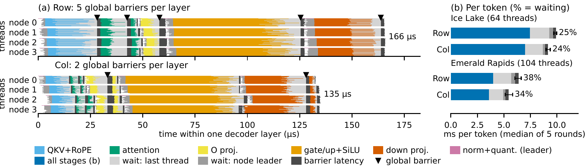
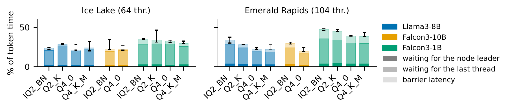
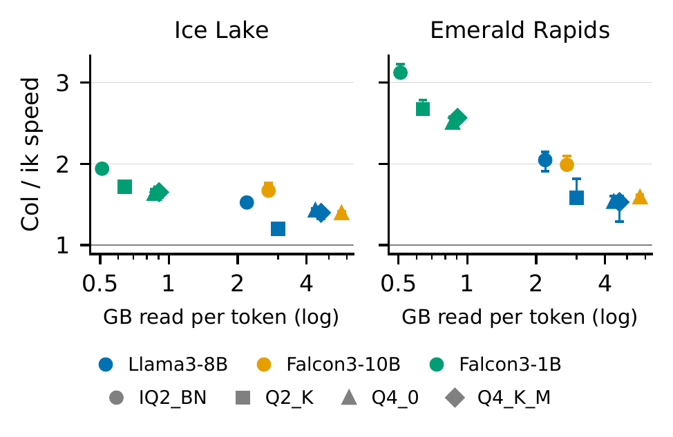
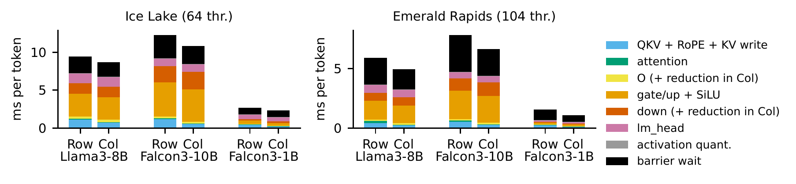
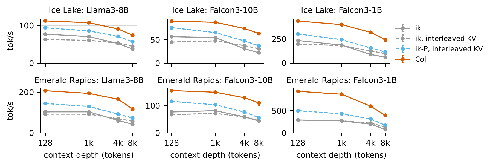

<section class="wp-hero" aria-label="Overview">
  
Under reviewLLM inference · CPU servers · NUMA

  
Weight placement is not enough

  
With every weight on the right NUMA node, ternary LLM decoding still spends <em>20–48% of each token waiting</em> at synchronization points.

  
<strong>Runguo Li</strong>* · University of Illinois Urbana-Champaign &nbsp;&nbsp; <strong>Dezhen Lu</strong>* · University of Tübingen &nbsp;&nbsp; *equal contribution

  
A ternary LLM reads only about 2 GB of weights per generated token, so a dual-socket CPU server with hundreds of GB/s of memory bandwidth should decode it quickly. The fastest ternary runtime we found, ik_llama.cpp, uses less than half of that bandwidth. We fix weight placement, measure what the threads do afterwards, and build a decode engine on the same kernels whose threads meet only a few times per layer. Where decoding is bound by DRAM, it is <strong>1.5–2.1× faster</strong> than ik_llama.cpp at the same accuracy.

  

    <a class="wp-btn primary" href="#one-layer"><svg width="13" height="13" viewBox="0 0 13 13" aria-hidden="true"><path d="M3 1.5v10l8.5-5z" fill="currentColor"/></svg>Watch one decoder layer</a>
    <a class="wp-btn ghost" href="#explore"><svg width="13" height="13" viewBox="0 0 13 13" aria-hidden="true"><circle cx="3" cy="9.5" r="1.7" fill="currentColor"/><circle cx="6.5" cy="5.5" r="1.7" fill="currentColor"/><circle cx="10.5" cy="3" r="1.7" fill="currentColor"/></svg>Explore the results</a>
    <svg width="13" height="13" viewBox="0 0 13 13" aria-hidden="true"><path d="M3 1h5l3 3v8H3z M8 1v3h3" fill="none" stroke="currentColor" stroke-width="1.3"/></svg>Paper · under review
  

  

    <button type="button" data-wp-plat="icl">Ice Lake</button><button type="button" data-wp-plat="emr">Emerald Rapids</button>
    <button type="button" data-wp-model="llama3_8b">Llama3-8B</button><button type="button" data-wp-model="falcon3_10b">Falcon3-10B</button><button type="button" data-wp-model="falcon3_1b">Falcon3-1B</button>
    <button type="button" class="wp-again" id="wp-race-again">↻ Replay</button>
  

  

    

<b>ik</b>ik_llama.cpp, all cores

<i></i>

<b>–</b> tok/s<em></em>

    

<b>ik-P</b>ik + our four patches

<i></i>

<b>–</b> tok/s<em></em>

    

<b>Row</b>our engine, row-owned

<i></i>

<b>–</b> tok/s<em></em>

    

<b>Col</b>our engine, column-split

<i></i>

<b>–</b> tok/s<em></em>

    
<b id="wp-race-cap"></b> A real-time replay of the measured decode speeds (medians of 6 interleaved rounds, context depth 0). No model runs in your browser.

  

</section>

  

20–48%

of each token is spent waiting at synchronization points, with node-local weights and two global barriers per layer

  

1.5–2.1×

faster than ik_llama.cpp with all cores where decoding is DRAM-bound; 3.2× for a small model that runs from the L3 cache

  

63–78%

of the machine's read bandwidth is used by Col, against 24–46% for ik_llama.cpp

  

29–64%

less energy per token than ik_llama.cpp, at the same accuracy

Abstract

Ternary LLMs read only a few gigabytes per decoded token, yet on dual-socket servers with four NUMA nodes the fastest ternary runtime we found uses less than half of the memory bandwidth. Placing each weight on the node of the thread that reads it is necessary but not enough: in a decode engine with node-local weights that reuses ik_llama.cpp's kernels, threads on two generations of Xeon servers still spend 20–48% of each token waiting at synchronization points. Per-thread barrier traces show that most of the wait is for the slowest threads of each node; the barriers' own latency (microseconds each, but up to 12% of the token for the smallest model) and serial per-node work are smaller parts. On identical kernels, a Megatron-style column split beats a row-owned split without cross-node reductions in every configuration we measured, and isolating the number of barriers shows that most of its gain comes from its threads waiting less for each other and for their node leaders, and only a minority from having fewer barriers. Where decoding is DRAM-bound, the resulting engine is 1.5–2.1× faster than ik_llama.cpp with all cores and 1.5–1.9× faster than ik_llama.cpp at its fastest thread count (3.2× and 2.8× for a small model that runs from the L3 cache), at the same accuracy and with less energy per token.

<h2 id="the-problem">The problem</h2>

<strong>Ternary models</strong> such as BitNet b1.58 restrict their weights to −1, 0 and +1 and store them in about two bits each. An eight-billion-parameter model then reads about 2 GB per generated token, and since each token reads all weights once, decoding speed is set by how fast memory can be read. On <strong>one NUMA node</strong> this works well: the best runtimes use 72–78% of the node's bandwidth.

Using the <strong>whole machine</strong> is harder. A dual-socket server exposes four NUMA nodes, and across them ik_llama.cpp reads DRAM at only 48% of the machine's bandwidth on our Ice Lake server (Llama3-8B). On our Emerald Rapids server it becomes 3–12% <em>slower</em> when given 104 cores instead of 64. The usual diagnosis is weight placement: a thread that reads weights stored on another node reads them slowly. We ask what limits decoding <em>after</em> placement is solved.

  

<i></i>Machines
Two dual-socket Intel servers with four NUMA nodes each. <strong>Ice Lake</strong>: 2 × Xeon Platinum 8358, 64 cores, 354 GB/s of local read bandwidth. <strong>Emerald Rapids</strong>: 2 × Xeon Platinum 8555C, 104 cores, 610 GB/s, and 5.4× the L3 cache. Both are shared machines running Linux 6.8.

  

<i></i>Models
Three ternary Llama-architecture models: Llama3-8B-1.58, Falcon3-10B-1.58bit and Falcon3-1B-1.58bit. In the exact 2-bit format IQ2_BN, one token reads 2.19, 2.73 and 0.51 GB. For the format study, the same models also run as Q2_K, Q4_0 and Q4_K_M.

  

<i></i>Measurement
The rate of generating 128 tokens, with one thread per physical core. Everything a table or chart compares was measured together: each of 5–6 rounds runs every variant once in rotating order, and we report medians and the median of the per-round ratios.

The four implementations compared

  

ik
ik_llama.cpp at a fixed commit, with <code>--numa distribute</code>. It already places 97% of the weight pages on the node of their reader. Our baseline.

  

ik-P
ik with four patches: page migration, a two-level barrier, attention split over KV chunks, and an AVX-512 activation quantizer.

  

Row
Our decode engine with a row-owned dataflow: every matrix is split by output rows, with five global barriers per layer and no cross-node sums.

  

Col
Our engine with the Megatron-style column split: each node owns a quarter of the heads and of the FFN, with two global barriers per layer. The main design.

Terms used below

<dl class="wp-terms">
  
<dt>NUMA node.</dt> <dd>A group of cores with its own memory controllers. Here each socket appears as two nodes, so a server has four. Reading another node's memory is slower than reading one's own.</dd>

  
<dt>Barrier.</dt> <dd>A point where threads wait until all of them have arrived. A <em>global</em> barrier gathers all threads of the machine, a <em>node</em> barrier only those of one node.</dd>

  
<dt>Node leader.</dt> <dd>One thread per node that normalizes and quantizes the input of each matrix stage alone, while the node's other threads wait for it.</dd>

  
<dt>Waiting for the last thread.</dt> <dd>The time from a thread's own arrival at a barrier until the last thread arrives. It measures how unevenly the threads finish.</dd>

  
<dt>Barrier latency.</dt> <dd>The time from the last arrival until a thread leaves the barrier: the cost of the barrier itself, a few microseconds.</dd>

  
<dt>DRAM-bound.</dt> <dd>The weights do not fit in the caches, so every token streams them from memory. This holds for all models here except Falcon3-1B on Emerald Rapids, which runs from L3.</dd>

  
<dt>Effective bandwidth.</dt> <dd>Decode speed times the bytes read per token. As a share of the machine's measured read bandwidth, it shows how much of the memory system a runtime uses, whatever its kernels.</dd>

  
<dt>Context depth.</dt> <dd>The number of tokens already in the KV cache when the 128 timed tokens are generated. It is 0 unless stated.</dd>

</dl>

<h2 id="where-the-time-goes">Where the time goes</h2>

Finding 1

<h3 class="wp-h" id="placement-first">Placement is nearly solved in ik; synchronization is the larger step</h3>

We add our changes to ik one at a time (the step chart under <a href="#explore">Results</a> shows every step). Migrating the 3% of misplaced weight pages gains only 0–3%, and 6–14% on the small Falcon3-1B. The largest single step is synchronization: replacing ggml's global barrier by a two-level one, where threads first meet within their node and then one thread per node meets globally, gains 10–14% on Ice Lake and 20–44% on Emerald Rapids. Together the four patches give 1.20–1.73×, and further changes inside ggml gain nothing. What remains is its execution model: one parallel region and one global barrier per operator, about 17 per layer.

Finding 2 · Interactive

<h3 class="wp-h" id="one-layer">One decoder layer, thread by thread</h3>

Our engine keeps ik's kernels and weights but groups a layer into a few stages. It also records when every thread enters and leaves every barrier. Below is one of the 32 layers of one token on Emerald Rapids. Each thin row is one of 104 threads; colour means the thread is computing, grey means it is waiting. <strong>Row</strong> meets globally five times per layer (▼) and <strong>Col</strong> twice. In both, the grey areas are large: threads of the same node read equal shares of node-local weights and still finish at different times.

<figure class="wp-fig" style="--accent:var(--c-wait)">
  

    <button type="button" class="wp-again" id="wp-trace-play">▶ Play in slow motion (about 50,000×)</button>
    Move over a thread to see what it is doing.
  

  
<canvas id="wp-trace" role="img" aria-label="Per-thread timeline of one decoder layer for the Row and Col dataflows: 104 threads on 4 nodes, coloured while computing and grey while waiting. Row finishes the layer in 166 microseconds with 5 global barriers, Col in 135 microseconds with 2."></canvas>

  

    <i style="background:#56B4E9"></i>QKV + RoPE<i style="background:#009E73"></i>attention<i style="background:#F0E442"></i>O projection<i style="background:#E69F00"></i>gate/up + SiLU<i style="background:#D55E00"></i>down projection<i style="background:#CC79A7"></i>norm + quantization (leader)
    <i style="background:#D4D4D4"></i>waiting for the last thread<i style="background:#9C9C9C"></i>waiting for the node leader<i style="background:#4A4A4A"></i>barrier latency▼ global barrier
  

  

  

  <figcaption><strong>Figure 1 (measured).</strong> Top: layer 16 of the median-duration token of a traced run (Emerald Rapids, Llama3-8B in IQ2_BN, 104 threads on 4 nodes). Bottom: the whole token of Llama3-8B split the same way, as medians of 5 traced rounds (blue: computing; greys: the three kinds of waiting).
    With all weights node-local, a quarter to more than a third of the token is still waiting, most of it for the last thread to arrive.</figcaption>
  

Static version (Figure 1 of the paper)

</figure>

Finding 3

<h3 class="wp-h" id="what-the-wait-is">Most of the wait is for the slowest threads of a thread's own node</h3>

Across models and weight formats, Col's threads wait for 22–35% of each token on Ice Lake and 20–48% on Emerald Rapids. The traces split this wait into three parts. The share grows with the number of threads per barrier: with 13, 20 and 26 cores per node on Emerald Rapids, threads wait for 18–31, 23–42 and 29–48% of the token.

  

65–86%

Waiting for the last thread
This is 17–26% of the token on Ice Lake and 14–31% on Emerald Rapids. More than half of the late arrivals are threads of the waiting thread's own node.

  

1–12%

Barrier latency
Each barrier costs microseconds, but Falcon3-1B has 18 thin layers, and on Emerald Rapids latency alone takes 9–12% of its token.

  

2–5%

Waiting for the node leader
The serial normalization and quantization of each stage's input by one thread per node.

<figure class="wp-fig" style="--accent:var(--c-wait)">
  

  <figcaption><strong>Figure 2.</strong> Waiting at synchronization points as a share of Col's per-token decode time (mean over threads; median of 5 interleaved rounds, whiskers: min–max), split into waiting for the node leader (dark), for the last thread (medium) and barrier latency (light).
    The model that reads the fewest bytes per token, Falcon3-1B, waits the most: nearly half of each token on Emerald Rapids.</figcaption>
</figure>

Finding 4

<h3 class="wp-h" id="fewer-bytes">Fewer bytes per token, more synchronization</h3>

The same models in larger formats read 1.3–2.1× as many bytes per token. On Emerald Rapids, going from IQ2_BN to Q4_K_M lowers Col's wait share from 34 to 22% for Llama3-8B and from 48 to 39% for Falcon3-1B, and its speedup over ik from 2.05 to 1.53× and from 3.12 to 2.57×. On Ice Lake the relation is weak. Across models the order holds on both machines: the model with the fewest bytes per token has the largest wait share and the largest speedup in every format. The effect is not specific to ternary weights: with 4-bit formats Col is still 1.40–2.57× faster than ik.

<figure class="wp-fig" style="--accent:var(--c-col)">
  

  <figcaption><strong>Figure 3.</strong> Decode speedup of Col over ik against the bytes read per token, three models in four formats (median of per-round ratios, 5 rounds).</figcaption>
</figure>

<h2 id="two-dataflows">Two dataflows on the same kernels</h2>

To find which property of a dataflow matters, the engine runs two of them on ik's matrix–vector kernels, ik's quantizers and the same weight files. They differ in how often all threads meet and in how much data crosses nodes.

<figure class="wp-fig" style="--accent:var(--c-col)">
  

  

    
<b>Row</b>
QKV<u></u>attention<u></u>comb.<s></s>O + res.<u></u>gate/up<u></u>down + res.<u></u>

    
Every thread writes its output rows into all 4 node copies of the vector.

    
<b>Col</b>
QKVh<s></s>attn.h<s></s>comb.<s></s>Oh<u></u>Σ<s></s>gate/upf<s></s>downf<u></u>Σ<s></s>

    
Outputs stay on the node; Σ adds the four nodes' partial sums after a global barrier.

    
<u></u>global barrier (all threads)<s></s>node barrier (one node's threads)h the node's quarter of the heads · f its quarter of the FFN

  

  

  

    

1The engine
One thread is pinned to each physical core. At load time every weight matrix is cut into one slice per node and one range of rows per thread, and each slice is copied into memory of its node, as are the KV cache and the buffers. Barriers are two-level.

    

2Row: split by output rows
All threads of all nodes share every matrix by rows. A layer has five stages, each ending in a global barrier, and no cross-node sums; instead every thread writes its rows into a copy of the vector on every node.

    

3Col: split by heads and columns
The Megatron-LM decomposition, which ArcLight applies to the NUMA nodes of a CPU. A node computes its heads and its part of the FFN with node barriers only. O and down yield partial sums, which every node adds up after each of two global barriers.

  

  <figcaption><strong>Figure 4.</strong> One layer in the two dataflows. Each matrix stage starts with the node leader's normalization and quantization (not shown). Col's two sums cost each node three remote reads of a hidden-size vector (16 KiB for Llama3-8B).</figcaption>
</figure>

Comparison

<h3 class="wp-h" id="col-beats-row">Col is faster than Row in all 24 configurations</h3>

The gain is 5–21% on Ice Lake and 11–46% on Emerald Rapids. It is largest for the model with the fewest bytes per token, and it persists with a context of 4096 tokens.

<figure class="wp-fig" style="--accent:var(--c-col)">
  

  <table class="wp-table">
    <thead>
      <tr><th></th><th class="grp" colspan="2">IQ2_BN (2-bit, ternary)</th><th class="grp" colspan="2">Q4_0 (4-bit)</th></tr>
      <tr><th>Col speed relative to Row</th><th>depth 0</th><th>depth 4096</th><th>depth 0</th><th>depth 4096</th></tr>
    </thead>
    <tbody>
      <tr><td>Ice Lake · Llama3-8B</td><td>1.09×</td><td>1.06×</td><td>1.05×</td><td>1.06×</td></tr>
      <tr><td>Ice Lake · Falcon3-10B</td><td>1.11×</td><td>1.11×</td><td>1.11×</td><td>1.08×</td></tr>
      <tr><td>Ice Lake · Falcon3-1B</td><td>1.21×</td><td>1.19×</td><td>1.15×</td><td>1.16×</td></tr>
      <tr class="sep"><td>Emerald Rapids · Llama3-8B</td><td>1.21×</td><td>1.18×</td><td>1.14×</td><td>1.11×</td></tr>
      <tr><td>Emerald Rapids · Falcon3-10B</td><td>1.20×</td><td>1.24×</td><td>1.11×</td><td>1.20×</td></tr>
      <tr><td>Emerald Rapids · Falcon3-1B</td><td>1.46×</td><td>1.41×</td><td>1.32×</td><td>1.31×</td></tr>
    </tbody>
  </table>
  

  <figcaption><strong>Table 3.</strong> Decode speed of Col relative to Row (median of per-round ratios over 5 interleaved rounds; 128 tokens generated from depth 0 or 4096).</figcaption>
</figure>

Why

<h3 class="wp-h" id="why-col-wins">The number of barriers explains only a minority of the gap</h3>

Row and Col differ in the number of global barriers and in where they read and write, so we separate the two inside the engine. Promoting three of Col's node barriers to global ones gives it Row's five global barriers per layer with its own data placement; adding empty global barriers right after an existing one measures the latency of a barrier with no imbalance to absorb. Neither changes the computed values.

  

5–26%

of the gap from barrier count
Five global barriers per layer instead of two slow Col by this share of the Row–Col difference (Emerald Rapids).

  

1.4–4.4 µs

per empty global barrier
Among 104 threads. Col's two per layer therefore take 1–10% of its token, a small part of its 20–48% wait.

  

36–57%

shorter QKV stage
In Col a node's heads, queries and KV cache stay on the node. In Row most threads write K, V and Q across nodes.

  

39–48%

of the leader's work
Col's leaders quantize this share of the elements Row's do per layer, since the inputs of O and down are the node's own slices.

<figure class="wp-fig" style="--accent:var(--c-col)">
  

  <figcaption><strong>Figure 5.</strong> Per-token decode time of the engine by stage (mean over threads; IQ2_BN, depth 0; median of 5 rounds). In Col, O and down include the sum of the partial results.
    Two parts shrink from Row to Col: the barrier wait (by 7–23% on Ice Lake and 25–35% on Emerald Rapids) and the QKV stage. The sums add at most 0.22 ms per token, while the token gets 0.38–1.45 ms shorter.</figcaption>
</figure>

The traces attribute most of the remaining gap to Row's longer waits for late threads and for the leaders. Row's cross-node writes of the stage outputs do not explain them: a variant of Row that writes those outputs only to its own node and copies the rest after the barrier, with bit-identical results, is 1–7% slower and waits as long for late threads.

<h2 id="results">Results</h2>

Interactive

<h3 class="wp-h" id="explore">Explore every machine and model</h3>

Pick a machine and a model. The step chart shows what each change adds, starting from ik. The bandwidth chart shows how much of the memory system each implementation uses. The two line charts show where the advantage comes from (more nodes) and that it holds with long contexts.

<figure class="wp-fig" id="wp-explore" style="--accent:var(--c-col)">
  

    <button type="button" data-wp-plat="icl">Ice Lake</button><button type="button" data-wp-plat="emr">Emerald Rapids</button>
    <button type="button" data-wp-model="llama3_8b">Llama3-8B</button><button type="button" data-wp-model="falcon3_10b">Falcon3-10B</button><button type="button" data-wp-model="falcon3_1b">Falcon3-1B</button>
  

  

    

Decode speed, step by step · tok/s and speed relative to ik

    

Share of the machine's read bandwidth

  

  

    

Scaling over NUMA nodes · tok/s; legend: speedup from 1 to 4 nodes

    

Long contexts · tok/s; legend: tok/s at depth 8192

  

  <figcaption>
    On one node all four implementations are within 17% of each other and reach 70–84% of the node's bandwidth. From one node to four, ik speeds up 1.3–2.4× and Col 3.0–3.7×: the engine's advantage arises across nodes.</figcaption>
  
Data of Table 2 and Figures 6–8 of the paper; 128 generated tokens, IQ2_BN, medians over 5–6 interleaved rounds. Each chart is its own batch, so the same configuration can differ by a few percent between charts. Each added step in the first chart includes the steps above it.

</figure>

Other runtimes

<h3 class="wp-h" id="arclight">Against ArcLight, which uses the same decomposition</h3>

ArcLight implements the column split on top of llama.cpp's operators and kernels. It supports F16, Q4_0, Q8_0 and Q6_K weights, so the comparison uses Q4_0, the format it was evaluated with. On one node of Emerald Rapids, Col is only 1.05–1.23× faster than ArcLight; on four nodes in the same batch it is 1.81–3.59× faster. The decomposition alone does not deliver the speedup: across nodes, ArcLight executes llama.cpp's operator graph with node-level barriers inside its tensor-parallel subgraphs and global ones at their boundaries, whereas Col runs each stage as one parallel region.

<figure class="wp-fig" style="--accent:var(--c-col)">
  

  <table class="wp-table">
    <thead>
      <tr><th></th><th class="grp" colspan="3">Ice Lake, 64 threads</th><th class="grp" colspan="3">Emerald Rapids, 104 threads</th></tr>
      <tr><th>Q4_0 weights, tok/s</th><th>Llama3-8B</th><th>Falcon3-10B</th><th>Falcon3-1B</th><th>Llama3-8B</th><th>Falcon3-10B</th><th>Falcon3-1B</th></tr>
    </thead>
    <tbody>
      <tr><td>llama.cpp (<code>distribute</code>)</td><td>17.0</td><td>12.8</td><td>84.9</td><td>60.6</td><td>48.3</td><td>195.0</td></tr>
      <tr><td>ik</td><td>41.6</td><td>32.7</td><td>162.9</td><td>68.4</td><td>48.9</td><td>225.1</td></tr>
      <tr><td>ArcLight</td><td>38.9</td><td>32.8</td><td>119.6</td><td>56.3</td><td>45.5</td><td>162.3</td></tr>
      <tr><td>ik-P</td><td>44.7</td><td>38.3</td><td>193.1</td><td>80.3</td><td>60.9</td><td>319.0</td></tr>
      <tr><td>Row</td><td>55.7</td><td>40.5</td><td>234.6</td><td>88.7</td><td>72.9</td><td>392.3</td></tr>
      <tr class="hl"><td>Col</td><td>59.4</td><td>45.6</td><td>270.5</td><td>101.6</td><td>77.8</td><td>528.4</td></tr>
      <tr class="sep"><td>Col / ArcLight</td><td>1.53×</td><td>1.39×</td><td>2.25×</td><td>1.75×</td><td>1.74×</td><td>3.23×</td></tr>
    </tbody>
  </table>
  

  <figcaption><strong>Table 5.</strong> Decode speed with Q4_0 weights (tok/s, depth 0; median of 5 interleaved rounds). ArcLight was built for AVX2; a build with <code>-march=native</code> was within 3%. The last row is the median of the per-round ratios. llama.cpp is unusually slow on Ice Lake because it repacks Q4_0 weights into a buffer on one node.</figcaption>
</figure>

More measurements

<h3 class="wp-h" id="more-measurements">Thread count, context depth, energy and accuracy</h3>

  

1.5–1.9×

against ik at its fastest thread count
ik is not always fastest with all cores: on Emerald Rapids it is 6–14% faster with 64 or 80 of its 104 cores. Against the best count per model, Col is 1.53–1.93× faster on Ice Lake and 1.89–2.78× on Emerald Rapids (2.78× is Falcon3-1B, which runs from L3).

  

up to 76%

faster ik with an interleaved KV cache
ik allocates its whole KV cache on one node. Interleaving it with <code>numactl</code> helps at depth 8192 and hurts at depth 128. Against the faster of the two at each depth, Col is 1.66–2.49× faster on Ice Lake and 2.02–2.93× on Emerald Rapids at depth 8192.

  

29–64%

less energy per token
Measured with RAPL over the whole machine (package and DRAM): 29–45% less than ik on Ice Lake, 39–64% less on Emerald Rapids. There Col draws 16–29% more package power, so the saving is smaller than the speedup.

  

same accuracy

within the spread of ik's own decode paths
On 5100 WikiText-2 tokens, ik's two decode paths have KL divergences of 0.0030–0.0045 from an F16 reference with the same ternary weights. Row falls within this spread and Col has the lowest of all paths (0.0020–0.0034).

<figure class="wp-fig" style="--accent:var(--c-ikp)">
  

  <figcaption><strong>Figure 8.</strong> Decode speed after a context of the given depth, all six configurations (5 interleaved rounds). ik with its default KV cache (on one node) and with the cache interleaved over all nodes.
    Compared only with ik's default placement, the depth-8192 speedups would have been overstated as 2.0–5.2×. A baseline's KV cache has to be placed as carefully as its weights.</figcaption>
</figure>

<h2 id="takeaways">Takeaways for CPU runtimes</h2>

  

1Group a layer into a few stages
On multi-node machines, one global barrier per operator, with single-row operators on one thread, costs more than misplaced weights. Beyond that, how the work is divided among threads matters more than the barrier count.

  

2Balance the work within a node
Most of the remaining wait is imbalance among a node's threads, which fixed row ranges cannot absorb. Assigning rows dynamically within a node is the direct remedy to test.

  

3Place the KV cache like the weights
An interleave alone makes ik up to 76% faster at depth 8192 than its single-node default.

  

4Thresholds tuned on one machine break on another
ik's rule for splitting single-query attention leaves most threads idle at short context for models with four KV heads and, at 104 threads, also for Llama3-8B.

<strong>Scope and limitations.</strong> Col supports Llama-architecture models whose head, KV-head and FFN counts are divisible by the number of nodes, and it decodes a single sequence without prefill or batching; it targets latency-bound single-user settings. Machines with more than four NUMA nodes, AMD systems and Intel systems without sub-NUMA clustering are outside our measurements. Both servers were shared with other users: variants alternate within every round, so comparisons between implementations are affected little, but absolute wait shares on Ice Lake may be a few points high.

<h2 id="links-and-citation">Links and citation</h2>

  

Paper

Under review. The PDF will be linked here when it is public.

  

Authors

Runguo Li and Dezhen Lu contributed equally.

<button class="wp-copy" type="button" data-target="wp-bibtex">Copy</button>
<pre><code id="wp-bibtex">@misc{li2026weightplacement,
  title  = {Weight Placement Is Not Enough: Synchronization in Multi-Node {CPU} Decoding of Ternary {LLMs}},
  author = {Li, Runguo and Lu, Dezhen},
  year   = {2026},
  note   = {Manuscript under review}
}</code></pre>

